# N:N Multi-Select

A Power Apps component framework (PCF) field control for model-driven apps. It edits a **many-to-many (N:N)
relationship** and looks and behaves like the platform's own **multi-select choice** field, so a form can offer related
records the same way it offers choices. An optional Dataverse plug-in (server code that runs inside Dataverse) keeps a
text copy of the selected names up to date wherever records are linked.


The same demo as a [video on YouTube](https://www.youtube.com/watch?v=2jof2VszZjU).

| Item | Value |
| --- | --- |
| Control | `KV.NToNMultiSelect`, display name *N:N Multi-Select*, version 1.0.0 |
| Solutions | `NToNMultiSelect` (*N:N Multi-Select*): the control and the form library.<br>`NToNMultiSelectWithPlugin` (also *N:N Multi-Select*): the same, plus the names copy plug-in with its link steps (Associate and Disassociate) and the steps page.<br>Both version 1.0.0.0, each as a managed and an unmanaged package. See [Which solution](#which-solution) |
| Plug-in (solution with the plug-in only) | Assembly `NToNMultiSelect.NamesCopy`, plug-in type `NToNMultiSelect.NamesCopy.NamesCopyPlugin` (*N:N Multi-Select names copy*), sandbox, .NET Framework 4.6.2, two steps (Associate and Disassociate), plus the Delete and Update steps that the steps page creates for your linked tables. See [Names copy plug-in](#names-copy-plug-in-optional) and [what each step costs](#time-trade-offs-what-each-step-costs) |
| Steps page (solution with the plug-in only) | HTML web resource `kv_/NToNMultiSelect/namescopysteps.html` (*N:N Multi-Select names copy: steps for your tables*), for administrators: creates the plug-in's Delete and Update steps for your linked tables only. Open it at `https://<your environment>/WebResources/kv_/NToNMultiSelect/namescopysteps.html`. See [The steps page](#the-steps-page) |
| Publisher | `KV`, prefix `kv`, choice value prefix 72720 |
| Form library (optional) | Web resource `kv_/NToNMultiSelect/formloader.js`, handler `KVNToNMultiSelectLoader.onLoad` |
| Languages | English and French, following the user's language (the plug-in's messages are in English) |
| Documentation | [Technical reference (Word)](docs/NToNMultiSelect%20-%20Technical%20Reference.docx)<br>[Developer guide: how the control and the plug-in are built and how to change them](docs/developer-guide.md) (also as [Word](docs/NToNMultiSelect%20-%20Developer%20Guide.docx)) |
| License | [MIT](LICENSE) |

When the environment already has a publisher with the unique name `KV`, the import uses it instead of creating a new
one.

## Contents

* [Features](#features) and [screenshots](#screenshots)
* [Download](#download)
* [Install](#install), [which solution](#which-solution) and [add the control to a form](#add-the-control-to-a-form)
* [Settings](#settings), including [Maximum selections](#maximum-selections), [+ New](#-new-quick-create), [Copy names into the host column](#copy-names-into-the-host-column) and [column security](#column-security-on-the-host-column)
* [Form library (optional)](#form-library-optional)
* [Names copy plug-in (optional)](#names-copy-plug-in-optional), including [what each step costs](#time-trade-offs-what-each-step-costs), [the steps page](#the-steps-page) and [turning steps off](#turning-steps-off)
* [Messages](#messages), [Upgrade](#upgrade), [Uninstall](#uninstall) and [Troubleshooting](#troubleshooting)
* [Limitations](#limitations) and [Enforcing the rules on the server](#enforcing-the-rules-on-the-server)
* [How it works](#how-it-works), [Repository layout](#repository-layout) and [Build](#build), including
  [the signing key](#the-signing-key) of the plug-in
* [Developer guide](docs/developer-guide.md): how the control and the plug-in are built and how to change them (also as
  a [Word document](docs/NToNMultiSelect%20-%20Developer%20Guide.docx))

## Features

| State | What the user sees (same as the native control) |
| --- | --- |
| Idle | Selected names in bold, comma separated (`---` when empty) |
| Hover | Grey border; the values become chips with an × to remove them |
| Click / focus | Chips, a "Select or search options" box and a chevron. Clicking the box focuses it; the list opens from the chevron, ↓, Enter or typing |
| List | "Select all" with the item count, check-box rows, type to filter. It always opens at its beginning |
| After an × or "+N" | The field stays focused and one value is highlighted with a black border: the next one after an ×, the first one after "+N". The arrow keys and Delete work on it, and Enter opens it with *Open selected records*. After "+N" all values stay shown until the focus leaves the field |
| Read-only | Grey box with the names, comma separated |

* **Saved immediately.** Each pick is saved as an association straight away (unpicking removes it). The form is never
  made dirty, so required fields elsewhere on the form do not block the change.
* **Subgrids stay in sync.** Subgrids on the form that show the same relationship refresh after a change, and links
  added or removed in those subgrids appear in the control. The control can also take the place of those subgrids
  and hide them.
* **Filtering.** The records offered can be limited with an OData filter, a system view or FetchXML.
* **Large tables.** Up to 500 records load once and are filtered in the browser; larger tables search on the server and
  load more rows as the list scrolls.
* **New records.** Picks made before the first save are linked as soon as the record is saved.
* **Native-like editing.** Removing a value with its ×, "+N" and "less" behave like the native control: the field keeps
  the focus and highlights a value, so values can be removed one after another with the mouse or the keyboard.
* **Optional extras**: a *+ New* button (quick create, which keeps the field focused and puts the focus back in the
  search box when it closes), links that open the selected records, a copy of the selected names in the host column
  for views and exports, a selection limit.
* **Optional names copy plug-in.** A second solution adds a Dataverse plug-in that keeps the names in the host column
  up to date when records are linked or unlinked anywhere: subgrids on other forms, the other side of the relationship,
  Power Automate flows, imports and integrations. With the Delete and Update steps that its steps page creates for
  your linked tables, it also follows deletes and renames of linked records, without a cost on any other table. See
  [Names copy plug-in](#names-copy-plug-in-optional).
* **Column security.** When column security secures the host column, users who are not allowed to update it see the
  control read-only, as they would see a native field on that column.
* **Accessible.** Full keyboard support, screen reader semantics and Windows high contrast support.

## Screenshots

**Idle.** The selected names in bold. Below it, a native multi-select choice column of the same form for comparison.

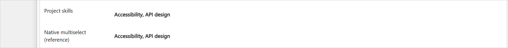

**Pointer over the field.** The values become chips with an × to remove them; with *Open selected records* the names
are links to the records.

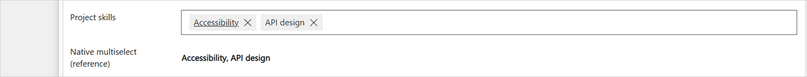

**After removing a value with its ×.** As in the native control, the field stays focused and the next value is
highlighted with a black border, ready for another ×, Delete or the arrow keys.

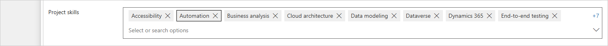

**List open.** Check boxes, selected rows in grey, and *+ New* at the end when quick create is available. The native
multi-select choice list is shown below it for comparison.

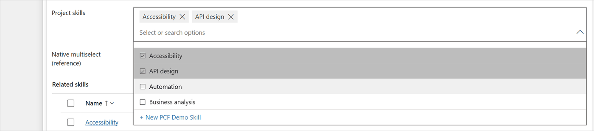

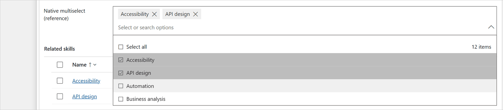

**Typing filters the list**, ignoring case and accents.

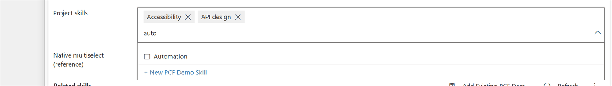

**Saved straight away.** A pick is linked at once, the subgrid of the same relationship shows it, and the form stays
saved.

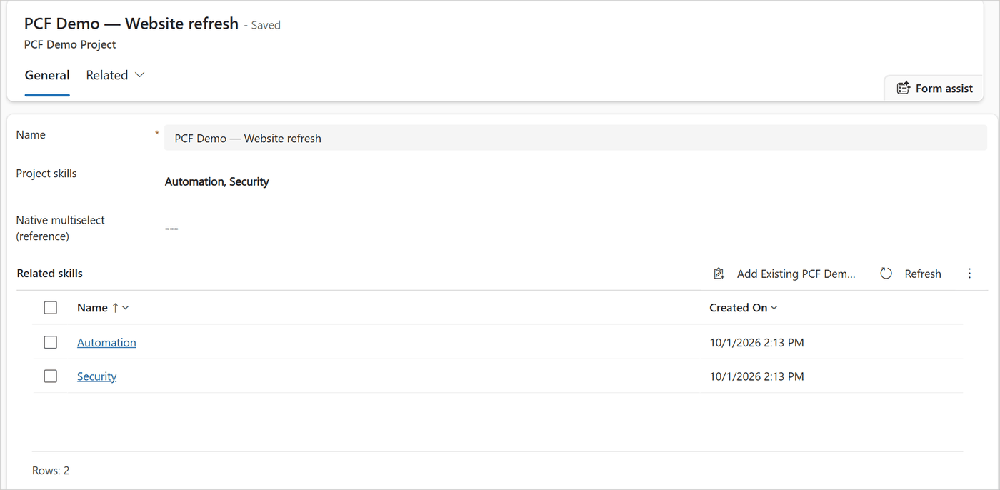

**Many values.** The field keeps one line, like the native control. "+N" shows all values and "less" collapses them.

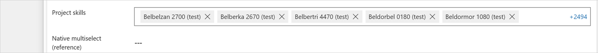

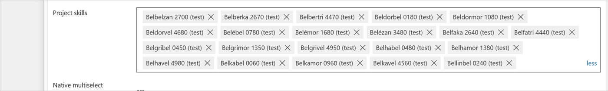

**After "+N".** All values stay shown when the pointer moves away, with the first value highlighted and "less" to
collapse them, until the focus leaves the field.

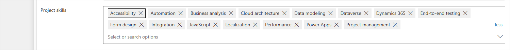

**Large lists.** With more than 500 matching records, the list shows the first 500 and fetches the next 500 when
the user scrolls to the end. Typing then searches on the server.

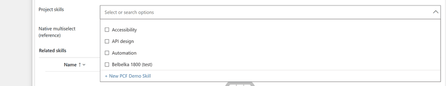

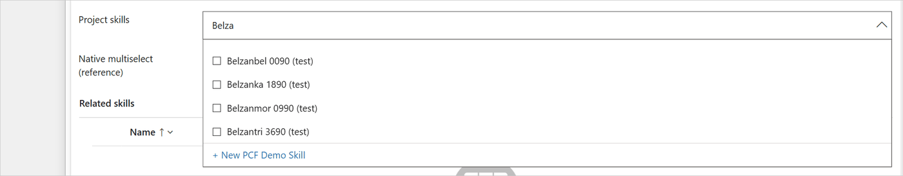

**New records.** Picks made before the first save are held and linked when the record is saved.

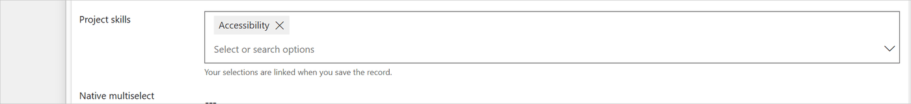

**Read-only.** A grey box with the names (links with *Open selected records*).

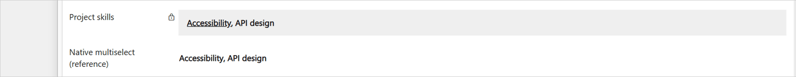

## Download

The solution packages are attached to each release on the [Releases](../../releases) page:

| File | Use |
| --- | --- |
| `NToNMultiSelect_unmanaged.zip` | Solution without the plug-in, unmanaged: for development environments |
| `NToNMultiSelect_managed.zip` | Solution without the plug-in, managed: for test and production environments |
| `NToNMultiSelectWithPlugin_unmanaged.zip` | Solution with the names copy plug-in, its link steps (Associate, Disassociate) and the [steps page](#the-steps-page), unmanaged: for development environments |
| `NToNMultiSelectWithPlugin_managed.zip` | Solution with the names copy plug-in, its link steps and the steps page, managed: for test and production environments |
| `README.txt` | Component names of the build, notes on the plug-in and on replacing an installed 1.0.0, and SHA-256 checksums of the zip files |
| `NToNMultiSelect-Technical-Reference.docx` | Installation, settings, form library, the names copy plug-in, upgrade, uninstall and troubleshooting, step by step with screenshots |
| `NToNMultiSelect-Developer-Guide.docx` | The developer guide as a Word document: how the control, the form library and the plug-in are built and how to change them |

**Which one to download.** Take the solution without the plug-in unless the names column (*Copy names into the host
column*) must also follow links made outside the form; then take `NToNMultiSelectWithPlugin`. When the names column
must also follow deletes and renames of linked records, create the Delete and Update steps for your linked tables
with its [steps page](#the-steps-page). The recommended setup for production is `NToNMultiSelectWithPlugin` with the
steps for your linked tables, created in development and deployed with your solution. No package contains Delete or
Update steps. Take the managed package for test and production, the unmanaged one for development. See
[Which solution](#which-solution).

The file names carry no version number; the version is inside the solution. To build the packages from source, see
[Build](#build).

## Install

### Which solution

| | `NToNMultiSelect` (without the plug-in) | `NToNMultiSelectWithPlugin` (with the plug-in) |
| --- | --- | --- |
| Contains | The control and the form library | The same control and form library, plus the plug-in assembly, its Associate and Disassociate steps and the [steps page](#the-steps-page). No Delete or Update step: the steps page creates them in the environment, for your linked tables only |
| *Copy names into the host column* follows | Changes made with the control and with subgrids on the same form | Also links made anywhere else: subgrids on other forms, the other side of the relationship, flows, imports, integrations, the Web API. With the Delete and Update steps made for your linked tables on the steps page, also deletes and renames of those tables' records |
| Choose it when | The names copy is not used, or following changes made on the form is enough | The names column must also follow links made outside the form. **Recommended for production**, with the steps for your linked tables made on the steps page in development and deployed with your solution; without them, a deleted or renamed record's name stays until the links next change |
| Server cost | None | Synchronous steps on every link and unlink in the environment: a few milliseconds for links nobody copies, about 70 ms for each link it copies. The steps made for your tables run only for deletes of those tables and for updates that set their name: about 80–100 ms for each record whose names they rewrite, nothing on any other table |

See [Time trade-offs](#time-trade-offs-what-each-step-costs) for the measurements behind these numbers.

Import one of the two solutions into an environment. Both contain the same control, so forms set up with one keep
working with the other. The plug-in only does something where a form has *Copy names into the host column* set to
Yes; for every other link it returns at once (the time it costs then is the time Dataverse needs to call it).

**Adding the plug-in later.** Import `NToNMultiSelectWithPlugin` on top of `NToNMultiSelect` (the same kind, managed
or unmanaged, as the solution already installed). Both solutions are then installed, both named *N:N Multi-Select*
in the solution list (the **Name** column tells them apart), and they share the control and the form library. Dataverse keeps a component as long as any installed managed solution contains it. So deleting only the
managed `NToNMultiSelectWithPlugin` removes the plug-in and keeps the control, and removing everything means deleting
both (see [Uninstall](#uninstall)).

### Managed or unmanaged

| | Unmanaged (`..._unmanaged.zip`) | Managed (`..._managed.zip`) |
| --- | --- | --- |
| Use for | Development environments | Test and production environments |
| Components | Can be edited and added to other solutions | Locked; owned by this solution |
| After import | **Publish all customizations** is required | Live immediately |
| Uninstall | Deleting the solution removes only the container; the components stay | Deleting the solution removes its components, except those another installed managed solution still contains (for example the control and the form library, when both N:N Multi-Select solutions are installed) |

Import only one kind, managed or unmanaged, into a given environment. To ship the control as part of an application
solution instead, import the unmanaged package into the development environment and add the custom control
`kv_KV.NToNMultiSelect` (and, if used, the web resource `kv_/NToNMultiSelect/formloader.js`, and for the plug-in, the
plug-in assembly `NToNMultiSelect.NamesCopy`, its Associate and Disassociate steps, the steps made on the
[steps page](#the-steps-page), and if you want it there, the steps page `kv_/NToNMultiSelect/namescopysteps.html`) to
the application solution. With the steps page in it, new steps made on the page can go straight into the application
solution once you choose it in the list on the page (see [The steps page](#the-steps-page)).

### Import the solution

1. Go to [make.powerapps.com](https://make.powerapps.com) and select the environment. Select **Solutions** (1), then
   **Import solution** (2).

   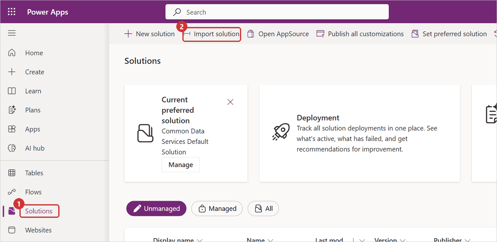

2. In the **Import a solution** panel, select **Browse**.

   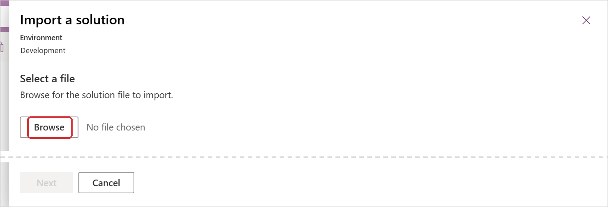

3. Select the zip file (1), then **Next** (2).

   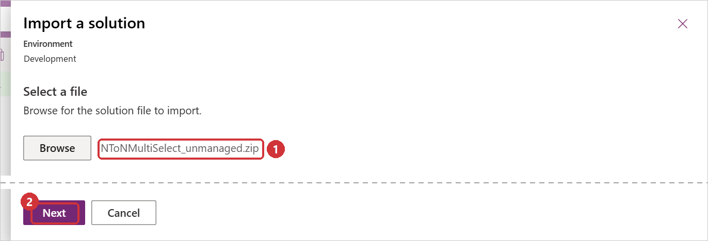

4. Check the type (1), *Unmanaged* or *Managed*, then select **Import** (2).

   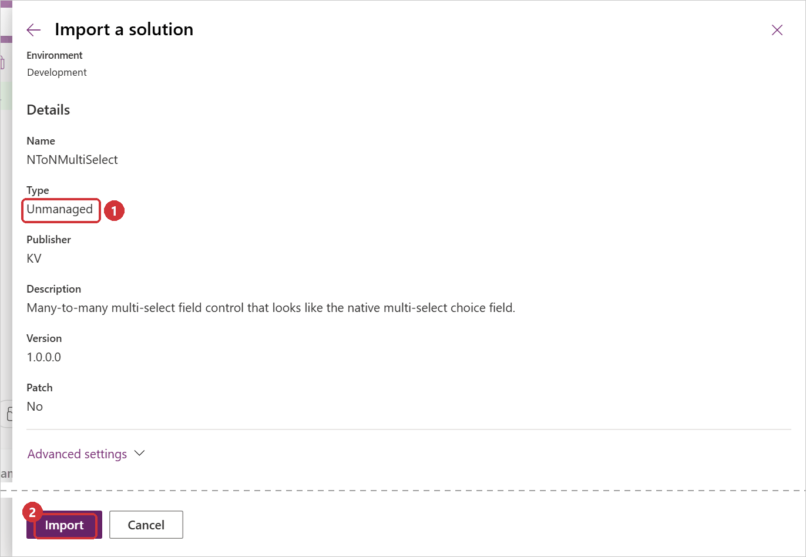

5. Wait for the banner that confirms the import.

   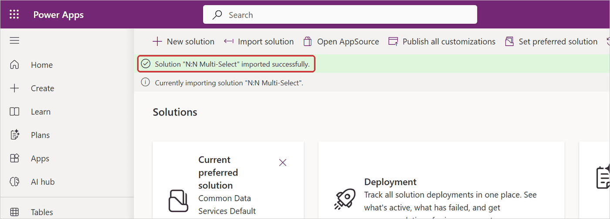

6. For the unmanaged package, select **Publish all customizations**. A managed package is live as soon as the import
   finishes.

   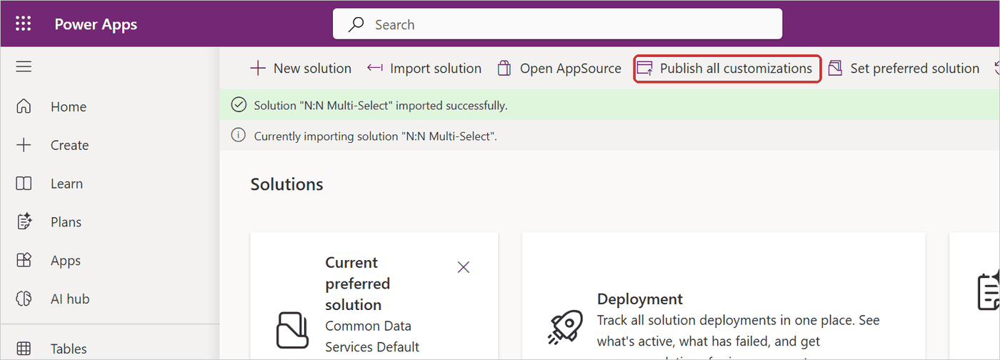

The solution without the plug-in contains the code component and the form library web resource:

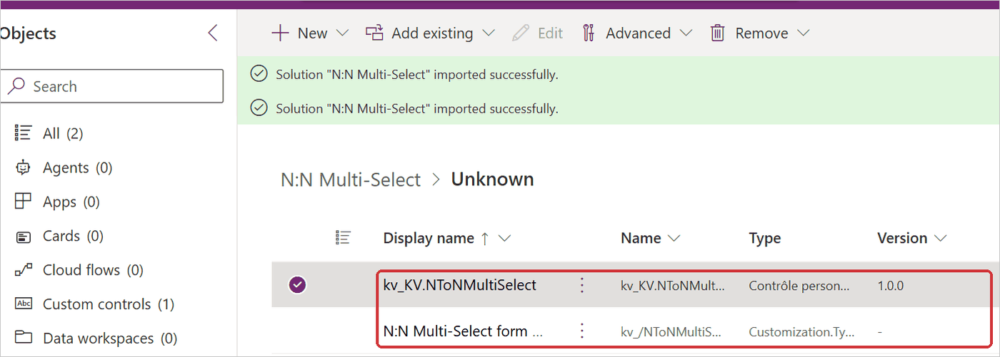

The solution with the plug-in (*N:N Multi-Select*, name `NToNMultiSelectWithPlugin`) also contains the plug-in
assembly, its two link steps (Associate and Disassociate) and the steps page, the web resource *N:N Multi-Select names
copy: steps for your tables* (`kv_/NToNMultiSelect/namescopysteps.html`), listed under **Web resources** next to the
form loader (see [The steps page](#the-steps-page)). A fresh import has these six components and no Delete or Update
step. Open the solution and select **Objects** → **All** to see them:

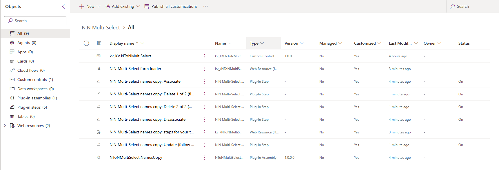

The picture shows the solution in a development environment where the steps page has made the three steps of one
linked table (*Delete 1 of 2*, *Delete 2 of 2* and *Update*), which it puts into `NToNMultiSelectWithPlugin` there,
the unmanaged solution the page is in: nine components (see [When it runs](#when-it-runs)).

### Add the control to a form

1. **Find the relationship's schema name.** **Tables** → the table of the form → **Relationships** → the
   many-to-many relationship → *Relationship name* (for example `new_project_skill`). Any casing works.
2. **Pick a host column.** The control is placed on a text column of the form's table: *Single line of text*,
   *Text area* or *Multiple lines of text*. The column must **not be Business Required**: the control never sets its
   value on the form, so a required column would block every save. A new single line of text column (for example
   *Project skills*) is the safest choice. If *Copy names into the host column* will be turned on, give the column room
   for all the names (for example 4,000 characters, or *Multiple lines of text*); the copy is cut to the column's
   length.
3. **Open the form** in the form designer and add the host column to the form if it is not already there. Select it.

   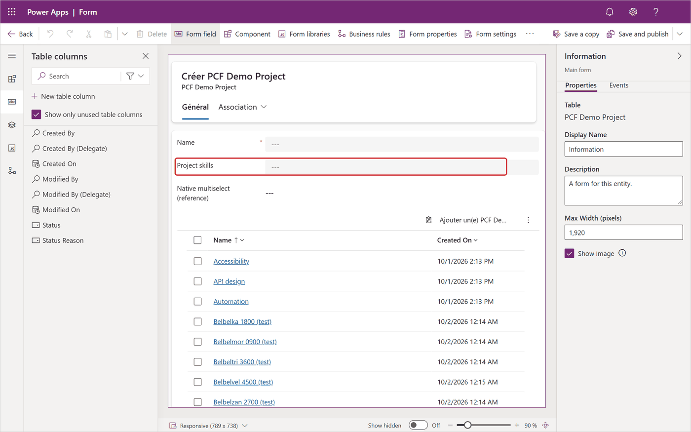

4. **Add the component.** In the column's properties, under **Components**, select **+ Component**.

   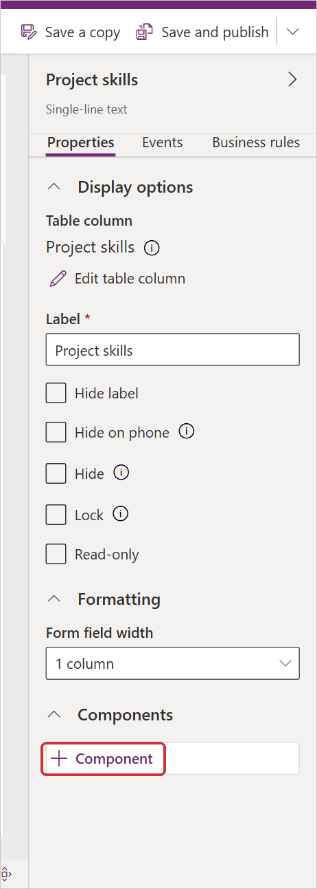

   Select **N:N Multi-Select** (1). When it is not listed, select **Get more components** (2), select
   **N:N Multi-Select** there, then **Add**.

   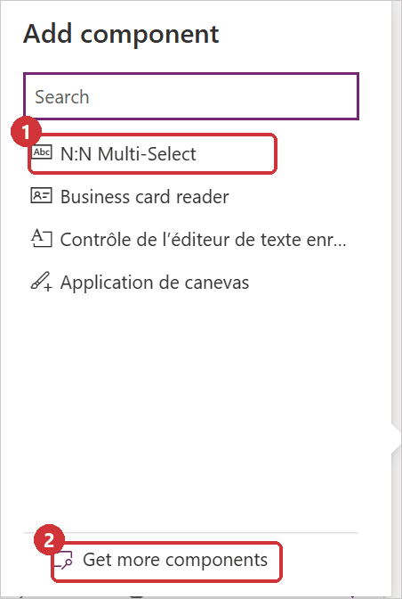 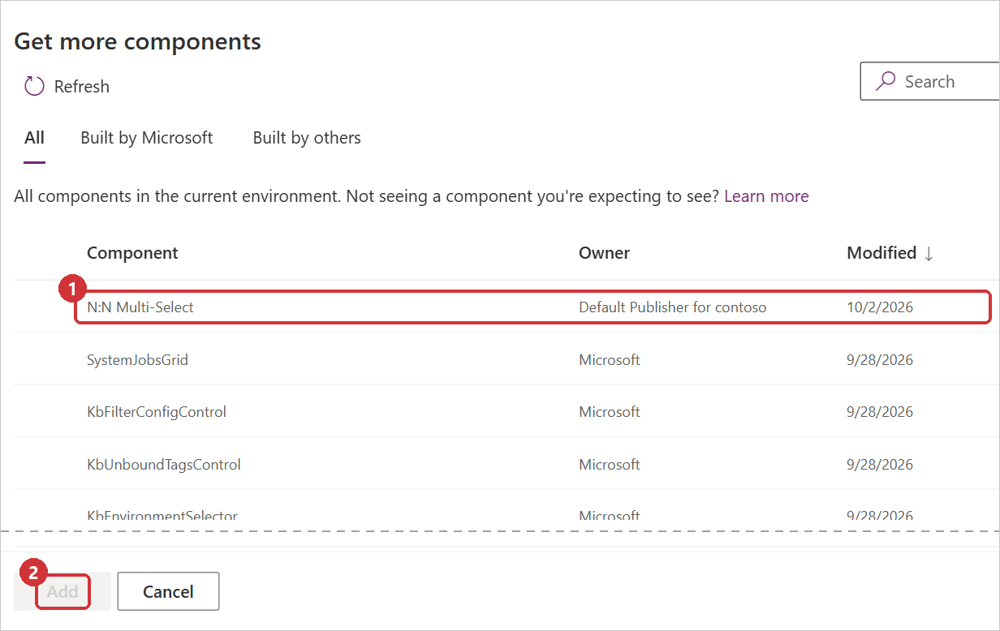

   Enter the **N:N relationship schema name** under *Static value* (leave *Bind to table column* cleared), fill in any
   optional settings (see [Settings](#settings)), choose the clients (Web, Mobile, Tablet), then **Done**. The control is
   listed under the column's components.

   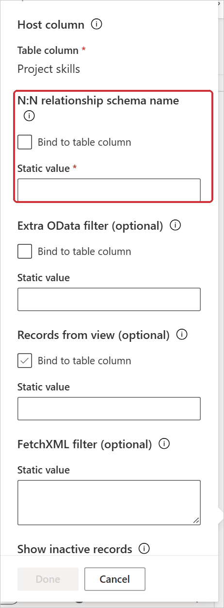 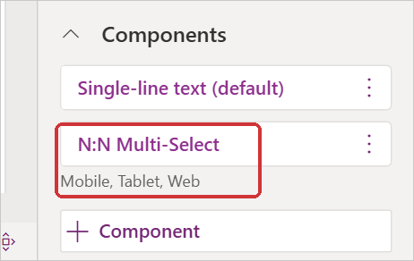

5. **Save and publish** the form.

   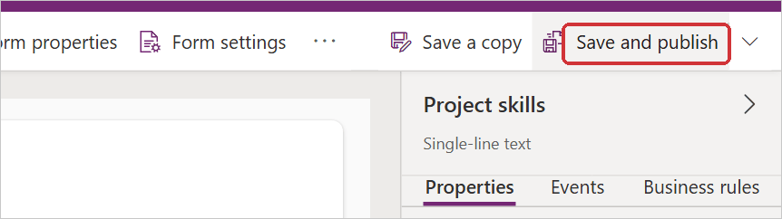
6. Open a record. If the field shows the control, the installation is complete. If it shows "Error loading control",
   add the [form library](#form-library-optional).

**Security roles.** Users need Read on both tables and Append / Append To to link records, Create on the related table
for *+ New*, and Write on the record for *Copy names into the host column*. When column security secures the host
column, users also need Update on that column in their field security profile; without it, the control is read-only
for them (see [Column security on the host column](#column-security-on-the-host-column)). Without the other
privileges the control says so and names the missing privilege. The names copy plug-in needs no privileges from the
users: it writes as the system user.

## Settings

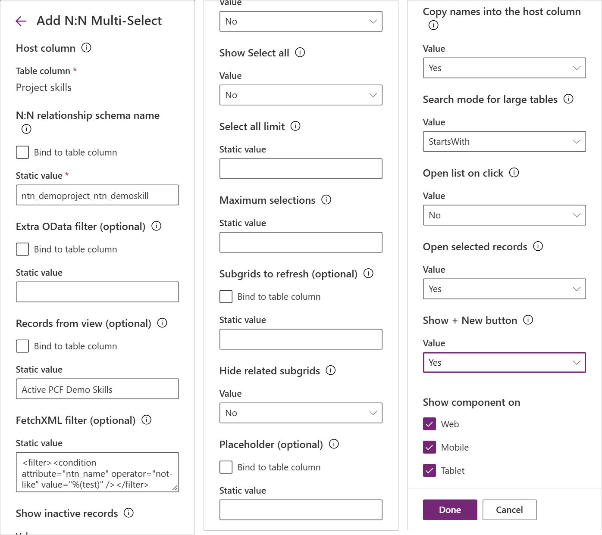

The single-line text settings have *Static value* and *Bind to table column*; *FetchXML filter* takes a static value
only. Leave *Bind to table column* cleared and type the value under *Static value*; it then applies to every record.

| Setting | Default | Description |
| --- | --- | --- |
| Host column | (required) | Any text column on the form that is not Business Required. The control uses it only as an anchor and never sets its value on the form, so a required column would block saving. To store the selected names in this column, turn on *Copy names into the host column*. When column security secures this column, users who are not allowed to update it see the control read-only, as they would see the column |
| N:N relationship schema name | (required) | The relationship to edit, for example `new_project_skill`. Not case-sensitive |
| Extra OData filter | empty | Limits the records that can be selected, for example `new_category eq 2`. Cannot be combined with a view or FetchXML |
| Records from view | empty | Name or id of a system view of the related table; only records the view returns can be selected, in the view's sort order. Use the id when view names are translated. See [Choosing which records can be selected](#choosing-which-records-can-be-selected) |
| FetchXML filter | empty | `<filter>` and `<link-entity>` elements that narrow the list (and the view, if set), or a complete `<fetch>` query, which also sets the sort order |
| Show inactive records | No | Also offer inactive records. Ignored with a view or a complete FetchXML query |
| Show Select all | Yes | Shows or hides the Select all row |
| Select all limit | 100 | Select all is offered only when the list holds at most this many records. Maximum 500; 0 means 500 |
| Maximum selections | 0 (no limit) | The most records that can be selected with this control. At the limit, further rows are greyed out with a hint and *+ New* is hidden. A value whose removal is still being saved keeps its place until the removal has succeeded. Each copy of the field checks the limit on its own, and subgrids, imports, flows and integrations are not limited. See [Maximum selections](#maximum-selections) |
| Search mode for large tables | Starts with | For tables with more than 500 records: *Starts with* (fast on any size) or *Contains* (matches anywhere, slower on very large tables) |
| Open list on click | No | No: as in the native control, clicking focuses the box, and the chevron, the Down arrow key, Enter or typing opens the list. Yes: clicking the box opens the list |
| Open selected records | No | No: as in the native control, the selected values are plain text. Yes: each selected value is a link that opens the record in a new browser tab. Ctrl+click and middle-click work as for any link, Enter opens the chip highlighted with the keyboard (Backspace in the empty search box, then the Left and Right arrow keys), and the links also work when the field is read-only |
| Subgrids to refresh | empty (all subgrids with the same relationship) | Comma-separated subgrid names, or `none` (no refresh, and changes made in subgrids are not followed) |
| Hide related subgrids | No | Yes: the control takes the place of the related subgrids and hides them. See [Subgrids](#subgrids) |
| Placeholder | Select or search options | Text in the empty search box |
| Copy names into the host column | No | No: the host column is never changed. Yes: after each change is saved, the selected names (for example "API design; Automation") are written to the host column of the record in a separate update, for views, search and exports. The text is cut to the column's maximum length, so give the column room (for example 4,000 characters); records linked before the setting was turned on need a one-time update. The form is not made dirty, plug-ins, flows and auditing see the update, and users need Write on the record. Only changes made with this control or with subgrids on the same form are copied, with the records the user can see. Anyone who can read the record can read the names: when the related table holds restricted records, leave this off or secure the host column with column security (users who are not allowed to update the column then see the control read-only). With the [names copy plug-in](#names-copy-plug-in-optional) solution installed, changes made elsewhere (imports, flows, integrations or the other side of the relationship) are copied too, with every linked name. See [Copy names into the host column](#copy-names-into-the-host-column) |
| Show + New button | No | Yes: adds "+ New ..." at the end of the list, which opens quick create and selects the new record if the list offers it. Only shown when the related table allows quick create |

The form designer shows a fuller description of each setting as its tooltip. There, *Extra OData filter*, *Records
from view*, *FetchXML filter*, *Subgrids to refresh* and *Placeholder* carry the suffix "(optional)".

### Choosing which records can be selected

By default every active record of the related table can be selected. Three settings narrow that down:

* **Records from view**: the list shows what a system view of the related table shows, in the view's sort order (see
  [Sort order](#sort-order)). Enter the view's name or id. The view's filters are used, including filters on related
  tables; its columns are ignored. The view decides which records are usable, so *Show inactive records* is ignored.
  In an environment with more than one language, **enter the id**: translated view names differ between languages,
  so a name that works for one user can fail for another. To find the id, open
  `<environment URL>/api/data/v9.2/savedqueries?$select=name&$filter=returnedtypecode eq '<table name>'` in the
  browser; each view comes with its `savedqueryid`. When a name cannot be used, the control's message gives the id of
  the translated view, or lists the table's views with their ids (in full in the browser console).
* **FetchXML filter**: either `<filter>` and `<link-entity>` elements, which are added with AND to the view (or,
  without a view, to a query of the related table that still follows *Show inactive records*), or a complete `<fetch>`
  query of the related table, which then decides on its own, sort order included. A complete query cannot be combined
  with a view. `<filter>` and `<link-entity>` elements only narrow the list and never change its order.
* **Extra OData filter**: a simple condition on the related table's own columns, for example `new_category eq 2`. It
  cannot be combined with a view or FetchXML; put the condition in the FetchXML filter instead.

Example: to offer only technical skills, set **Records from view** to the id of a view that filters on that, or set
**FetchXML filter** to:

```xml
<filter>
  <condition attribute="new_kind" operator="eq" value="1" />
</filter>
```

Here `new_kind` and `1` stand for a choice column of the related table and one of its values.

Records that are already linked but no longer match still show as selected and can be removed; they are just not
offered in the list. Settings that cannot work (a view that does not exist or belongs to another table, a translated
view name, FetchXML that is not valid or queries another table, a complete query together with a view) are explained
in the list and in the browser console. A view's query is read once per page load, so reload the app after changing
the view.

### Sort order

Without a view or a complete `<fetch>` query, the list is sorted by name. With one, the list follows its sort order:

* Its `<order>` elements in their sequence (`descending="true"` included), then the record id, so that records with
  equal values always come in the same order. A view or query without an order the list can follow is sorted by name.
* Orders written inside a `<link-entity>` that follows a lookup (joined on the linked table's id) come after the
  orders on the related table's own columns, as Dataverse applies them; an `<order entityname="alias">` on the entity
  keeps its place.
* Orders on other `<link-entity>` elements (child records, `exists`, `in`, `any` and `all` links, links inside links)
  and any `<order>` in the `<filter>` and `<link-entity>` elements of *FetchXML filter* are ignored.
* Choice columns are sorted by their label in the user's language, unless the `<fetch>` has `useraworderby="true"`
  (then by value). Lookup columns are sorted by the name of the related record.
* On tables with more than 500 matching records, more rows load with Dataverse's paging cookie. A list sorted on a
  linked column, or with `useraworderby="true"`, loads them by page number instead (the cookie can't follow those
  orders), which is slower on very large tables and stops at 50,000 records.
* The selected values, and the names copied into the host column, stay sorted by name.

### Subgrids

After the user pauses (about half a second after the last change is saved), each related subgrid is refreshed once
with the standard `gridControl.refresh()`, which reloads the grid's rows without saving the form.

With **Hide related subgrids**, the control hides the subgrids it takes the place of as soon as it starts, including
grids that appear later. It only hides grids that are visible, turning the setting off shows again only the grids it
hid, and a hidden grid is not refreshed. The control does not need the subgrid, so it can also be removed from the
form, or *Visible by default* cleared in its properties, which avoids the grid showing briefly while the form loads.

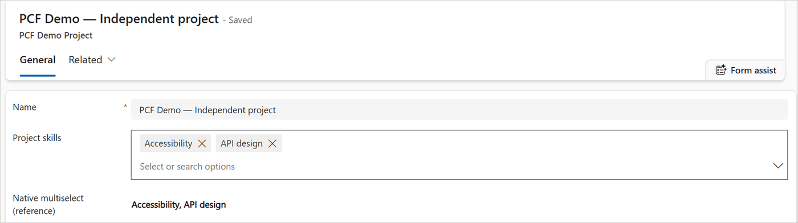

When a saved record is opened in a dialog or a side pane, the control still saves every change, but it does not
refresh, follow or hide that form's subgrids: the platform's form API there describes the page underneath, so the control
leaves all subgrids alone.

### Copy names into the host column

Once a change is saved, the control writes the selected names ("A; B; C") to the host column of the record, with an
update of its own. The names are sorted by name (ignoring case and accents, with numbers in numeric order), separated
by `; ` and cut to the column's maximum length with "…"; the column is emptied when nothing is linked. Plug-ins, flows
and auditing on the record see that update, and the user needs Write on the record. The form is never made dirty,
opening a record never writes to it, and a new record gets its copy once, after its first save has linked the picks.

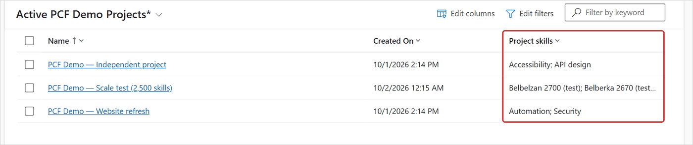

**The saved links are read first.** Just before it writes, the control reads the links saved on the server and writes
their names, not only the names it has on the page. A link made elsewhere while the form was open (by another user, a
flow, or from the other side of the relationship) is therefore not overwritten, and the field shows it too. In a
development environment the names were written about 120 ms after the link was saved (67 ms without this read);
picking is not slower. A change made elsewhere in the short moment between the read and the write can still be
missed: about 50 ms in a development environment, longer on a slow connection and when the write has to be resent
(retries wait 1, 2 and 4 seconds; throttling can make it wait up to about a minute). A change missed this way is in
the column with the record's next change of links.

When that read fails, the control leaves the column as it is and shows "The names could not be copied into
&lt;field&gt;: &lt;reason&gt;" under the field, with a reason that describes the failed read. A write that fails is
reported the same way. In both cases the links stay, and the next change writes the names again; a change saved while
the failed read or write was on its way is still copied right after it. After a change whose outcome is not known
(below), the field's re-read of the saved links (tried again after 1, 3 and 9 seconds while the record is open, and
when the connection comes back) also writes the names when it finds links the field did not show. Once the record is closed, the message
appears as an app notification instead.

**After a change whose outcome is not known.** When a link or unlink fails in a way that may still have saved it (the
connection was lost, the request timed out, or the server or a gateway answered with an error), the value goes back on
screen and the message under the field says that it could not be added or removed. The server may have saved it all
the same, so the control then reads the links saved on the server and writes their names into the host column. The
field shows the saved links again (it reads them after any failed write), and the subgrids and the other copies of
the field on the page read them again. The same holds for writes that finish after the record was closed, also when
it was closed in the middle of a batch. This costs nothing in normal use: only after such a failure, one read of the
saved links, and one write when the names differ from the column.

**Leaving the page.** The update of the host column is sent with `keepalive` (for updates of up to 60,000 bytes;
a larger one, or one the browser refuses, is sent as an ordinary request): once it is on its way, the browser finishes
it even when the page is closed meanwhile. The names are written once the last link of a batch is saved, and closing
the page before then asks for confirmation first. If the user leaves anyway, or the browser or app closes without
asking, the column can miss some names until the record's links next change (see [Limitations](#limitations)).

**What is copied.**

| Change | Without the plug-in | With the [names copy plug-in](#names-copy-plug-in-optional) solution |
| --- | --- | --- |
| Made with this control | Written by the control | Written by the control. The plug-in leaves it to the control when the user could write it (see the tag below); otherwise, for example for a secured host column, the plug-in writes it too |
| Made in a subgrid of the same form | Written by the control (not with *Subgrids to refresh* set to `none`) | Written by the plug-in, then by the control |
| Made anywhere else: subgrids on other forms, the other side of the relationship, flows, imports, integrations, the Web API | Not copied | Written by the plug-in |
| A linked record is deleted | Not copied: the name stays until the links next change | Written by the plug-in's Delete steps made for the linked table on the [steps page](#the-steps-page) (see [Deleting linked records](#deleting-linked-records-the-delete-steps)). Without steps for that table: not copied |
| A linked record is renamed | Not copied: the old name stays until the links next change | Written by the plug-in's Update step made for the linked table on the steps page (see [Renaming linked records](#renaming-linked-records-the-update-step)). Without steps for that table: not copied |

**The tag.** While *Copy names into the host column* is Yes, the control sends each link it makes or removes with a
`tag`: a Web API parameter that Dataverse hands to the plug-ins of the request. The tag reads
`NToNMultiSelect|<relationship schema name>|<table>|<record id>|<host column>`. The names copy plug-in then leaves that
column of that record to the control (when the user could write it, see below), which writes it once all the links
are saved: the column is written once. The plug-in still writes the other record of the link, and other host columns,
when forms copy names there too. It therefore does not fill in names that the control did not write because the page
was left or closed before it wrote them (see [Limitations](#limitations)).

Any caller can send a tag, so the plug-in follows it **only when the user who made the link could write that column
themselves**: the column has no column security, and the user may write the record. Where Dataverse answers
`RetrievePrincipalAccess` for the table (most tables owned by users or teams; the plug-in reads which tables do from
the message filters, `sdkmessagefilter`), that is Write access to the record; for a table owned by the organization,
the table's Write privilege (`RetrieveUserPrivilegeByPrivilegeName`, with the privilege name read from the table's
metadata; roles of the user's teams count). For any other table, or a host column with column security, the tag is
ignored and the plug-in rewrites the column as for any other link (the control writes it as well when the user may).
The user is the one the request runs for (with impersonation, the impersonated user). A user who can link records but
cannot write the host record, or the secured column, therefore cannot keep the host column out of date with a forged
tag. The check is one request per tagged link; measured in a development environment, the control's links cost the
same with it (no difference beyond the run-to-run variation).

**Records linked before.** The copy is written only when a record's links change, so records linked before the
setting was turned on (or before the plug-in solution was installed) keep a blank (or old) value until then. Fill them
once when the setting goes live, for example with a flow or a script that writes each record's linked names, sorted
by name and separated by `; `.

**Who can read the copy.** The host column is an ordinary column of the record, so anyone who can read the record can
read the copied names (in forms, views, Advanced Find, exports and the Web API), including users whose security roles
or business units hide the related records themselves. The control and the subgrid only ever show a user the related
records they can read, but the copy holds:

* **Without the plug-in:** the names the last editor could see.
* **With the plug-in:** after a link made elsewhere, every linked name, because the plug-in writes as the system user
  (SYSTEM), whatever the user who made the link can see. A change made with the control, or in a subgrid of the same
  form, ends with the control's write, with the names that editor can see.

When the related table holds records that not everyone may see, leave the setting off, or secure the host column with
column security so that only the right people can read it (see the next section).

### Column security on the host column

Column security (field security profiles) controls who can read or update a single column. When it secures the host
column:

* Users whose field security profile does not allow **Update** on the column see the control **read-only**, as they
  would see a native field on that column. They can still open the records with *Open selected records*.
* The control never writes the names column for those users. Links they make in a subgrid on the same form are copied
  by the names copy plug-in when its solution is installed (it writes as the system user); without it, the column keeps
  its text until a user who may update it changes the links.
* With the plug-in, a host column with column security is rewritten by the plug-in for the control's links too: it does
  not follow the control's [tag](#copy-names-into-the-host-column) for a secured column. The control writes it as well
  when the user may.
* Column security only decides whether the control can be edited. The control shows the linked records, not the
  column's text, so it does not hide them behind "****" as a native field does for users who cannot read the column.
  As everywhere, it lists only related records the user is allowed to read.

### Open selected records

Each selected value becomes a link that opens the record in a new browser tab (in the mobile app, the record opens in
the app). Ctrl+click and middle-click work as for any link. With the keyboard: Backspace in the empty search box, the
Left and Right arrow keys to move between the values, then Enter. After a value was removed with its ×, or after "+N",
a value is already highlighted, so Enter opens it straight away.

### Maximum selections

With **Maximum selections** set, the user can select at most that many records in the field. The top of the list
says "You can select up to &lt;n&gt; records."; at the limit it says "Maximum reached: you can select up to &lt;n&gt;
records.", the rows that are not selected are greyed out and *+ New* is hidden. Select all is offered only while
selecting every row of the list stays within the limit.

A record keeps its place toward the limit until the server has settled it, so that changes made in the field cannot
take the record over the limit, for example when the server refuses a removal while a new pick is saved:

* a saved value whose removal is on its way (its chip goes away at once);
* a pick the user undid while its link was on its way (the link may still be saved);
* a pick whose save failed in a way that may still have saved it (the connection was lost, it timed out, or a server
  or gateway error answered), until the control has read the saved links again, which it does after any failed
  write. When that read fails as well, it is tried again after 1, 3 and 9 seconds (at most three times in a row);
  after that, the next read of the links settles it, for example when the connection comes back or the record is
  opened again.

So at the limit, after a value was removed, the other rows stay greyed out and *+ New* and Select all stay hidden
until the removal has succeeded, usually a fraction of a second. Picking again a record that holds a place this way is
allowed (it takes no new place), and a pick that takes no new place is never refused, also when the record already
holds more links than the limit (made elsewhere, or the limit was lowered). This costs no extra request, and nothing
changes below the limit or without a maximum.

**Where the limit applies.** Each copy of the field checks the limit on its own, with the links it knows: two copies
of the same field on one form, two browser tabs, or two users can together go over it. Subgrids, imports, flows,
integrations and the Web API are not limited at all. To make the limit hold everywhere, enforce it on the server
([Enforcing the rules on the server](#enforcing-the-rules-on-the-server)).

### + New (quick create)

With **Show + New button**, the list ends with *+ New &lt;related table&gt;*, which opens the related table's quick
create form. The button appears when quick create is enabled for the related table, and is hidden while
[Maximum selections](#maximum-selections) is reached. To set the table up:

* **Tables** → the related table → **Properties** → **Advanced options** → tick **Leverage quick create form if
  available**.
* Give the table an active form of type **Quick Create** with the columns a new record needs.

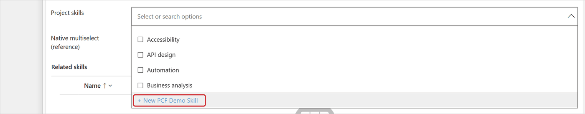

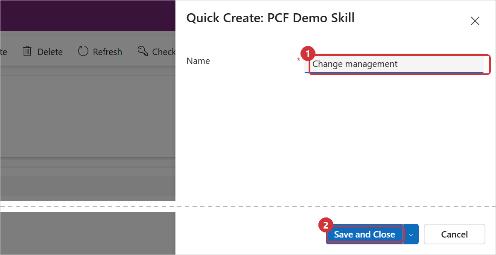

Selecting **+ New** (or pressing Enter on it) closes the list and opens quick create on the right of the page. While
quick create is open, the field keeps its focused look (the values and the search row) and the list stays closed:
typing, Enter and the chevron do nothing, and a second quick create cannot start.

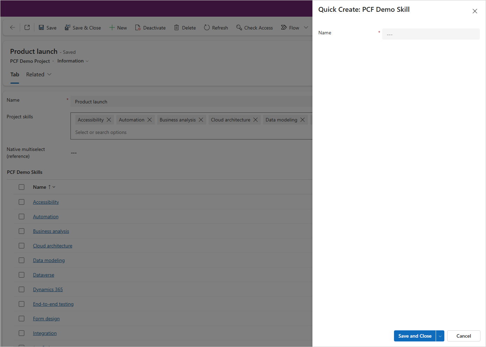

* After **Save and Close**, the new record is selected and linked straight away, provided the list offers it (it is
  active and matches the view and filters of the field), and the focus is back in the search box with the list closed.
  When the list does not offer it, it is created but not selected, and a message under the field says so.
* After **Cancel** (or closing quick create), the focus is back in the search box, without a new value.

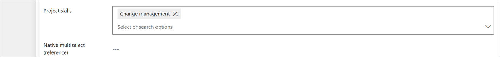

## Form library (optional)

`kv_/NToNMultiSelect/formloader.js` is included in both solutions but does nothing unless it is added to a form.

**When it is needed.** Some environments deliver code components to the form without their resources, so the
control's bundle (`cc_KV.NToNMultiSelect/bundle.js`) is never downloaded. The field then shows **"Error loading
control"** and the browser console reports **"Could not find/invoke KV.NToNMultiSelect constructor"**. The form
library fixes this: it downloads the bundle as soon as the form starts loading, and re-creates controls that tried to
start before the bundle arrived (by hiding and showing them, at most twice per control and record).

**When it is not needed.** When the platform loads the control itself, the field works without the library. If the
library is added anyway, it finds the control already registered, or waits up to 10 seconds for the platform's
download before it loads the bundle itself.

**Recommendation.** Add the control to the form without the library first and open a record. Add the library only if
the field shows "Error loading control".

**How to add it:**

1. Open the form in the form designer.
2. **Form libraries** (1) → **+ Add library** (2). Search for `NToNMultiSelect`, select **N:N Multi-Select form
   loader** (`kv_/NToNMultiSelect/formloader.js`), then **Add**.

   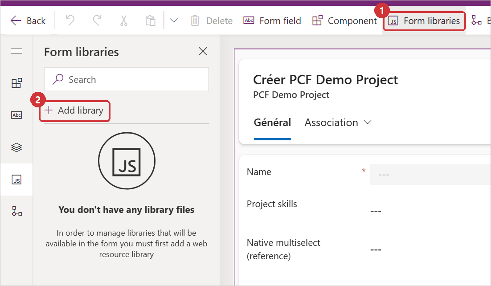 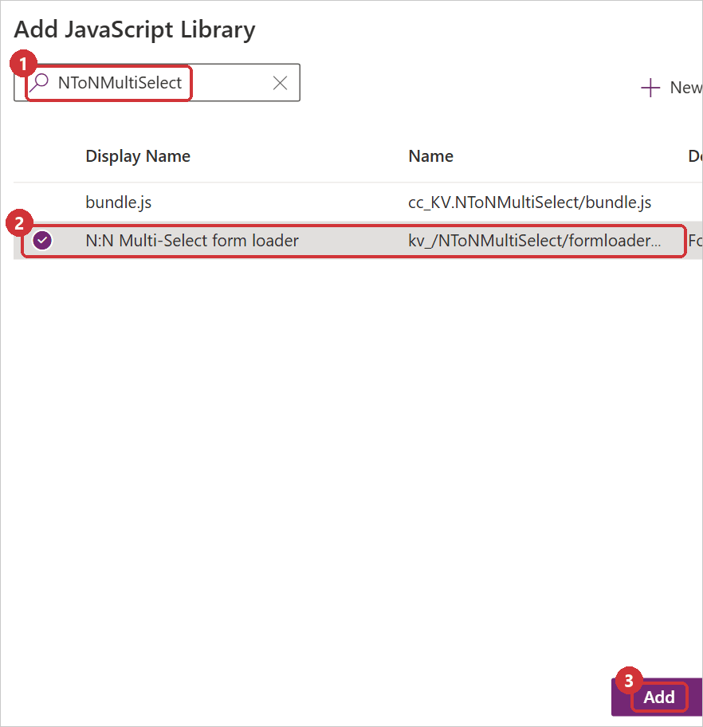

3. Select an empty area of the form, open **Events** (1) and select **+ Event Handler** (2). Set **Event Type** to
   **On Load** and fill in the handler:

   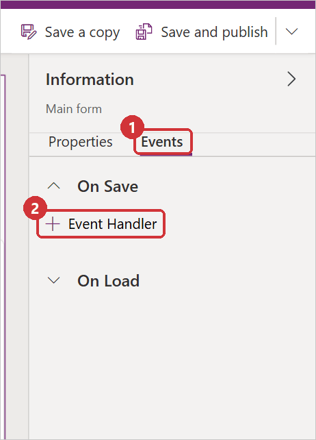 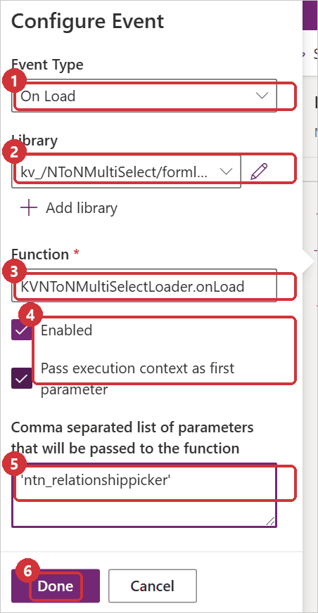

   * **Library**: `kv_/NToNMultiSelect/formloader.js`
   * **Function**: `KVNToNMultiSelectLoader.onLoad`
   * **Enabled**: ticked
   * **Pass execution context as first parameter**: ticked
   * **Comma separated list of parameters**: the logical names of the host columns, in quotes, for example
     `'new_projectskills'`. Without parameters, every control on the form that failed to load is retried.
4. **Done**, then **Save and publish**. The Events tab shows one handler.

   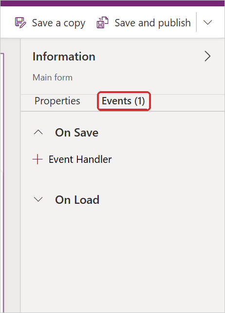

To run without the library, remove the On Load handler and the library from the form, then save and publish.

The bundle injects its own CSS, so the control does not depend on CSS resources either. The build stamps the control
version into the bundle address the library uses, so browsers download the new bundle after an upgrade.

## Names copy plug-in (optional)

The control itself needs no server code. On its own, *Copy names into the host column* follows only the changes made
on the form. The solution `NToNMultiSelectWithPlugin` adds a **Dataverse plug-in**: server code that Dataverse runs
when records change, wherever the change comes from.

* It comes with two **link steps**, Associate and Disassociate: the plug-in runs for every link made or removed.
* Its [steps page](#the-steps-page) creates Delete and Update steps for your linked tables only, so that deleted and
  renamed records of those tables leave the host columns too, without a cost on any other table. No package contains
  Delete or Update steps: the steps page creates them in the environment, and it is the one supported way to make the
  host columns follow deletes and renames.
* `NToNMultiSelectWithPlugin` with the steps for your linked tables, created in development and deployed with your
  solution, is the recommended setup for production.

### What it does

* **After every link made or removed** (the **Associate** and **Disassociate** messages, which Dataverse uses for
  every many-to-many link), it rewrites the host column of each affected record from its saved links. This covers
  subgrids on other forms, the other side of the relationship, Power Automate flows, imports, integrations and the
  Web API.
* **When a linked record is deleted** (with the Delete steps made for its table on the
  [steps page](#the-steps-page)), Dataverse removes its links without a Disassociate. The two Delete steps then rewrite
  the host column of the records it was linked to (see
  [Deleting linked records](#deleting-linked-records-the-delete-steps)).
* **When a linked record is renamed** (with the Update step made for its table on the steps page), no link changes.
  The Update step compares the record's saved name with the new one before the update is saved and, when it changed,
  rewrites the host column of the records linked to it (see
  [Renaming linked records](#renaming-linked-records-the-update-step)).
* **The same text as the control**: the names sorted by name (ignoring case and accents, numbers in numeric order),
  separated by `; `, cut to the column's maximum length with "…", and empty when nothing is linked.
* **It writes as the system user** (SYSTEM), so the text it writes holds every linked name, including records some
  readers of the host record cannot open, and the write works whatever column security the host column has. Writing as the user
  who made the link is not offered: linking only needs Append / Append To, while the update would then also need Write
  on the host record, and a failed update undoes the link.
* **It leaves the control's own links to the control.** Links the control makes while *Copy names into the host column*
  is Yes carry a [tag](#copy-names-into-the-host-column). When the user who made the link could write that host column
  of that record themselves (no column security on it, and Write on the record), the plug-in skips exactly that record
  and column, so there is no second write. Otherwise it rewrites the column as for any other link, so a forged tag
  cannot keep a host column out of date.
* **Every copy is an update of the host record.** The plug-in writes the column after each link it handles, also when
  the text stays the same, so the record's *Modified On* changes and *Modified By* shows SYSTEM, and flows or plug-ins
  that run on updates of the record run too.

### When it runs

A plug-in **step** tells Dataverse when to run the plug-in: on which **message** (the operation, such as Associate)
and in which **stage** (PreValidation runs before the operation; PreOperation runs just before the change is saved and
PostOperation right after it, both in the same database transaction, so a failure there undoes the operation). All
steps are **synchronous** (the request waits for them).

* The **Associate and Disassociate steps** come with `NToNMultiSelectWithPlugin`. They have **no primary table**:
  Dataverse has none for these messages, so they run for every link and unlink in the environment, whatever the table.
  For relationships that no form copies, they end after a lookup in the cached form settings.
* The **Delete and Update steps** are in no package. The [steps page](#the-steps-page) creates them in the environment:
  three for each linked table, limited to that table, so Dataverse calls them only for deletes of that table and for
  updates that set its name.

| Step name (as shown in the solution) | Message | Stage | Comes from | What it does |
| --- | --- | --- | --- | --- |
| N:N Multi-Select names copy: Associate | Associate | PostOperation | `NToNMultiSelectWithPlugin` | Rewrites the host column of the records just linked |
| N:N Multi-Select names copy: Disassociate | Disassociate | PostOperation | `NToNMultiSelectWithPlugin` | Rewrites the host column of the records just unlinked |
| N:N Multi-Select names copy: Delete 1 of 2 (find linked records) for &lt;table&gt; | Delete | PreValidation | The steps page, for each linked table | Before a delete of the table, while the links still exist, notes the records whose host column holds the name of the record being deleted |
| N:N Multi-Select names copy: Delete 2 of 2 (update their names) for &lt;table&gt; | Delete | PostOperation | The steps page, for each linked table | After the delete, rewrites the host column of the records step 1 noted |
| N:N Multi-Select names copy: Update (follow renames) for &lt;table&gt; | Update | PreOperation | The steps page, for each linked table | Before an update that sets the table's name is saved, compares the record's saved name with the new one; when it changed, rewrites the host column of the records linked to it with the new name |

For example, the Update step made for the table `new_skill` is named *N:N Multi-Select names copy: Update (follow
renames) for new_skill*.

The plug-in runs in the Dataverse **sandbox** (an isolated process for custom code). The steps have no images and can
be turned off and on like any customizable step.

### Configuration

None of its own. The plug-in reads the settings of the active forms that have the control with *Copy names into the
host column* set to Yes: the relationship schema name, the form's table and the host column. It reads them with one
query and keeps them for 2 minutes in each sandbox worker, so a form change counts within about 2 minutes after the
form is published.

* Only a relationship schema name typed under *Static value* counts; a value bound to a table column is ignored.
* Setting *Copy names into the host column* to No on every form turns the plug-in off for that relationship.
* A setting that cannot work (the relationship is not many-to-many, or the host column is not a text column that can
  be updated, for example a calculated column) is skipped and written to the plug-in trace log; the link is kept.

### Time trade-offs: what each step costs

A step costs time in two ways:

* **On every operation it runs for**, also those that have nothing to do with the control: Dataverse calls the
  plug-in in its sandbox, and the plug-in returns after a lookup in its cached settings. For the link steps, this is
  every link and unlink in the environment (these messages have no table). The steps made on the
  [steps page](#the-steps-page) run only for deletes of their table and for updates of their table that set its name.
* **When it does its work**: rewriting the host column of each record concerned, about 80–100 ms per record, while
  the user who made the change waits.

Measured in a development environment: medians of single Web API requests seen from the browser, so the times include
the network. Each step was turned off and on in turn, in alternating blocks.

**On operations the step has nothing to do with**

| Step | Runs for | Without the step | With the step | Extra time |
| --- | --- | --- | --- | --- |
| Associate, Disassociate | Every link and unlink in the environment (cannot be limited: these messages have no table) | 161 ms (a link) | 164 ms (a link the plug-in leaves alone) | about 3 ms |
| Delete 1 and 2, made for one table on the steps page | Deletes of that table only | 109, 149, 111 and 127 ms (four measurements) | 107–109 ms (deletes of other tables) | none on deletes of other tables |
| Update, made for one table on the steps page | Updates of that table that set its name | 72–80 ms | 71–74 ms | none on updates of other tables, nor on updates of that table that do not set its name |

The plug-in's own writes of the host columns are updates too, but they do not set the linked table's name, so the
Update step made on the page is not called for them.

**Why the Delete and Update steps are made per table.** A Delete or Update step registered for every table (no
primary table) would run on every delete and every update in the environment: measured, about 15–50 ms more per delete
and 15–30 ms more per update, whatever the table. Limited to the linked table, they cost nothing on any other table.
That is why no package contains them and the steps page creates them for the linked tables only.

**When the step does its work**

| What happens | Without the step(s) | With the step(s) |
| --- | --- | --- |
| One link made elsewhere (copied) | 161 ms | 232 ms |
| 48 links made elsewhere, 4 at a time | 2.08 s | 4.06 s |
| Delete of a record linked to 100 records | 0.5 s | 8.6 s |
| Rename of a record linked to nothing | about 0.1 s | 0.12 s (the saved name is read and compared) |
| Rename of a record linked to 1 record | about 0.1 s | 0.24 s |
| Rename of a record linked to 10 records | about 0.1 s | 0.9 s |
| Rename of a record linked to 100 records | 0.1–0.2 s | 10.3 s |
| Update that sets a linked table's name to the name it already has (an import or integration that sends every column) | 72–79 ms | 97–104 ms: the saved name is read, nothing is written |

Deletes and renames rewrite about 10 records a second, up to a **30-second budget per operation**: roughly 300–350
records. The records left after that keep the deleted or old name until their links next change (see
[Deleting linked records](#deleting-linked-records-the-delete-steps) and
[Renaming linked records](#renaming-linked-records-the-update-step)).

**In short**

* **The link steps** cost almost nothing on links they do not copy, and about 70 ms on each link they copy. Only the
  people and processes who link records pay for them.
* **The Delete and Update steps for your tables** (made on the [steps page](#the-steps-page)) cost nothing on the
  deletes and updates of other tables, nor on updates of your tables that do not set the name. Deletes and renames of
  linked records wait about 0.1 s for each linked record.
* **Production:** `NToNMultiSelectWithPlugin` plus the Delete and Update steps for your linked tables, created on the
  [steps page](#the-steps-page) in development and deployed with your solution. Deletes and renames of the linked
  tables are followed, and no other delete or update pays anything. Without those steps, a deleted or renamed record's
  name stays in the host columns until their links next change; the form itself always shows the current links and
  names.

### The steps page

The solution with the plug-in (`NToNMultiSelectWithPlugin`, not `NToNMultiSelect`) contains a page for
administrators: the HTML web resource `kv_/NToNMultiSelect/namescopysteps.html`, display name *N:N Multi-Select names
copy: steps for your tables*. It creates the plug-in's Delete and Update steps for your **linked tables** only, the
tables whose names are copied into a host column. With them, the host columns follow deletes and renames of those
tables' records, and the deletes and updates of every other table pay nothing. This is the one supported way to make
the host columns follow deletes and renames. The Associate and Disassociate steps cannot be limited to a table; the
page leaves them as they are.

**Opening it.** In a browser where you are signed in to the environment, go to
`https://<your environment>/WebResources/kv_/NToNMultiSelect/namescopysteps.html`, for example
`https://contoso.crm.dynamics.com/WebResources/kv_/NToNMultiSelect/namescopysteps.html`. The page runs at the
environment's own address and calls the Dataverse Web API with your session and privileges: it has no sign-in and no
server code of its own. Opened anywhere else, for example in a preview in the maker portal, it cannot reach Dataverse
and says where to open it. Any user can open it; only System Customizers and System Administrators can create or
remove steps (Dataverse refuses the others, and the page explains it).

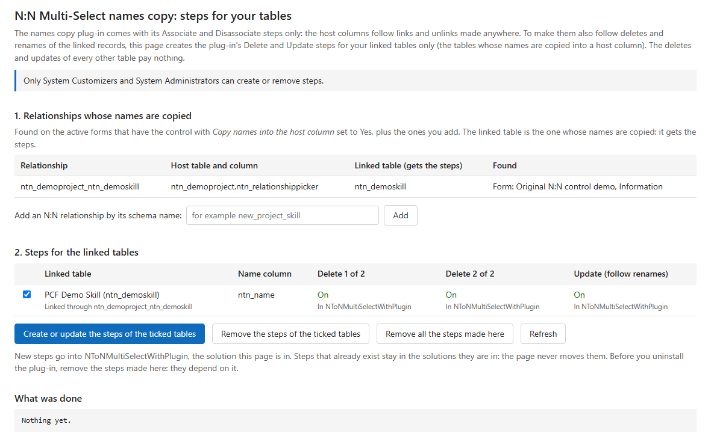

The picture shows the page in a development environment where `NToNMultiSelectWithPlugin` is installed unmanaged: one
relationship found on two forms, and its linked table *PCF Demo Skill* with its three steps on, each in
`NToNMultiSelectWithPlugin`.

**What it shows.** Under the title, the page says what it is for: the plug-in comes with its Associate and
Disassociate steps only, so the host columns follow links and unlinks made anywhere; to make them also follow deletes
and renames of the linked records, the page creates the plug-in's Delete and Update steps for the linked tables only,
and the deletes and updates of every other table pay nothing.

**A warning** appears at the top only when it applies: when the plug-in has Delete or Update steps that the page did
not make (steps registered another way, for example with the Plugin Registration Tool: see
[Steps registered another way](#steps-registered-another-way)). It lists them, each with its scope and state, for
example "(every table, on)" or "(only &lt;table&gt;, off)", and says that those that are on run as well as the steps
made on the page: a table that has both is handled twice (same result, twice the time), and a step for every table
makes every delete or update in the environment slower. Turn off or delete the ones you no longer need, in
the solution's plug-in steps or with the Plugin Registration Tool. The page only reports them and never changes them.
A step counts as the page's own when its id is the one the page computes for its table and kind (see **Create**
below).

Then two sections, and a log (*What was done*) of every change:

1. **Relationships whose names are copied.** Found on the active forms that have the control with *Copy names into
   the host column* set to Yes, read with the plug-in's own rules: the control of any publisher counts, and only a
   relationship name typed under *Static value* (see [Configuration](#configuration)). For each: the host table and
   column, the **linked table** (the other side of the relationship; for a self-referencing relationship, the same
   table) and the forms it was found on. A relationship can also be added by its schema name (any case); you then
   choose its linked side: one table, the other, or both. Relationships added this way are kept in that browser only.
   One that no active form copies is marked: its steps do nothing until a form copies names through it, because the
   plug-in only acts on the relationships the forms copy.
2. **Steps for the linked tables.** For each linked table: its name column and the state of its three steps
   (*Missing*, *On*, *Off*, and in red *Other settings: Create updates it* or, for a step that another tool put on
   another message, *On &lt;message&gt;, not &lt;its message&gt;: Remove, then Create*, see **Create**), and under
   each step the solutions it is in: "In NToNMultiSelectWithPlugin", "In YourSolution", "In no solution: Create adds
   it to ...", "In no solution" (where new steps are not added to a solution, see **Where new steps go** below), or
   "Managed, in ...: change it in development". A table that still has steps made on the page but is no longer linked
   through any relationship above is listed too, so that its steps can be removed. The buttons: **Create or update the steps of
   the ticked tables**, **Remove the steps of the ticked tables**, **Remove all the steps made here** and **Refresh**.
   Below them, when the page is in more than one unmanaged solution, a list to choose which one new steps go into
   (see **Where new steps go** below); then the page says where new steps go, and: "Before you uninstall the plug-in,
   remove the steps made here: they depend on it."

**Create** (*Create or update the steps of the ticked tables*), after a confirmation that names the tables and says
where new steps go:

* It first checks every ticked table: the table has a primary name column, Dataverse allows plug-in steps on its
  Delete and Update, none of its steps is managed, and none is on another message than its own. A table that fails is
  skipped whole, with the reason in the log; the others go on.
* For each table it then creates or updates three steps on the plug-in type, limited to that table, in this order:
  *Delete 2 of 2 (update their names)* (PostOperation, stage 40), *Delete 1 of 2 (find linked records)*
  (PreValidation, stage 10) and *Update (follow renames)* (PreOperation, stage 20, with the table's primary name
  column as filtering attribute, so that Dataverse calls it only for updates that set the name). All three are
  synchronous and named "N:N Multi-Select names copy: &lt;step&gt; for &lt;table&gt;".
* Each step has a **fixed id calculated from the table name and the step** (a name-based UUID, version 5). Running
  Create again updates the same steps and never makes a second set, also after the steps were moved to another
  solution, and the same table gets the same ids in every environment. Create turns a step that was off back on, and
  corrects in place a step shown as *Other settings: Create updates it* (its stage, mode, table or filtering
  attribute); the step stays in the solutions it is in.
* **A step on another message.** A step's message (Delete or Update) cannot be changed, and the page deletes a step
  only when you remove it. When another tool has put one of the page's steps on another message, section 2 shows it
  in red as *On &lt;message&gt;, not &lt;its message&gt;: Remove, then Create*, and Create skips that table whole: it
  changes nothing of it and deletes nothing. The log says "&lt;table&gt;: skipped, &lt;step&gt; is registered on
  &lt;message&gt;. A step's message can't be changed: remove the table's steps (Remove the steps of the ticked
  tables), then Create makes them again." Remove the table's steps (see **Remove**), then select Create. If a step is
  put on another message in the short time between the check and the write, Create stops that table at that step,
  and the log says "&lt;step&gt; is registered on &lt;message&gt;: remove the table's steps, then Create makes them
  again."

**Where new steps go.** Into one solution: the unmanaged solution the page itself is in. The page looks up its own web
resource and the solutions that contain it, as you see them in the maker portal (managed solutions, hidden ones and
the system solutions Default, Active and Basic do not count):

* **In one unmanaged solution:** new steps go into it. Where `NToNMultiSelectWithPlugin` is installed unmanaged, as in
  development, that is `NToNMultiSelectWithPlugin`, the solution with the plug-in.
* **In more than one** (for example you also added the page to a solution of your own): a list under the buttons,
  *This page is in more than one unmanaged solution. New steps go into:*, sets which one. The solution that also
  contains the plug-in comes first, shown as "&lt;name&gt; (with the plug-in)", and is chosen until you choose
  another; the others follow by name. The choice is kept in that browser for that environment and written to the log
  ("New steps go into &lt;name&gt;."); when the solution chosen is no longer one of them, the first one is used.
* **In none** (the page is only in managed solutions, for example in test or production with the managed package):
  into an unmanaged solution `NToNMultiSelectTableSteps`, which the page makes only when a new step needs it, with the
  publisher of a solution that contains the plug-in. Where `NToNMultiSelectTableSteps` is itself installed managed
  (for example deployed from development), nothing can be added to it, so new steps go into no solution (Dataverse
  keeps them in the environment's default solution); the page says so under its buttons and before Create: "New steps
  made here are not added to a solution."

The page **never moves a step between solutions and never deletes a solution**: steps that already exist stay in the
solutions they are in (move them yourself, for example into the solution you deploy), and only a step that is in no
solution at all (because adding it failed earlier) is added to the solution new steps go into. A step that you remove
and Create then makes again is a new step, so it goes only into the solution new steps go into. Managed steps are never
changed or removed by the page.

**Test and production.** Where a managed solution contains the plug-in and the page is in no unmanaged solution,
Create warns first: this is probably a test or production environment. The usual way is to create the steps in
development and deploy them with the solution you deploy; steps created in test or production would have the same ids
and block that import.

**Deploying the steps.** In development the page puts new steps into the unmanaged solution it is in, normally
`NToNMultiSelectWithPlugin`. To take them to test and production, add them to the solution you deploy (**Solutions** →
your solution → **Add existing** → plug-in step), or deploy from development the solution that holds them. To have new
steps go straight into the solution you deploy, add the steps page to it in development (**Add existing** → **More** →
**Web resource**, `kv_/NToNMultiSelect/namescopysteps.html`) and, when the page is then in more than one unmanaged
solution, choose that one on the page; steps made before stay where they are. The page then also goes with that
solution to test and production. The packages on the [Releases](../../releases) page never contain steps for your
tables.

**Remove.** *Remove the steps of the ticked tables* and *Remove all the steps made here* delete the page's steps of the
ticked tables or of all tables (in the order Delete 1 of 2, Delete 2 of 2, Update), found by their ids, also one that
is on another message; managed ones are skipped with an explanation. The page asks first: "Remove the Delete and
Update steps of: &lt;tables&gt;? Deletes and renames of their records are then no longer followed in the host
columns." A Create after Remove makes the table's three steps fresh, on their own messages and with the same ids, in
the solution new steps go into (see **Where new steps go**). A step that was in a solution of your own is then back
only in the solution new steps go into: if that is not yours, add it to yours again, as any new step. Remove all the
steps made here **before
you uninstall the plug-in**: the steps depend on it, and Dataverse refuses the uninstall while they exist (see
[Uninstall](#uninstall)).

**Imports.** Importing `NToNMultiSelectWithPlugin` again, upgrades included, does not touch the steps made on the
page: they are components of their own, with their own ids, and an unmanaged import adds and updates components, it
does not take them out of a solution. An unmanaged import turns the Associate and Disassociate steps back on and
re-creates deleted ones; after a managed import, check them (see [Turning steps off](#turning-steps-off)).

**Tested** in a development environment: the steps created for the linked table only, and only in
`NToNMultiSelectWithPlugin`, with the same ids after Remove and Create; a rename and a delete followed by them alone;
Delete or Update steps made elsewhere listed in the warning and left untouched; no `NToNMultiSelectTableSteps` made
where the page is in `NToNMultiSelectWithPlugin` installed unmanaged. Also tested: steps moved by hand into another
solution still shown *On*, and neither moved nor duplicated by Create; a step in no solution added by Create; a step
put on another message shown as such, its table skipped by Create with no step deleted, its three steps deleted by
Remove and made again by Create on their own messages, with the same ids, in `NToNMultiSelectWithPlugin`; and, with
the page also added to a second unmanaged solution, the list with `NToNMultiSelectWithPlugin (with the plug-in)` first
and chosen, the steps made after choosing the other solution in that solution only, and the choice kept after a
reload.

### Deleting linked records (the Delete steps)

The two Delete steps made for a linked table on the [steps page](#the-steps-page). Dataverse calls them only for
deletes of that table.

* Step 1 reads the records linked to the record being deleted, up to 5,000 for each relationship that is copied.
  Step 2 rewrites their host column once the record is gone, about 80–100 ms per record.
* The two steps share a **30-second budget per delete operation** (a delete and the deletes it cascades to), which
  covers roughly **300–350** linked records. Records left when the time has run out, and records beyond the first
  **5,000**, keep the deleted name until their links next change. This is written to the plug-in trace log.
* The user who deletes waits while the names are rewritten. The budget keeps the delete well within the 2 minutes
  after which Dataverse cancels an operation.
* When step 1 cannot read the linked records of a delete made on its own (not inside a transaction), the delete
  goes ahead and those records keep the name. Any other failed read or write undoes the delete with a message that
  starts "N:N Multi-Select could not ...".

### Renaming linked records (the Update step)

The Update step made for a linked table on the [steps page](#the-steps-page). Its filtering attribute is the table's
primary name column, so Dataverse calls it only for updates of that table that set the name.

* The step runs in **PreOperation**, just before an update is saved, because only then can it still read the name
  that is being replaced. It does something only when the update sets the primary name column of a table whose names a
  form copies (for example the skill's name, when a project form copies skill names). Then it reads the saved name
  (one query) and compares it with the new one.
* **An update that sets the name it already has**, or that sets other columns only, writes nothing.
* **When the name changes**, it reads the records linked to the renamed record, up to 5,000 for each relationship
  that is copied, and rewrites their host column with the new name in its place in the order, about 80–100 ms per
  record. It shares the **30-second budget** of the Delete steps (per operation), which covers roughly **300–350**
  records. Records left when the time has run out, and records beyond the first 5,000, keep the old name until their
  links next change. This is written to the plug-in trace log.
* The user who renames waits while the names are rewritten.
* A failed read or write undoes the rename with a message that starts "N:N Multi-Select could not ...".
* In a self-referencing relationship, a record linked to itself gets its own new name within the same update.
* Keep the step **synchronous** and in **PreOperation**: in any other stage it does nothing.

### Steps registered another way

The [steps page](#the-steps-page) is the one supported way to create the Delete and Update steps: tick the linked
tables it lists and select **Create or update the steps of the ticked tables**.

Steps registered another way, for example with the Plugin Registration Tool, still work, but the page does not
recognise them as its own: it lists them in its warning, shows that table's steps as *Missing*, and **Create** would
add a second set, so the table's deletes and renames would then be handled twice. Turn off or delete those steps before
you create the table's steps on the page ([Turning steps off](#turning-steps-off)).

### Turning steps off

Turning steps off (or deleting them) is safe, and the control keeps working:

* **The Delete steps of a table off:** deletes still work, and links made anywhere are still copied. A deleted
  record's name stays in the host column of the records it was linked to until their links next change.
* **The Update step of a table off:** renames still work. A renamed record's old name stays in those host columns
  until their links next change.
* **The Associate and Disassociate steps off:** links made outside the form are no longer copied.
* **All steps off:** the control works as in the solution without the plug-in: it still writes the names for the
  changes made on the form.

The form itself always shows the current links and names.

Rules:

1. **Turn off both Delete steps of a table**, one after the other (or delete both). Step 1 runs on every delete of
   its table and does the reading; turning off only step 2 keeps that cost.
2. In a **managed** installation the steps cannot be deleted, only turned off.
3. **An unmanaged import turns the Associate and Disassociate steps back on** and re-creates deleted ones; after a
   managed import, check them. Do so after every import of `NToNMultiSelectWithPlugin`, upgrades included, and turn
   them off again where needed. Imports do not touch the steps made on the [steps page](#the-steps-page).
4. For the steps made on the steps page, the page is the simpler way: its **Remove** buttons delete the three steps of
   a table in one go, and **Create** makes them again, or turns them back on.

To turn a step off:

1. Go to [make.powerapps.com](https://make.powerapps.com), select the environment, then **Solutions**.
2. Open *N:N Multi-Select*: the one whose name is `NToNMultiSelectWithPlugin` (or the solution that holds the step,
   for steps made on the steps page that are in a solution of your own).
3. Select **Objects**, then **Plug-in steps**.
4. Select only the step, for example *N:N Multi-Select names copy: Delete 1 of 2 (find linked records) for
   &lt;table&gt;*, then select **Turn off**. **Turn off** is offered only while a single step is selected.

   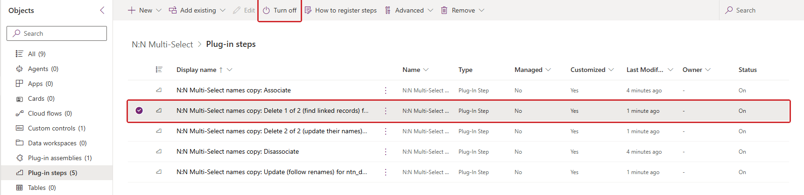

   The picture shows `NToNMultiSelectWithPlugin` in a development environment: the Associate and Disassociate steps,
   and the three steps the steps page made there for one table (*... for ntn_demoskill*). *Delete 1 of 2 (find linked
   records) for ntn_demoskill* is selected, with **Turn off** on the command bar.
5. Repeat for each step to turn off, for example *Delete 2 of 2 (update their names)* of the same table.

To turn a step back on later, select it on its own and select **Turn on**. To delete a step instead (unmanaged
installation only), select it, choose **Remove** → **Delete from this environment** and confirm.

Steps made on the page can be turned off here like any other step; the page then shows them *Off*, **Create** on the
page turns them back on, and its **Remove** buttons delete them.

**Removing the plug-in and keeping the control.** For an environment that does not need the plug-in at all, use the
solution without the plug-in. To remove the plug-in from an environment that has `NToNMultiSelectWithPlugin`, first
remove the steps made on the [steps page](#the-steps-page) (**Remove all the steps made here**; steps deployed with a
managed solution of your own are removed as in step 2 of [Uninstall](#uninstall)): they depend on the plug-in, and
Dataverse refuses to remove it while they exist. Then:

* **Managed:** import the managed solution without the plug-in if it is not installed yet, then delete
  `NToNMultiSelectWithPlugin`, and `NToNMultiSelectTableSteps` if the steps page made one (it holds steps only). The
  control and the form library stay, because the other solution still contains them.
* **Unmanaged:** open `NToNMultiSelectWithPlugin`, delete its Associate and Disassociate steps one at a time, then the
  plug-in assembly `NToNMultiSelect.NamesCopy` and the steps page `kv_/NToNMultiSelect/namescopysteps.html`
  (**Remove** → **Delete from this environment**), then delete the solution itself, and `NToNMultiSelectTableSteps`
  if the steps page made one. The control and the form library stay in the environment.

### What the plug-in does not cover

* **Deletes and renames of linked records** whose table has no Delete and Update steps made on the
  [steps page](#the-steps-page): the solution has the link steps only. Host columns keep the deleted or old name until
  their links next change. The form itself always shows the current links and names, and the next change in the
  control writes them.
* **Records linked before** the solution was installed, or before *Copy names into the host column* was turned on,
  keep their old text until their links change. Fill them once, for example with a flow.
* **Operations that bypass custom plug-ins**, such as imports or integrations that use `BypassCustomPluginExecution`,
  or data migrations with plug-ins turned off, are not copied.
* **Large deletes and renames**: the limits under [Deleting linked records](#deleting-linked-records-the-delete-steps)
  and [Renaming linked records](#renaming-linked-records-the-update-step).
* **One link request with very many records**: more than about 1,000 host records in one Associate or Disassociate
  request can reach the 2-minute limit of synchronous plug-ins, and the whole request is rolled back (see
  [Limitations](#limitations)).
* **More than 5,000 forms with the control**: only the first 5,000 are read (practically never reached).

## Messages

The control explains every problem in the user's language. Problems with a change appear under the field (a change
that fails is undone). Problems with the list appear in the list, including a view, FetchXML filter or Extra OData
filter that cannot work. A missing or wrong relationship name appears in the field itself.
The [technical reference](docs/NToNMultiSelect%20-%20Technical%20Reference.docx) lists every text the control shows,
in English and French (Appendix A). The failures below were produced on purpose in a development environment.

**Connection lost while saving a pick:**

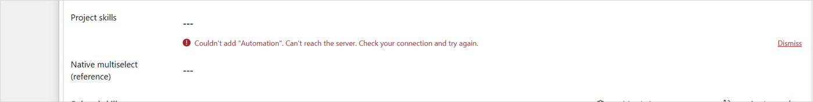

**Missing privilege** (the privilege is named in brackets):

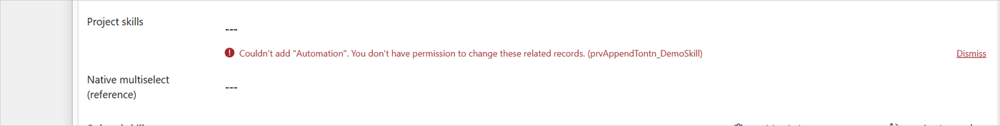

**Throttled by Dataverse** (service protection limits), after the control's own retries:

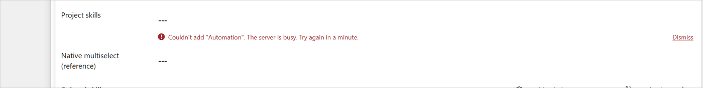

**The link was saved, but the names could not be copied into the host column** (the same message, with a reason about
reading, appears when the saved links could not be read just before the copy):

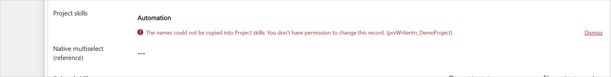

**A record made with + New that the list does not offer:**

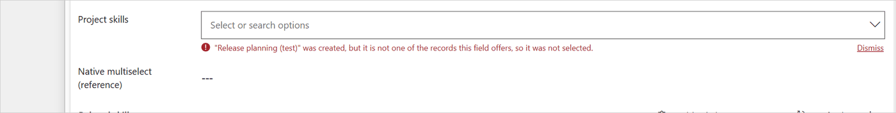

**Maximum selections reached:**

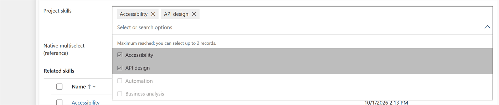

**Settings that cannot work**, for example a wrong relationship name or a view that does not exist (the messages list
the valid names and the views with their ids):

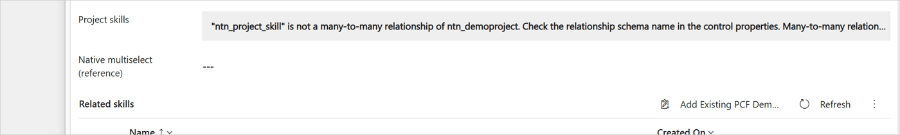


**The names copy plug-in could not copy the names** (solution with the plug-in): the link is undone, and the message
under the field gives the plug-in's reason, which starts with "N:N Multi-Select could not ...", for example "N:N
Multi-Select could not copy the names into &lt;table.column&gt;: &lt;reason&gt;".

## Upgrade

### Replacing an installed copy of version 1.0.0

This build keeps version 1.0.0. Dataverse keeps the old code component when a solution with the same control version
is imported, so an environment that already has N:N Multi-Select 1.0.0 needs the old copy removed first:

1. Note the control's settings on each form that uses it (relationship schema name, view, FetchXML filter and the
   other settings), and whether the form uses the form library and the parameter of its On Load handler.
2. Remove the control from those forms: step 1 of [Uninstall](#uninstall).
3. Delete the installed code component:
   * Unmanaged: open the solution, select the custom control `kv_KV.NToNMultiSelect` and choose **Remove** →
     **Delete from this environment**. The solution, the form library and the plug-in can stay; the import replaces
     them.
   * Managed: delete the solution, as in step 2 of [Uninstall](#uninstall). If more than one N:N Multi-Select
     solution is installed, delete them all; otherwise the old control stays and the import does not replace it.
4. Import the new package, with or without the plug-in. After an unmanaged import, select **Publish all
   customizations**.
5. Add the control to the forms again with the same settings, and the form library where it was used, then **Save and
   publish**.
6. Reload the app with Ctrl+F5. If the old behaviour still shows, clear the site data of the environment in the
   browser (F12 → **Application** → **Storage** → **Clear site data**) and reload.

The plug-in assembly and its Associate and Disassociate steps need no removal of their own: in an unmanaged
installation the import of the solution with the plug-in replaces them, and in a managed installation deleting the
solution removes them and the import brings them back. An unmanaged import turns the Associate and Disassociate steps
back on and re-creates deleted ones; after a managed import, check them. If they were turned off, turn them off again
([Turning steps off](#turning-steps-off)). The import does not touch the steps made on the
[steps page](#the-steps-page).

**Managed installations and the steps made on the steps page.** Step 3 deletes the solution with the plug-in, and
Dataverse refuses to remove the plug-in while those steps exist, so remove them first, as in step 2 of
[Uninstall](#uninstall): **Remove all the steps made here** on the page; steps deployed with a managed solution of
your own are removed from that solution in development, which you then deploy again. After the import, deploy them
again with your solution; in development, create them again on the page (they get the same ids). Steps created on the page in test or production would block a
later import of the same steps from development.

To add the plug-in to an environment that has the solution without it, see [Which solution](#which-solution).

### Releasing a new version of your own

1. Raise `version` in `control/NToNMultiSelect/ControlManifest.Input.xml` (for example 1.0.1). The build stamps the
   same number into the solution (1.0.1.0) and the form library.
2. Run `node scripts/build.mjs`, and then `node scripts/build-with-plugin.mjs` for the solution with the plug-in.
3. Import the new package over the installed solution, the same kind as before (managed over managed, unmanaged over
   unmanaged). For the unmanaged package, select **Publish all customizations** afterwards. An unmanaged import turns
   the Associate and Disassociate steps back on and re-creates deleted ones; after a managed import, check them. If one
   of them was turned off, turn it off again (the steps made on the steps page need nothing).

**Always raise the version.** Dataverse does not replace a code component when a solution with the same control
version is imported, so the old bundle would stay in place.

## Uninstall

1. **Remove the control from every form.** On each form that uses it, select the host column → **Components** →
   open the menu (⋮) of *N:N Multi-Select* and select **Delete** (the component's menu, not Delete on the command bar,
   which removes the whole column from the form). If the form library was added, remove its On Load handler and the
   library as well. Save and publish each form.

   
2. **Remove the solution.** For the solution with the plug-in, first remove the steps made on the
   [steps page](#the-steps-page): open it and select **Remove all the steps made here**. They depend on the plug-in,
   and Dataverse refuses to uninstall it while they exist. The page skips steps that came with a managed solution of
   your own: remove them from that solution in development and deploy it again, or delete that solution.
   * Managed: **Solutions** → **Managed** → select *N:N Multi-Select* → **Delete**. This removes the control and the
     web resource and, for the solution with the plug-in, also the plug-in assembly, its Associate and Disassociate
     steps and the steps page. If both are installed (two rows named *N:N Multi-Select*, with the names
     `NToNMultiSelect` and `NToNMultiSelectWithPlugin`), delete both. Dataverse keeps a component while any installed
     managed solution still contains it, so deleting only `NToNMultiSelectWithPlugin` removes just the plug-in. Then
     delete `NToNMultiSelectTableSteps` too if the steps page made one (it holds steps only).

     
   * Unmanaged: deleting the solution removes only the container. Delete the components themselves first: open the
     solution, select the custom control `kv_KV.NToNMultiSelect` and choose **Remove** → **Delete from this
     environment**, then do the same for the web resource `kv_/NToNMultiSelect/formloader.js`. For the solution with
     the plug-in, delete its Associate and Disassociate steps one at a time, and then the plug-in assembly
     `NToNMultiSelect.NamesCopy` and the steps page `kv_/NToNMultiSelect/namescopysteps.html`, the same way. Then
     delete the solution (every N:N Multi-Select solution that is installed, and `NToNMultiSelectTableSteps` if the
     steps page made one) and select **Publish all customizations**.

     

Dataverse refuses the delete while a form still uses a component, or while plug-in steps still depend on the plug-in;
**Show dependencies** lists them.

Uninstalling does not touch data: the links are stored in the N:N relationship and stay, as does any text in the host
columns. The publisher `KV` stays in the environment and can be deleted separately once no solution uses it.

## Troubleshooting

| Symptom | Cause and fix |
| --- | --- |
| An old version of the control (or form) still shows after an update | The browser cached it. Reload with Ctrl+F5. If that is not enough, press F12 → **Application** → **Storage** → **Clear site data** (this signs the user out of that site), then reload |
| "Error loading control"; console: "Could not find/invoke ... constructor" | The environment did not deliver the control's bundle. Add the [form library](#form-library-optional) |
| An update made no difference | The control version was not raised, so Dataverse kept the old bundle. Raise the version, rebuild and import again. To install this 1.0.0 build over an earlier 1.0.0, remove the old copy first ([Replacing an installed copy of version 1.0.0](#replacing-an-installed-copy-of-version-100)) |
| "... is not a many-to-many relationship of ..." | The schema name is wrong or belongs to another table. The message lists the valid names |
| A view name is not found, or is reported as translated | Enter the view's id instead of its name |
| The form cannot be saved while the field is empty | The host column is Business Required. Use a column that is not required (the console also warns about this) |
| "You don't have permission ..." with a privilege name | The user's security role lacks that privilege (for example `prvAppendToContact`) |
| The field is read-only although the form can be edited | Column security secures the host column and the user's field security profile does not allow Update on it. Allow Update, or use a host column that is not secured ([Column security](#column-security-on-the-host-column)) |
| At the limit of *Maximum selections*, the other rows stay greyed out after a value was removed | A record keeps its place until its removal is saved, usually a fraction of a second. After a change that failed with a lost connection, a timeout or a server error, which the server may have saved all the same, the place is held until the control has read the saved links again: it tries again after 1, 3 and 9 seconds, and then with the next read of the links, for example when the connection comes back or the record is opened again ([Maximum selections](#maximum-selections)) |
| A record has more links than *Maximum selections* | The limit is checked only in the control, by each copy of the field on its own: two copies of the field on one form, two browser tabs or two users can together go over it, and subgrids, imports, flows and integrations are not limited. Links made before the limit was lowered stay. To make it hold everywhere, enforce it on the server ([Enforcing the rules on the server](#enforcing-the-rules-on-the-server)) |
| The names column is not updated for links made outside the form | `NToNMultiSelectWithPlugin` is not installed, its Associate and Disassociate steps are turned off, or no active form has *Copy names into the host column* set to Yes for that relationship (with the relationship name typed under *Static value*). After publishing a form change, wait up to 2 minutes |
| The names column still shows a record that was deleted | The record's table has no Delete steps (create them on the [steps page](#the-steps-page)), its Delete steps are turned off, or the deleted record had more linked records than its delete could update (about 300–350 within the 30-second budget, at most 5,000). The name goes when those records' links next change |
| The names column still shows a record's old name | The record's table has no Update step (create it on the [steps page](#the-steps-page)), its Update step is turned off, or the renamed record had more linked records than its rename could update (about 300–350 within the 30-second budget, at most 5,000). The old name goes when those records' links next change |
| The names column misses a name although its link is saved | The page was left while the control was still saving (**Leave** in the browser's prompt), or the browser or app closed without asking (a crash, the mobile app closed), before the control wrote the names: it writes them once the last link of a batch is saved, and the names copy plug-in leaves the control's own links to it. Or a link was made elsewhere in the moment between the control's read of the saved links and its write. In both cases the names are written with the record's next change of links ([Limitations](#limitations)) |
| Deletes or renames of a linked table take longer | The Delete and Update steps made for that table on the [steps page](#the-steps-page) rewrite the names of the records linked to a deleted or renamed record, about 0.1 s per record ([Time trade-offs](#time-trade-offs-what-each-step-costs)). Deletes and updates of other tables, and updates that do not set the name, pay nothing. If the steps page warns about Delete or Update steps it did not make, see the next row |
| The steps page lists Delete or Update steps that it did not make | The plug-in has Delete or Update steps registered another way, for example by hand with the Plugin Registration Tool. Those that are on run as well as the steps made on the page: a table that has both is handled twice (same result, twice the time), and a step for every table makes every delete or update in the environment slower. Turn off or delete the ones you no longer need, in the solution's plug-in steps or with the Plugin Registration Tool ([Turning steps off](#turning-steps-off)); the page never changes them |
| **Turn off** is not offered for the plug-in steps | The command is only offered when a single step is selected. Select one step, turn it off, then select the next one ([Turning steps off](#turning-steps-off)). For the steps made on the [steps page](#the-steps-page), its **Remove** buttons delete the three steps of a table in one go |
| Steps that were turned off are on again | `NToNMultiSelectWithPlugin` was imported again. An unmanaged import turns the Associate and Disassociate steps back on and re-creates deleted ones; after a managed import, check them. Steps made on the steps page are not touched. [Turn them off](#turning-steps-off) again |
| A request that links or unlinks very many records at once is rolled back | Each host record is rewritten in the same transaction, about 80–100 ms each: more than about 1,000 host records in one request can reach the 2-minute limit of synchronous plug-ins. Link in smaller batches ([Limitations](#limitations)) |
| The steps page says "The names copy plug-in is not installed in this environment" | Import `NToNMultiSelectWithPlugin` first, then open the page again |
| The steps page says "Open this page at your environment's address" | It was opened somewhere it cannot reach Dataverse, for example a preview in the maker portal or the file opened from disk. In a browser where you are signed in to the environment, open `https://<your environment>/WebResources/kv_/NToNMultiSelect/namescopysteps.html` ([The steps page](#the-steps-page)) |
| The steps page says "You do not have the privileges to change plug-in steps or solutions" | Only System Customizers and System Administrators can create or remove steps; Dataverse refuses the others. Ask one of them, or have that security role assigned |
| The steps page shows a step "On &lt;message&gt;, not &lt;its message&gt;: Remove, then Create", and Create skips its table | Another tool, for example the Plugin Registration Tool, put that step on another message, and a step's message cannot be changed. The page deletes a step only when you remove it: tick the table, select **Remove the steps of the ticked tables**, then **Create or update the steps of the ticked tables**. Create makes the three steps again on their own messages, with the same ids, in the solution new steps go into; add them to your own solution again if they were in one and new steps go elsewhere ([The steps page](#the-steps-page)) |
| Uninstall of the plug-in is refused because steps depend on it | Steps made on the [steps page](#the-steps-page) depend on the plug-in. Open the page, select **Remove all the steps made here**, then uninstall again. Steps that came with a managed solution of your own are skipped by the page: remove them from that solution in development and deploy it again, or delete that solution ([Uninstall](#uninstall)) |
| A link, delete or rename is undone with "N:N Multi-Select could not ..." | The names copy plug-in could not read the form settings or the links, or could not write the host column (for example, another plug-in or a rule refused the update of the host record). The message gives the reason |

The control logs to the browser console with the prefix `[KV.NToNMultiSelect]`, and the form library with
`[KV.NToNMultiSelect loader]`. The plug-in writes to the plug-in trace log when that log is turned on in the
environment.

## Limitations

* **Where it runs.** Model-driven app forms (browser, phone and tablet). Not canvas apps, Power Pages, views or
  editable grids.
* **Relationships.** Native many-to-many (N:N) relationships only, one per control. A many-to-many link built from a
  custom table and two one-to-many relationships is not supported.
* **Rules.** The view, the filters, *Show inactive records* and *Maximum selections* apply only in this control.
  Subgrids, imports, flows, integrations and the Web API can still link any record (see
  [Enforcing the rules on the server](#enforcing-the-rules-on-the-server)). *Maximum selections* is checked by each
  copy of the field on its own, with the links it knows: two copies of the same field on one form, two browser tabs or
  two users can together go over it ([Maximum selections](#maximum-selections)).
* **Names copy without the plug-in.** *Copy names into the host column* follows only changes made with this control
  and with subgrids on the same form. Records linked elsewhere, or before the setting was turned on, keep their old
  text until their selection changes here. The text holds only the records the editing user can see.
* **Names copy with the plug-in.** Links made elsewhere are copied by the plug-in, with every linked name. Changes
  made with the control (and in a subgrid of the same form, which the control writes last) hold the names the editing
  user can see. Deleting or renaming a linked record updates the copies only when its table has the Delete and Update
  steps made on the [steps page](#the-steps-page); records linked before the plug-in was installed keep their old text
  until their links change, and operations that bypass custom plug-ins are not copied.
* **Leaving the page while it saves.** The control writes the names into the host column once the last link of a
  batch is saved: about 0.1–0.3 s after a single pick, up to many seconds after a Select all of hundreds of records.
  Closing or reloading the browser tab before then asks for confirmation. When the user leaves anyway (**Leave** in
  the browser's prompt), or the browser or the app closes without asking (a crash, the mobile app closed), the links
  already saved stay, but the host column can miss their names until the record's links next change. The names copy
  plug-in, when installed, does not fill them in: it leaves the control's own links to the control
  ([the tag](#copy-names-into-the-host-column)). Only writing the names on the server for every link would cover this;
  that is not done, because it would cost about 70 ms per link. An update of the column that is already on its way is
  finished by the browser (`keepalive`).
* **Names copy and changes made at the same moment.** A change made elsewhere between the control's read of the saved
  links and its write can be missed: about 50 ms in a development environment, longer on a slow connection or when the
  write is resent. It is in the column with the record's next change of links
  ([Copy names into the host column](#copy-names-into-the-host-column)).
* **Deleting and renaming linked records** (the Delete and Update steps). Each delete or rename updates at most about
  300–350 linked records (30 seconds) and never more than 5,000; the others keep the deleted or old name until their
  links next change ([Time trade-offs](#time-trade-offs-what-each-step-costs)).
* **Large link requests** (with the plug-in). One Associate or Disassociate request with very many records (possible
  with the SDK; the control sends one link per request, up to four at a time) rewrites each host record in the same
  transaction, about 80–100 ms each. More than about 1,000 host records in one request can reach the 2-minute limit of
  synchronous plug-ins; Dataverse then rolls the whole request back. Link in smaller batches.
* **Text length.** The copy is cut to the host column's maximum length.
* **Saving.** Each pick is saved immediately. Discarding the form's other changes does not undo picks. The host
  column's value on the form does not change, so business rules and OnChange scripts on it do not run when records
  are picked.
* **New records.** On new records opened in a dialog or side pane, and on new Appointment, Recurring Appointment and
  Service Activity records, the control shows "Save the record first" and records can be picked once the record is
  saved. On quick create forms, which close when they are saved, the control cannot be used to pick.
* **List.** Only the related table's primary name is shown, sorted by name or in the sort order of the view or
  complete query ([Sort order](#sort-order)). On tables with more than 500 matching records, search matches the start
  of the name by default.
* **Select all.** Offered only when every matching record is loaded and their number is within the Select all limit
  (500 at most). Each record is linked with its own request.
* **Dialogs and side panes.** On saved records, changes are saved, but that form's subgrids are not refreshed or
  hidden.
* **Column security.** It makes the control read-only for users who may not update the host column; the control does
  not mask the linked records for users who may not read the column.
* **Offline.** Read-only in the mobile app's offline mode.
* **Languages.** English and French; other languages show English. The plug-in's messages are in English. To change
  a text or add a language, see [Change texts or add a language](docs/developer-guide.md#102-change-texts-or-add-a-language)
  in the developer guide.
* **Environments.** Some environments need the [form library](#form-library-optional).
* **Updates.** Every update needs a higher control version ([Upgrade](#upgrade)).

## Enforcing the rules on the server

The rules about which records may be linked (the view, the filters, *Show inactive records*, *Maximum selections*)
apply only in the control, and *Maximum selections* only within each copy of the field: two copies of the same field
on one form, two browser tabs or two users can together go over it. A plug-in of your own closes that gap, because it
runs for every link made anywhere: forms, subgrids, imports, flows, integrations and the Web API.

Links are created and removed with the **Associate** and **Disassociate** messages. These messages cannot be
registered for one table, so a step on them runs for every many-to-many link in the environment. The sample below
checks the relationship name first and returns at once for any other relationship.

A plug-in on **Associate** in the **PreValidation** stage can refuse links that break a rule, such as inactive
records or too many links. The rule then holds everywhere. When the control makes the link, it undoes the pick and
shows the plug-in's message under the field, for example: *Couldn't add "Security". Only active skills can be linked.*

```csharp
using System;
using System.Linq;
using Microsoft.Xrm.Sdk;
using Microsoft.Xrm.Sdk.Query;

// Associate, primary table none, PreValidation.
public class CheckLinks : IPlugin
{
    private const string Relationship = "new_project_skill";
    private const string RelatedTable = "new_skill";

    public void Execute(IServiceProvider serviceProvider)
    {
        var context = (IPluginExecutionContext)serviceProvider
            .GetService(typeof(IPluginExecutionContext));
        if (!context.InputParameters.TryGetValue("Relationship", out object value)
            || !(value is Relationship relationship)
            || !string.Equals(relationship.SchemaName, Relationship,
                StringComparison.OrdinalIgnoreCase))
        {
            return;
        }

        var factory = (IOrganizationServiceFactory)serviceProvider
            .GetService(typeof(IOrganizationServiceFactory));
        var service = factory.CreateOrganizationService(null);
        var target = (EntityReference)context.InputParameters["Target"];
        var related = (EntityReferenceCollection)context
            .InputParameters["RelatedEntities"];
        var records = related.Concat(new[] { target })
            .Where(r => r.LogicalName == RelatedTable);
        foreach (var record in records)
        {
            var row = service.Retrieve(RelatedTable, record.Id, new ColumnSet("statecode"));
            if (row.GetAttributeValue<OptionSetValue>("statecode").Value != 0)
            {
                throw new InvalidPluginExecutionException(
                    "Only active skills can be linked.");
            }
        }
    }
}
```

Register it with the Plugin Registration Tool (or `pac plugin`): message **Associate**, primary table **none**, stage
**PreValidation**, synchronous. This sample is not part of either solution; the control works the same way with or
without it, and it works next to the names copy plug-in.

## How it works

* **Existing records**: each pick is saved immediately through the Web API (at most 4 requests at a time). Rapid
  clicking is collapsed, so add → remove → add sends the minimum number of requests. A write that fails is **rolled
  back** and explained under the field; the rest keep going.
* **Maximum selections**: the limit counts the selected values and the records that may still end up saved: a
  removal on its way, an undone pick whose link is on its way, and a pick whose save failed in a way that may still
  have saved it, until the saved links are read again. Each copy of the field counts on its own
  ([Maximum selections](#maximum-selections)).
* **New records**: picks are kept until the record's first successful save, then linked automatically (also with
  Save & Close). If the save is blocked (for example, a required field is empty), nothing is linked and the picks stay
  until the save succeeds. On a quick create form, on a new record opened in a dialog or side pane, and on new
  Appointment, Recurring Appointment and Service Activity records, where the save cannot be followed safely, the
  control shows "Save the record first ..." instead of risking links to the wrong record.
* **Names copy**: one copy per record and host column on the page writes the updates one at a time, so they can never
  arrive out of order, and a value the column is known to hold is not written again. Just before each write it reads
  the saved links (one request) and writes their names; a failed read leaves the column alone and is reported. After
  a link or unlink that failed in a way that may still have saved it, it reads the saved links and writes their names
  too. The update is sent with `keepalive` (bodies up to 60,000 bytes, under the browsers' limit of 64 KiB for such
  requests at a time; a larger one, or one the browser refuses, goes as an ordinary request). While the setting is on,
  each link request carries the [tag](#copy-names-into-the-host-column) for the plug-in, which follows it only when
  the user could write that column themselves. When column security does not let the user update the host column,
  nothing is written.
* **+ New**: selecting it closes the list and opens quick create. Until quick create closes, the field keeps its focused
  look and ignores typing, Enter and the chevron; then the focus returns to the search box. The record made in quick
  create is selected only when the list offers it (active records, the extra filter, the view or the FetchXML filter);
  otherwise the control says it was created but not selected.
* **Large tables**: up to 500 selectable rows load once and are filtered instantly (ignoring case and accents). Larger
  tables switch to server-side search with paging on scroll (FetchXML paging cookies with a view or FetchXML, or page
  numbers when the list is sorted on a linked column or with `useraworderby`). As soon as the search text changes, the
  rows of the previous search are removed and the list shows "Loading…" until the new search (sent 300 ms after the
  last key press) answers, so a click, Enter or Select all in that moment cannot link records of the previous search.
  Select all appears only when every matching row is loaded and the count is within the Select all limit. When the
  list settings change while the form is open (a setting bound to a column), the list reloads, and a page still on its
  way for the old settings is dropped.
* **Metadata**: relationship metadata (and a view's query, when one is set) is read once per page load and kept in
  memory. If it turns out to be out of date (for example, the relationship was renamed), the control reads it again
  once.
* **Resilience**: requests that are throttled (honouring Retry-After), hit a gateway error or lose the connection are
  retried up to 3 times. Reads time out after 2 minutes; writes are given a little longer than the 2-minute plug-in
  limit and are never resent after a timeout. An error that would repeat (no permission, offline, server busy) stops
  the rest of that batch and names the cause. After a failed write the control reads the saved links again, because
  a write whose connection was lost, that timed out or that a server or gateway error answered may have been saved all
  the same; while the outcome of such an add is still unknown (it holds a place toward *Maximum selections*), a failed
  read is tried again after 1, 3 and 9 seconds. Failures after the record was closed appear as an app notification.
  When the control cannot start because the server could not be reached, it tries again once after 30 seconds
  and when the connection comes back; a setting that cannot work is reported without retrying.
* **Offline**: read-only with a note.
* **Leaving the page**: while a link (or the names copy) is still being saved, closing or reloading the browser tab asks
  for confirmation. Closing the record or hiding the field does not cancel queued writes. The names are written once
  the last link of a batch is saved (about 0.1–0.3 s after a single pick, up to many seconds after a Select all of
  hundreds of records), and an update of the host column that is already on its way is finished by the browser
  (`keepalive`). When the user leaves anyway (**Leave** in the browser's prompt), or the browser or app closes without
  asking (a crash, the mobile app closed), the links already saved stay, but the host column can miss their names
  until the record's links next change; the names copy plug-in does not fill them in ([Limitations](#limitations)).
* **Safety**: names are rendered as text (no HTML injection). The control is read-only when the form or the field is
  read-only, or when column security does not let the user update the host column.
* **Keyboard** (same as native): ↓ or Alt+↓ opens the list with the first row highlighted, Enter opens it or toggles
  the highlighted row, ↑/↓, PageUp/PageDown and Ctrl+Home/End move, Esc closes. Backspace in an empty box (with the
  list closed) moves to the chips (←/→ move, Delete/Backspace removes, Enter opens the record with *Open selected
  records*). Screen readers get combobox and listbox semantics and live announcements.
* **Values after an × or "+N"** (same as native): the focus moves to the values, with one highlighted by a black
  border (after an ×, the next value, or the previous one when the last was removed; after "+N", the first). ←/→ move
  the highlight (the first and the last value keep it), Delete/Backspace remove the highlighted value, Escape
  collapses an expanded field, Tab moves to the search box, ↓ opens the list, Enter opens the record with *Open
  selected records*, and typing does nothing. With nothing left, the search box takes the focus. An × or "+N" also
  closes an open list. After "+N" the field stays open until the focus leaves it (a click outside, or Tab away);
  "less" collapses it and keeps the focus and the highlight.

## Repository layout

| Path | Contents |
| --- | --- |
| `control/NToNMultiSelect/ControlManifest.Input.xml` | Control definition and its settings |
| `control/NToNMultiSelect/index.ts` | Controller: settings, loading, saving, new-record handling, column security, the names copy writer |
| `control/NToNMultiSelect/src/view.ts` | Rendering: the field, chips, list, quick create focus and keyboard handling |
| `control/NToNMultiSelect/src/styles.ts` | CSS that matches the native multi-select look (injected by the bundle) |
| `control/NToNMultiSelect/src/syncEngine.ts` | Turns picks into associate and disassociate requests (4 at a time, rollback on failure) and counts the places toward *Maximum selections* |
| `control/NToNMultiSelect/src/relatedData.ts` | Web API calls that read and change the relationship, with the tag for the plug-in |
| `control/NToNMultiSelect/src/fetchQuery.ts` | Builds the list's FetchXML from *Records from view* and *FetchXML filter* |
| `control/NToNMultiSelect/src/metadata.ts` | Resolves tables, columns and navigation properties from the relationship name; finds system views |
| `control/NToNMultiSelect/src/formBridge.ts` | Form integration: subgrid refresh and hiding, OnPostSave for new records |
| `control/NToNMultiSelect/src/namesCopy.ts` | *Copy names into the host column*: the text, the read of the saved links and the ordered updates of the record |
| `control/NToNMultiSelect/src/dataverse.ts` | Small Web API client (retries, timeouts, throttling) and error messages |
| `control/NToNMultiSelect/src/strings.ts` | All user-facing text, in English and French |
| `control/NToNMultiSelect/src/types.ts` | Shared types and helpers |
| `formloader/formloader.js` | Optional form library (see [Form library](#form-library-optional)) |
| `solution/` | Dataverse solution project: publisher, version and the form library web resource |
| `plugin/NamesCopy/` | The names copy plug-in: `NamesCopyPlugin.cs` (the Associate and Disassociate steps, and the Delete and Update steps that the steps page creates), `NamesCopyHelpers.cs` (reading the form settings, the names text) and `NamesCopy.csproj`. Its strong-name key `NamesCopy.snk` is not committed: the first build of `scripts/build-with-plugin.mjs` creates it. Keep that file ([The signing key](#the-signing-key)) |
| `plugin/registration/` | The plug-in assembly, the plug-in type and the two step definitions of the solution, Associate and Disassociate |
| `plugin/steps-page/` | The [steps page](#the-steps-page), `namescopysteps.html`, which the build adds to the solution with the plug-in as the web resource `kv_/NToNMultiSelect/namescopysteps.html` |
| `scripts/build.mjs` | Release build: bundle, the two packages of the solution without the plug-in, copies in `dist/` |
| `scripts/build-with-plugin.mjs` | Builds the plug-in (creating its strong-name key at the first build) and the two packages of the solution with the plug-in, with the steps page |
| `solution-with-plugin/` | The solution project that `scripts/build-with-plugin.mjs` generates (not committed) |
| `dist/` | Built solution packages (not committed; attached to each release) |
| `docs/` | Technical reference (Word), the [developer guide](docs/developer-guide.md) (Markdown, and the same as a Word document), the screenshots used in this README (`images/`) and the demo (`gallery/`) |

## Build

Requirements: Node.js 22 or later and the .NET SDK 6 or later (for the solution projects and the plug-in). The Power
Apps build packages, the Dataverse SDK assemblies and the .NET Framework 4.6.2 reference assemblies are downloaded
from NuGet by the first `dotnet build`. The Power Platform CLI, Visual Studio and the .NET Framework developer pack
are not needed, and the plug-in itself builds on any operating system the .NET SDK supports.

On Windows, keep the repository in a short folder near the root of a drive: the folder path must stay under about 100
characters. Some file names of the solution are long, and in a deeper folder `dotnet build` stops with
MSB3030 "Could not copy the file ... because it was not found", because the full path is longer than the
260-character Windows limit.

```
cd control
npm ci
npm run refreshTypes
npx tsc --noEmit
npm run lint
cd ..
node scripts/build.mjs
node scripts/build-with-plugin.mjs
```

`npm run refreshTypes` generates `control/NToNMultiSelect/generated/ManifestTypes.d.ts`, which the type check
(`npx tsc --noEmit`) needs; `npm run lint` runs ESLint with the Power Apps rules. Only `npm ci` and `node scripts/build.mjs` are needed to build
the solution without the plug-in; `node scripts/build-with-plugin.mjs` adds the solution with the plug-in.

`scripts/build.mjs` checks the manifest texts (Dataverse rejects apostrophes in them on import), stamps the control
version into the solution and the form library, builds the production bundle, packages the solution with
`dotnet build -c Release` (after removing packages left from an earlier build), checks that the built manifest and
the form library that go into the packages are the current ones, and writes
`dist/NToNMultiSelect_unmanaged.zip` and `dist/NToNMultiSelect_managed.zip`.

`scripts/build-with-plugin.mjs` runs after `scripts/build.mjs`. It:

1. Builds the control's production bundle (`npm run build -- --buildMode production` in `control/`), as
   `scripts/build.mjs` does: the solution project takes the bundle from `control/out`, which could otherwise hold a
   development bundle.
2. Creates the strong-name key `plugin/NamesCopy/NamesCopy.snk` the first time it runs without one (a new RSA key
   pair, in the format `sn -k` writes), prints a message, and uses that key for every later build (see
   [The signing key](#the-signing-key)). Builds the plug-in in `plugin/NamesCopy` with `dotnet build -c Release`
   (.NET Framework 4.6.2, as the Dataverse sandbox requires), signed with that key, and reads the public key token
   from the key.
3. Generates the solution project `solution-with-plugin/` (not committed): the project and sources of the solution
   without the plug-in under the unique name `NToNMultiSelectWithPlugin`, with its own description, plus
   `plugin/registration` with the DLL just built and the public key token written in, so any key works without further
   changes. The steps are the Associate and Disassociate steps only: the build stops when `plugin/registration` holds a
   step of another message, or anything but one Associate and one Disassociate step (the messages are listed in
   `MESSAGES` at the top of the script).
   It adds the steps page `plugin/steps-page/namescopysteps.html` as the web resource
   `kv_/NToNMultiSelect/namescopysteps.html` (with the prefix of the solution's publisher; the build writes that name
   into the page, which shows it when the page is opened somewhere it cannot work), and adds the plug-in assembly, the
   two steps and the steps page as root components of the solution.
4. Packages it with `dotnet build -c Release` and writes `dist/NToNMultiSelectWithPlugin_unmanaged.zip` and
   `dist/NToNMultiSelectWithPlugin_managed.zip`.

### The signing key

Dataverse only accepts signed (strong-named) plug-in assemblies. The key file `plugin/NamesCopy/NamesCopy.snk` gives
the assembly its identity, its public key token. **It is not in the repository** (`.gitignore` leaves it out): the
first run of `scripts/build-with-plugin.mjs` in a copy of the repository creates one, prints a message and uses it for
every later build. The build reads the public key token from the key and writes it into the registration of the
generated solution project, so any key works. The released packages are signed with the maintainer's key.

* **Keep that file.** An environment that has the plug-in only takes an update signed with the same key.
* A build signed with your own key has another identity than the released plug-in. To switch an environment from the
  released plug-in to your own build, remove the released one first (see *Removing the plug-in and keeping the
  control* under [Turning steps off](#turning-steps-off)), or keep using the released packages.
* Signing gives the assembly an identity, not security: anyone could build a plug-in with a key of their own, but
  only administrators and customizers can import solutions.

To change the control or the plug-in, see the [developer guide](docs/developer-guide.md).

## License

[MIT](LICENSE). Copyright (c) 2026 KV.

The control is free to use, modify and share, including commercially. Keep the copyright notice and the license
text with copies of the code. It is provided as is, without warranty.
