# N:N Multi-Select - Developer guide

This guide explains how N:N Multi-Select is built and how to change it. It covers the field control, the optional
form library, the optional names copy plug-in, the build scripts and the solution packages, down to the functions that
do the work and the reasons behind each design decision.

**Who it is for.** Developers who want to understand the code, fix something or adapt the control to their own needs,
and administrators who want to know what the control and the plug-in do behind the scenes. To install the control, add
it to a form or look up a setting, read the [README](../README.md) instead: it covers installation, every setting, the
messages users see, upgrades, uninstalling and troubleshooting.

**What you need to know.**

* Some TypeScript or JavaScript for the control (chapters 3 to 7), and some C# for the plug-in (chapter 8).
* How to use a model-driven app, and how to import a solution and edit a form in the maker portal
  ([make.powerapps.com](https://make.powerapps.com)).
* Nothing about the Power Apps component framework (PCF) or Dataverse plug-ins: the guide explains each term the first
  time it is used, and [Appendix B](#appendix-b-glossary-and-plug-in-messages) has a glossary.

**How to read it.** Read chapters 1 and 2 first: they show the pieces and get a build running. Then go to the chapter
you need:

| You want to ... | Read |
| --- | --- |
| Understand how a PCF control works, with this one as the example | [3](#3-pcf-basics-as-used-in-this-control) |
| Find which file of the control does what | [4](#4-control-architecture) |
| Follow what happens when a record opens, a value is picked, the list is searched or a new record is saved | [5](#5-key-flows-step-by-step) |
| Change the look, the keyboard handling or the list | [6](#6-the-view-in-detail) and [10.3](#103-change-the-look) |
| Understand the optional form library | [7](#7-the-form-library) |
| Understand the optional plug-in, create its Delete and Update steps for your tables, or turn steps off | [8](#8-the-names-copy-plug-in), [8.16](#816-turning-steps-off) and [8.17](#817-the-steps-page) |
| Build the packages, or sign the plug-in with your own key | [9](#9-building-and-packaging) |
| Make a change: your own publisher, another language, a new setting, another names format ... | [10](#10-customization-recipes) |
| Check a change before you ship it | [11](#11-testing-your-changes) |
| Find out why something does not work | [12](#12-debugging-and-troubleshooting) |
| Publish a release of your own | [13](#13-releasing-a-new-version) |
| Look up a setting, a constant, a request, a term or a plug-in message | [Appendix A](#appendix-a-reference-tables) and [Appendix B](#appendix-b-glossary-and-plug-in-messages) |

**Conventions.**

* Code excerpts are copied from the source files. The line above each excerpt names the file, the function and the
  approximate line numbers. Line numbers move when the code changes, so search for the function name. A `// ...` line
  (or `<!-- ... -->` in XML) marks lines left out.
* The recipes in chapter 10 also show new code for you to add; the text always says when code is new.
* Paths are relative to the root of the repository, for example `control/NToNMultiSelect/index.ts`.
* Names in *italics* are settings and labels as people see them, for example *Copy names into the host column*.
  **Bold** marks buttons and menu items.
* The guide describes version 1.0.0 of the control (solution version 1.0.0.0), publisher `KV`, prefix `kv`.
* The guide exists twice, with the same content: as Markdown, `docs/developer-guide.md`, and as a Word document,
  `docs/NToNMultiSelect - Developer Guide.docx` (also attached to each release).

## Contents

* [1. The big picture](#1-the-big-picture)
  * [1.1 What the solution consists of](#11-what-the-solution-consists-of)
  * [1.2 The two solutions](#12-the-two-solutions)
  * [1.3 How the pieces talk to each other](#13-how-the-pieces-talk-to-each-other)
  * [1.4 What runs where](#14-what-runs-where)
  * [1.5 Repository tour](#15-repository-tour)
* [2. Getting set up](#2-getting-set-up)
  * [2.1 Tools](#21-tools)
  * [2.2 Get the code](#22-get-the-code)
  * [2.3 Install the npm packages](#23-install-the-npm-packages)
  * [2.4 Build](#24-build)
  * [2.5 Checks before you commit](#25-checks-before-you-commit)
  * [2.6 Prepare a development environment](#26-prepare-a-development-environment)
  * [2.7 Import into the development environment](#27-import-into-the-development-environment)
  * [2.8 The development loop](#28-the-development-loop)
  * [2.9 The same-version rule](#29-the-same-version-rule)
* [3. PCF basics as used in this control](#3-pcf-basics-as-used-in-this-control)
  * [3.1 The terms used in this guide](#31-the-terms-used-in-this-guide)
  * [3.2 The manifest: ControlManifest.Input.xml](#32-the-manifest-controlmanifestinputxml)
    * [3.2.1 The control element](#321-the-control-element)
    * [3.2.2 The host column (the bound property)](#322-the-host-column-the-bound-property)
    * [3.2.3 The input properties (the settings)](#323-the-input-properties-the-settings)
    * [3.2.4 Resources](#324-resources)
    * [3.2.5 Rules for manifest texts](#325-rules-for-manifest-texts)
  * [3.3 How the platform passes values](#33-how-the-platform-passes-values)
  * [3.4 The lifecycle](#34-the-lifecycle)
    * [3.4.1 init](#341-init)
    * [3.4.2 updateView](#342-updateview)
    * [3.4.3 getOutputs](#343-getoutputs)
    * [3.4.4 destroy](#344-destroy)
  * [3.5 The context objects the control uses](#35-the-context-objects-the-control-uses)
  * [3.6 How the CSS gets in: styles.ts](#36-how-the-css-gets-in-stylests)
  * [3.7 How the bundle is built and registered](#37-how-the-bundle-is-built-and-registered)
  * [3.8 Changing the manifest safely](#38-changing-the-manifest-safely)
* [4. Control architecture](#4-control-architecture)
  * [4.1 Module map](#41-module-map)
  * [4.2 index.ts: the controller](#42-indexts-the-controller)
    * [4.2.1 The token pattern](#421-the-token-pattern)
    * [4.2.2 Reacting to setting changes: applyConfig](#422-reacting-to-setting-changes-applyconfig)
    * [4.2.3 Building what the view shows: render](#423-building-what-the-view-shows-render)
    * [4.2.4 The functions, by job](#424-the-functions-by-job)
  * [4.3 src/view.ts: the view](#43-srcviewts-the-view)
  * [4.4 src/syncEngine.ts: from picks to requests](#44-srcsyncenginets-from-picks-to-requests)
  * [4.5 src/relatedData.ts: the requests for one relationship](#45-srcrelateddatats-the-requests-for-one-relationship)
  * [4.6 src/dataverse.ts: the Web API client](#46-srcdataversets-the-web-api-client)
  * [4.7 src/fetchQuery.ts: the list query for views and FetchXML](#47-srcfetchqueryts-the-list-query-for-views-and-fetchxml)
  * [4.8 src/metadata.ts: finding the relationship and the views](#48-srcmetadatats-finding-the-relationship-and-the-views)
  * [4.9 src/formBridge.ts: the surrounding form](#49-srcformbridgets-the-surrounding-form)
  * [4.10 src/namesCopy.ts: the host column copy](#410-srcnamescopyts-the-host-column-copy)
  * [4.11 src/strings.ts: the texts](#411-srcstringsts-the-texts)
  * [4.12 src/styles.ts: the look](#412-srcstylests-the-look)
  * [4.13 src/types.ts: shared types](#413-srctypests-shared-types)
* [5. Key flows step by step](#5-key-flows-step-by-step)
  * [5.1 Opening a record](#51-opening-a-record)
  * [5.2 Opening the list](#52-opening-the-list)
    * [5.2.1 One request decides the mode](#521-one-request-decides-the-mode)
    * [5.2.2 Searching in server mode](#522-searching-in-server-mode)
    * [5.2.3 Loading more rows](#523-loading-more-rows)
    * [5.2.4 When Select all is offered](#524-when-select-all-is-offered)
  * [5.3 Picking and removing](#53-picking-and-removing)
  * [5.4 The names copy](#54-the-names-copy)
    * [5.4.1 When the copy is written](#541-when-the-copy-is-written)
    * [5.4.2 One queue per record](#542-one-queue-per-record)
    * [5.4.3 Read, then write](#543-read-then-write)
    * [5.4.4 Errors](#544-errors)
    * [5.4.5 The link tag and the names copy plug-in](#545-the-link-tag-and-the-names-copy-plug-in)
  * [5.5 Subgrids on the same form](#55-subgrids-on-the-same-form)
    * [5.5.1 Refresh after a change](#551-refresh-after-a-change)
    * [5.5.2 Following changes made in a subgrid](#552-following-changes-made-in-a-subgrid)
    * [5.5.3 Hiding the subgrids](#553-hiding-the-subgrids)
  * [5.6 New records](#56-new-records)
  * [5.7 + New and quick create](#57--new-and-quick-create)
  * [5.8 Leaving the page while writes are pending](#58-leaving-the-page-while-writes-are-pending)
  * [5.9 Offline and read-only](#59-offline-and-read-only)
    * [5.9.1 Offline](#591-offline)
    * [5.9.2 Read-only](#592-read-only)
* [6. The view in detail](#6-the-view-in-detail)
  * [6.1 The elements](#61-the-elements)
  * [6.2 Field states](#62-field-states)
  * [6.3 Values, "+N" and "less"](#63-values-n-and-less)
  * [6.4 The two keyboard models](#64-the-two-keyboard-models)
    * [6.4.1 Focus in the search box (onKeyDown)](#641-focus-in-the-search-box-onkeydown)
    * [6.4.2 Focus on the values (onChipsListKey)](#642-focus-on-the-values-onchipslistkey)
  * [6.5 The list](#65-the-list)
  * [6.6 Accessibility](#66-accessibility)
  * [6.7 Positioning of the floating list](#67-positioning-of-the-floating-list)
  * [6.8 Touch handling](#68-touch-handling)
  * [6.9 Matching the native look](#69-matching-the-native-look)
* [7. The form library](#7-the-form-library)
  * [7.1 Why it exists](#71-why-it-exists)
  * [7.2 How it loads the bundle](#72-how-it-loads-the-bundle)
  * [7.3 How it re-creates failed controls](#73-how-it-re-creates-failed-controls)
  * [7.4 The version stamp](#74-the-version-stamp)
  * [7.5 The OnLoad handler](#75-the-onload-handler)
  * [7.6 Using the loader for another control](#76-using-the-loader-for-another-control)
* [8. The names copy plug-in](#8-the-names-copy-plug-in)
  * [8.1 Purpose](#81-purpose)
  * [8.2 Registration](#82-registration)
  * [8.3 The entry point: Execute](#83-the-entry-point-execute)
  * [8.4 The Associate and Disassociate flow](#84-the-associate-and-disassociate-flow)
  * [8.5 Finding the configuration in the published forms](#85-finding-the-configuration-in-the-published-forms)
  * [8.6 Caches and their 2-minute lifetime](#86-caches-and-their-2-minute-lifetime)
  * [8.7 Copy plans and routes](#87-copy-plans-and-routes)
  * [8.8 The tag protocol with the control](#88-the-tag-protocol-with-the-control)
  * [8.9 Rebuild: writing the names](#89-rebuild-writing-the-names)
  * [8.10 The Delete steps](#810-the-delete-steps)
  * [8.11 The Update step: following renames](#811-the-update-step-following-renames)
  * [8.12 Transactions and error handling](#812-transactions-and-error-handling)
  * [8.13 Tracing](#813-tracing)
  * [8.14 Running as SYSTEM, and why](#814-running-as-system-and-why)
  * [8.15 Performance: what each step costs](#815-performance-what-each-step-costs)
  * [8.16 Turning steps off](#816-turning-steps-off)
  * [8.17 The steps page](#817-the-steps-page)
    * [8.17.1 What it is and how to open it](#8171-what-it-is-and-how-to-open-it)
    * [8.17.2 How it is packaged](#8172-how-it-is-packaged)
    * [8.17.3 Starting: the address check](#8173-starting-the-address-check)
    * [8.17.4 Reading the forms as the plug-in does](#8174-reading-the-forms-as-the-plug-in-does)
    * [8.17.5 Reading the steps and their solutions](#8175-reading-the-steps-and-their-solutions)
    * [8.17.6 The step ids](#8176-the-step-ids)
    * [8.17.7 Creating or updating the steps](#8177-creating-or-updating-the-steps)
    * [8.17.8 Where new steps go, and why the page never moves steps](#8178-where-new-steps-go-and-why-the-page-never-moves-steps)
    * [8.17.9 Removing steps, and the steps the page did not make](#8179-removing-steps-and-the-steps-the-page-did-not-make)
    * [8.17.10 Drawing the page: render, the render token and setBusy](#81710-drawing-the-page-render-the-render-token-and-setbusy)
    * [8.17.11 Security](#81711-security)
    * [8.17.12 Deploying the steps to test and production](#81712-deploying-the-steps-to-test-and-production)
* [9. Building and packaging](#9-building-and-packaging)
  * [9.1 What gets packaged](#91-what-gets-packaged)
  * [9.2 scripts/build.mjs, step by step](#92-scriptsbuildmjs-step-by-step)
  * [9.3 scripts/build-with-plugin.mjs, step by step](#93-scriptsbuild-with-pluginmjs-step-by-step)
  * [9.4 The strong-name key and the public key token](#94-the-strong-name-key-and-the-public-key-token)
  * [9.5 The solution project](#95-the-solution-project)
  * [9.6 Managed and unmanaged packages](#96-managed-and-unmanaged-packages)
* [10. Customization recipes](#10-customization-recipes)
  * [10.1 Use your own publisher, prefix and namespace instead of KV](#101-use-your-own-publisher-prefix-and-namespace-instead-of-kv)
  * [10.2 Change texts or add a language](#102-change-texts-or-add-a-language)
  * [10.3 Change the look](#103-change-the-look)
  * [10.4 Add a new setting](#104-add-a-new-setting)
  * [10.5 Change limits and timings](#105-change-limits-and-timings)
  * [10.6 Change the names format or separator](#106-change-the-names-format-or-separator)
  * [10.7 Add a step of your own to the solution](#107-add-a-step-of-your-own-to-the-solution)
  * [10.8 Create the Delete and Update steps for your tables](#108-create-the-delete-and-update-steps-for-your-tables)
  * [10.9 Enforce rules on the server](#109-enforce-rules-on-the-server)
* [11. Testing your changes](#11-testing-your-changes)
  * [11.1 States and look](#111-states-and-look)
  * [11.2 Picking and removing](#112-picking-and-removing)
  * [11.3 Keyboard and the native-like behaviours](#113-keyboard-and-the-native-like-behaviours)
  * [11.4 + New (quick create)](#114--new-quick-create)
  * [11.5 Large lists and search](#115-large-lists-and-search)
  * [11.6 List settings](#116-list-settings)
  * [11.7 Subgrids](#117-subgrids)
  * [11.8 New records](#118-new-records)
  * [11.9 Read-only and column security](#119-read-only-and-column-security)
  * [11.10 The names copy, without the plug-in](#1110-the-names-copy-without-the-plug-in)
  * [11.11 The names copy, with the plug-in](#1111-the-names-copy-with-the-plug-in)
  * [11.12 Deletes and renames](#1112-deletes-and-renames)
  * [11.13 Messages, tabs and slow networks](#1113-messages-tabs-and-slow-networks)
  * [11.14 Checking the plug-in with the Plug-in Trace Log](#1114-checking-the-plug-in-with-the-plug-in-trace-log)
  * [11.15 The steps page](#1115-the-steps-page)
* [12. Debugging and troubleshooting](#12-debugging-and-troubleshooting)
  * [12.1 The browser console](#121-the-browser-console)
  * [12.2 The network requests to look at](#122-the-network-requests-to-look-at)
  * [12.3 Common errors and their causes](#123-common-errors-and-their-causes)
  * [12.4 The Plug-in Trace Log](#124-the-plug-in-trace-log)
  * [12.5 The Plugin Registration Tool](#125-the-plugin-registration-tool)
* [13. Releasing a new version](#13-releasing-a-new-version)
  * [13.1 Version numbers](#131-version-numbers)
  * [13.2 Build both solutions](#132-build-both-solutions)
  * [13.3 Checksums](#133-checksums)
  * [13.4 What to publish](#134-what-to-publish)
  * [13.5 The same-version caveat](#135-the-same-version-caveat)
* [Appendix A. Reference tables](#appendix-a-reference-tables)
  * [A.1 Manifest properties](#a1-manifest-properties)
  * [A.2 Constants](#a2-constants)
  * [A.3 Web API requests of the control](#a3-web-api-requests-of-the-control)
  * [A.4 What the plug-in reads and writes](#a4-what-the-plug-in-reads-and-writes)
* [Appendix B. Glossary and plug-in messages](#appendix-b-glossary-and-plug-in-messages)
  * [B.1 Glossary](#b1-glossary)
  * [B.2 Error messages of the names copy plug-in](#b2-error-messages-of-the-names-copy-plug-in)

---

## 1. The big picture

This chapter explains what the solution is made of, how its pieces work together, and where each piece lives in the
repository. Read it first: every later chapter refers back to it.

### 1.1 What the solution consists of

N:N Multi-Select edits a **many-to-many (N:N) relationship**. In Dataverse, an N:N relationship links records of two
tables (for example *Project* and *Skill*): one project has many skills, and one skill belongs to many projects.
Dataverse stores each link as a row in a hidden table of its own, the **intersect table**. Making a link is called
**associating** two records; removing it is called **disassociating** them.

The solution has five parts:

| Part | What it is | Source | Needed? |
| --- | --- | --- | --- |
| **The control** `KV.NToNMultiSelect` | A **code component**: a custom field control built with the **Power Apps component framework (PCF)**. PCF is Microsoft's framework for custom controls in model-driven and canvas apps. A code component is a TypeScript class that the form creates and calls (`init`, `updateView`, `getOutputs`, `destroy`). It is compiled into one file, `bundle.js`. | `control/` | Always |
| **The form library** `kv_/NToNMultiSelect/formloader.js` | A JavaScript web resource (a file stored in Dataverse) that a form can load. It downloads the control's `bundle.js` in environments that send the control to the form without its code, and re-creates controls that failed to start. | `formloader/` | Only on forms that show "Error loading control" |
| **The names copy plug-in** `NToNMultiSelect.NamesCopy` | A C# **plug-in**: server code that Dataverse runs when something happens to data. It rewrites the host column after links are made or removed anywhere and, with the Delete and Update steps that its steps page creates for the linked tables, after a linked record is deleted or renamed. | `plugin/NamesCopy/`, `plugin/registration/` | Optional |
| **The steps page** `kv_/NToNMultiSelect/namescopysteps.html` | An HTML web resource for administrators, in the solution with the plug-in. Opened at the environment's address, it creates the plug-in's Delete and Update steps for the **linked tables** only (the tables whose names are copied), and removes them (8.17). | `plugin/steps-page/` | With the plug-in, to follow deletes and renames |
| **The solution packages** | The zip files an administrator imports. There are two solutions, each built as managed and unmanaged. | `solution/`, `scripts/` | Always |

The control is placed on a text column of the form's table. That column is called the **host column**. The control
only uses it as an anchor: it never sets its value on the form. With the setting *Copy names into the host column* =
Yes, the control writes the selected names ("A; B; C") into the host column with a separate update of the record, so
the names can be shown in views, searched and exported.

**Where the control runs.** On model-driven app forms, in the browser and in the Power Apps mobile app (phone and
tablet). It does not run in canvas apps, custom pages, Power Pages, views or editable grids: it needs the
model-driven form of a record (5.1, step 2).

### 1.2 The two solutions

Both solutions have version 1.0.0.0, publisher `KV`, prefix `kv` and choice value prefix 72720, and both contain the
same control and form library. Import the one you need into an environment. Each is built twice: as an **unmanaged**
package, whose components can be changed (for development), and as a **managed** package, whose components are locked
(for test and production; see 9.6). Two solutions, each managed and unmanaged, make four zip files.

| Solution (unique name) | Files | Contents |
| --- | --- | --- |
| `NToNMultiSelect` (display name *N:N Multi-Select*) | `NToNMultiSelect_unmanaged.zip`, `NToNMultiSelect_managed.zip` | The control (`kv_KV.NToNMultiSelect`) and the form library (`kv_/NToNMultiSelect/formloader.js`) |
| `NToNMultiSelectWithPlugin` (display name *N:N Multi-Select*) | `NToNMultiSelectWithPlugin_unmanaged.zip`, `NToNMultiSelectWithPlugin_managed.zip` | The same control and form library, plus the plug-in assembly `NToNMultiSelect.NamesCopy` with its **Associate and Disassociate steps only** (the **link steps**: no table, PostOperation, synchronous), and the steps page `kv_/NToNMultiSelect/namescopysteps.html` |

The two solutions have the same display name. The unique name and the description tell them apart. The description of
`NToNMultiSelectWithPlugin` (written by `scripts/build-with-plugin.mjs`, 9.3) is: "Many-to-many multi-select field
control, with the plug-in that keeps the names in the host column up to date when records are linked or unlinked. Its
steps page creates the Delete and Update steps for the linked tables."

**No package contains a Delete or an Update step.** The plug-in's Delete and Update steps make the host columns follow
deletes and renames of linked records (8.10, 8.11). They are created **in the environment, for each linked table, by
the steps page** (8.17): that is the one supported way to get them. The reason is their cost. A Delete or Update step
registered for every table (with no primary table) would run on every delete and every update in the environment:
measured, about 15–50 ms more per delete and 15–30 ms more per update, on every table. Limited to a linked table, the
steps cost nothing on any other table (8.15).

**Which one to take.**

* `NToNMultiSelect`, unless the host column must follow links made outside the form (subgrids on other forms, the
  other side of the relationship, flows, imports, integrations).
* `NToNMultiSelectWithPlugin` when it must. When it must also follow deletes and renames of the linked records, create
  the steps for the linked tables with the steps page. The recommended setup for production is
  `NToNMultiSelectWithPlugin` with the steps of your linked tables, created in development and deployed with your own
  solution (8.17.12).

The plug-in only matters when *Copy names into the host column* is Yes on at least one form. Without such a form, it
returns at once (see section 8).

**Adding the plug-in later.** Import `NToNMultiSelectWithPlugin` on top of `NToNMultiSelect` (the same kind, managed
or unmanaged). Both solutions are then installed, and both are named *N:N Multi-Select* in the list of solutions (the
**Name** column, which shows the unique name, tells them apart). They share the control and the form library:
Dataverse keeps a component while any installed managed solution contains it (13.5 explains what that means for
removing them).


*The solution without the plug-in after its import: the code component `kv_KV.NToNMultiSelect` and the form library
web resource. The control comes from the control project that `solution/solution.cdsproj` references, the web
resource from `solution/src/WebResources/`.*


*The solution `NToNMultiSelectWithPlugin` in a development environment, **Objects** > **All (9)**: the control, the
form library web resource (N:N Multi-Select form loader), the web resource of the steps page (N:N Multi-Select names
copy: steps for your tables), the plug-in assembly `NToNMultiSelect.NamesCopy`, the two link steps (Associate and
Disassociate) and the three steps that the steps page made for one linked table (Delete 1 of 2, Delete 2 of 2 and
Update). `scripts/build-with-plugin.mjs` adds the assembly and the link steps from `plugin/registration/`, and the steps
page from `plugin/steps-page/`. A fresh import has six components: the table steps are not in the package, the steps
page put them into the installed solution (8.17.8).*

### 1.3 How the pieces talk to each other

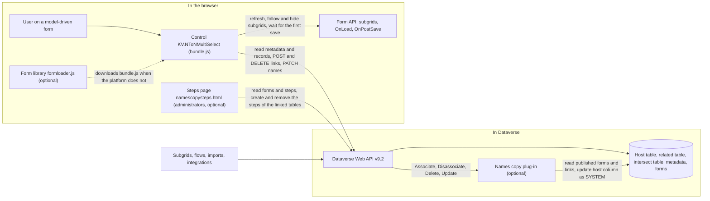

What each arrow means:

* **User → control.** The form creates the control and passes it the settings typed in the form designer. Every pick
  is saved at once.
* **Control → Web API.** The control talks to the **Dataverse Web API** (the REST/OData interface of Dataverse at
  `<environment URL>/api/data/v9.2`) with the browser's `fetch`, in the user's own session. It reads the relationship's
  metadata, the saved links and the list of records that can be picked. It makes links with `POST .../$ref` and
  removes them with `DELETE .../$ref`. With *Copy names into the host column* = Yes, it writes the names with a `PATCH`
  of the record. The PCF `webAPI` object has no associate or disassociate operations, which is why the control calls
  the Web API directly (see 4.6).
* **Control → form API.** The control uses the model-driven form API (`Xrm.Page`) to refresh related subgrids, to
  follow changes made in them (their `OnLoad` event), to hide them, and to wait for the first save of a new record
  (`OnPostSave`). See 4.9.
* **Form library → control.** Only where the platform does not download `bundle.js` itself. See chapter 7.
* **Web API → plug-in.** Every link made or removed anywhere (the control, subgrids, the other side of the
  relationship, flows, imports, integrations) goes through the **Associate** or **Disassociate** message. Dataverse
  runs the plug-in's link steps for these messages and, where the steps page created them for a linked table, its
  steps for **Delete** (a record of that table is deleted) and **Update** (a record of that table is renamed).
* **Plug-in → tables.** The plug-in reads the settings of the published forms, reads the links and writes the host
  column, as the SYSTEM user.
* **Steps page → Web API.** An administrator opens the steps page at the environment's address. With that user's
  session, it reads the forms and the plug-in's steps, and creates or removes the Delete and Update steps of the linked
  tables (8.17).

### 1.4 What runs where

| Piece | Runs in | Talks to | Runs as |
| --- | --- | --- | --- |
| Control | The user's browser, inside the model-driven app | Web API (same origin), form API | The signed-in user, with that user's privileges |
| Form library | The user's browser (form script) | `<environment URL>/webresources/cc_KV.NToNMultiSelect/bundle.js` | The signed-in user |
| Names copy plug-in | The Dataverse **sandbox** (an isolated process on the server that runs custom plug-ins) | The organization service inside Dataverse | SYSTEM |
| Steps page | The administrator's browser, at `<environment URL>/WebResources/kv_/NToNMultiSelect/namescopysteps.html` | Web API (same origin) | The signed-in user, with that user's privileges |

### 1.5 Repository tour

Every folder and file of the repository, with one line each. In the Markdown version on GitHub, the paths are links to the files. Folders and files
marked *not committed* are created by the build and ignored by Git (see [`.gitignore`](../.gitignore)), so they only
appear once you build.

| Path | What it is |
| --- | --- |
| [`.gitignore`](../.gitignore) | Files Git ignores: `node_modules/`, `out/`, `obj/`, `bin/`, `**/generated/`, `*.binlog`, `.vs/`, `dist/`, `solution-with-plugin/`, the plug-in's private key `plugin/NamesCopy/NamesCopy.snk`, the lock files of open Office documents (`~$*`) and operating system files |
| [`LICENSE`](../LICENSE) | The MIT license |
| [`README.md`](../README.md) | The user and administrator documentation: features, install, settings, messages, troubleshooting |
| **[`control/`](../control/)** | **The PCF project of the control** |
| [`control/.gitignore`](../control/.gitignore) | Ignore rules of the PCF project |
| [`control/control.pcfproj`](../control/control.pcfproj) | MSBuild project of the control. The solution project references it so that `dotnet build` packages the control |
| [`control/package.json`](../control/package.json) | npm scripts (`build`, `lint`, `refreshTypes`, `start` ...) and development dependencies (`pcf-scripts`, TypeScript, ESLint) |
| [`control/package-lock.json`](../control/package-lock.json) | Exact versions of every npm package, used by `npm ci` |
| [`control/pcfconfig.json`](../control/pcfconfig.json) | PCF build setting: the output folder `./out/controls` |
| [`control/tsconfig.json`](../control/tsconfig.json) | TypeScript settings (extends the PCF base configuration) |
| [`control/eslint.config.mjs`](../control/eslint.config.mjs) | ESLint rules, including the Power Apps rules (`@microsoft/eslint-plugin-power-apps`) |
| [`control/NToNMultiSelect/ControlManifest.Input.xml`](../control/NToNMultiSelect/ControlManifest.Input.xml) | **The manifest**: the control's namespace, name, version and every setting shown in the form designer |
| [`control/NToNMultiSelect/index.ts`](../control/NToNMultiSelect/index.ts) | **The controller**: the class the form creates. Reads the settings, loads data, saves picks, handles new records, writes the names copy |
| [`control/NToNMultiSelect/src/view.ts`](../control/NToNMultiSelect/src/view.ts) | Draws the field, the chips and the list with plain DOM; all mouse and keyboard handling |
| [`control/NToNMultiSelect/src/styles.ts`](../control/NToNMultiSelect/src/styles.ts) | The CSS (injected once per page) and the icon code points of the native look |
| [`control/NToNMultiSelect/src/syncEngine.ts`](../control/NToNMultiSelect/src/syncEngine.ts) | Turns picks into associate and disassociate requests, at most 4 at a time, with rollback on failure |
| [`control/NToNMultiSelect/src/relatedData.ts`](../control/NToNMultiSelect/src/relatedData.ts) | Web API calls that read the list and the links, make and remove links, and update the host column; builds the link tag |
| [`control/NToNMultiSelect/src/fetchQuery.ts`](../control/NToNMultiSelect/src/fetchQuery.ts) | Builds the list's FetchXML from *Records from view* and *FetchXML filter*; FetchXML paging |
| [`control/NToNMultiSelect/src/metadata.ts`](../control/NToNMultiSelect/src/metadata.ts) | Finds the tables, columns and navigation property of the relationship, and the system views; caches them for the page |
| [`control/NToNMultiSelect/src/formBridge.ts`](../control/NToNMultiSelect/src/formBridge.ts) | Form integration: subgrid refresh, follow and hide; the first save of a new record |
| [`control/NToNMultiSelect/src/namesCopy.ts`](../control/NToNMultiSelect/src/namesCopy.ts) | *Copy names into the host column*: the text and the ordered updates of the record |
| [`control/NToNMultiSelect/src/dataverse.ts`](../control/NToNMultiSelect/src/dataverse.ts) | A small Web API client (timeouts, retries, throttling) and the error messages for users |
| [`control/NToNMultiSelect/src/strings.ts`](../control/NToNMultiSelect/src/strings.ts) | Every text the control shows, in English and French |
| [`control/NToNMultiSelect/src/types.ts`](../control/NToNMultiSelect/src/types.ts) | Shared types (`Item`, `RelationshipInfo`) and helpers (id normalisation, name sorting) |
| `control/NToNMultiSelect/generated/` | *Not committed.* `ManifestTypes.d.ts`, the TypeScript types of the settings, written from the manifest by the build |
| `control/out/` | *Not committed.* The built control: `bundle.js` and `ControlManifest.xml` |
| `control/obj/` | *Not committed.* Intermediate files of `dotnet build` for the control project |
| `control/node_modules/` | *Not committed.* npm packages installed by `npm ci` |
| **[`formloader/`](../formloader/)** | **The optional form library** |
| [`formloader/formloader.js`](../formloader/formloader.js) | Source of the web resource `kv_/NToNMultiSelect/formloader.js` (the build stamps the version into a copy) |
| **[`solution/`](../solution/)** | **The solution project** (packages the solution without the plug-in) |
| [`solution/.gitignore`](../solution/.gitignore) | Ignore rules of the solution project |
| [`solution/solution.cdsproj`](../solution/solution.cdsproj) | MSBuild project that packs `src/` into managed and unmanaged zips and references the control project |
| [`solution/src/Other/Solution.xml`](../solution/src/Other/Solution.xml) | Solution unique name, display name, description, version, publisher and root components |
| [`solution/src/Other/Customizations.xml`](../solution/src/Other/Customizations.xml) | The (empty) customizations of the solution, language 1033 |
| [`solution/src/Other/Relationships.xml`](../solution/src/Other/Relationships.xml) | Empty: the solution adds no relationships |
| [`solution/src/WebResources/kv_NToNMultiSelectformloaderjs078EAC10-CCC9-489A-8EEB-8FA3FEECD8F8`](../solution/src/WebResources/kv_NToNMultiSelectformloaderjs078EAC10-CCC9-489A-8EEB-8FA3FEECD8F8) | The form library as it goes into the package (written by `scripts/build.mjs`) |
| [`solution/src/WebResources/kv_NToNMultiSelectformloaderjs078EAC10-CCC9-489A-8EEB-8FA3FEECD8F8.data.xml`](../solution/src/WebResources/kv_NToNMultiSelectformloaderjs078EAC10-CCC9-489A-8EEB-8FA3FEECD8F8.data.xml) | The web resource's name, display name, description and type |
| `solution/bin/`, `solution/obj/` | *Not committed.* Build output of the solution project; `solution/bin/Release` holds the two packages before `build.mjs` copies them to `dist/` |
| **[`plugin/`](../plugin/)** | **The names copy plug-in** |
| [`plugin/NamesCopy/NamesCopy.csproj`](../plugin/NamesCopy/NamesCopy.csproj) | The plug-in project: .NET Framework 4.6.2, assembly `NToNMultiSelect.NamesCopy`, version 1.0.0.0, signed |
| `plugin/NamesCopy/NamesCopy.snk` | *Not committed.* The strong-name key the assembly is signed with: private, created by the first run of `scripts/build-with-plugin.mjs` and used by every later build. Keep it (9.4) |
| [`plugin/NamesCopy/NamesCopyPlugin.cs`](../plugin/NamesCopy/NamesCopyPlugin.cs) | The plug-in: the entry point of every step (Associate, Disassociate, Delete, Update), caches, copy plans, the tag check, rebuilds, the Delete steps and the Update step |
| [`plugin/NamesCopy/NamesCopyHelpers.cs`](../plugin/NamesCopy/NamesCopyHelpers.cs) | The parts that need no Dataverse: reading form XML, sorting names, the names text |
| [`plugin/registration/PluginAssemblies/NToNMultiSelectNamesCopy-02116F62-39C3-F111-B377-7CED8DA4E57C/NToNMultiSelectNamesCopy.dll.data.xml`](../plugin/registration/PluginAssemblies/NToNMultiSelectNamesCopy-02116F62-39C3-F111-B377-7CED8DA4E57C/NToNMultiSelectNamesCopy.dll.data.xml) | Registration of the assembly and its plug-in type (ids, friendly name, sandbox isolation) |
| [`plugin/registration/SdkMessageProcessingSteps/{05116f62-39c3-f111-b377-7ced8da4e57c}.xml`](../plugin/registration/SdkMessageProcessingSteps/%7B05116f62-39c3-f111-b377-7ced8da4e57c%7D.xml) | Step *N:N Multi-Select names copy: Associate* |
| [`plugin/registration/SdkMessageProcessingSteps/{07116f62-39c3-f111-b377-7ced8da4e57c}.xml`](../plugin/registration/SdkMessageProcessingSteps/%7B07116f62-39c3-f111-b377-7ced8da4e57c%7D.xml) | Step *N:N Multi-Select names copy: Disassociate*. There are no other step files: the Delete and Update steps are created in the environment by the steps page |
| [`plugin/steps-page/namescopysteps.html`](../plugin/steps-page/namescopysteps.html) | The steps page (8.17): the source of the web resource `kv_/NToNMultiSelect/namescopysteps.html` of the solution with the plug-in, one HTML file with its style and script. The build writes the web resource name into its copy |
| `plugin/NamesCopy/bin/`, `plugin/NamesCopy/obj/` | *Not committed.* Build output of the plug-in |
| **[`scripts/`](../scripts/)** | **Build scripts** (Node.js) |
| [`scripts/build.mjs`](../scripts/build.mjs) | Builds the control and the solution without the plug-in |
| [`scripts/build-with-plugin.mjs`](../scripts/build-with-plugin.mjs) | Builds the plug-in (creating its strong-name key at the first run) and the solution with the plug-in: the control and the form library, the plug-in with its Associate and Disassociate steps, and the steps page |
| `solution-with-plugin/` | *Not committed.* The solution project of `NToNMultiSelectWithPlugin`, which `build-with-plugin.mjs` creates again on every run |
| **[`docs/`](./)** | **Documentation** |
| [`docs/NToNMultiSelect - Technical Reference.docx`](NToNMultiSelect%20-%20Technical%20Reference.docx) | The Technical Reference: the administrator's guide in Word format |
| [`docs/NToNMultiSelect - Developer Guide.docx`](NToNMultiSelect%20-%20Developer%20Guide.docx) | This guide as a Word document (the same content) |
| `docs/developer-guide.md` | This guide |
| [`docs/images/`](images/) | Screenshots used by the README and this guide |
| [`docs/gallery/`](gallery/) | The demo as GIF and MP4, and a thumbnail |
| `dist/` | *Not committed.* The built packages; attached to each release |

---

## 2. Getting set up

This chapter takes you from an empty computer to a working build and a development loop.

### 2.1 Tools

| Tool | Version | What it is used for |
| --- | --- | --- |
| **Node.js** | 22 (LTS) or later | npm, the PCF build (`pcf-scripts`) and the two build scripts |
| **.NET SDK** | 6 or later | `dotnet build`: packs the solutions and builds the plug-in. The Power Apps build packages, the Dataverse SDK assemblies (`Microsoft.CrmSdk.CoreAssemblies`) and the .NET Framework 4.6.2 reference assemblies are downloaded from NuGet by the first build |
| **Git** | Any recent version | Getting the code and keeping track of your changes |
| **An editor** | Visual Studio Code is a good choice for TypeScript; Visual Studio or Visual Studio Code with the C# extension for the plug-in | Editing |
| **A browser** | Microsoft Edge or Google Chrome | Testing, with the developer tools (F12) |
| **Power Platform CLI** (`pac`) | Optional | Opening the Plugin Registration Tool (`pac tool prt`) and unpacking exported solutions (`pac solution unpack`). Not needed to build |
| **A development environment** | A Dataverse environment where you are System Administrator or System Customizer | Importing and testing your build |

The repository's `package.json` does not pin a Node.js version, but some of the locked build packages ask for Node.js
22, and `npm ci` warns about them with an older version. Visual Studio and the .NET Framework developer pack are not
needed.

**Other operating systems.** The build scripts call only Node.js and `dotnet`, and the .NET Framework reference
assemblies come from NuGet, so the plug-in builds on any operating system the .NET SDK supports. The steps in this
guide were checked on Windows only. A few snippets use Windows tools; the guide gives another way where they appear (a
new id in 10.1, checksums in 13.3). The plug-in's strong-name key needs no Windows tool: `scripts/build-with-plugin.mjs`
creates it with Node.js at its first run (9.4).

**Where the projects come from.** The control project has the layout that `pac pcf init` creates, and the solution
project the layout of `pac solution init`. You do not need either command: both projects are in the repository. To
move to newer build tools:

* **npm packages.** `pcf-scripts` and `pcf-start` are allowed as `^1` in `control/package.json`, and `npm ci` installs
  the versions in `package-lock.json`. To update them, run this in `control/`, then build, run the checks (2.5), test
  (chapter 11) and commit `package.json` and `package-lock.json`:
  `npm install pcf-scripts@latest pcf-start@latest --save-dev`.
* **NuGet packages.** `Microsoft.PowerApps.MSBuild.Pcf` (in `control/control.pcfproj`) and
  `Microsoft.PowerApps.MSBuild.Solution` (in `solution/solution.cdsproj`) are referenced as `1.*`, and
  `Microsoft.CrmSdk.CoreAssemblies` (in `plugin/NamesCopy/NamesCopy.csproj`) as `9.0.2.*`. A fresh restore takes the
  newest matching version, so you get updates without a change. Write an exact version in the project file when you
  need builds that do not change from one day to the next.

### 2.2 Get the code

```powershell
git clone https://github.com/<owner>/<repository>.git
cd <repository>
```

Replace `<owner>/<repository>` with the address of the repository (or of your fork).

**On Windows, clone into a short folder**, for example `C:\src\NToNMultiSelect`: the folder path must stay under about
100 characters. The build creates files with long paths below the repository folder (the plug-in registration files
in the project `solution-with-plugin/`, 9.3). In a deeper folder the full path passes the 260-character Windows
limit, and `dotnet build` stops with MSB3030 "Could not copy the file ... because it was not found", although the file
exists.
Git can also stop with "Filename too long" for files under `plugin/registration/`.

### 2.3 Install the npm packages

```powershell
cd control
npm ci
cd ..
```

`npm ci` installs exactly the versions listed in `control/package-lock.json` into `control/node_modules`. Use it
rather than `npm install`, which may pick newer versions.

`npm ci` may print deprecation warnings and an audit summary about the build tools (development packages; none of
them goes into the bundle). Do not run `npm audit fix --force`: it rewrites `package-lock.json` with other versions.

### 2.4 Build

Both scripts find the repository from their own location, so you can run them from any folder.

```powershell
node scripts/build.mjs
node scripts/build-with-plugin.mjs
```

| Command | What it does | What it produces |
| --- | --- | --- |
| `npm run build` (in `control/`) | A development build of the control | `control/out/controls/NToNMultiSelect/bundle.js` and `ControlManifest.xml`, and `control/NToNMultiSelect/generated/ManifestTypes.d.ts` |
| `node scripts/build.mjs` | The release build of the control and the solution without the plug-in (section 9.2) | `dist/NToNMultiSelect_unmanaged.zip` and `dist/NToNMultiSelect_managed.zip`. It also rewrites two committed files: the version in `solution/src/Other/Solution.xml` and the form library copy in `solution/src/WebResources/` |
| `node scripts/build-with-plugin.mjs` | Builds the control's production bundle, the plug-in and the solution with the plug-in (section 9.3). Run `build.mjs` first: the version and the form library copy that both solutions take are written by it | At the first run, the strong-name key `plugin/NamesCopy/NamesCopy.snk` (keep it, 9.4); `plugin/NamesCopy/bin/Release/net462/NToNMultiSelect.NamesCopy.dll`, the solution project `solution-with-plugin/` (created again on every run), and `dist/NToNMultiSelectWithPlugin_unmanaged.zip` and `dist/NToNMultiSelectWithPlugin_managed.zip` |

The two scripts together write four zips: two for each of the two solutions. A zip in `dist/` is replaced only when
its package was built. After a failure the zips not yet written are still those of the previous build, so check that
the script ended with all its "Wrote dist/..." lines before you import a package.

### 2.5 Checks before you commit

```powershell
cd control
npm run refreshTypes
npx tsc --noEmit
npm run lint
cd ..
```

* `npm run refreshTypes` writes `control/NToNMultiSelect/generated/ManifestTypes.d.ts` from the manifest. The type
  check needs it, and the `generated` folder is not committed, so run it first in a fresh clone.
* `npx tsc --noEmit` checks the TypeScript types without writing files.
* `npm run lint` runs ESLint with the Power Apps rules.

Only `npm ci` and the build scripts are needed to build; these checks catch mistakes early.

### 2.6 Prepare a development environment

You need:

1. A Dataverse environment for development (never test unfinished code in production).
2. A security role that can import solutions and customize forms: **System Administrator** or **System Customizer**.
3. Two tables with a many-to-many relationship, for example *Project* and *Skill* with the relationship
   `new_project_skill`. Records in both tables.
4. A text column on the form's table that is **not** Business Required, for example *Project skills*
   (`new_projectskills`), 4,000 characters long if you will test *Copy names into the host column*.

**The privileges users need** (useful when you set up test users): Read on both tables; Append and Append To to link
records; Create on the related table for *+ New*; Write on the record for *Copy names into the host column*; and, when
column security secures the host column, Update on that column (without it the control is read-only, 5.9.2). The names
copy plug-in needs no privileges from the users: it writes as SYSTEM (8.14).

### 2.7 Import into the development environment

Use the **unmanaged** package in a development environment. Its components can be changed and removed.

1. Go to [make.powerapps.com](https://make.powerapps.com) and select the development environment.
2. **Solutions** → **Import solution** → **Browse** → select `dist/NToNMultiSelect_unmanaged.zip` (or
   `dist/NToNMultiSelectWithPlugin_unmanaged.zip` to work on the plug-in or the steps page; create the Delete and
   Update steps of your linked tables with the steps page, recipe 10.8) → **Next** → **Import**.
3. When the import has finished, select **Publish all customizations**.
4. Add the control to a form as the README describes in
   [Add the control to a form](../README.md#add-the-control-to-a-form), then **Save and publish** the form.

The README shows each step of the import with screenshots: [Import the solution](../README.md#import-the-solution).

### 2.8 The development loop

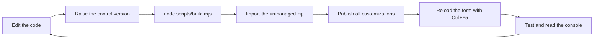

1. **Edit** the code in `control/` (or `plugin/`, `formloader/`).
2. **Raise the control version** in `control/NToNMultiSelect/ControlManifest.Input.xml` (see 2.9). Skip this step
   when you only changed the plug-in.
3. **Build**: `node scripts/build.mjs`. If you work on the plug-in or use a solution with the plug-in, also run
   `node scripts/build-with-plugin.mjs`.
4. **Import** the unmanaged zip you use in the development environment.
5. **Publish all customizations.**
6. **Reload** the app with **Ctrl+F5**. If the old behaviour still shows, the browser kept the old bundle: press F12 →
   **Application** → **Storage** → **Clear site data** (this signs you out of that site), then reload.
7. **Test** (chapter 11) and watch the browser console (chapter 12).

To check which bundle the page runs, open the developer tools, **Network** tab, and look for `bundle.js`; or search the
**Sources** tab for a text you just changed.

**Plug-in only.** Dataverse replaces the plug-in assembly and steps with every import, so a plug-in change needs no
version change. A faster way during development is the Plugin Registration Tool: select the assembly, **Update**, and
pick the new `NToNMultiSelect.NamesCopy.dll` (see 12.5).

**Faster ways to try a change of the control.**

* **Serve the bundle from your computer.** A tool that redirects web requests (for example the AutoResponder of
  Fiddler, or the Requestly browser extension) can answer the page's request for `cc_KV.NToNMultiSelect/bundle.js`
  with your local `control/out/controls/NToNMultiSelect/bundle.js`. Run `npm run build` in `control/` and reload the
  form: no import and no version change. This development build is not minified, so the **Sources** tab shows readable
  code. It only replaces the code: a change to the manifest (a new setting) still needs an import.
* **`pac pcf push`.** `pac pcf push --publisher-prefix kv` (Power Platform CLI, signed in to the development
  environment with `pac auth create`) builds the control and imports it in a temporary solution of its own, without
  the form library and the plug-in. Use it only in a development environment, and check in the **Sources** tab that
  the new code runs.

**Versions raised only for testing.** Raise the version as often as you need while you test; those raises do not need
to be committed. Before you commit, set `version` to the version you will release and run `node scripts/build.mjs`
again, so that `Solution.xml` and the web resource copy carry it too (13.2). Where a test build with a higher version
is installed, remove that copy before you import the release (2.9).

**Why not the PCF test harness?** `npm start` opens the control in a local test page. That page has no Dataverse
behind it, so the control cannot read its relationship. Test in a development environment instead.

### 2.9 The same-version rule

> Dataverse does not replace a code component when a solution with the **same control version** is imported. The old
> `bundle.js` stays in place, and your change seems to have no effect.

You have two ways around it:

* **Raise the control version** for every import (the usual way). Change `version` on the `<control>` element of the
  manifest, for example by raising its third number by one. `scripts/build.mjs` stamps the same number into the
  solution (with `.0` added, as `1.0.0` became `1.0.0.0`) and into the form library, so there is one place to
  change.
* **Remove and re-add the control.** Note each form's settings, remove the control from the forms, delete the
  component from the environment, import, add the control to the forms again, then save and publish them. This is the
  way to replace a copy that has the same version, for example a build of 1.0.0 over an installed 1.0.0
  (see 13.5).

---

## 3. PCF basics as used in this control

This chapter explains the parts of the Power Apps component framework (PCF) that the control uses, and shows where
each one appears in the code. If you have built a PCF control before, you can skim 3.1 and read the rest for the
details that are specific to this control.

### 3.1 The terms used in this guide

Chapter 1 explained the N:N relationship, the intersect table, associating and disassociating, code components, web
resources, plug-ins and the host column. The control's code also uses the terms below. [Appendix B](#b1-glossary)
lists every term in one glossary.

| Term | Meaning |
| --- | --- |
| **Dataverse** | The database behind model-driven apps. It stores data in **tables** (also called entities), each with **columns** (attributes) and **rows** (records). |
| **Model-driven app** | A Power Apps app built on Dataverse. Its forms, views and navigation are built from table metadata. |
| **Form** | The page that shows one record. Each column on the form is shown by a **control**. |
| **Manifest** | The XML file that describes a code component: its name, its version and the settings the form designer shows (3.2). |
| **Field control** | A code component that is placed on one column of a form. This control is a field control (`control-type="standard"`). |
| **Navigation property** | The name the Web API uses to reach the related rows of a record, for example `new_projects(<id>)/new_project_skill`. |
| **Web API** | Dataverse's REST API at `<environment URL>/api/data/v9.2/`, based on the **OData** standard (query options such as `$select`, `$filter`, `$orderby`). |
| **FetchXML** | Dataverse's XML query language. System views store their query as FetchXML. |
| **Subgrid** | A list of related records shown on a form, for example the skills of a project. |
| **Quick create** | A small form that opens in a side panel to create a record without leaving the current one. |
| **Solution** | The package that carries customizations from one environment to another (1.2). |
| **Xrm** | The global client API object of model-driven apps (`window.Xrm`). It gives access to the form, its subgrids and its save events. |

### 3.2 The manifest: `ControlManifest.Input.xml`

The manifest is the contract between the control and the platform. The form designer reads it to show the control's
settings, and the platform reads it to know which file to load and which values to pass.

#### 3.2.1 The control element

`control/NToNMultiSelect/ControlManifest.Input.xml`, the `control` element (about lines 13–15):

```xml
<control namespace="KV" constructor="NToNMultiSelect" version="1.0.0" display-name-key="N:N Multi-Select" description-key="Edits a many-to-many (N:N) relationship with a control that looks and behaves like the native multi-select choice field. Each selection is saved immediately, and related subgrids on the form refresh automatically." control-type="standard">
  <external-service-usage enabled="false">
  </external-service-usage>
```

| Attribute | Value | Why |
| --- | --- | --- |
| `namespace` + `constructor` | `KV` + `NToNMultiSelect` | Together they form the control name `KV.NToNMultiSelect`. The class exported from `index.ts` must have the name given in `constructor`. When the solution is packaged, the publisher prefix is added in front: the solution component is named `kv_KV.NToNMultiSelect`. |
| `version` | `1.0.0` | The control version. `scripts/build.mjs` copies it into the solution version (`1.0.0.0`) and into the form library. Dataverse keeps an installed code component when a solution with the same control version is imported (see 3.8). |
| `display-name-key`, `description-key` | literal English text | The control has no `.resx` resource files, so the platform shows these keys as they are. |
| `control-type` | `standard` | The control renders its own HTML into a `<div>` the platform gives it. (The other type, `virtual`, is for controls that render with the platform's own React and Fluent UI libraries.) |
| `external-service-usage enabled="false"` | | Declares that the control calls no external service. It only talks to the Dataverse environment it runs in. |

#### 3.2.2 The host column (the bound property)

`control/NToNMultiSelect/ControlManifest.Input.xml`, the type group and the `value` property (about lines 17–23):

```xml
<type-group name="text">
  <type>SingleLine.Text</type>
  <type>SingleLine.TextArea</type>
  <type>Multiple</type>
</type-group>

<property name="value" display-name-key="Host column" description-key="Any text column on the form that is not business required. The control uses it only as an anchor and never sets its value on the form, so a required column would block saving. To store the selected names in this column, turn on Copy names into the host column. When column security secures this column, users who are not allowed to update it see the control read-only, as they would see the column." of-type-group="text" usage="bound" required="true" />
```

`usage="bound"` means the property is connected to a column of the form: the column the maker places the control on.
The type group lists the column types that are allowed: single line of text, text area and multiple lines of text.

**Why a text column and not the relationship itself?** PCF field controls must be bound to a column. A many-to-many
relationship is not a column, so the control needs some column to sit on. Any text column works, and the control never
puts a value into it on the form (see `getOutputs` in 3.4). That is why the description says the column must not be
business required: a required column that is always empty would block every save.

#### 3.2.3 The input properties (the settings)

All other properties are `usage="input"`: settings the maker fills in when adding the control to a form. The table
lists every property in the order of the manifest. Appendix A.1 repeats them with their display names.

| Property | Type | Usage | Required | Default | What the control does with it |
| --- | --- | --- | --- | --- | --- |
| `value` | text type group | bound | yes | – | The host column (see 3.2.2). |
| `relationshipName` | `SingleLine.Text` | input | yes | – | Schema name of the N:N relationship. Not case-sensitive. |
| `filter` | `SingleLine.Text` | input | no | empty | Extra OData filter for the list. |
| `view` | `SingleLine.Text` | input | no | empty | Name or id of a system view of the related table. |
| `fetchXml` | `Multiple` | input | no | empty | A complete FetchXML query, or `<filter>` and `<link-entity>` elements. |
| `showInactive` | `Enum` (0 No, 1 Yes) | input | no | `0` (No) | Also offer inactive records. |
| `showSelectAll` | `Enum` (0 No, 1 Yes) | input | no | `1` (Yes) | Show the *Select all* row. |
| `selectAllLimit` | `Whole.None` | input | no | none in the manifest; the code uses 100 | *Select all* is offered only up to this many rows. 0 means 500; values above 500 count as 500. |
| `maxSelections` | `Whole.None` | input | no | none in the manifest; the code uses 0 (no limit) | Maximum number of selected records. |
| `subgrids` | `SingleLine.Text` | input | no | empty (all subgrids of the relationship) | Comma-separated subgrid names to keep in sync, or `none`. |
| `hideSubgrids` | `Enum` (0 No, 1 Yes) | input | no | `0` (No) | Hide the related subgrids. |
| `placeholder` | `SingleLine.Text` | input | no | empty ("Select or search options") | Text in the empty search box. |
| `writeSummary` | `Enum` (0 No, 1 Yes) | input | no | `0` (No) | *Copy names into the host column*. |
| `searchMode` | `Enum` (0 Starts with, 1 Contains) | input | no | `0` (Starts with) | How the server search matches names on large tables. |
| `openOnClick` | `Enum` (0 No, 1 Yes) | input | no | `0` (No) | Open the list on any click in the box. |
| `openRecords` | `Enum` (0 No, 1 Yes) | input | no | `0` (No) | Selected values are links that open the records. |
| `allowCreate` | `Enum` (0 No, 1 Yes) | input | no | `0` (No) | Show the *+ New* button (quick create). |

The Yes/No settings are `Enum` properties with the values `0` (*No*) and `1` (*Yes*). They arrive as the strings `"0"`
and `"1"` (see 3.3).

**Why `Enum` and not `TwoOptions`?** An `Enum` property defines its own options (*No*, *Yes*) and its default in the
manifest, and the form designer shows them as a drop-down list that needs no column. The form stores the chosen value
(`0` or `1`), and the names copy plug-in reads exactly that value for *Copy names into the host column* (8.5). Forms
that already use the control store these values, so keep `Enum` for new Yes/No settings too.


*The settings panel the form designer shows when the control is added to a column. The platform builds it from the
manifest: each `display-name-key` becomes a label, each `Enum` property a drop-down list, and the single line of text
properties offer **Bind to table column** next to the static value.*

#### 3.2.4 Resources

`control/NToNMultiSelect/ControlManifest.Input.xml`, the `resources` element (about lines 82–84):

```xml
<resources>
  <code path="index.ts" order="1" />
</resources>
```

The control declares only its code. There is no CSS file and no `.resx` language file:

* The **CSS** is injected by the code itself (see 3.6).
* The **texts** are in `src/strings.ts` (see 4.11).

The reason is the same for both: some environments deliver code components to the form **without their resources**.
In such an environment a CSS or `.resx` resource would never arrive, and the control would look broken. Keeping
everything inside `bundle.js` means that once the bundle runs (delivered by the platform or by the form library in
chapter 7), the control is complete.

#### 3.2.5 Rules for manifest texts

Dataverse rejects an apostrophe (`'`) in `display-name-key` and `description-key` when the solution is imported. The PCF
build tools do not check this, so `scripts/build.mjs` does, before it builds anything (step 0 in 9.2 shows the check).
When you write a new description, write "does not" instead of "doesn't".

### 3.3 How the platform passes values

The platform passes all values in `context.parameters`, one entry per manifest property. Each entry has a `raw` value.
The PCF build tools write TypeScript types for them, from the manifest, into `generated/ManifestTypes.d.ts` (run
`npm run refreshTypes` after changing the manifest; the `generated` folder is not committed).

`control/NToNMultiSelect/generated/ManifestTypes.d.ts` (written by the build tools; shortened):

```ts
export interface IInputs {
    value: ComponentFramework.PropertyTypes.StringProperty;
    relationshipName: ComponentFramework.PropertyTypes.StringProperty;
    // ...
    showInactive: ComponentFramework.PropertyTypes.EnumProperty<"0" | "1">;
    // ...
    selectAllLimit: ComponentFramework.PropertyTypes.WholeNumberProperty;
    // ...
}
export interface IOutputs {
    value?: string;
}
```

What arrives in `raw`:

| Manifest type | `raw` value | Example |
| --- | --- | --- |
| `SingleLine.Text`, `Multiple` | a string, or `null` when empty | `"new_project_skill"` |
| `Enum` | the value of the chosen option as a **string** | `"0"` or `"1"` |
| `Whole.None` | a number, or `null` when empty | `100` |
| bound text column (`value`) | the column's current text, or `null` | `"API design; Automation"` |

The bound property carries more than its value. The control reads three extra parts of `context.parameters.value`:

| Part | Used for | Where |
| --- | --- | --- |
| `raw` | The host column text the form loaded with, so the names copy does not write the same text again. | `initialize` (`this.loadedCopy`) |
| `attributes.LogicalName`, `attributes.MaxLength`, `attributes.RequiredLevel` | The column the names are written to, its maximum length, and a console warning when it is required. | `startCopy`, `linkTag`, `orphanKey`, `warnAboutRequiredHost` |
| `security.editable` | Column security: `false` when the user may not update the column. The control is then read-only. | `columnLocked` |

All settings are read in one place, `readConfig`. Every read has a fallback, because a setting that was never filled in
arrives as `null` (or not at all).

`control/NToNMultiSelect/index.ts`, `readConfig` (about lines 437–461):

```ts
private readConfig(context: ComponentFramework.Context<IInputs>): Config {
    const p = context.parameters;
    return {
        relationshipName: (p.relationshipName?.raw ?? "").trim(),
        filter: (p.filter?.raw ?? "").trim(),
        // ...
        showInactive: String(p.showInactive?.raw ?? "0") === "1",
        subgrids: (p.subgrids?.raw ?? "")
            .split(/[,;]/)
            .map((s) => s.trim())
            .filter(Boolean),
        // ...
        showSelectAll: String(p.showSelectAll?.raw ?? "1") !== "0",
        // 0 means "as many as the list holds"; nothing above that is ever offered.
        selectAllLimit: Math.min(wholeNumber(p.selectAllLimit?.raw, DEFAULT_SELECT_ALL_LIMIT) || CLIENT_MODE_LIMIT, CLIENT_MODE_LIMIT),
        maxSelections: wholeNumber(p.maxSelections?.raw, 0),
        searchMode: String(p.searchMode?.raw ?? "0") === "1" ? "contains" : "startswith",
        // ...
    };
}
```

Notes:

* `String(raw ?? "0") === "1"` is used for every Yes/No setting, so an unexpected value counts as the default.
* `showSelectAll` is the only Yes/No setting whose default is **Yes**, so it is checked with `!== "0"`.
* `wholeNumber` turns an empty or invalid number into the default and a negative number into 0.
* The single line of text settings can also be **bound to a column** in the form designer (**Bind to table
  column**) instead of typed in. Their value can then change while the form is open. That is why `readConfig` runs on
  every `updateView` (see `applyConfig` in 4.2.2). The names copy plug-in ignores bound values (8.5).

### 3.4 The lifecycle

The platform creates one instance of the class for each place the control appears on a form (a copy of the field in the
form header is a second instance). It then calls four methods:

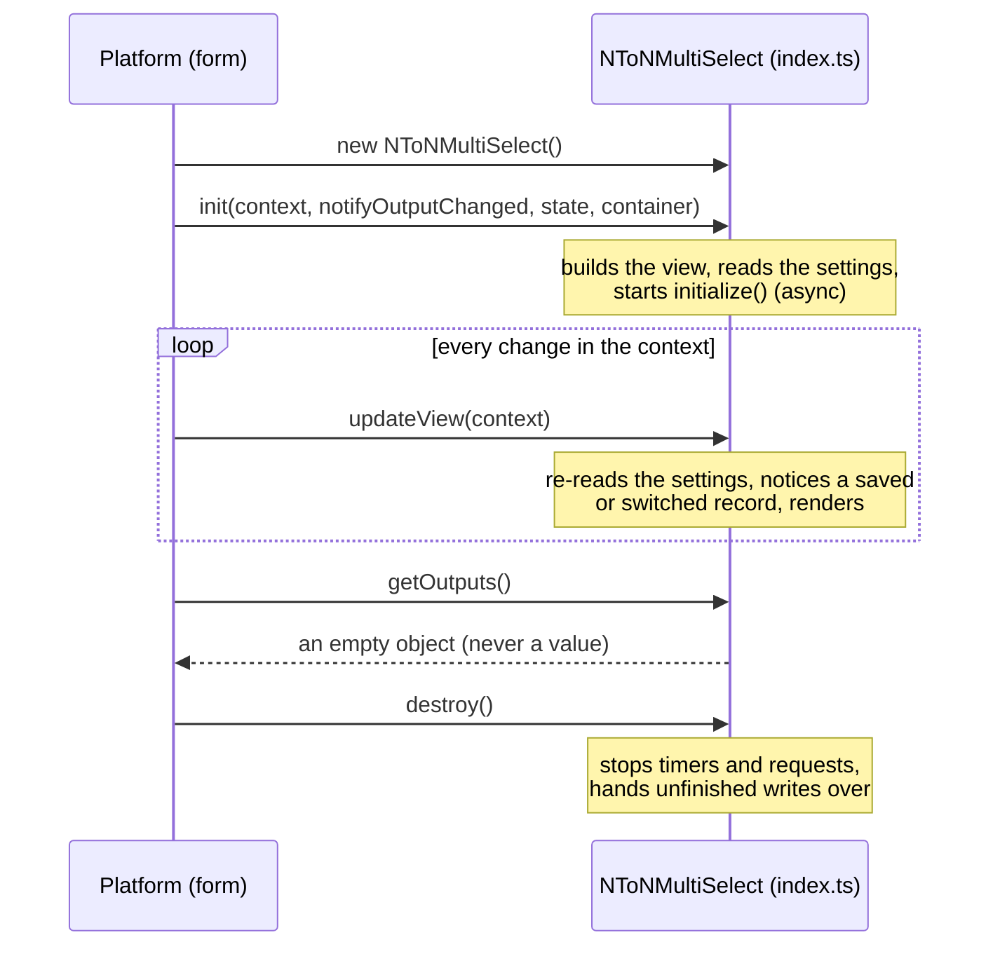

#### 3.4.1 `init`

`control/NToNMultiSelect/index.ts`, `init` (about lines 344–371):

```ts
public init(context: ComponentFramework.Context<IInputs>, _notifyOutputChanged: () => void, _state: ComponentFramework.Dictionary, container: HTMLDivElement): void {
    this.context = context;
    this.t = stringsFor(context.userSettings?.languageId);
    this.offline = isOffline(context);
    this.webClient = isWebClient(context);
    this.view = new MultiSelectView(
        container,
        {
            onToggle: (item, select) => this.onToggle([item], select),
            onToggleAll: (items, select) => this.onToggle(items, select),
            onSearch: (term) => this.onSearch(term),
            onOpen: () => void this.ensureOptions(),
            onLoadMore: () => void this.loadMore(),
            onDismissError: () => {
                this.error = null;
                this.render();
            },
            onCreate: () => void this.createRecord(),
            recordUrl: (item) => this.recordUrl(item),
            onOpenRecord: (item) => void this.openRecord(item),
        },
        this.t,
    );
    window.addEventListener("online", this.onOnline);
    liveControls.add(this);
    this.applyConfig(context);
    this.render();
}
```

What happens, in order:

1. The language is chosen from the user's Dynamics language (`userSettings.languageId`).
2. The view is created in the `container` the platform provides. The view gets **callbacks** instead of a reference to
   the controller: it can only report what the user did, never reach into the controller's state.
3. The control listens for the browser's `online` event, to try again after a connection loss.
4. `applyConfig` reads the settings. On the first call it always starts `initialize`, which is asynchronous (it reads
   metadata and the saved links, see 5.1). `init` itself returns at once.
5. The first `render` shows an empty, busy field until the data arrives.

`init` does not use `notifyOutputChanged` or `state` (hence the leading underscores). The control never reports a
value to the form, and it keeps no state between sessions.

#### 3.4.2 `updateView`

The platform calls `updateView` whenever something in the context changes: a property value, the form's read-only
state, the offline state, the label. The control uses it for three jobs.

`control/NToNMultiSelect/index.ts`, `updateView` (about lines 373–412, shortened):

```ts
public updateView(context: ComponentFramework.Context<IInputs>): void {
    this.context = context;
    this.offline = isOffline(context);
    this.applyConfig(context);
    const recordId = this.recordIdFrom(context);
    const engine = this.engine;
    if (engine && this.bridge && this.rel) {
        const current = engine.getRecordId();
        // ...
        if (!current && recordId) {
            // A new record got an id. Only a save of the followed form counts; anything else means the control
            // is now showing some other record, and picks made for the unsaved one must not end up there.
            if (this.bridge.savedAs(recordId)) {
                this.onRecordSaved(engine, this.bridge, recordId, this.rel.schemaName, this.data);
            } else {
                this.retireEngine(true);
                void this.initialize(context);
                return;
            }
        } else if (current && recordId !== current) {
            // The same control instance now shows a different record (or a new one): never carry state over.
            void this.initialize(context);
            return;
        }
    }
    // Grids can register after the control, so both are applied again on every update.
    const linkedRecordId = this.engine?.getRecordId() ?? null;
    this.applyHideSubgrids(linkedRecordId);
    this.bridge?.watchSubgrids(linkedRecordId, this.onSubgridLoad);
    this.render();
}
```

1. **Settings changed** (a setting bound to a column): `applyConfig` re-initialises when the relationship changed, or
   reloads only the list when a list setting changed.
2. **The record changed**: a new record that was just saved continues with its new id (see 5.6). An instance that now
   shows a different record starts over, because the platform can reuse one instance for another record.
3. **Subgrids appeared**: subgrids can register on the form after the control. Hiding and watching them is repeated on
   every update; both calls skip grids they already handled.

#### 3.4.3 `getOutputs`

`control/NToNMultiSelect/index.ts`, `getOutputs` (about lines 414–418):

```ts
public getOutputs(): IOutputs {
    // The host column is only an anchor, so the form never gets a value from this control and is never made
    // dirty by it. "Copy names into the host column" writes to the record itself (see updateSummary).
    return {};
}
```

**Why the control never outputs a value.** Each pick is saved to the server at once, as a link. If the control also
gave the form a value, the form would become "dirty" (unsaved), the user would be asked to save, and a required field
elsewhere on the form could block that save. Returning `{}` keeps the form clean. The names copy, when it is on, is
written with a separate update of the record (see 5.4), not through the form.

#### 3.4.4 `destroy`

`control/NToNMultiSelect/index.ts`, `destroy` (about lines 420–433):

```ts
public destroy(): void {
    this.destroyed = true;
    this.initToken++;
    clearTimeout(this.searchTimer);
    clearTimeout(this.resyncTimer);
    clearTimeout(this.loadRetryTimer);
    clearTimeout(this.initRetryTimer);
    clearTimeout(this.subgridTimer);
    this.searchAbort?.abort();
    window.removeEventListener("online", this.onOnline);
    liveControls.delete(this);
    this.view.destroy();
    this.retireEngine();
}
```

The platform calls `destroy` when the form closes, when the user moves to another record, or when a business rule
hides the field. Increasing `initToken` makes every asynchronous step that is still running drop its result (see the
token pattern in 4.2). `retireEngine` decides what happens to writes that are still queued: they are **not** cancelled
(see 5.8).

### 3.5 The context objects the control uses

| Member | Used in | What for |
| --- | --- | --- |
| `context.parameters` | `readConfig`, `initialize`, `startCopy`, `linkTag`, `columnLocked` | Settings, the host column value, its metadata and its column security (see 3.3). |
| `context.mode.isControlDisabled` | `readOnly` | The form or the field is read-only. |
| `context.mode.label` | `render`, `retireEngine`, `startCopy` | The field's label, for screen readers and messages. |
| `context.mode.contextInfo.entityTypeName`, `.entityId` | `initialize`, `recordIdFrom` | The table and the id of the record the control is on. `contextInfo` is not declared in the published PCF type definitions, so it is read through a cast. |
| `context.userSettings.languageId` | `init` | The user's language (English or French texts). |
| `context.client.isOffline()` | `isOffline` | Offline mode (read-only with a note). |
| `context.client.getClient()` | `isWebClient` | Browser, mobile app or Outlook: decides how *Open selected records* opens a record. |
| `context.navigation.openForm` | `createRecord`, `openRecord` | Quick create for *+ New*; opening a record inside the mobile app or Outlook. |
| `context.page.getClientUrl()`, `context.page.appId` | `clientUrl`, `recordPageBase` | The environment URL for Web API calls and the app id for record links. Read through a cast, with fallbacks. |
| `context.webAPI` | **not used** | See below. |

**Why `fetch` instead of `context.webAPI`.** The PCF `webAPI` object has no associate or disassociate operation, and
those are the control's main job. The control therefore has its own small Web API client (`src/dataverse.ts`) that
calls `window.fetch` with the user's own session (`credentials: "same-origin"`, no tokens). Having its own client also
lets it send the headers it needs (`Prefer` for page sizes and FetchXML paging annotations, `If-Match` for the names
copy), add the `tag` parameter to link requests, and apply one retry and throttling policy to every request.

The control also uses the global `Xrm` object in a few places, always defensively (each call is optional and guarded,
mostly with `try`/`catch`, so the control keeps working where `Xrm` is missing):

| Global API | Where | What for |
| --- | --- | --- |
| `Xrm.Page` (the page form) | `src/formBridge.ts` | Subgrids (refresh, hide, OnLoad), the save events of a new record. PCF gives a field control no access to other controls on the form. |
| `Xrm.App.addGlobalNotification` | `notifyApp` in `index.ts` | A message that stays visible after the form is gone (writes that failed after the record was closed). |
| `Xrm.Navigation.openAlertDialog` | `notifyApp` | Fallback when app notifications are not available. |
| `Xrm.Utility.getGlobalContext().getClientUrl()` / `.getCurrentAppUrl()` | `clientUrl`, `recordPageBase` | Fallbacks for the environment URL and the app address. |

### 3.6 How the CSS gets in: `styles.ts`

The whole style sheet is a string constant in `src/styles.ts`. The view calls `ensureStyles` in its constructor; the
first instance on the page adds a `<style>` element to the document head, and every later instance finds it by id and
does nothing.

`control/NToNMultiSelect/src/styles.ts`, `ensureStyles` (about lines 116–126):

```ts
const STYLE_ID = "ntnms-styles-v8";

export function ensureStyles(doc: Document = document): void {
    if (doc.getElementById(STYLE_ID)) {
        return;
    }
    const style = doc.createElement("style");
    style.id = STYLE_ID;
    style.textContent = CSS;
    (doc.head || doc.documentElement).appendChild(style);
}
```

* **Why not a CSS resource?** See 3.2.4: the resources may not be delivered, the bundle always is.
* **Why the version in the id (`-v8`)?** If a page ever holds two different builds of the control (for example, an old
  bundle still cached), each build adds its own style sheet instead of reusing the other's. When you change the CSS,
  change the id too.
* **Why the `ntnms` prefix on every class?** The control's HTML lives inside the model-driven app's page, next to the
  platform's own styles. A unique prefix keeps the two from affecting each other.

### 3.7 How the bundle is built and registered

1. `npm run build` (run by `scripts/build.mjs` in production mode) uses `pcf-scripts`, which compiles the TypeScript and
   bundles `index.ts` and everything it imports with webpack into one file, `control/out/controls/NToNMultiSelect/bundle.js`,
   next to the built `ControlManifest.xml`.
2. `pcf-scripts` appends a short footer to the bundle that registers the class with the platform.

   `control/out/controls/NToNMultiSelect/bundle.js` (output of the build; the end of the file):

   ```js
   if (window.ComponentFramework && window.ComponentFramework.registerControl) {
   	ComponentFramework.registerControl('KV.NToNMultiSelect', pcf_tools_652ac3f36e1e4bca82eb3c1dc44e6fad.NToNMultiSelect);
   } else {
   	var KV = KV || {};
   	KV.NToNMultiSelect = pcf_tools_652ac3f36e1e4bca82eb3c1dc44e6fad.NToNMultiSelect;
   	pcf_tools_652ac3f36e1e4bca82eb3c1dc44e6fad = undefined;
   }
   ```

3. The control registers itself as well, at the end of `index.ts`. This makes the constructor available as
   `window.KV.NToNMultiSelect` in every case, which is what the form library checks (chapter 7).

   `control/NToNMultiSelect/index.ts`, `registerGlobally` (about lines 1587–1599):

   ```ts
   (function registerGlobally(): void {
       const w = window as unknown as {
           KV?: Record<string, unknown>;
           ComponentFramework?: { registerControl?: (name: string, ctor: unknown) => void };
       };
       w.KV = w.KV || {};
       w.KV.NToNMultiSelect = NToNMultiSelect;
       try {
           w.ComponentFramework?.registerControl?.(CONTROL_NAME, NToNMultiSelect);
       } catch {
           // ignore – the default lookup above still works
       }
   })();
   ```

4. The solution project `solution/solution.cdsproj` references `control/control.pcfproj`. `dotnet build` therefore puts
   the control into the solution package as the component `kv_KV.NToNMultiSelect` (folder `Controls/kv_KV.NToNMultiSelect/`
   in the zip, with `bundle.js` and `ControlManifest.xml`).
5. In the browser, the form library requests the bundle from `<environment URL>/webresources/cc_KV.NToNMultiSelect/bundle.js`
   (see 7.2).

### 3.8 Changing the manifest safely

To add a setting, for example a Yes/No option:

1. Add a `<property>` to `ControlManifest.Input.xml`. Use `usage="input"`, `required="false"` and a `default-value`.
   Write the display name and description without apostrophes (3.2.5).
2. Run `npm run refreshTypes` in `control/`. This rewrites `generated/ManifestTypes.d.ts`, so `context.parameters`
   knows the new property.
3. Add a field to the `Config` interface in `index.ts` and read it in `readConfig` with a fallback, as the existing
   settings do.
4. If the setting changes what the list offers, add it to `optionsKey` in `applyConfig` (so a bound value that changes
   reloads the list) and to `optionsQuery`.
5. Pass it to the view through `ViewState` if the view needs it (see 4.3).
6. Build with `node scripts/build.mjs`. The script checks that every property of the source manifest made it into the
   built manifest, so a stale package is caught.
7. Raise `version` in the manifest before you import the build into an environment that already has the control.
   Dataverse keeps the old code component when the version is the same.

Recipe 10.4 walks through these steps with a complete example.

**Names that other parts depend on.** Do not rename these without changing the other side too:

| Name | Who else uses it |
| --- | --- |
| `constructor="NToNMultiSelect"`, `namespace="KV"` | `CONTROL_NAME` and the `window.KV.NToNMultiSelect` global set by `registerGlobally` in `index.ts`; `CONTROL`, `BUNDLE` and the global `KV.NToNMultiSelect` checked in `formloader/formloader.js`; the names copy plug-in finds forms with the control by the name ending `.NToNMultiSelect` (`ControlName`). |
| Properties `value`, `relationshipName`, `writeSummary` | The names copy plug-in reads these three from the published form definitions to know which relationships and host columns to keep up to date. It only uses values typed in the form designer, not values bound to a column. |
| The link tag prefix `NToNMultiSelect\|` (see 4.5) | The names copy plug-in recognises the control's own link requests by it. |

## 4. Control architecture

### 4.1 Module map

The control is one TypeScript class (`index.ts`) and eleven small modules in `src/`. No UI framework and no runtime
library is used: apart from the small wrapper webpack adds, the compiled bundle contains only this code.

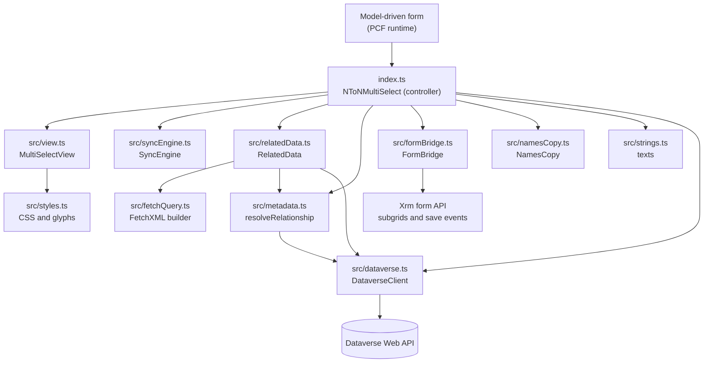

`src/types.ts` (shared types) is used by almost every module and is left out of the picture.

| Module | Responsibility | Knows about |
| --- | --- | --- |
| `index.ts` | Controller: settings, start-up, list state, feedback, new records, page-wide coordination | everything |
| `src/view.ts` | All HTML, mouse, keyboard, focus and screen reader behaviour | only `ViewState`, `ViewCallbacks`, texts and styles |
| `src/syncEngine.ts` | Turns "what the user picked" into associate and disassociate calls | an executor interface, no HTTP |
| `src/relatedData.ts` | Builds the Web API requests for one relationship | the relationship metadata and the Web API client |
| `src/dataverse.ts` | Sends requests: retries, timeouts, throttling, error wording | `fetch` and the texts |
| `src/fetchQuery.ts` | Builds the list's FetchXML from a view or the FetchXML setting | XML only |
| `src/metadata.ts` | Finds tables, columns, navigation properties and views from names | the Web API client |
| `src/formBridge.ts` | Talks to the surrounding form: subgrids, save events | `Xrm.Page` |
| `src/namesCopy.ts` | Keeps the host column copy of the names in order | a writer interface, no HTTP |
| `src/strings.ts` | Every text the user can see, in English and French | nothing |
| `src/styles.ts` | The CSS and the icon glyphs | nothing |
| `src/types.ts` | `Item`, `RelationshipInfo` and small helpers | nothing |

**Why it is split this way.** Each module has one job and gets what it needs from the controller, usually as an
interface. The view never sends a request; the sync engine never builds a URL; the names copy never knows how a value
is written. This keeps each part small enough to read in one sitting, and lets you change one part (for example the
look) without touching the parts that save data.

### 4.2 `index.ts`: the controller

**Purpose.** `index.ts` exports the class `NToNMultiSelect`, the class the platform creates (see 3.4). It reads the
settings, creates the other modules, keeps the state of the list (the records offered), turns events into actions, and
builds the `ViewState` the view draws. It also holds a few **page-wide** registries, shared by all instances of the
control on the page.

**Page-wide state** (module-level variables, shared by every instance on the page):

| Variable | Holds | Why it is page-wide |
| --- | --- | --- |
| `detached` | Engines whose control is gone but which still have writes to finish (`Detached`) | The writes must finish after the form closed (see 5.8). |
| `orphans` | Picks on an unsaved record left by an instance that was destroyed while the form stayed open (`Orphan`) | The next instance on the same form adopts them (see 5.6). |
| `liveEngines` | Every engine that may still write: the current ones and the detached ones | The "leave page?" guard checks them (see 5.8). |
| `copiesWriting` | Number of names copy requests on their way | Same guard. |
| `liveControls` | Every instance on the page | When one instance saves a change, the others that show the same record read their links again (`resyncPeers`). |

**Instance state** (fields of the class, grouped as in the source):

| Group | Fields | Notes |
| --- | --- | --- |
| Configuration | `config`, `relationshipKey`, `optionsKey`, `subgridsKey` | The keys detect which settings changed (see `applyConfig`). |
| Working parts | `rel`, `data`, `engine`, `bridge` | Created by `initialize` for one record. `hiddenGrids` is created once with the instance and handed to every bridge, so the grids it hid are remembered across restarts (5.5.3). |
| The list | `mode`, `allOptions`, `allOptionsKeys`, `baseOptions`, `baseNext`, `shownOptions`, `shownNext`, `shownPageSize`, `optionsStatus`, `optionsError`, `loadingMore`, `loadMoreError`, `searchTerm`, `optionsPromise`, `searchTimer`, `searchAbort` | See 5.2. |
| Feedback | `error`, `batchErrors`, `batchFirstError`, `batchUnknown`, `fatalError`, `saveFirst`, `offline`, `selectedLoaded`, ... | Messages, hints and the reasons the field cannot be edited. `batchUnknown`: a write of the current batch failed in a way that may still have saved it (5.3). |
| Names copy | `loadedCopy`, `copy` | See 5.4. |
| Render cache | `renderedVersion`, `renderedRecordId`, `cachedSelected`, `cachedPending`, `cachedHeld`, `cachedOccupied` | The sorted selection, the records that hold a place toward *Maximum selections* without being selected, and the number of places taken (5.3) are only worked out again when the engine's `version` changed. |
| Tokens | `initToken`, `optionsToken`, `searchToken` | See below. |

#### 4.2.1 The token pattern

Most work in the controller is asynchronous: a request is sent, and the answer arrives later. By then the user may have
moved to another record, changed a setting or typed more text. The controller protects itself with **tokens**: a
counter is read before the request and compared after it. If the counter changed in the meantime, the answer is
dropped.

`control/NToNMultiSelect/index.ts`, `serverSearch` (about lines 1441–1455, shortened):

```ts
private async serverSearch(term: string): Promise<void> {
    if (!this.data || !this.config) return;
    const token = ++this.searchToken;
    const abort = new AbortController();
    this.searchAbort = abort;
    // ...
    try {
        const page = await this.data.loadOptions(this.optionsQuery(), term, SERVER_PAGE_SIZE, null, abort.signal);
        if (token !== this.searchToken) return;
        this.shownOptions = page.items;
        // ...
```

| Token | Increased by | Protects |
| --- | --- | --- |
| `initToken` | `initialize`, `destroy` | Everything that belongs to one start-up for one record: metadata, the first read of the links, retries, timers. |
| `optionsToken` | `resetOptions` | The first page of the list, when the list settings change while it loads. |
| `searchToken` | every search, every reset, clearing the search | Search results and "load more" pages that belong to an earlier search. |

When you add asynchronous code to the controller, follow the same pattern: capture the token, `await`, compare.

#### 4.2.2 Reacting to setting changes: `applyConfig`

`control/NToNMultiSelect/index.ts`, `applyConfig` (about lines 463–488):

```ts
private applyConfig(context: ComponentFramework.Context<IInputs>): void {
    const config = this.readConfig(context);
    this.config = config;
    const relationshipKey = config.relationshipName.toLowerCase();
    const optionsKey = JSON.stringify([config.filter, config.view, config.fetchXml, config.showInactive, config.searchMode]);
    const subgridsKey = config.subgrids.join(",");
    if (relationshipKey !== this.relationshipKey) {
        this.relationshipKey = relationshipKey;
        this.optionsKey = optionsKey;
        this.subgridsKey = subgridsKey;
        void this.initialize(context);
        return;
    }
    if (optionsKey !== this.optionsKey) {
        // Only the list of offered records changes; picks and queued writes are kept.
        this.optionsKey = optionsKey;
        const warmed = this.optionsStatus !== "idle";
        this.resetOptions();
        if (warmed) void this.ensureOptions();
    }
    if (subgridsKey !== this.subgridsKey) {
        this.subgridsKey = subgridsKey;
        this.bridge?.setSubgrids(config.subgrids);
        this.bridge?.watchSubgrids(this.engine?.getRecordId() ?? null, this.onSubgridLoad);
    }
}
```

Three levels of change, from expensive to cheap: a new relationship starts everything again; a new list setting only
reloads the list (picks and queued writes stay); new subgrid names only change which grids are followed. Settings that
only affect the look (placeholder, *Open list on click*, ...) need nothing: the next `render` uses them.

#### 4.2.3 Building what the view shows: `render`

`render` is the only place that calls `view.render`. It is cheap and is called after every change.

`control/NToNMultiSelect/index.ts`, `render` (about lines 1507–1573, shortened):

```ts
if (engine.version !== this.renderedVersion || recordId !== this.renderedRecordId) {
    this.renderedVersion = engine.version;
    this.renderedRecordId = recordId;
    this.cachedSelected = engine.selected();
    // Show the "saving" look only for real writes, not for values waiting for a new record's first save.
    this.cachedPending = recordId ? engine.pendingIds() : new Set<string>();
    this.cachedHeld = engine.placeHolders();
    this.cachedOccupied = this.cachedSelected.length + this.cachedHeld.size;
}
// ...
const max = config?.maxSelections ?? 0;
// Records whose removal is still on its way count until it succeeded (see SyncEngine.occupiedCount).
const maxReached = max > 0 && this.cachedOccupied >= max;

// Select all only appears when every matching row is loaded, the setting allows it, the list is within the
// limit (0 = as many as one load holds, 500) and selecting them all stays within Maximum selections.
const allLoaded = this.mode === "client" || (this.mode === "server" && !this.shownNext && this.searchTerm.trim() !== "");
const limit = config && config.selectAllLimit > 0 ? config.selectAllLimit : CLIENT_MODE_LIMIT;
let canSelectAll = allLoaded && !!config?.showSelectAll && this.shownOptions.length > 0 && this.shownOptions.length <= limit;
if (canSelectAll && max > 0 && engine) {
    const extra = this.shownOptions.filter((i) => !engine.occupies(i.id)).length;
    canSelectAll = this.cachedOccupied + extra <= max;
}
// ...
const canCreate = !!config?.allowCreate && !!this.rel?.targetQuickCreate && !maxReached;
// ...
this.view.render({
    selected: this.cachedSelected,
    pending: this.cachedPending,
    held: this.cachedHeld,
    options: this.shownOptions,
    // ...
    canSelectAll,
    maxReached,
    note,
    ready: !!engine && this.selectedLoaded,
    disabled: this.readOnly() || this.saveFirst || this.offline,
    // ...
    createLabel: canCreate ? t.newRecord(this.rel!.targetDisplayName) : null,
    openOnClick: !!config?.openOnClick,
    openRecords,
    interceptLinks: openRecords && this.opensRecordsInApp(),
});
```

All the rules about **what** the field shows (is *Select all* allowed? is the field read-only? which hint?) live here,
in one function. The view decides only **how** it is shown.

*Maximum selections* counts **places**, not only the selected records: `maxReached`, *Select all* and *+ New* use
`cachedOccupied`, the selected records plus the records that hold a place without being selected
(`SyncEngine.placeHolders`, 4.4), and `held` tells the view which of the rows that are not selected can still be
picked at the limit (5.3).

#### 4.2.4 The functions, by job

| Job | Functions |
| --- | --- |
| Start-up and reading links | `readConfig`, `applyConfig`, `contextInfo`, `recordIdFrom`, `clientUrl`, `recordKey`, `initialize`, `retryInitialize`, `warmOptions`, `warnAboutRequiredHost`, `loadSelected`, `retryInitialLoad`, `scheduleResync`, `firstLoadDone` |
| Engines and records | `retireEngine`, `orphanKey`, `releaseAbandonedOrphan`, `adoptOrphan`, `peersIdle`, `onRecordSaved`, `onWriteError`, `onSettled`, `finishDetached`, `resyncPeers` |
| Subgrids | `onSubgridLoad`, `scheduleSubgridRefresh`, `applyHideSubgrids` |
| Names copy | `updateSummary`, `linkTag`, `startCopy`, `showSaved`, `onCopyFailed` |
| User actions | `onToggle`, `createRecord`, `recordPageBase`, `recordUrl`, `opensRecordsInApp`, `openRecord`, `readOnly`, `columnLocked`, `canEdit` |
| The list | `optionsQuery`, `resetOptions`, `ensureOptions`, `onSearch`, `applySearch`, `serverSearch`, `loadMore` |
| Drawing | `render` |
| Helpers outside the class | `installUnloadGuard`, `trackCopy`, `xrm`, `notifyApp`, `wholeNumber`, `searchKey`, `stopsBatch`, `mayHaveSaved`, `isTransient`, `isOffline`, `isWebClient`, `sameIds`, `registerGlobally` |

Chapter 5 walks through these functions flow by flow.

**How others use it.** Nothing imports `index.ts`. The platform creates it; the view calls it through
`ViewCallbacks`; the sync engine calls it through `SyncCallbacks`; the names copy calls it through `CopyWriter`.

**Typical customizations.**

* **Timing.** The delays are constants at the top of the file (`SEARCH_DEBOUNCE_MS`, `RESYNC_DEBOUNCE_MS`,
  `SUBGRID_REFRESH_DELAY_MS`, ...). Appendix A.2 lists them all.
* **Ask before a change is saved** (for example, confirm removing a value): `onToggle` is the single entry point for
  every pick, *Select all* and *+ New*. Check there before `engine.setMany(items, select)`.
* **Other read-only rules** (for example, read-only for a status): extend `readOnly()`. `render` passes the result to
  the view as `disabled`, and `canEdit()` blocks every write.
* **Tables whose new records cannot be followed**: extend `NO_POST_SAVE_TABLES`. New records of these tables show "Save
  the record first, then pick values here." instead of holding picks.
* **No background loading of the list**: `warmOptions` loads the list 50 ms after start-up so that the first opening is
  instant. Remove its call in `initialize` and `retryInitialLoad` to load the list only when it is first opened.
* **Giving the form a value** is possible (return it from `getOutputs` and call `notifyOutputChanged`), but every pick
  would then make the form dirty. Read 3.4.3 first.

### 4.3 `src/view.ts`: the view

**Purpose.** `MultiSelectView` builds and updates all the HTML of the control with plain DOM calls, and handles the
mouse, the keyboard, the focus, touch and screen readers. It holds no data of its own: everything it shows comes from
the `ViewState` the controller passes to `render`, and everything the user does goes back through `ViewCallbacks`.

`control/NToNMultiSelect/src/view.ts`, `ViewState` and `ViewCallbacks` (about lines 7–68, shortened):

```ts
export interface ViewState {
    /** Current (desired) selection, sorted. */
    selected: Item[];
    /** Items whose change is still being written. */
    pending: Set<string>;
    /** Rows to list in the menu (already filtered by the search term). */
    options: Item[];
    optionsStatus: OptionsStatus;
    optionsError: string | null;
    /** More rows can be loaded by scrolling (server mode). */
    hasMore: boolean;
    // ...
    /** Show the "Select all" row (every matching row is loaded and the form's settings allow it). */
    canSelectAll: boolean;
    /** The "Maximum selections" setting is reached: unselected rows can't be picked until something is removed. */
    maxReached: boolean;
    /**
     * Records that take a place toward the limit without being selected (a removal on its way, an add whose outcome
     * isn't known yet): picking one of them again takes no new place, so it isn't blocked at the limit.
     */
    held?: ReadonlySet<string>;
    // ...
    /** False until metadata and the saved values are loaded (the field shows blank instead of a misleading "---"). */
    ready: boolean;
    disabled: boolean;
    // ...
}

export interface ViewCallbacks {
    onToggle(item: Item, select: boolean): void;
    onToggleAll(items: Item[], select: boolean): void;
    onSearch(term: string): void;
    onOpen(): void;
    onLoadMore(): void;
    onDismissError(): void;
    onCreate(): void;
    /** Address of the item's record for "Open selected records", or null when it can't be linked to. */
    recordUrl(item: Item): string | null;
    /** Opens the item's record in a new tab: Enter on a highlighted chip, and link clicks while interceptLinks is set. */
    onOpenRecord(item: Item): void;
}
```

**Public methods.**

| Method | Called by | Does |
| --- | --- | --- |
| `constructor(container, callbacks, t)` | `init` | Injects the CSS, builds the elements, wires the events. |
| `render(state)` | `index.ts` `render` | Updates the HTML to match `state`, touching only what changed. |
| `createDone()` | `createRecord` | Quick create has closed: the search box takes the focus back (see 5.7). |
| `element()` | `initialize` | Returns the root element. The form bridge uses it to tell the main form from a quick create pane or dialog. |
| `destroy()` | `destroy` | Removes everything, including the list layer on `<body>`. |

**State it owns** (only interaction state, never data):

| Field | Meaning |
| --- | --- |
| `active` | The mouse is over the field (hover look). |
| `focused` | The field has the focus (focused look). |
| `open` | The list is open. |
| `expanded` | All values are shown ("+N" was used, or the keyboard is on the values). |
| `current` | The highlighted list row: an index into `options`, `-1` for *Select all*, `options.length` for *+ New*, or `null`. |
| `chipCurrent` | The id of the highlighted value (chip), or `null`. An id rather than a position, so the highlight stays on its record when the selection changes. |
| `creating` | Quick create of *+ New* is open. |
| `keyboardHighlight` | The highlight came from the keyboard, so it gets the black outline. |
| `visitedRows` | Selected rows the mouse has left (drawn lighter, like the native list). |
| `placeAbove`, `clippingAncestors`, `followFrame` | Positioning of the floating list (see 6.7). |
| `chipsShownAtPress`, `tapped` | Touch handling (see 6.8). |
| `announcing`, `announceTimer` | Screen reader announcements (see 6.6). |

**Why plain DOM?** The class comment says it: "Renders the control with plain DOM (no framework) so it is tiny, fast
and has no style conflicts." A field control appears many times in an app; a framework would add size and start-up time
to every form, and its styles could clash with the platform's.

**How it stays fast with thousands of values.** `render` compares the new state with the previous one and only redoes
what changed:

* The chips are rebuilt only when the `selected` array is a different array (the sync engine returns the same array
  until the selection changes), or when the read-only state or *Open selected records* changed. When only the "saving"
  state changed, `updateChipStates` toggles a class.
* At most `MAX_COLLAPSED_CHIPS` (50) chips are built while the field is collapsed.
* The list rows are rebuilt only when the `options` array changed; a "load more" only appends rows. Otherwise
  `refreshRows` redraws just the rows whose selected, saving, held, visited or highlight state changed (see 6.5).

**Typical customizations.**

* **Look**: change the CSS in `src/styles.ts` (4.12). If you change the row height, update `LIST_MAX_HEIGHT` and
  `MENU_MAX_HEIGHT` at the top of `view.ts`, which the positioning uses.
* **A second line in each row** (for example a code under the name): add a field to `Item` (4.13), select the column
  in `RelatedData` (4.5), and add an element in `rebuildRows` next to `ntnms-option-text`.
* **Different keyboard behaviour**: `onKeyDown` (search box), `onChipKey` and `onChipsListKey` (values). Chapter 6.4
  describes both models.
* **More than one line of values before "+N"**: the collapsed field shows one line because `.ntnms-chips` has
  `max-height:34px` in the CSS, and `countOverflow` counts every chip below the first line as hidden. Change both.

### 4.4 `src/syncEngine.ts`: from picks to requests

**Purpose.** `SyncEngine` keeps the links on the server in line with what the user picked, for one record.

`control/NToNMultiSelect/src/syncEngine.ts` (about lines 23–45, shortened):

```ts
/**
 * Keeps the server's N:N links in line with what the user picked.
 *
 * The UI only ever edits the *desired* set. A worker compares it with the *confirmed* (saved) set and
 * performs the missing associate/disassociate calls – at most MAX_PARALLEL at once and never two for the
 * same item. Because it reconciles state instead of replaying clicks, rapid toggling (add → remove → add)
 * collapses to the minimum number of requests, and nothing is lost or duplicated.
 */
export class SyncEngine {
    private confirmed = new Map<string, Item>();
    private desired = new Map<string, Item>();
    private inFlight = new Set<string>();
    /** Adds that failed in a way that may still have saved them, until the next read of the saved links. */
    private uncertain = new Set<string>();
    private recordId: string | null = null;
    // ...
    /** Incremented on every change to desired/confirmed state; lets callers detect concurrent edits. */
    public version = 0;
```

**The idea.** The engine keeps two sets of records:

* **confirmed**: the links saved on the server, as far as the engine knows;
* **desired**: what the user wants.

A third set, **uncertain**, holds the adds that failed in a way that may still have saved them, until the saved links
are read again (see below).

A click only changes **desired**. A worker (`pump`) then looks for differences and sends requests for them, at most
`MAX_PARALLEL` (4) at a time and never two for the same record.

`control/NToNMultiSelect/src/syncEngine.ts`, `pump` (about lines 231–249):

```ts
private pump(): void {
    if (this.disposed || !this.recordId) {
        return;
    }
    if (!this.running) {
        this.running = true;
        this.changedInBatch = false;
    }
    while (this.inFlight.size < MAX_PARALLEL) {
        const next = this.nextOperation();
        if (!next) {
            break;
        }
        void this.run(next.item, next.operation, this.recordId);
    }
    if (this.inFlight.size === 0) {
        this.finishBatch();
    }
}
```

Without a record id (a new, unsaved record) `pump` does nothing: the picks wait in **desired** until `setRecordId` is
called after the first save (see 5.6).

Each request runs in `run`. On success the record moves into **confirmed**. On failure it is **rolled back**: desired
goes back to the saved state, so the field never shows a link that is not stored.

`control/NToNMultiSelect/src/syncEngine.ts`, `run` (about lines 265–294):

```ts
private async run(item: Item, operation: "add" | "remove", recordId: string): Promise<void> {
    this.inFlight.add(item.id);
    try {
        if (operation === "add") {
            await this.executor.associate(recordId, item.id);
            this.confirmed.set(item.id, item);
            this.uncertain.delete(item.id);
        } else {
            await this.executor.disassociate(recordId, item.id);
            this.confirmed.delete(item.id);
        }
        this.changedInBatch = true;
    } catch (error) {
        if (this.disposed) {
            return;
        }
        // Roll the item back to its saved state so the UI never shows something that is not stored.
        if (operation === "add") {
            this.desired.delete(item.id);
        } else {
            this.desired.set(item.id, this.confirmed.get(item.id) ?? item);
        }
        this.sortedCache = null;
        if (this.callbacks.onError(item, operation, error) === true && operation === "add") {
            this.uncertain.add(item.id);
        }
    } finally {
        this.inFlight.delete(item.id);
        this.version++;
    }
```

`onError` (the controller's `onWriteError`, 5.3) returns `true` when the failed write may have been saved all the same:
the connection dropped, the request timed out, or a gateway or server error answered (`mayHaveSaved` in `index.ts`).
A failed add is then kept in **uncertain**. The field still shows the value as not selected, but the engine cannot
know whether the link exists until it reads the saved links again: `setConfirmed` empties **uncertain**, and an add of
the same record that succeeds takes it out.

When nothing is left in flight, `finishBatch` calls `onSettled(changed)` once for the whole burst of clicks.

**Why reconcile instead of queueing clicks?** If the user clicks a value three times quickly (add, remove, add), a
queue would send three requests. The engine compares sets: after the three clicks the record is in **desired** and,
once the first add is saved, in **confirmed**, so nothing more is sent. The same idea makes *Select all* safe: it is
just "add 100 records to desired", and the worker sends them 4 at a time.

**Places toward *Maximum selections*.** A record can end up saved without being in **desired**, so the limit counts
more than the selected records. `placeHolders()` returns the records that take a place without being selected:

* a saved record whose removal has not succeeded yet (**confirmed**, not **desired**): the removal may fail and bring
  it back;
* an add the user undid while it was on its way (**inFlight**, not **desired**): it may land, and the removal that then
  follows may fail;
* an add that may have been saved (**uncertain**, not **desired**), until a read of the saved links settles it.

`occupiedCount()` is the number of selected records plus `placeHolders()`, and `occupies(id)` says whether a record
takes a place (selected, or one of the above). The controller uses them for the limit (5.3); `hasUncertain()` tells it
that a place is held that only a read of the saved links can free (5.5.2).

`control/NToNMultiSelect/src/syncEngine.ts`, `occupies` and `placeHolders` (about lines 95–120):

```ts
/**
 * Whether `id` takes a place toward Maximum selections: it is selected, or it may end up saved (see placeHolders).
 */
public occupies(id: string): boolean {
    return this.desired.has(id) || this.confirmed.has(id) || this.inFlight.has(id) || this.uncertain.has(id);
}

/**
 * Records that take a place toward Maximum selections without being selected, because they may end up saved: a
 * saved record whose removal hasn't succeeded yet (it may fail and bring the record back), an add the user undid
 * while it was on its way (it may land and need a removal, which may fail), and an add that failed in a way that
 * may still have saved it, until a read of the saved links settles it.
 */
public placeHolders(): Set<string> {
    const ids = new Set<string>();
    for (const id of this.confirmed.keys()) {
        if (!this.desired.has(id)) ids.add(id);
    }
    for (const id of this.inFlight) {
        if (!this.desired.has(id)) ids.add(id);
    }
    for (const id of this.uncertain) {
        if (!this.desired.has(id)) ids.add(id);
    }
    return ids;
}
```

The controller works them out once per engine `version` (4.2.3), not on every drawing.

**Public API.**

| Member | Does |
| --- | --- |
| `setRecordId(id)` / `getRecordId()` | Sets the record the links belong to (starts the worker). |
| `setConfirmed(items)` | Loads the saved links from the server, keeping local changes that are not written yet. Empties **uncertain**. |
| `set(item, selected)`, `setMany(items, selected)` | The user's picks. |
| `selected()` | The desired selection, sorted by name. Returns the same array until the selection changes. |
| `isSelected(id)`, `selectedCount()` | Queries on the desired selection. |
| `occupies(id)`, `placeHolders()`, `occupiedCount()` | The places taken toward *Maximum selections* (see above). |
| `hasUncertain()` | Whether an add whose outcome is not known still holds a place. |
| `pendingIds()`, `hasPendingChanges()`, `isBusy()` | What still differs from the server, and whether requests are in flight. |
| `cancelQueued()` | Drops changes not yet sent (used when every further request would fail the same way). |
| `whenIdle()` | A promise that resolves when the current batch is done. |
| `dispose()` | Stops the engine. |
| `version` | Increased on every change; the controller uses it to detect changes during a read. |

**Who uses it.** Only `index.ts`. The engine gets an executor with `associate` and `disassociate` (built in
`initialize` on top of `RelatedData`) and three callbacks (`onChange`, `onSettled`, `onError`; `onError` returns whether
the failed write may have been saved). It never knows URLs.

**Typical customizations.**

* **More or fewer parallel requests**: `MAX_PARALLEL`. Dataverse limits concurrent requests per user, so keep it low.
* **Sending changes as one batch request**: replace the executor in `initialize`; the engine does not need to change.

### 4.5 `src/relatedData.ts`: the requests for one relationship

**Purpose.** `RelatedData` knows how to read and change the links of one N:N relationship, and how to read the list of
records that can be picked. It builds Web API paths from the relationship metadata and sends them with
`DataverseClient` (4.6).

`control/NToNMultiSelect/src/relatedData.ts` (about lines 6–9):

```ts
/** When the whole target table has at most this many selectable rows, it is loaded once and filtered locally. */
export const CLIENT_MODE_LIMIT = 500;
/** Page size used for server-side search when the target table is larger. */
export const SERVER_PAGE_SIZE = 100;
```

**Main functions.**

| Function | Request | Used for |
| --- | --- | --- |
| `loadSelected(recordId)` | `GET <set>(<id>)/<navigation>?$select=...&$orderby=...`, all pages | The saved links (record open, re-reads, names copy). |
| `loadOptions(query, term, pageSize, nextLink)` | OData or FetchXML `GET` on the related table | One page of the list. |
| `isOffered(query, id)` | The list query narrowed to one id | Is a record made with *+ New* offered by the list? |
| `associate(recordId, targetId, tag?)` | `POST <set>(<id>)/<navigation>/$ref` | Make a link. |
| `disassociate(recordId, targetId, tag?)` | `DELETE <set>(<id>)/<navigation>(<target>)/$ref` | Remove a link. |
| `updateRecord(recordId, column, value)` | `PATCH <set>(<id>)` with `If-Match: *`, sent with `keepalive` (4.6) | The names copy. |
| `optionsPath(query, term)` | (builds the OData path) | Used by `loadOptions`. |

**Reading the saved links.** `control/NToNMultiSelect/src/relatedData.ts`, `loadSelected` (about lines 76–84):

```ts
public async loadSelected(recordId: string, signal?: AbortSignal): Promise<Item[]> {
    const { currentEntitySet, navigationProperty, targetIdAttribute, targetNameAttribute } = this.rel;
    // Ordered by name and id: paging over a non-unique order can skip or repeat rows.
    const path =
        `${currentEntitySet}(${recordId})/${navigationProperty}` +
        `?$select=${targetIdAttribute},${targetNameAttribute}&$orderby=${targetNameAttribute} asc,${targetIdAttribute} asc`;
    const rows = await this.client.getAll<Record<string, unknown>>(path, { maxPageSize: 5000, signal });
    return rows.map((row) => this.toItem(row));
}
```

The saved links are read **without** the list's filters: a linked record that is now inactive, or outside the view,
still shows as selected. Only the list of records that can be **picked** is filtered.

**Making a link, and why a "duplicate" error is checked.** `control/NToNMultiSelect/src/relatedData.ts`, `associate` (about lines 212–225):

```ts
public async associate(recordId: string, targetId: string, tag?: string): Promise<void> {
    const { currentEntitySet, navigationProperty, targetEntitySet } = this.rel;
    try {
        await this.client.send("POST", `${currentEntitySet}(${recordId})/${navigationProperty}/$ref${tagQuery(tag)}`, {
            "@odata.id": `${this.client.apiUrl}/${targetEntitySet}(${targetId})`,
        });
    } catch (error) {
        // Only accept a "duplicate" error when the link really exists; a plugin could use similar wording for a
        // real failure, and the UI must never show a link that was not saved.
        if (!isAlreadyAssociated(error) || !(await this.isLinked(recordId, targetId))) {
            throw error;
        }
    }
}
```

A link that already exists (made in a subgrid or another tab a moment earlier) is not an error: the user wanted the
link, and it is there. But the control checks that the link really exists before it accepts the error. In the same
spirit, `disassociate` treats "not found" as done.

**The link tag.** While *Copy names into the host column* is Yes, every associate and disassociate request carries a
`tag` query parameter. Dataverse hands the tag to the plug-ins of the request (in their shared variables), and the
optional names copy plug-in uses it to skip the column the control writes itself, when the user may write that column
(see 5.4.5 and 8.8).

`control/NToNMultiSelect/src/relatedData.ts`, `linkTag` and `tagQuery` (about lines 54–61):

```ts
export function linkTag(rel: RelationshipInfo, recordId: string, hostColumn: string): string {
    return `NToNMultiSelect|${rel.schemaName}|${rel.currentEntity}|${recordId}|${hostColumn}`;
}

/** The query string that hands `tag` to the plug-ins of a request, or "" without one. */
function tagQuery(tag?: string): string {
    return tag ? `?tag=${encodeURIComponent(tag)}` : "";
}
```

**The OData list query, with every filter the settings can add.** `control/NToNMultiSelect/src/relatedData.ts`, `optionsFilters` (about lines 175–193):

```ts
private optionsFilters(query: OptionsQuery, searchTerm: string): string[] {
    const { targetIdAttribute, targetNameAttribute, activeFilter } = this.rel;
    const filters: string[] = [];
    if (activeFilter && !query.showInactive) {
        filters.push(activeFilter);
    }
    const extra = query.extraFilter.trim();
    if (extra) {
        filters.push(`(${extra})`);
    }
    if (query.excludeId) {
        filters.push(`${targetIdAttribute} ne ${query.excludeId}`);
    }
    const term = searchTerm.trim();
    if (term) {
        filters.push(`${query.searchMode}(${targetNameAttribute},${odataString(escapeLikeWildcards(term))})`);
    }
    return filters;
}
```

* `escapeLikeWildcards` wraps `%`, `_` and `[` in brackets, because Dataverse runs `startswith` and `contains` as SQL
  `LIKE`, where those characters are wildcards. A search for "50%" then finds "50%" literally.
* `odataString` doubles single quotes, so a name like "O'Neil" cannot break the query.
* `isSearchable` refuses a search made only of spaces, hyphens or apostrophes: such a pattern cannot use an index and
  would scan the whole table.

When *Records from view* or *FetchXML filter* is set, `loadOptions` goes to `loadFetchOptions` instead, which uses
`src/fetchQuery.ts` (4.7) and pages with FetchXML paging cookies (5.2).

**State.** None besides the client, the relationship metadata and the "(No name)" text it was created with. A new
`RelatedData` is made for each start-up.

**Who uses it.** `index.ts` (list, re-reads, *+ New*, names copy) and, through the executor, the sync engine.

**Typical customizations.**

* **Show another column than the primary name**: `toItem` turns a row into an `Item` and reads `targetNameAttribute`.
  To show, for example, "code – name", add the column to the `$select` of `optionsPath` and `loadSelected` (and to
  `buildListFetch` for views and FetchXML), and build the name in `toItem`. Note that sorting and searching still use
  the primary name column.
* **A fixed extra filter for every form**: add it in `optionsFilters` (OData) and in `buildListFetch` (FetchXML), or
  simply use the *Extra OData filter* setting.

### 4.6 `src/dataverse.ts`: the Web API client

**Purpose.** A small client for the Dataverse Web API with one policy for every request: retries, timeouts, throttling,
cancellation and error wording.

`control/NToNMultiSelect/src/dataverse.ts`, `DataverseClient` (about lines 123–131):

```ts
export class DataverseClient {
    /** e.g. https://contoso.crm.dynamics.com/api/data/v9.2 */
    public readonly apiUrl: string;
    private readonly fetchImpl: FetchLike;

    constructor(clientUrl: string, fetchImpl?: FetchLike) {
        this.apiUrl = clientUrl.replace(/\/+$/, "") + "/api/data/v9.2";
        this.fetchImpl = fetchImpl ?? ((input, init) => window.fetch(input, init));
    }
```

| Method | Does |
| --- | --- |
| `get(path, options)` | One `GET`, with optional `Prefer: odata.maxpagesize=...` and extra `Prefer` values. Returns the parsed JSON. |
| `getPage(path, options)` | One page of a collection: `{ value, nextLink }`. |
| `getAll(path, options)` | Every page, following `@odata.nextLink`. |
| `send(method, path, body, headers, options)` | `POST`, `DELETE` or `PATCH`. With `options.keepalive`, the request is sent with fetch `keepalive` (below). |

Every request sends `Accept: application/json`, `OData-MaxVersion: 4.0` and `OData-Version: 4.0`, and runs with the
user's own session (`credentials: "same-origin"`).

**Keepalive.** A request sent with fetch `keepalive` is finished by the browser even when the page is closed while it is
on its way. The names copy's write uses it (`RelatedData.updateRecord`, 5.4.3), so once that write is on its way, it
still reaches the record when the user closes the tab. Browsers take at most 64 KiB of the bodies of such requests at a
time, so `send` only asks for it up to `KEEPALIVE_MAX_BYTES` (60,000 bytes); a larger body is sent as an ordinary
request.

`control/NToNMultiSelect/src/dataverse.ts`, `send` (about lines 164–181):

```ts
public async send(
    method: "POST" | "DELETE" | "PATCH",
    path: string,
    body?: unknown,
    extraHeaders: Record<string, string> = {},
    options: SendOptions = {},
): Promise<void> {
    const headers = { ...this.baseHeaders(), ...extraHeaders };
    if (body !== undefined) {
        headers["Content-Type"] = "application/json; charset=utf-8";
    }
    const json = body === undefined ? undefined : JSON.stringify(body);
    const init: RequestInit = { method, headers, body: json };
    if (options.keepalive && json !== undefined && new TextEncoder().encode(json).length <= KEEPALIVE_MAX_BYTES) {
        init.keepalive = true;
    }
    await this.request(this.resolve(path), init);
}
```

A browser also refuses a keepalive request on the spot when the bodies of all the keepalive requests the page has on
their way would pass 64 KiB. `fetch` then fails as for a dropped connection, and `request` sends it again as an
ordinary request (about lines 215–222):

```ts
} else if (failure) {
    retryable = isNetworkError(failure);
    // A browser also refuses a keepalive request on the spot, like a dropped connection, when the bodies of
    // all keepalive requests on their way from the page would pass 64 KiB: resend it as an ordinary one.
    if (retryable && init.keepalive) init = { ...init, keepalive: false };
} else {
    retryable = isRetryableStatus(reply!.status);
}
```

The resend counts as one of the retries and waits as they do (see the table below).

**The retry policy** (in `request`):

| Situation | What happens |
| --- | --- |
| Answer 429 (throttled) | Waits for `Retry-After` (at most 5 minutes) and tries again, up to 3 retries. The pause is **shared by every instance on the page** (`pausedUntil`), so four parallel writes do not keep hitting the server. A request that would have to wait more than 60 seconds fails at once with "server busy". |
| Answer 502, 503, 504 | Waits 1 s, 2 s, 4 s (plus up to 250 ms at random) and tries again, up to 3 retries. |
| Connection failed (`fetch` throws a `TypeError`) | Same as 502-504. A keepalive request is sent again as an ordinary one (see above). |
| Read timed out (2 minutes) | Tried once more. |
| Write timed out (130 seconds) | **Not** sent again: it may still finish on the server. Reported as failed; the controller reads the links again. |
| Any other error | Thrown at once as a `DataverseError` with the HTTP status, the Dataverse error code and message. |

`control/NToNMultiSelect/src/dataverse.ts`, `request` (about lines 226–233):

```ts
let delay = BACKOFF_MS[attempt] + Math.floor(Math.random() * 250);
if (reply?.status === 429) {
    const retryAfter = retryAfterMs(reply.retryAfter);
    if (retryAfter !== null) delay = retryAfter;
    pausedUntil = Math.max(pausedUntil, Date.now() + delay);
    continue; // the wait happens at the top of the loop, where a very long pause fails fast
}
await sleep(delay, signal);
```

**Why writes get 130 seconds.** Synchronous plug-ins in Dataverse may run for up to 2 minutes. A write that waits a bit
longer than that lets a slow plug-in finish instead of being abandoned halfway.


*A pick that was still throttled after the retries: `isServerBusy` recognises the 429 answer, `friendlyError` words it
as "The server is busy. Try again in a minute.", and `onWriteError` in `index.ts` shows it under the field.*

**Error helpers** (used by the controller to decide what to do next):

| Function | True when |
| --- | --- |
| `isNetworkError` | `fetch` failed (offline, DNS, dropped connection). |
| `isPermissionError` | 401, 403 or the "missing privilege" code `0x80040220`. |
| `isServerBusy` | 429 or one of the service protection codes. |
| `isAlreadyAssociated` | The link exists already (code `0x80040237` or a duplicate message). |
| `isNotFound` | 404 about a record or link (not about the URL itself). |

`friendlyError(error, t, operation)` turns any error into a sentence for the user, in the user's language. For a
permission error it adds the missing privilege in brackets (for example `(prvAppendTonew_skill)`), so an
administrator knows what to grant. The `operation` decides the wording: `"read"` (see), `"change"` (link) or `"update"`
(the record itself).

**Typical customizations.**

* **API version**: `"/api/data/v9.2"` in the constructor.
* **Timeouts and retries**: `READ_TIMEOUT_MS`, `WRITE_TIMEOUT_MS`, `MAX_RETRIES`, `BACKOFF_MS` (Appendix A.2).
* **Your own wording for an error code**: add a branch to `friendlyError` and a text to `strings.ts`.

### 4.7 `src/fetchQuery.ts`: the list query for views and FetchXML

**Purpose.** When *Records from view* or *FetchXML filter* is set, the list is read with FetchXML. This module turns
the view's query and the setting into one valid FetchXML query for the list, and adds paging. It is made of pure
functions over the browser's `DOMParser` and `XMLSerializer`.

`control/NToNMultiSelect/src/fetchQuery.ts` (about lines 4–9):

```ts
/*
 * FetchXML for the list of records that can be picked, when the form designer chose a system view or gave FetchXML.
 * Everything here is a pure function on DOMParser and XMLSerializer, which every supported browser provides.
 * Values only ever go in through setAttribute, so a search term or a paging cookie is escaped by the serializer and
 * can never change the shape of the query.
 */
```

**Main functions.**

| Function | Does |
| --- | --- |
| `readFetchSetting(settings)` | Reads the *FetchXML filter* setting: a complete `<fetch>` or a list of `<filter>` / `<link-entity>` elements. Rejects combinations that cannot work (an OData filter with a view or FetchXML; a complete query with a view). |
| `buildListFetch(rel, setting, viewFetchXml, showInactive)` | Builds the list query (see below). |
| `firstPageFetch(xml, count, conditions)` | Sets `count` and `page="1"` and adds the search and "not this record" conditions. |
| `nextPageFetch(xml, pagingCookie)` | The next page: `page + 1`, with the paging cookie when it can be used. |
| `parsePagingCookie(annotation)` | Reads Dataverse's paging cookie annotation (URL-encoded twice). |
| `QueryConfigError` | An error for a setting that cannot work; `describe(t)` words it in the user's language. |

What `buildListFetch` does, step by step:

1. Starts from the view's FetchXML, or the complete query of the setting, or a new `<fetch><entity name="..."/></fetch>`.
2. Checks that it queries the related table and is not an aggregate query.
3. Remembers the sort order of the view or query (including orders on lookup links).
4. Adds the setting's `<filter>` and `<link-entity>` elements.
5. Removes all `<attribute>`, `<all-attributes>` and `<order>` elements, a Quick Find filter (`isquickfindfields="1"`,
   which holds a `{0}` placeholder) and any paging or row limit.
6. Adds the id and name columns and the sort order again, with the id last so the order is unique (paging needs that).
   Without any usable order, it sorts by name, then id.
7. Adds `distinct="true"` when the query has links (a link to the "many" side would repeat records).
8. Only for a query the control builds itself (no view, no complete query): adds the active-records condition unless
   *Show inactive records* is Yes.

**Why so careful with the order?** The list keeps the view's sort order (the description of *Records from view*
promises it), and paging needs an order that is unique. Adding the id at the end makes it unique without changing what
the user sees.

**Who uses it.** `RelatedData.loadFetchOptions` and `RelatedData.isOffered`; `QueryConfigError` is also thrown by
`metadata.ts` and worded by `friendlyError`.

**Typical customizations.** Change the default sort of the query the control builds itself (step 6, the `rel.targetNameAttribute`
fallback), or add your own conditions with `firstPageFetch`'s `conditions`.

### 4.8 `src/metadata.ts`: finding the relationship and the views

**Purpose.** The maker only enters a relationship schema name. `resolveRelationship` finds everything else: which side
of the relationship the form's table is on, the related table, its entity set name (the plural name used in Web API
URLs), its id and name columns, the navigation property, its display name, whether it allows quick create, and what
"active" means for it. The result is a `RelationshipInfo` (4.13).

`control/NToNMultiSelect/src/metadata.ts`, `resolveRelationship` (about lines 42–48):

```ts
export function resolveRelationship(client: DataverseClient, schemaName: string, currentEntity: string, refresh = false): Promise<RelationshipInfo> {
    const key = `${client.apiUrl}|${schemaName.trim().toLowerCase()}|${currentEntity.trim().toLowerCase()}`;
    if (refresh) {
        cache.delete(key);
    }
    return cached(cache, key, () => load(client, schemaName.trim(), currentEntity.trim().toLowerCase()));
}
```

**Caching.** Results are kept in memory for the life of the page (`cache` and `viewCache`), as promises, so two controls
that start at the same time share one request. Failures are never cached, so a fixed setting works on the next try.
The source explains why it does not use browser storage: "Microsoft recommends that code components don't keep data in
browser storage".

**How `load` works.**

1. Reads the relationship with `RelationshipDefinitions(SchemaName='...')`. That lookup is case-sensitive, so on a miss
   `findRelationship` lists the table's N:N relationships and matches the name without case. If nothing matches, the
   error message lists the valid names.
2. Picks the side: when the form's table is `Entity1`, the related table is `Entity2` and the navigation property is
   `Entity1NavigationPropertyName`, and the other way round. A **self-referencing** relationship (both sides the same
   table) is always used from the `Entity1` side, which is the side a native subgrid shows by default.
3. Reads the metadata of both tables and, in parallel, what "active" means (`activeFilterFor`).

`control/NToNMultiSelect/src/metadata.ts`, `activeFilterFor` (about lines 176–183):

```ts
async function activeFilterFor(client: DataverseClient, entity: string): Promise<Pick<RelationshipInfo, "activeFilter" | "activeCondition">> {
    if (entity === "systemuser") {
        return { activeFilter: "isdisabled eq false", activeCondition: { attribute: "isdisabled", value: "0" } };
    }
    return (await hasAttribute(client, entity, "statecode"))
        ? { activeFilter: "statecode eq 0", activeCondition: { attribute: "statecode", value: "0" } }
        : { activeFilter: null, activeCondition: null };
}
```

**Views.** `resolveView(client, table, view)` finds an active system view of the related table by its name or id and
returns its FetchXML. When nothing is found, `loadView` builds a helpful error: the view belongs to another table, or
the name entered is a translation (the error gives the id to use instead), or a list of the table's views with their
ids.


*A Records from view setting naming a view that does not exist: `loadView` throws a `QueryConfigError` of the kind
`viewNotFound`, which lists the table's views with their ids, and the list shows it after "Couldn't load records."*

**Who uses it.** `index.ts` (`initialize`) and `RelatedData.listFetch`. `clearMetadataCache` empties both caches.

**Typical customizations.** Another notion of "active" for a table (for example a custom status column): add a case
to `activeFilterFor`, returning both the OData filter and the FetchXML condition.

### 4.9 `src/formBridge.ts`: the surrounding form

**Purpose.** PCF gives a field control no access to the rest of the form. The form bridge uses the model-driven client
API (`Xrm.Page`) for the four things the control needs from the form:

1. **refresh** the related subgrids after a change;
2. **follow** changes made in those subgrids (their OnLoad event);
3. **hide** them when *Hide related subgrids* is Yes;
4. **report** when a new record has been saved (OnSave and OnPostSave events).

Every call is optional and guarded, so the control keeps working (without these features) where `Xrm` is missing.

**Finding the right form.** On a page with a quick create pane, a dialog or a side pane, `Xrm.Page` describes the form
**underneath**, not the one the control is on. Acting on it would refresh the wrong grids or, worse, link picks to the
wrong record. The bridge therefore checks where its own element is.

`control/NToNMultiSelect/src/formBridge.ts`, `OVERLAY` (about lines 53–54):

```ts
/** Containers in which the page-level form API (Xrm.Page) describes another form than the control's. */
const OVERLAY = '[role="dialog"], [aria-modal="true"], [data-id*="quickCreate" i], [id*="quickCreate" i], [data-id*="sidePane" i]';
```

| Function | Returns |
| --- | --- |
| `form(recordId)` | The page form if it shows the control's table (and record, when known) and the control is not in an overlay. |
| `hostForm(recordId)` | The page form only when it certainly hosts this control (used for hiding grids). |
| `newRecordForm()` | The page form when it is an unsaved record of this table and the control is on the page itself. |
| `waitUntilPlaced()` | Waits up to 3 seconds for the control's element to be attached (the platform sometimes calls `init` before that). |

**Subgrids.** `relatedSubgrids` finds the grids named in *Subgrids to refresh* or, when that is empty, every subgrid
whose `getRelationship().name` is the control's relationship (for a self-referencing relationship it also compares the
navigation property). `refreshSubgrids` reloads them and returns how many it reloaded (it skips grids the control hid);
`hideSubgrids` hides only visible grids and remembers them in `hiddenGrids`, so it never shows a grid that someone else
hid; `watchSubgrids` adds an OnLoad handler once per grid.

**New records.** `onPostSave(handler)` attaches to the form's OnSave and OnPostSave events and calls `handler(newId)`
once, after the save that **creates** the record.

`control/NToNMultiSelect/src/formBridge.ts`, `onPostSave` (about lines 361–377):

```ts
this.postSaveHandler = () => {
    // Later saves of the same form are updates of that record, or saves of another record the form moved on
    // to: the handler stays attached until dispose, but only the save that creates the record is reported.
    if (reported) return;
    try {
        const id = normalizeId(entity.getId());
        if (id && this.savingNew) {
            reported = true;
            handler(id);
        } else if (!id && this.saveHandler) {
            // The save failed: only a later save (OnSave again) can still create the record.
            this.savingNew = false;
        }
    } catch {
        // ignore
    }
};
```

`savedAs(recordId)` answers the question "did the followed form really save itself as this record?", taking a cancelled
save into account. The controller uses it in `updateView` to tell a real first save apart from the control being moved
to another record.

**Who uses it.** Only `index.ts`.

**Typical customizations.** If your app shows forms in another kind of container where `Xrm.Page` is not the control's
form, add its selector to `OVERLAY`. To sync other controls than subgrids, extend `relatedSubgrids`.

### 4.10 `src/namesCopy.ts`: the host column copy

**Purpose.** Implements *Copy names into the host column*: the text, and the order in which updates are written.

**The text.** `control/NToNMultiSelect/src/namesCopy.ts`, `namesText` (about lines 3–19):

```ts
/** How the names are joined in the host column, e.g. "API design; Automation". */
const SEPARATOR = "; ";

/**
 * The text "Copy names into the host column" writes: the selected names in the order shown, cut to the column's
 * maximum length with an ellipsis, or null when nothing is selected.
 */
export function namesText(selected: Item[], maxLength?: number): string | null {
    const value = selected.map((item) => item.name).join(SEPARATOR);
    if (maxLength && value.length > maxLength) {
        // The length counts UTF-16 code units: never keep the first half of a character outside the BMP (an emoji).
        let cut = Math.max(0, maxLength - 1);
        if (cut > 0 && isHighSurrogate(value.charCodeAt(cut - 1))) cut--;
        return value.slice(0, cut) + "…";
    }
    return value || null;
}
```

**`NamesCopy`** holds the copy of **one record, relationship and host column**. All instances on the page that show
that record share it (`namesCopyFor`), so their updates go **one at a time**, and a newer value waits for the one on its
way. It remembers what the column holds (`saved`) and skips a write that would not change anything, so opening a
record never writes to it. It has two entry points. `update(selected, writer)` runs once the page's links are saved:
when the names of `selected` differ from what the column holds, or a write is on its way, it reads the links saved on
the server and writes their names, unless the column already holds them (5.4.3). `refresh(writer)` does the same even
when the page's names have not changed; the controller calls it after a link write whose outcome is not known (5.4.1).

**`CopyWriter`** is how the copy reaches the server. The controller provides it (`startCopy` in `index.ts`).

`control/NToNMultiSelect/src/namesCopy.ts`, `CopyWriter` (about lines 26–37):

```ts
export interface CopyWriter {
    /** The host column's maximum length, which the names are cut to. */
    maxLength?: number;
    write(value: string | null): Promise<void>;
    /** `step`: whether reading the saved links (see readSaved) or writing the column failed. */
    onError(error: unknown, step: "read" | "write"): void;
    /**
     * The records linked to the record now, as saved on the server (those the user can read). When the writer has it,
     * the copy writes their names rather than the page's (see NamesCopy.namesToWrite).
     */
    readSaved?(): Promise<Item[]>;
}
```

The full flow, including the read of the saved links before each write, is in 5.4.

**Who uses it.** `index.ts` (`startCopy`, `updateSummary`, `finishDetached`).

**Typical customizations.** To change the format (another separator, one name per line), change `SEPARATOR` or
`namesText`. **If the names copy plug-in is installed, change it the same way**: the plug-in writes the same text
(`NamesCopyHelpers.Separator` and the matching code in `plugin/NamesCopy/NamesCopyHelpers.cs`). If the two differ, the
column changes format depending on where the last link was made. Recipe 10.6 lists every place to change.

### 4.11 `src/strings.ts`: the texts

**Purpose.** Every text the user can see, in English and French. The language follows the user's Dynamics language.

`control/NToNMultiSelect/src/strings.ts`, `LANGUAGES` and `stringsFor` (about lines 228–235):

```ts
/** French LCIDs: France, Canada, Belgium, Switzerland, Luxembourg, Monaco. */
const LANGUAGES: { lcids: number[]; strings: Strings }[] = [{ lcids: [1036, 3084, 2060, 4108, 5132, 6156], strings: fr }];

/** Text for the given Dynamics language id; English when the language isn't translated. */
export function stringsFor(languageId: number | null | undefined): Strings {
    const match = LANGUAGES.find((l) => languageId !== null && languageId !== undefined && l.lcids.includes(languageId));
    return match ? match.strings : en;
}
```

The `Strings` interface lists every text. Texts with values are functions, for example
`` addFailed: (name) => `Couldn't add "${name}".` ``. **Why whole sentences?** The file's header explains it: word order
and agreement differ between languages, so sentences are never glued together from pieces.

To change a text or add a language, follow recipe 10.2.

The settings' names and descriptions in the form designer come from the manifest, not from this file, and are English
only (see 3.2.1).

**Who uses it.** `index.ts` picks the block once in `init` and passes it to the view, the error wording
(`friendlyError`) and `QueryConfigError`.

### 4.12 `src/styles.ts`: the look

**Purpose.** The CSS of the control (a single string) and the icon glyphs. The header comment records the measurements
taken from the platform's own multi-select choice control, so both look the same side by side.

`control/NToNMultiSelect/src/styles.ts` (about lines 1–14):

```ts
/*
 * Visual spec measured from the platform's own multi-select choice control (MultiSelectPicklist) on the same form,
 * so both controls look identical side by side:
 *  - idle: bold, comma separated values (or "---"), no border
 *  - hover: 1px #666 border, values as #efefef chips with a remove (x) button
 *  - focused: chips + "Select or search options" box + chevron; the list opens from the chevron or the keyboard,
 *    below the field, or above it when there is no room
 *  - list: "Select all" + item count, 35px rows with CRM MDL2 checkbox glyphs, 4 visible rows
 *  - list rows: #f0f0f0 under the mouse; selected #bdbdbd, #c7c7c7 under the mouse and #e6e6e6 once the mouse has
 *    left the row, until the selection changes (see visitedRows in view.ts)
 *  - read-only: grey box, 44px high, like the native read-only field
 * The CSS is injected from code (once per page) rather than shipped as a PCF css resource, because some environments
 * send code components to the form without their resources and the bundle is then loaded by the form library.
 */
```

**The main classes.**

| Class | Element | State classes |
| --- | --- | --- |
| `ntnms` | The root of the field | `is-empty`, `is-active` (hover), `is-focused`, `is-open`, `is-expanded`, `is-disabled` |
| `ntnms-view`, `ntnms-view-text` | The idle text (bold names or `---`) | |
| `ntnms-chips-row`, `ntnms-chips`, `ntnms-chip` | The values as chips | `is-saving`, `is-current` (keyboard highlight) |
| `ntnms-chip-remove`, `ntnms-more-button` | The × of a chip, "+N" / "less" | |
| `ntnms-inner`, `ntnms-input`, `ntnms-caret-button` | The search row | |
| `ntnms-menu` | The floating list (on `<body>`) | `is-open` |
| `ntnms-option` | A row of the list (and *Select all*) | `is-selected`, `is-visited`, `is-saving`, `is-current`, `is-disabled` |
| `ntnms-note`, `ntnms-status`, `ntnms-count`, `ntnms-create` | Limit note, "Loading…" / "No entries found", item count, *+ New* | |
| `ntnms-error`, `ntnms-hint`, `ntnms-a11y` | Error under the field, grey hint, text for screen readers only | |

**Glyphs.** The icons are characters of the platform's icon font *CRM MDL2* (with *Segoe Fluent Icons* and *Segoe MDL2
Assets* as fallbacks), the same the native control uses:

| `GLYPH` key | Code point | Icon |
| --- | --- | --- |
| `remove` | U+E711 | × on a chip |
| `chevronDown` | U+E70D | the arrow of a closed list |
| `chevronUp` | U+E70E | the arrow of an open list |
| `unchecked` | U+E739 | empty check box |
| `checked` | U+E73A | ticked check box |

The CSS also has a Windows high contrast block (`@media (forced-colors:active)`) that marks selected rows with the
system highlight colours, because the grey backgrounds disappear in that mode.

**Typical customizations.** Colours, fonts and sizes are plain values in `CSS`. After a change, raise the number in
`STYLE_ID` (see 3.6), and keep `LIST_MAX_HEIGHT` and `MENU_MAX_HEIGHT` in `view.ts` in line with the row height.
Recipe 10.3 lists the classes to change for each part of the field.

### 4.13 `src/types.ts`: shared types

`control/NToNMultiSelect/src/types.ts`, `Item` (about lines 1–5):

```ts
/** A record that can be picked in the control. Ids are always lower-case GUIDs without braces. */
export interface Item {
    id: string;
    name: string;
}
```

| Export | Purpose |
| --- | --- |
| `Item` | A record in the control: id and name. Used everywhere. |
| `RelationshipInfo` | Everything about the relationship, from `metadata.ts`: table and entity set names on both sides, id and name columns, navigation property, display name, `activeFilter` / `activeCondition`, `targetQuickCreate`, `selfReferencing`. |
| `OptionsMode` | `"client"` or `"server"` (see 5.2). |
| `normalizeId(id)` | Turns `"{ABC-...}"` into `"abc-..."`. Ids from Xrm, the Web API and quick create come in different forms; the control compares them only after this. |
| `isGuid(id)` | Checks the format. |
| `compareItems(a, b)` | The one sort order of the control. |

`control/NToNMultiSelect/src/types.ts`, `compareItems` (about lines 49–58):

```ts
// One shared collator: String.localeCompare with options builds a new one on every call, which makes sorting a
// few hundred selected records noticeably slow.
const nameCollator = new Intl.Collator(undefined, { sensitivity: "base", numeric: true });

/** Locale-aware, case-insensitive name comparison used everywhere items are sorted. */
export function compareItems(a: Item, b: Item): number {
    const byName = nameCollator.compare(a.name, b.name);
    if (byName !== 0) return byName;
    return a.id < b.id ? -1 : a.id > b.id ? 1 : 0;
}
```

`sensitivity: "base"` ignores case and accents; `numeric: true` sorts "Team 2" before "Team 10". The id breaks ties,
so the order is always the same. The selected values and the names copy use this order. The list itself keeps the
order the server returns (by name, or the view's order).

**Typical customization.** Adding a field to `Item` (for example a second column) is safe: the engine and the names
copy only use `id` and `name`.

## 5. Key flows step by step

This chapter follows the code through the situations that matter. Each section names the functions involved, so you
can read along in the source.

### 5.1 Opening a record

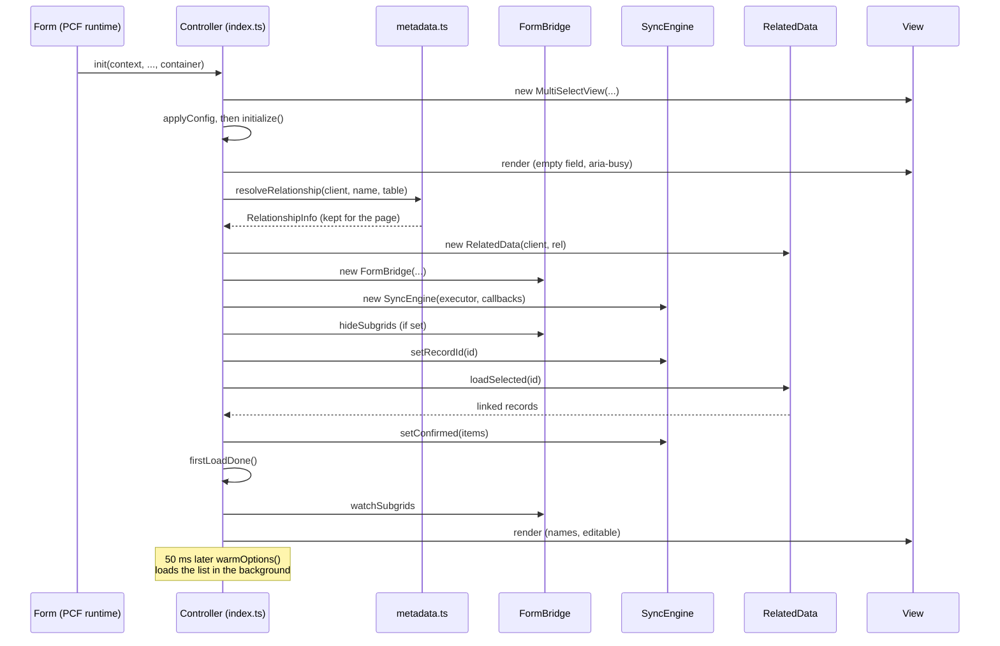

Step by step (`initialize` in `index.ts`):

1. **Reset.** A new `initToken` is taken, the previous engine is retired (3.4.4), and the field is drawn empty and
   busy (`ready: false`). It shows nothing rather than `---`, because "nothing selected" is not known yet.
2. **Where am I?** The table comes from `context.mode.contextInfo.entityTypeName`. Without it the control is not on a
   model-driven form and shows "This control can only be used on a model-driven form." Without a relationship name it
   shows "Set the N:N relationship schema name in the control properties."
3. **Metadata.** `resolveRelationship` (4.8) finds the related table and the navigation property. The result is cached
   for the page, so the second form costs no request.
4. **Working parts.** `RelatedData`, `FormBridge` and `SyncEngine` are created. While *Copy names into the host
   column* is Yes, the engine's executor adds the link tag (4.5) to every associate and disassociate request.
5. **The record id** comes only from the control's own context (`recordIdFrom`). The source explains why: on a quick
   create form, the page-level form API describes the record underneath, which would link values to the wrong record.
6. **Hide subgrids** (if set) before the links are read, so replaced grids disappear as early as possible.
7. **Names copy** (if *Copy names* is Yes): the record's shared copy is joined now, with the host column value the form
   loaded (see 5.4).
8. **Read the links** (`loadSelected`), then `firstLoadDone`: from now on the field can be edited.
9. **Follow subgrids** (`watchSubgrids`) and draw.
10. **Warm the list**: 50 ms later `warmOptions` starts loading the list, so the first opening is instant. It is
    skipped when the field is read-only or offline.

`control/NToNMultiSelect/index.ts`, `initialize` (about lines 591–605, shortened):

```ts
// Use the latest context: the record may have been saved while the metadata was loading.
const recordId = this.recordIdFrom(this.context);
// Before the links are read, so that replaced subgrids disappear as early as possible.
this.applyHideSubgrids(recordId);
if (recordId) {
    engine.setRecordId(recordId);
    this.releaseAbandonedOrphan(bridge, recordId);
    if (config.writeSummary) {
        // ...
        this.copy = this.startCopy(recordId, this.recordKey(recordId), data);
    }
    const loaded = await this.loadSelected(token, false);
    if (token !== this.initToken) return;
    // ...
```

**When something fails.**

| Failure | What the control does |
| --- | --- |
| A setting that cannot work (wrong relationship name, view not found, bad FetchXML) | Shows the reason in the field (`fatalError`), worded by `friendlyError`. No retry: the same setting would fail again. |
| A passing problem during start-up (offline, timeout, server busy, 5xx) | Shows the reason, tries again once after 30 seconds (`INIT_RETRY_DELAY_MS`) and again when the browser is back online. |
| Reading the links fails with 400 or 404 | The metadata may be out of date (for example a renamed relationship): it is read again once, then start-up repeats. |
| Reading the links fails with a permission error | Shows "You don't have permission to see these related records." No retry. |
| Reading the links fails otherwise | The field cannot be used yet. It shows "Couldn't load the selected values." with the reason and retries the read after 1, 3 and 9 seconds (`LOAD_RETRY_DELAYS_MS`). Then it shows "Couldn't load the selected values. Reload the form to try again." and tries once more when the browser is back online. |

**Why the field is never editable before the first read.** The source says it in one line: "Never let the user edit
against an unknown baseline". Until the saved links are known, the engine does not know which links exist, so it could
neither show the right selection nor work out the right requests. Once the first read is done, the field shows the
names in bold: the idle look in 6.2.


*A setting that cannot work (a wrong relationship name). `findRelationship` throws a `QueryConfigError`, `friendlyError` words it, and the view shows it in the field's grey read-only box.*

### 5.2 Opening the list

The list opens from the chevron, ↓ or Alt+↓, Enter, typing, or any click in the box when *Open list on click* is Yes.
The view calls `callbacks.onOpen()`, which runs `ensureOptions`. Usually the list was already loaded by `warmOptions`
and opens at once.

#### 5.2.1 One request decides the mode

`control/NToNMultiSelect/index.ts`, `ensureOptions` (about lines 1347–1362):

```ts
this.optionsPromise = (async () => {
    try {
        // One request decides the mode: if everything fits in one page of 500, filter locally from then on.
        const page = await data.loadOptions(query, "", CLIENT_MODE_LIMIT, null);
        if (token !== this.initToken || listToken !== this.optionsToken) return;
        if (!page.nextLink) {
            this.mode = "client";
            this.allOptions = page.items;
            this.allOptionsKeys = page.items.map((i) => searchKey(i.name));
        } else {
            this.mode = "server";
            this.baseOptions = page.items;
            this.baseNext = page.nextLink;
        }
        this.optionsStatus = "ready";
        this.applySearch(this.searchTerm, true);
```

The first request asks for 500 records (`CLIENT_MODE_LIMIT`). If the server says there are no more:

* **Client mode** (up to 500 records). All records are in memory. Typing filters them **instantly**, in the browser,
  with no request. The match is "contains", ignoring case and accents: `searchKey` normalises each name once (Unicode
  NFD, accent marks removed, lower case), so "resume" finds "Résumé", like the native search. *Select all* can be offered.

If there are more:

* **Server mode** (more than 500 records). The first 500 are shown. Scrolling to the end loads the next 500. Typing
  searches **on the server**, 100 records per page (`SERVER_PAGE_SIZE`), with "starts with" or "contains" (*Search mode
  for large tables*).

**Why this split?** One request of up to 500 short rows (only the id and the name) is quick, and filtering 500 names in
the browser is instant and needs no further request. Larger tables are searched on the server, so the browser never has
to hold a whole large table.

#### 5.2.2 Searching in server mode

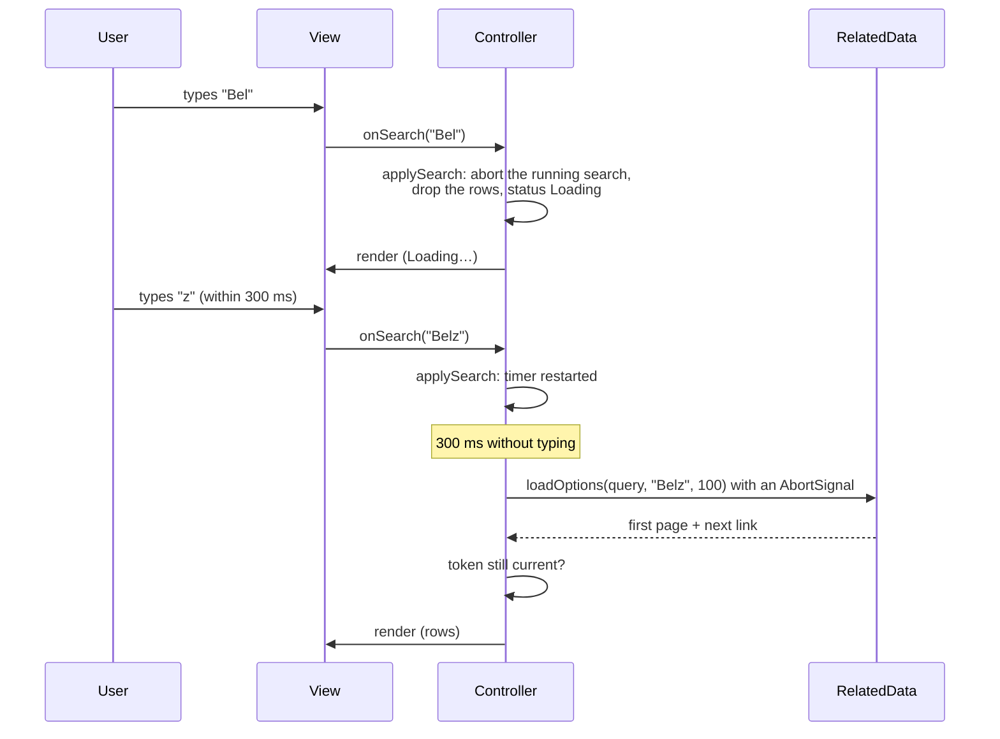

**The part of `applySearch` that runs on each keystroke.** `control/NToNMultiSelect/index.ts`, `applySearch` (about lines 1424–1438):

```ts
if (immediate) {
    void this.serverSearch(trimmed);
    return;
}
// The rows on screen belong to the previous search. They go now rather than when the request starts, so that in
// the meantime nothing of that search can act: a page of it still on its way is dropped, and a click, Enter or
// Select all can't link its records under the new search text.
this.searchToken++;
this.loadingMore = false;
this.loadMoreError = null;
this.optionsStatus = "loading";
this.shownOptions = [];
this.shownNext = null;
this.render();
this.searchTimer = setTimeout(() => void this.serverSearch(trimmed), SEARCH_DEBOUNCE_MS);
```

**Why the rows are removed at once.** The search waits 300 ms (`SEARCH_DEBOUNCE_MS`) after the last keystroke, so that
typing "Belz" sends one request instead of four. During that wait, the rows on screen still belong to the previous
search text. If they stayed visible, a click, Enter or *Select all* in that moment would link records the user is no
longer looking for. Removing them as soon as the text changes, and showing "Loading…", makes that impossible.
Increasing `searchToken` also drops any page of the previous search that is still on its way.

Other details of the search:

* `applySearch` aborts the request still on its way (`AbortController`); `serverSearch` starts the new one with its
  own `AbortController` and a new `searchToken`.
* An empty search box shows the base list again: the 500 (or more, if the user scrolled) records loaded before, with no
  new request.
* A search made only of hyphens or apostrophes is not sent (`isSearchable`); the list shows "No entries found".
* Typing before the first page has arrived is not lost: `onSearch` stores the term and `ensureOptions` applies it when
  the page arrives.


*Client mode: typing "auto" filters the list in the browser, through `applySearch` and `searchKey`.*


*Server mode: the rows come from `serverSearch`, a "starts with" query on the server.*

#### 5.2.3 Loading more rows

When the user scrolls to within 70 pixels of the end of the list, the view calls `onLoadMore`, which runs `loadMore`.

`control/NToNMultiSelect/index.ts`, `loadMore` (about lines 1478–1488):

```ts
// The next link already carries the filter, search term and ordering; it must keep its page size.
const page = await this.data.loadOptions(this.optionsQuery(), "", pageSize, next);
if (token !== this.searchToken) return;
const seen = new Set(this.shownOptions.map((i) => i.id));
const merged = this.shownOptions.concat(page.items.filter((i) => !seen.has(i.id)));
this.shownOptions = merged;
this.shownNext = page.nextLink;
if (isBase) {
    this.baseOptions = merged;
    this.baseNext = page.nextLink;
}
```

How the next page is asked for depends on how the list is read:

| List read with | Next page | Notes |
| --- | --- | --- |
| OData (no view, no FetchXML setting) | The `@odata.nextLink` the server returned. | It must be requested with the same `Prefer: odata.maxpagesize` as the first page, so the page size is kept in `shownPageSize`. |
| FetchXML (a view or the FetchXML setting) | `nextPageFetch`: the same query with `page` + 1 and the **paging cookie** from the `@Microsoft.Dynamics.CRM.fetchxmlpagingcookie` annotation. | The server only says there is more with `@Microsoft.Dynamics.CRM.morerecords`; the control asks for both annotations with a `Prefer` header. |
| FetchXML sorted on a linked column, or with `useraworderby` | `page` + 1 **without** a cookie. | The cookie does not work reliably for these queries. |
| FetchXML whose cookie makes the address longer than 30,000 characters | `page` + 1 without a cookie. | FetchXML travels in the URL (`MAX_URL_LENGTH`). |

A page that arrives for an earlier search is dropped (token check), and records already in the list are not added
twice. A failed page shows "Couldn't load more records. Scroll to try again." at the end of the list.


*Server mode: scrolling to the end of the list calls `loadMore`, which appends the next page with `rebuildRows` (the scroll position is kept).*

#### 5.2.4 When *Select all* is offered

`render` (4.2.3) offers *Select all* only when **all** matching rows are loaded: always in client mode, and in server
mode only for a search whose results are all loaded (no next page is left: they fit in one page of 100, or the user
scrolled to the end). The number of rows must also be within *Select all limit* (100 by default, at most 500), and
selecting them all must stay within *Maximum selections*, counting the places already taken (5.3): rows that already
take a place add none.

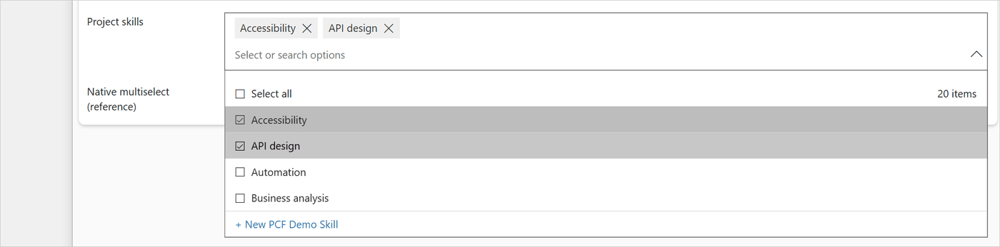

*The list in client mode with the **Select all** row and the item count, drawn by `renderMenu`.*

### 5.3 Picking and removing

Every way of changing the selection ends in the same function, `onToggle` in the controller:

| User action | View code |
| --- | --- |
| Click on a row | `list` click handler → `toggle` |
| Enter or Space on the highlighted row | `activateCurrent` → `toggle` |
| *Select all* | `toggleAll` → `callbacks.onToggleAll` |
| × on a value | `removeWithX` → `toggle` |
| Delete or Backspace on a highlighted value | `onChipKey` → `toggle` |
| *+ New* (after quick create) | controller `createRecord` → `onToggle` |

```mermaid
sequenceDiagram
    participant V as View
    participant C as Controller
    participant E as SyncEngine
    participant R as RelatedData
    participant D as DataverseClient
    V->>C: onToggle([item], true)
    C->>C: canEdit? within Maximum selections?
    C->>E: setMany([item], true)
    E->>C: onChange
    C->>V: render (value shown, saving look)
    E->>E: pump (up to 4 at a time)
    E->>R: associate(recordId, item.id, tag)
    R->>D: POST .../$ref?tag=...
    alt saved
        D-->>R: 204
        E->>E: item moves to confirmed
    else failed
        D-->>R: error
        E->>E: roll back (desired = confirmed)
        E->>C: onError(item, "add", error)
        C->>V: render (message under the field)
        C-->>E: true when it may have been saved: uncertain, keeps its place
    end
    Note over E: nothing left in flight
    E->>C: onSettled(changed)
    C->>C: subgrid refresh in 600 ms,<br/>names copy, other instances re-read
```

`control/NToNMultiSelect/index.ts`, `onToggle` (about lines 1227–1245):

```ts
private onToggle(items: Item[], select: boolean): void {
    const engine = this.engine;
    if (!engine || !this.canEdit()) return;
    const max = this.config?.maxSelections ?? 0;
    if (select && max > 0) {
        // A record whose removal is still on its way keeps its place, since the removal may fail and bring it
        // back: the limit counts it until the removal succeeded, and picking it again takes no new place.
        const adding = items.filter((i) => !engine.occupies(i.id)).length;
        // A pick that takes no new place is never refused (the record may hold more links than the limit already).
        if (adding > 0 && engine.occupiedCount() + adding > max) {
            // The view already blocks this; the check here also covers + New and anything else that selects.
            this.error = this.t.maxNote(max);
            this.render();
            return;
        }
    }
    this.error = null;
    engine.setMany(items, select);
}
```

What the user sees:

1. The value appears (or disappears) **at once**: the view draws the engine's **desired** set.
2. Until its change is saved, the chip and the row are drawn lighter (`is-saving`, opacity 0.6). The controller passes
   the engine's `pendingIds()` as `pending`.
3. When the request succeeds, the light look goes. When it fails, the value goes back to how it was, and a message
   appears under the field.

The check on *Maximum selections* in `onToggle` is a safety net: the view already greys out the other rows once the
limit is reached, and `toggle` in the view refuses them.

**Maximum selections and writes on their way.** The limit counts **places**, not only the values the field shows. A
record keeps its place until the server has settled it (`SyncEngine.occupiedCount`, 4.4):

* a saved value whose removal is on its way (its chip goes away at once, as always);
* a pick the user undid while its link was on its way (the link may still land);
* a pick whose save failed in a way that may still have saved it (a lost connection, a timeout, a gateway or server
  error), until the control has read the saved links again. It does that after any failed write (`scheduleResync`,
  below); when that read fails, it tries again after 1, 3 and 9 seconds, at most three times in a row, but only while
  such a pick holds a place (5.5.2).

The reason: if a removal freed its place at once and the server then refused it while a new pick was saved, the record
would end with one link more than the maximum. So, at the limit, the other rows stay greyed and *+ New* and *Select
all* stay hidden until those removals have succeeded, usually a fraction of a second. Picking the value that
is being removed again is allowed: it takes no new place (`holdsPlace` in the view, 6.5). A pick that takes no new place
is never refused, also when the record already holds more links than the limit (links made elsewhere, or a limit that
was lowered). None of this costs a request, and nothing changes below the limit or without a maximum.

**Where the limit holds.** The limit is checked by each copy of the field on its own, against the links it knows of.
Two copies of the same field on one form, two browser tabs or two users can together go over it, and subgrids, imports,
flows, integrations and the Web API are not limited at all. To make the limit hold everywhere, enforce it on the server
(10.9).


*Maximum selections = 2, reached: `render` passes `maxReached` and the note `maxReached(max)`, the view draws the
other rows with `is-disabled` (`drawRow`), and + New is hidden (`canCreate` is false).*

**Errors during a batch.** `control/NToNMultiSelect/index.ts`, `onWriteError` (about lines 935–962):

```ts
/** Reports a failed write; returns whether it may have been saved all the same (see mayHaveSaved). */
private onWriteError(engine: SyncEngine, item: Item, operation: "add" | "remove", error: unknown): boolean {
    console.error(`[${CONTROL_NAME}] ${operation} failed for ${item.id}`, error);
    const reason = friendlyError(error, this.t, "change");
    // Every queued change would fail the same way (no permission, offline, server busy): drop them now and count
    // them as failed, instead of sending them one by one.
    const dropped = stopsBatch(error) ? engine.cancelQueued() : 0;
    if (engine !== this.engine) {
        const away = detached.get(engine);
        if (away) {
            away.failures += 1 + dropped;
            if (!away.firstError) away.firstError = reason;
            if (mayHaveSaved(error)) away.unknown = true;
        }
        return mayHaveSaved(error);
    }
    if (mayHaveSaved(error)) this.batchUnknown = true;
    this.batchErrors += 1 + dropped;
    if (this.batchErrors === 1) {
        this.batchFirstError = reason;
        this.error = `${operation === "add" ? this.t.addFailed(item.name) : this.t.removeFailed(item.name)} ${reason}`;
    } else {
        if (this.batchErrors === 1 + dropped) this.batchFirstError = reason;
        this.error = `${this.t.manyFailed(this.batchErrors)} ${this.batchFirstError}`;
    }
    this.render();
    return mayHaveSaved(error);
}
```

* One failure: "Couldn't add "Automation". You don't have permission to change these related records.
  (prvAppendTo...)".
* Several: "Couldn't save 12 changes." followed by the first reason.
* A permission error, a lost connection, a timeout or "server busy" (`stopsBatch`) cancels the changes still queued:
  the remaining 90 requests of a *Select all* would only fail the same way.
* A write that failed with a lost connection, a timeout, or a gateway or server error (5xx) may still have been saved
  (`mayHaveSaved`, below). `onWriteError` then notes it for the batch (`batchUnknown`), or for a detached engine in
  its `Detached` entry (`unknown`, 5.8), and returns `true`, so a failed add keeps its place toward *Maximum selections*
  (4.4). The message still says that the value could not be added or removed: for the control the write failed, and
  the field shows the value as it was.
* After a batch with errors, the links are read again (`scheduleResync`): a request that "failed" because the
  connection dropped may in fact have been saved. While a failed add of unknown outcome holds a place, a failed re-read
  is tried again (5.5.2).

`control/NToNMultiSelect/index.ts`, `mayHaveSaved` (about lines 186–192):

```ts
/**
 * A write that failed this way may still have been saved: the connection dropped or the request timed out after it
 * reached the server, or a gateway or server error answered. Only a read of the saved links tells.
 */
function mayHaveSaved(error: unknown): boolean {
    return isNetworkError(error) || error instanceof TimeoutError || (error instanceof DataverseError && error.status >= 500);
}
```

**After the batch** (`onSettled`, once nothing is left in flight). `control/NToNMultiSelect/index.ts`, `onSettled`
(about lines 964–993):

```ts
private onSettled(engine: SyncEngine, changed: boolean): void {
    if (engine !== this.engine) {
        const away = detached.get(engine);
        if (away) this.finishDetached(engine, away, changed);
        return;
    }
    const hadErrors = this.batchErrors > 0;
    const unknown = this.batchUnknown;
    this.batchErrors = 0;
    this.batchUnknown = false;
    if (unknown) {
        // A write may have been saved although it failed: the copy follows the links saved on the server, and the
        // re-read that settles it gets its own retries (see loadSelected).
        this.resyncRetries = 0;
        this.updateSummary(true);
    }
    // A write that may have been saved changes the links as much as one that was: subgrids and the other instances
    // on the page read them again.
    if (changed || unknown) {
        this.scheduleSubgridRefresh();
        if (!unknown) this.updateSummary();
        const recordId = engine.getRecordId();
        if (recordId) this.resyncPeers(this.recordKey(recordId), engine);
    }
    if (hadErrors) {
        // A failure might not be what it seems (the connection dropped after the server saved): re-read.
        this.scheduleResync();
    }
    this.render();
}
```

* When at least one write succeeded, or one failed in a way that may have saved it: the related subgrids are
  refreshed 600 ms later (5.5), and other instances on the page that show the same record read their links again
  (`resyncPeers`).
* The names are copied (5.4): after a batch that changed something, when the page's names differ from what the column
  holds (`updateSummary()`); after a batch with a write of unknown outcome, whatever the page shows
  (`updateSummary(true)`, 5.4.1): the field rolled that value back, but the copy follows the links saved on the
  server.
* After any failure the field reads the saved links again (`scheduleResync`), and so shows them as they are.

A value removed with its × goes through `toggle` too; where the focus goes afterwards is described in 6.4.2.


*A failed associate: `run` rolled the value back, and `onWriteError` shows the reason from `friendlyError` with the missing privilege.*


*The same for a lost connection: `friendlyError` words a network error (`isNetworkError`) as "Can't reach the server. Check your connection and try again."*

### 5.4 The names copy

With *Copy names into the host column* = Yes, the control writes the selected names ("API design; Automation") into the
host column of the record, with its own update. The names then appear in views, searches and exports.


*A view of the host table showing the host column filled by the names copy (the names joined with "; " by `namesText`).*

#### 5.4.1 When the copy is written

The copy is written:

* after a batch of writes that changed something (`onSettled` calls `updateSummary`, 5.3);
* after a batch in which a link or unlink failed in a way that may still have saved it (`mayHaveSaved`: a lost
  connection, a timeout, a gateway or server error). `onSettled` calls `updateSummary(true)`: the copy reads the links
  saved on the server and writes their names into the host column, although the field rolled the value back
  (`NamesCopy.refresh`). The field then shows the saved links again (its re-read after a failure, 5.3), and the
  subgrids and the other instances of the control on the page read them again;
* after a re-read that found other links than before, for example a change in a subgrid on the same form
  (`loadSelected` calls `updateSummary`, 5.5);
* for writes that finish after the control is gone, once they are all done (`finishDetached` updates the copy it was
  handed, 5.8), also after a write of unknown outcome, and also when the form was closed in the middle of a batch.

`updateSummary` does nothing when the setting is off, when the record has no id yet, or when column security does not let the user
update the host column (`columnLocked`, 5.9).

`control/NToNMultiSelect/index.ts`, `updateSummary` (about lines 1062–1074):

```ts
private updateSummary(force = false): void {
    const engine = this.engine;
    const recordId = engine?.getRecordId();
    // With the host column locked by column security, the write would be refused: a change made in a subgrid of the
    // form is left to the names copy plug-in, when it is installed.
    if (this.destroyed || !this.config?.writeSummary || !engine || !recordId || this.columnLocked()) return;
    this.copy ??= this.startCopy(recordId, this.recordKey(recordId), this.data);
    if (this.copy) {
        // `force`: read the saved links and write their names even when the page's names haven't changed.
        if (force) this.copy.names.refresh(this.copy.writer);
        else this.copy.names.update(engine.selected(), this.copy.writer);
    }
}
```

**What it costs.** Nothing in normal use. Only after a failed write of unknown outcome: one read of the saved links,
and one write when their names differ from what the column holds.

#### 5.4.2 One queue per record

`startCopy` gets the record's `NamesCopy` from `namesCopyFor` with the key *record id | relationship | host column*. All
instances on the page that show that record (for example the field and its copy in the form header) share it. Updates
are written **one at a time**, in order: a newer update waits until the write on its way has finished. This is why two
writes can never arrive at the server in the wrong order and leave old names in the column.

The copy is joined as soon as the record opens (5.1, step 7), with the host column value the form loaded. If another
instance on the record writes first, this instance already knows the new value and does not write the same names again.

#### 5.4.3 Read, then write

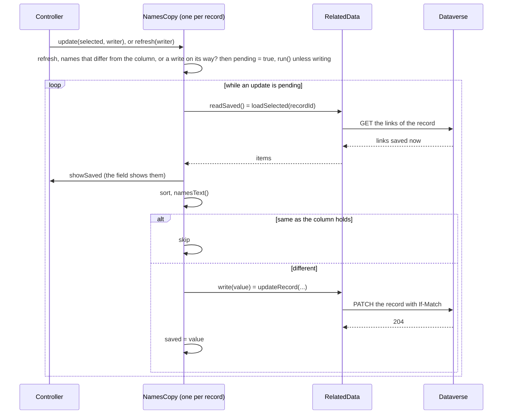

`update` does nothing (no read, no write) when the page's names equal what the column is known to hold and no write is
on its way. `refresh` always sets `pending`: it is only called after a link write whose outcome is not known, when the
page's names cannot be trusted.

`control/NToNMultiSelect/src/namesCopy.ts`, `NamesCopy.refresh`, `update` and `run` (about lines 79–131):

```ts
public refresh(writer: CopyWriter): void {
    if (!writer.readSaved) return;
    this.writer = writer;
    this.pending = true;
    if (!this.writing) void this.run();
}

/** Copies the names of `selected`; call it once their links are saved. */
public update(selected: Item[], writer: CopyWriter): void {
    this.wanted = namesText(selected, writer.maxLength);
    this.writer = writer;
    // While a write is on its way, the update waits for it, whatever its names: it may go back to what the
    // column held before that write.
    if (this.writing || this.wanted !== this.saved) {
        this.pending = true;
        if (!this.writing) void this.run();
    }
}

private async run(): Promise<void> {
    this.writing = true;
    try {
        while (this.pending) {
            this.pending = false;
            const writer = this.writer!;
            let value: string | null;
            try {
                value = writer.readSaved ? await this.namesToWrite(writer, writer.readSaved) : this.wanted;
            } catch (error) {
                // The saved links couldn't be read, so the right names aren't known: the column keeps what it
                // holds, and the failure is shown like a failed write. An update asked for during the read is
                // still done (it reads again); otherwise the next update tries again.
                writer.onError(error, "read");
                continue;
            }
            if (value === this.saved) continue;
            try {
                await writer.write(value);
                this.saved = value;
            } catch (error) {
                // The links stay as they are. The write may still have reached the column (a timeout, or a
                // connection lost after the server saved it), so its value isn't known and the next update writes.
                // An update asked for during the write is still done.
                this.saved = undefined;
                writer.onError(error, "write");
                continue;
            }
        }
    } finally {
        this.writing = false;
        this.writer = null;
    }
}
```

A failed read or write is reported (`onError`), and the loop goes on: an update that came in while it was on its way
(`pending` set again) is still done, with a new read. Without one, the loop ends and the next update tries again.

**Why read the links before writing?** The page knows the links it read when the record opened, plus its own changes.
A link made elsewhere while the form was open (another user, another tab, a flow, the other side of the relationship)
is not in that list. Writing the page's names would remove that link's name from the column. Reading the saved links
just before the write avoids that. The read also updates the field (`showSaved`), so links made elsewhere appear with
the user's next change, without a reload. A small window remains: a link made elsewhere in the moment between the read
and the write can still be missed. That moment was about 50 ms in a development environment; it is longer on a slow
connection, and when the write has to be sent again (the retries wait 1, 2 and 4 seconds, and throttling can make it
wait up to about a minute, 4.6). A change missed this way reaches the column with the record's next change of links.

**Whose names the control writes.** The read runs in the editing user's session, with that user's privileges, so the
control writes the names of the linked records that user can read; a linked record the user cannot open is left out
of the text. The names copy plug-in, which handles links made elsewhere, writes every linked name as SYSTEM (8.14).
With the plug-in installed, the column therefore holds every name after a link made elsewhere, and the names the
editing user can see after a change made in the control (or in a subgrid of the same form, which the control writes
after the plug-in).

**What the read costs.** Measured in a development environment, the names were written about 120 ms after the link was
saved, instead of 67 ms without the read. Picking is not slower: the read and the write happen after the link is
saved, while the user goes on.

**The writer the controller builds.** `control/NToNMultiSelect/index.ts`, `startCopy` (about lines 1100–1114):

```ts
const copy: HostCopy = {
    names: namesCopyFor(`${recordKey}|${host}`, this.loadedCopy),
    writer: {
        maxLength: attributes.MaxLength,
        write: (value) => trackCopy(data.updateRecord(recordId, host, value)),
        onError: (error, step) => this.onCopyFailed(copy, error, label, t, step),
        readSaved: async () => {
            const engine = this.engine;
            const version = engine?.version;
            const items = await trackCopy(data.loadSelected(recordId));
            this.showSaved(engine, version, recordId, items);
            return items;
        },
    },
};
```

* The **text** is the names sorted by `compareItems` (case and accent insensitive, then by id), joined with "; ", cut
  to the column's maximum length with "…", or empty (`null`) when nothing is linked.
* The **write** is a `PATCH` of the record with `If-Match: *`. Without that header a `PATCH` to a record that was just
  deleted would create it again. It is sent with `keepalive` (bodies up to 60,000 bytes, 4.6): once it is on its way,
  the browser finishes it even if the user closes the page meanwhile. A keepalive request that the browser refuses is
  sent again as an ordinary one.
* The update goes through Dataverse like any other: it does not make the form dirty, but plug-ins, flows and auditing
  see it, and the user needs Write permission on the record.
* `trackCopy` counts the read and the write as "on their way", so leaving the page asks for confirmation (5.8).

#### 5.4.4 Errors

| Step | Message | Effect |
| --- | --- | --- |
| Read of the saved links fails | "The names could not be copied into *Label*: " + a read reason, for example "You don't have permission to see these related records." | Nothing is written; the column keeps its value. An update that came in during the read is still done (it reads again); otherwise the next change tries again. After a change whose outcome is not known, the field's re-read of the saved links (5.5.2) also writes the names when it finds links the field did not show (while the record is open). |
| Write fails | "The names could not be copied into *Label*: " + an update reason, for example "You don't have permission to change this record. (prvWrite...)" | The column's value is now unknown, so the next change writes for sure. An update that came in during the write is still done. |

The message appears under the field, or as an app notification when the control is already gone (`onCopyFailed`). The
links themselves are never undone because of a failed copy.


*A failed write of the names copy, reported by `onCopyFailed` with the "update" wording of `friendlyError`.*

#### 5.4.5 The link tag and the names copy plug-in

While *Copy names* is Yes, each associate and disassociate request of the control carries the tag
`NToNMultiSelect|<relationship>|<table>|<record id>|<host column>` (`linkTag`, 4.5). The optional names copy plug-in
(in the solution with the plug-in) copies the names after links made **anywhere**. When it sees this tag, it skips
exactly that record and column, because the control writes them itself once its links are saved (with the names that
user can read, see 5.4.3). So a link made in the control costs about the same with or without the plug-in, and links
made elsewhere are still copied. Without the setting, or when the host column's name is not known, no tag is sent.
The plug-in also skips that column when the control never gets to write it, because the page was closed first (5.8).

Any caller can send a tag, so the plug-in follows it only when the user who made the link could write that column
themselves: the column has no column security, and Dataverse confirms that the user may write the record (for a few
tables it cannot be asked, and the tag is then ignored). Otherwise it rewrites the column as for any other link (8.8).

### 5.5 Subgrids on the same form


*The control and the subgrid **Related skills** of the same relationship show the same links. `FormBridge.refreshSubgrids` reloaded the grid after the change; the form stays saved because `getOutputs` returns nothing.*

#### 5.5.1 Refresh after a change

After a batch of writes that changed something, or in which a write failed in a way that may still have saved it
(5.3), `scheduleSubgridRefresh` waits 600 ms (`SUBGRID_REFRESH_DELAY_MS`), so a burst of clicks causes one refresh, not
one per click. Then `FormBridge.refreshSubgrids` reloads every related subgrid
and returns how many it reloaded.

#### 5.5.2 Following changes made in a subgrid

When a user adds or removes a record in a subgrid, the grid reloads and fires its OnLoad event. The control listens to
it (`watchSubgrids`). But the grid also fires OnLoad when **the control** refreshed it. These "echoes" are not someone
else's change, so they are counted and ignored.

`control/NToNMultiSelect/index.ts`, `onSubgridLoad` (about lines 320–326):

```ts
private readonly onSubgridLoad = (): void => {
    if (this.echoesLeft > 0 && Date.now() < this.echoesUntil) {
        this.echoesLeft--;
        return;
    }
    this.scheduleResync();
};
```

`echoesLeft` is set to the number of grids the control refreshed, for 3 seconds (`SELF_REFRESH_WINDOW_MS`). Any other
OnLoad starts a re-read 400 ms later (`scheduleResync`, `RESYNC_DEBOUNCE_MS`).

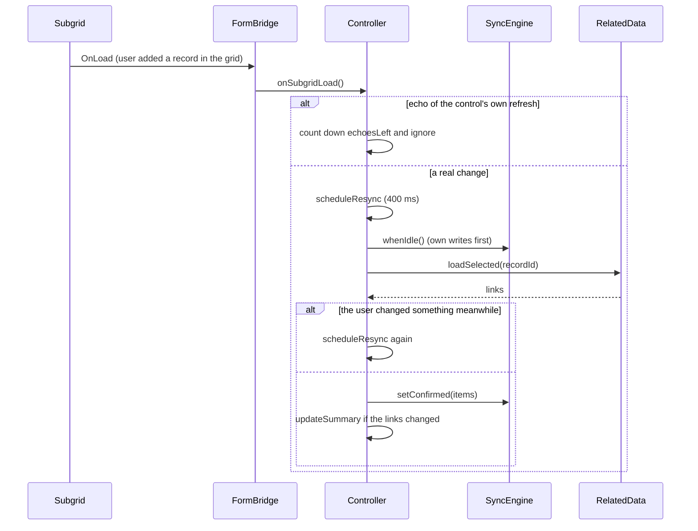

`loadSelected` always waits first for the engine's own writes (and for writes of an earlier instance on the same
record), then reads; with `isResync = true` it also copies the names when the links changed. If the engine's `version`
changed during the read, the user clicked something in the meantime, so the result may be stale: it reads again later
instead of using it.

`control/NToNMultiSelect/index.ts`, `loadSelected` (about lines 814–848, shortened):

```ts
try {
    await this.peersIdle(recordId);
    await engine.whenIdle();
    const version = engine.version;
    const items = await data.loadSelected(recordId);
    if (token !== this.initToken || engine !== this.engine) return false;
    if (engine.version !== version || engine.isBusy()) {
        // The user changed something during the read; read again once those writes are done.
        this.scheduleResync();
        return true;
    }
    const before = engine.selected();
    engine.setConfirmed(items);
    this.resyncRetries = 0;
    // The message of an earlier read that failed is out of date now (another message stays).
    if (this.error?.startsWith(this.t.loadSelectedFailed)) this.error = null;
    if (isResync && !sameIds(before, engine.selected())) {
        this.updateSummary();
    }
    // ...
} catch (error) {
    if (token !== this.initToken) return false;
    this.lastLoadError = error;
    this.error = `${this.t.loadSelectedFailed} ${friendlyError(error, this.t, "read")}`;
    console.error(`[${CONTROL_NAME}] loading related records failed`, error);
    // A place held by an add whose outcome isn't known is only freed by a read of the saved links: while there
    // is one, the read is tried again a few times (as the first load is).
    if (isResync && engine === this.engine && engine.hasUncertain() && this.resyncRetries < LOAD_RETRY_DELAYS_MS.length) {
        const delay = LOAD_RETRY_DELAYS_MS[this.resyncRetries++];
        clearTimeout(this.resyncTimer);
        this.resyncTimer = setTimeout(() => {
            if (!this.destroyed && token === this.initToken) void this.loadSelected(token, true);
        }, delay);
    }
```

**When a re-read fails.** The field keeps what it shows and says "Couldn't load the selected values." with the reason;
a later re-read that succeeds takes that message away (any other message stays). A failed add whose outcome is not known
keeps its place toward *Maximum selections* until a read of the saved links succeeds (4.4, 5.3), so while the engine
has one (`hasUncertain`), a failed re-read is tried again after 1, 3 and 9 seconds (`LOAD_RETRY_DELAYS_MS`, as for the
first read), at most three times in a row. `resyncRetries` counts them. It starts again at 0 after a read of the saved
links that succeeds (also the names copy's read, when `showSaved` takes it over) and after each batch with a write of unknown outcome
(`onSettled`), so each such batch gets its own retries. Without such an add, a failed re-read is not tried again on a
timer.

**Other instances on the page.** A field can appear twice (for example in the header and in the body). When one saves
a change, `resyncPeers` makes the others that show the same record re-read, even when no subgrid would tell them.

**Turning sync off.** *Subgrids to refresh* = `none` makes `FormBridge.subgrids` return no grids: nothing is refreshed
and nothing is followed. Changes made in a subgrid then appear in the control only after the form reloads.

#### 5.5.3 Hiding the subgrids

With *Hide related subgrids* = Yes, `applyHideSubgrids` calls `FormBridge.hideSubgrids` at start-up (before the links
are read) and again on every `updateView`, because grids can register on the form after the control. Only grids that
are visible are hidden, and their names are remembered in `hiddenGrids`. When the setting is turned off,
`showHiddenSubgrids` shows those grids again and they are refreshed (they were not refreshed while hidden). Hidden grids
are not refreshed after changes: nobody sees them.


***Hide related subgrids** = Yes: `FormBridge.hideSubgrids` hid the related subgrid, and the control takes its place.*

### 5.6 New records

On a new record that has not been saved yet, there is no record id to link to. The control keeps the picks and links
them after the first save.

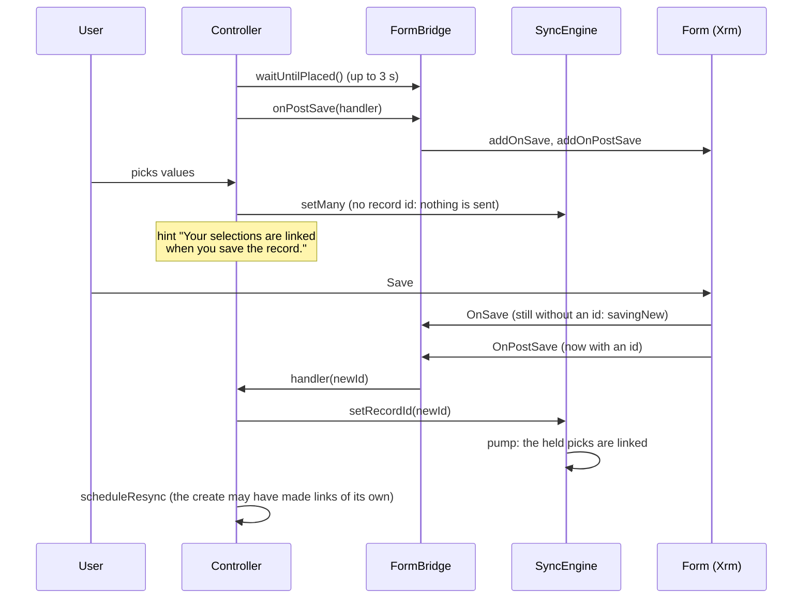

Step by step:

1. **Can the save be followed?** `initialize` finds no record id. For Appointment, Recurring Appointment and Service
   Activity (`NO_POST_SAVE_TABLES`), whose new-record save skips the save events, the field shows "Save the record first,
   then pick values here." Otherwise it waits until its element is on the page (`waitUntilPlaced`) and asks the bridge
   to follow the save (`onPostSave`).
2. **Where the save cannot be followed safely** (a quick create form, a new record in a dialog or side pane), `onPostSave`
   returns `false` and the field also shows "Save the record first ...". The reason is in 4.9: `Xrm.Page` would describe
   another form, and picks could be linked to the wrong record.
3. **Picks are held.** The engine has no record id, so `pump` sends nothing. The values show normally (not in the
   "saving" look), with the grey hint "Your selections are linked when you save the record."
4. **The save.** OnSave notes that the form saves a **new** record; OnPostSave then sees the new id and calls
   `onRecordSaved`, which gives the engine its id. The engine sends the held picks at once.
5. **The control may also learn the id from `updateView`.** There, `FormBridge.savedAs` checks that the followed form
   really saved itself as that record. Otherwise the control was moved to another record: its held picks are dropped
   (`retireEngine(true)`) so they never end up on the wrong record.
6. **After the links are written**, the links are read once more: the create may have made links of its own (a plug-in,
   or a record created from a related record's subgrid).

A **failed or cancelled save** (for example a required field is empty) links nothing; the picks stay until a later save
succeeds.

**Destroyed while the form stays open.** A business rule can hide and show the field, which destroys and re-creates the
control. The held picks then become an **orphan** (`retireEngine`), stored per form and per relationship and host
column. The next instance on the same form adopts them (`adoptOrphan`). If no instance comes back (*Save & Close*), the
orphan's own save handler still fires and links the picks on its own (`onRecordSaved` → detached, 5.8).


*A new, unsaved record with a held pick and the hint from `render` (`heldHint`). The chip has no "saving" look because `cachedPending` is empty while there is no record id.*

### 5.7 + New and quick create

The *+ New* row appears at the end of the list when *Show + New button* is Yes, the related table allows quick create
(`targetQuickCreate` from the metadata) and *Maximum selections* is not reached. Its text is "+ New" plus the related
table's display name.

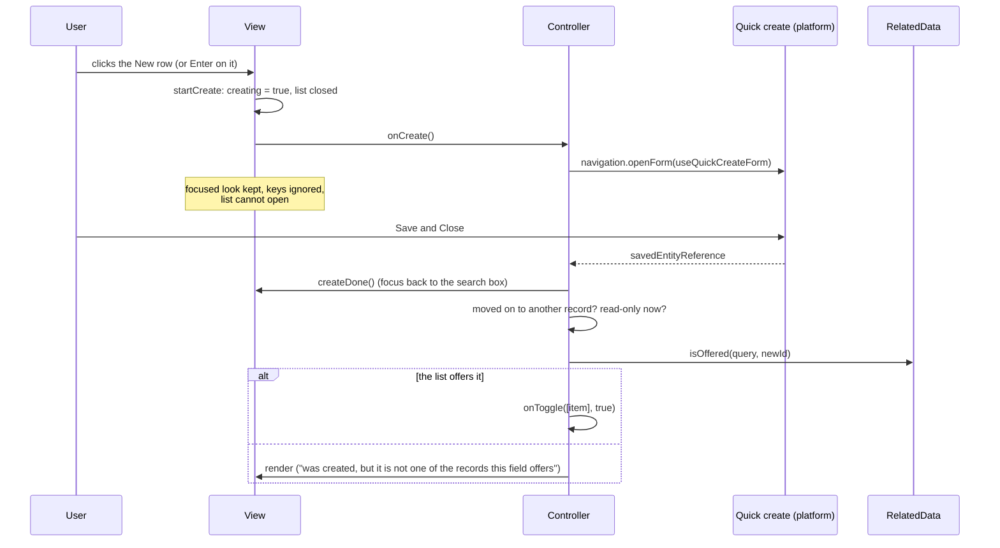

1. **`startCreate`** (view) sets `creating`, closes the list and calls `onCreate`. While `creating` is set, the
   `focusout` handler leaves the field in its focused look, `onKeyDown` ignores keys, `openMenu` refuses to open and a
   second `startCreate` does nothing. This covers the moment before quick create has taken the focus, too: a second
   Enter, typing or the chevron cannot bring the list back over the quick create panel.
2. **`createRecord`** (controller) opens quick create with `context.navigation.openForm({ entityName, useQuickCreateForm: true })`
   and waits until it closes. If quick create cannot open, the field shows "Couldn't create the record." with the reason.
3. **`createDone`** (view) runs whether the record was saved or not: `creating` ends, text typed in the meantime is
   cleared, and the search box takes the focus back (with the list closed).
4. If a record was saved, the controller checks that it **has not moved on** (same start-up, same engine, still
   editable). Otherwise it says "... was created but couldn't be linked here. Pick it from the list."
5. The list is reloaded, so the new record appears in its place.
6. **Is it offered?** Quick create knows nothing of the list's filter, view or FetchXML. `isOffered` runs the list's
   query narrowed to the new id. If the list offers it, it is selected through `onToggle` (the same path as a click);
   otherwise the field explains why it was not selected.


*The **+ New** row at the end of the list (`createButton`, shown when `ViewState.createLabel` is set).*


*Quick create open on the right. The field keeps its focused look with the list closed, because `creating` is set (`startCreate`).*


*The platform's quick create form, opened by `createRecord` with `useQuickCreateForm: true`.*


*After **Save and Close**: `isOffered` found the record in the list and `onToggle` selected it; `createDone` put the focus back in the search box.*


*The new record does not match the list's filter: `createRecord` shows `createdNotOffered`.*

### 5.8 Leaving the page while writes are pending

Two cases are handled differently.

**Closing the browser tab or reloading.** This would cancel the link requests on their way (an update of the names
already on its way is finished by the browser, 4.6). The control installs one
`beforeunload` handler per page that asks the browser to confirm while anything is unsaved.

`control/NToNMultiSelect/index.ts`, `installUnloadGuard` (about lines 128–133):

```ts
window.addEventListener("beforeunload", (event) => {
    if (copiesWriting > 0 || [...liveEngines].some((engine) => engine.hasPendingChanges() || engine.isBusy())) {
        event.preventDefault();
        event.returnValue = "";
    }
});
```

The names copy's write is sent with `keepalive` (5.4.3): once it is on its way, the browser finishes it even if the
user leaves the page meanwhile.

**What the prompt cannot cover.** The names are written once the last link of a batch is saved: about 0.1–0.3 seconds
after a single pick, and up to many seconds after a *Select all* of hundreds of records. If the user leaves anyway
(**Leave** in the browser's prompt), or the browser or the app closes without asking (a crash, the mobile app closed),
the links already saved stay, but the host column can miss their names until the record's links next change. The
names copy plug-in does not fill them in: it leaves the control's own links to the control (the tag, 5.4.5 and 8.8).
Only a server-side write of the names for every link would cover this case. That is not done, because it would cost
about 70 ms on every link (a rebuild, 8.15).

**Moving within the app** (*Save & Close*, another record, the back button). The page stays loaded, so the requests can
finish. The platform calls `destroy`, and `retireEngine` hands the engine over to the page-wide `detached` map instead
of stopping it:

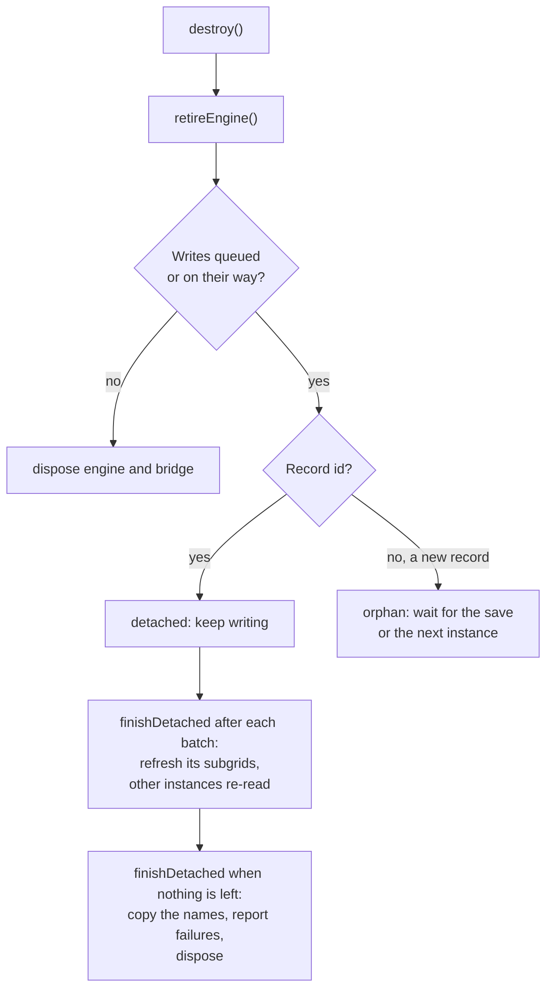

`finishDetached` runs after each batch of the detached engine, and finishes the job when nothing is left.

`control/NToNMultiSelect/index.ts`, `finishDetached` (about lines 995–1016):

```ts
private finishDetached(engine: SyncEngine, away: Detached, changed: boolean): void {
    if (changed || away.unknown) {
        away.bridge.refreshSubgrids(engine.getRecordId());
        this.resyncPeers(away.key, engine);
    }
    if (engine.hasPendingChanges() || engine.isBusy()) return;
    if (away.failures > 0) {
        notifyApp(`${away.t.closedFailures(away.failures, away.label)} ${away.firstError}`);
    }
    // Every link is saved (or has failed for good), so the copy can follow them, unless none of them changed
    // anything. Changes that were saved before the engine was detached have been copied already (updateSummary).
    // A write that failed may still have been saved (see mayHaveSaved): then the copy reads the saved links and
    // writes their names, whatever the page shows.
    if (away.copy) {
        if (away.unknown) away.copy.names.refresh(away.copy.writer);
        else if (changed) away.copy.names.update(engine.selected(), away.copy.writer);
    }
    detached.delete(engine);
    liveEngines.delete(engine);
    engine.dispose();
    away.bridge.dispose();
}
```

* Failures are reported with an **app notification** (`Xrm.App.addGlobalNotification`), because the form that could
  show them is gone: "3 changes to Project skills couldn't be saved after the form was closed." plus the reason.
* **A write of unknown outcome** (`mayHaveSaved`, 5.3) sets `unknown` on the `Detached` entry, whether it failed
  before the form was closed (`retireEngine` takes over the batch's `batchUnknown`, also when the form is closed in the
  middle of a batch) or after (`onWriteError`). The subgrids still on screen and the other instances on the page then
  read the links again, and at the end the copy reads the saved links and writes their names (`NamesCopy.refresh`).
* **Reopening the same record** while its detached writes run: `loadSelected` first waits for them (`peersIdle`), so the
  reopened form reads the final links, not a half-written state.

### 5.9 Offline and read-only

#### 5.9.1 Offline

`isOffline` asks the platform (`context.client.isOffline()`) whether the app runs offline (for example the mobile app
in offline mode). While offline the field is read-only and shows "Not available while you're offline." The list is
not warmed.

A **lost connection** in the browser is a different case: requests fail with a network error and are retried
(4.6). If they still fail, the user sees "Can't reach the server. Check your connection and try again.", and the rest
of the batch is cancelled. When the browser fires its `online` event, `onOnline` recovers.

`control/NToNMultiSelect/index.ts`, `onOnline` (about lines 327–342):

```ts
private readonly onOnline = (): void => {
    this.offline = isOffline(this.context);
    if (this.initGaveUp) {
        void this.initialize(this.context);
        return;
    }
    if (this.loadGaveUp && this.engine?.getRecordId()) {
        this.loadGaveUp = false;
        this.fatalError = null;
        clearTimeout(this.loadRetryTimer);
        this.retryInitialLoad(this.initToken, 0);
    } else {
        this.scheduleResync();
    }
    this.render();
};
```

#### 5.9.2 Read-only

`control/NToNMultiSelect/index.ts`, `readOnly` and `columnLocked` (about lines 1214–1221):

```ts
private readOnly(): boolean {
    return this.context.mode.isControlDisabled || this.columnLocked();
}

/** Column security doesn't let the user update the host column (when it isn't secured, the form doesn't say). */
private columnLocked(): boolean {
    return this.context.parameters.value?.security?.editable === false;
}
```

The field is read-only when:

* the form or the field is read-only (`mode.isControlDisabled`: a read-only form, a disabled field, a business rule, a
  user without Write permission on the record, an inactive record);
* **column security** does not let the user update the host column (`columnLocked`);
* the platform is offline, or the record is new and the save cannot be followed (`saveFirst`).

Read-only means: `render` passes `disabled: true`, the view draws the grey box with the names (links with *Open
selected records*), no chips, no ×, no search box, and `canEdit()` blocks every write. The list is not loaded.

**Column security in detail.** A field security profile can secure the host column. The platform then passes
`security.editable` for the bound property; when the user may not update the column, it is `false`. The control
reacts like a native field on that column: it becomes read-only. It also never writes the names copy for such a user
(`updateSummary` checks `columnLocked`), because that update would be refused. A change made by that user in a subgrid
on the same form is then left to the names copy plug-in, when it is installed.

Read-only follows the **update** permission only. The control does not mask the values (no "****" for a user who may
not read the column): what it shows are the related records, read through the relationship, and only those the user is
allowed to read.

The read-only look is shown in 6.2.

## 6. The view in detail

This chapter describes `src/view.ts` and the CSS in `src/styles.ts`: what the user sees and how each part is made.

### 6.1 The elements

The constructor builds this structure once. `render` only changes text, attributes and classes on it.

```text
container (from the platform)
├── div.ntnms                         root of the field (state classes, see 6.2)
│   ├── div.ntnms-view                idle text
│   │   └── div.ntnms-view-text       bold names, "---", or links when read-only
│   ├── div.ntnms-chips-row
│   │   ├── ul.ntnms-chips            the values (role="list", focusable by code only)
│   │   │   └── li.ntnms-chip         one value: span or a.ntnms-chip-text + button.ntnms-chip-remove
│   │   └── div.ntnms-more            button.ntnms-more-button: "+N" or "less"
│   ├── div.ntnms-inner               the search row
│   │   ├── div.ntnms-input-wrap      input.ntnms-input (role="combobox")
│   │   └── div.ntnms-caret           button.ntnms-caret-button (the chevron)
│   ├── span.ntnms-a11y               spoken summary of the selection
│   └── div.ntnms-a11y                live region for announcements
├── div.ntnms-error                   message under the field (role="alert") with "Dismiss"
└── div.ntnms-hint                    grey hint under the field

document.body
└── div.ntnms-menu                    the floating list (role="listbox")
    ├── div.ntnms-option.ntnms-select-all   "Select all" + item count
    ├── div.ntnms-note                limit note ("You can select up to 5 records.")
    ├── div.ntnms-status              "Loading…", "No entries found" or an error
    ├── ul.ntnms-list                 the rows: li.ntnms-option (role="option")
    └── button.ntnms-create           "+ New ..." (role="option")
```

**Why the list is on `<body>`.** The source says: "The list lives in a layer on `<body>`: form sections clip overflow,
so it could not drop down otherwise." The list is placed with `position: fixed` next to the field (6.7).

### 6.2 Field states

The look of the field is controlled by classes on the root element, set in one place.

`control/NToNMultiSelect/src/view.ts`, `applyClasses` (about lines 413–425):

```ts
private applyClasses(): void {
    const s = this.state;
    const cls = this.root.classList;
    cls.toggle("is-empty", !s || s.selected.length === 0);
    cls.toggle("is-disabled", !!s && (s.disabled || !!s.fatalError));
    cls.toggle("is-active", this.active && this.editable());
    cls.toggle("is-focused", this.focused);
    cls.toggle("is-open", this.open);
    this.menu.classList.toggle("is-open", this.open);
    cls.toggle("is-expanded", this.expanded);
    this.input.setAttribute("aria-expanded", String(this.open));
    this.caretGlyph.textContent = this.open ? GLYPH.chevronUp : GLYPH.chevronDown;
}
```

| State | Classes on `.ntnms` | What shows | Set by |
| --- | --- | --- | --- |
| Idle | none of the ones below | `.ntnms-view`: the names in bold, comma separated, `---` when empty (blank while loading) | default |
| Hover | `is-active` | Grey border; the values as chips with ×; the search row only when nothing is selected | `mouseenter` / `mouseleave` |
| Focused | `is-focused` | Chips, the search box and the chevron | `focus` of the input or the values |
| List open | `is-open` (and `is-open` on the menu) | The floating list; the chevron points up | `openMenu` / `closeMenu` |
| Expanded | `is-expanded` | All values, up to 136 px high with a scroll bar | "+N", chip navigation |
| Read-only | `is-disabled` | Grey box with the names (links with *Open selected records*); no chips, no search row | `ViewState.disabled` or `fatalError` |

The CSS does the rest: for example, a rule on `.ntnms.is-active:not(.is-disabled) .ntnms-view` sets `display:none`,
which hides the idle text on hover. Because the states are
just classes, you can restyle any state in `styles.ts` without touching the logic.


*Idle: `.ntnms-view-text` shows the names in bold, comma separated (`render` sets its text from `state.selected`). The native multi-select choice column below it looks the same.*


*The pointer over the field (`is-active`): the chips built by `renderChips`, with ×. The names are links because **Open selected records** is Yes.*


*Focused with the list open (`is-focused`, `is-open`): check-box rows drawn by `rebuildRows` / `drawRow`, selected rows grey, **+ New** at the end.*


*Read-only (`is-disabled`): the grey box; with **Open selected records** the names are links built by `renderViewLinks`.*

### 6.3 Values, "+N" and "less"

**Chips.** `renderChips` builds one `li.ntnms-chip` per value. A chip holds the name (a `span`, or a link with *Open
selected records*) and, unless the field is read-only, a × button. A chip whose change is not saved yet gets
`is-saving`; the keyboard highlight is `is-current` (a 1 px black border drawn with `::after`). While the field is
collapsed, at most 50 chips are built (`MAX_COLLAPSED_CHIPS`); the rest are built when the field expands.

**"+N".** The collapsed chip list is one line high (`max-height:34px`, `overflow:hidden`). After every render,
`countOverflow` counts the chips whose top is below the first line, plus the values not built, and writes "+N". In the
expanded field the same button says "less", but only when collapsing would hide something (like the native control).
`measureOverflow` measures twice when the button's own width changed, because the button's width decides how many chips
fit on the first line. A `ResizeObserver` measures again when the field changes width.

`control/NToNMultiSelect/src/view.ts`, the "+N" / "less" click handler in `wireEvents` (about lines 960–976):

```ts
this.expanded = !this.expanded;
// Collapsed, the list still keeps its scroll position (it only hides what overflows): back to the first line.
if (!this.expanded) this.chipsList.scrollTop = 0;
// As in the native control, +N and less put the focus on the values, the first one highlighted (an open list
// closes): the field stays open until the focus leaves it, not only while the mouse is over it.
const s = this.state;
const focusValues = !!s && s.selected.length > 0 && this.editable();
const highlight = focusValues && this.chipCurrent === null ? s.selected[0] : null;
if (focusValues) this.closeMenu();
if (highlight) this.chipCurrent = highlight.id;
this.applyClasses();
if (s) this.renderChips(s);
this.scheduleMeasure();
if (focusValues && this.container.ownerDocument.activeElement !== this.chipsList) this.chipsList.focus();
if (highlight) this.announce(highlight.name);
// A highlight kept from before (on a lower line, say) comes into view with the rest.
else if (s && this.expanded && this.chipCurrent !== null) this.scrollChipIntoView(s.selected.findIndex((i) => i.id === this.chipCurrent));
```

* "+N" shows all values, closes an open list, and puts the focus **on the values** with the first value highlighted.
  The field stays expanded when the mouse leaves, until the focus leaves the field (a click outside or Tab away).
* "less" collapses and keeps the focus and the highlight.
* When the focus leaves the field, the `focusout` handler collapses it, ends the highlight, closes the list and clears
  any search text.


*A record with 2,499 links, collapsed: one line of chips and "+2494", counted by `countOverflow` (only 50 chips are built).*


*After "+N": `is-expanded` lets the chip list grow to 136 px with a scroll bar; the button says "less".*


*After "+N" with the mouse away: all values shown, the focus on the values with the first one highlighted (`chipCurrent`), and the "less" link.*

**Open selected records.** With this setting, each chip's name is a real link
(`<a target="_blank" rel="noopener noreferrer">`) built by `recordLink`, so Ctrl+click and middle-click work as for any link. The address comes from the
controller (`recordUrl`): the current app's `main.aspx` with `pagetype=entityrecord`, the table and the id, so the
record opens in the same app. The read-only field shows the names as links too (`renderViewLinks`). Where a browser
tab cannot simply be opened (the mobile app, Outlook, offline), the controller sets `interceptLinks`, and a click opens
the record with `context.navigation.openForm` instead.

### 6.4 The two keyboard models

The control copies the native multi-select choice field, which has two places the keyboard can be: the **search box**,
and the **values** (after a value was removed with its ×, or after "+N"). Each has its own handler.

#### 6.4.1 Focus in the search box (`onKeyDown`)

| Key | List closed | List open |
| --- | --- | --- |
| ↓ or Alt+↓ | Opens the list with the first row highlighted | Next row |
| ↑ | – | Previous row |
| Alt+↑ | – | Closes the list |
| Page Down / Page Up | – | 4 rows down / up |
| Ctrl+Home / Ctrl+End | – | First / last row |
| Enter | Opens the list | Toggles the highlighted row (or *Select all*, or *+ New*) |
| Space | (types a space) | Toggles the highlighted row when the search box is empty |
| Esc | Clears the search text | Closes the list (and clears the search text) |
| Backspace in the empty box | Moves to the values: the last value is highlighted | Does nothing (as in the native control) |
| Tab | Moves on | Closes the list and moves on |
| Typing | Opens the list and filters | Filters |

The highlight moves over one sequence of positions: `-1` (*Select all*, when shown), `0` to `n-1` (the rows), `n`
(*+ New*, when shown). `refreshRowsAndScroll` keeps the highlighted row in view, and `aria-activedescendant` tells screen
readers which one it is (6.6).

**Values reached with Backspace** (the focus stays in the search box; `chipCurrent` is set, so `onKeyDown` hands every
key to `onChipKey`):

| Key | Does |
| --- | --- |
| ← / → | Previous / next value. → on the last value ends the navigation (back to typing). In a right-to-left language the arrows are swapped. |
| Delete / Backspace | Removes the highlighted value; the highlight moves to the next one (the previous one after the last). Holding the key down removes only one. |
| Enter | Opens the highlighted record (with *Open selected records*; otherwise nothing). |
| Esc | Ends the navigation (and closes the list if open). |
| ↓ | Ends the navigation and opens the list with the first row highlighted. |
| Tab | Ends the navigation; the focus moves on. |
| Typing | Ends the navigation; the character goes into the search box. |

#### 6.4.2 Focus on the values (`onChipsListKey`)

After a value is removed with its × (`removeWithX`) or after "+N", the focus is on the chip list itself
(`ul.ntnms-chips`, `tabIndex = -1`, so Tab never lands there). This is the model the native control uses after a click
on ×:

| Key | Does |
| --- | --- |
| ← / → | Moves the highlight. The first and the last value keep it (no wrap, no leaving). |
| Delete / Backspace | Removes the highlighted value. With nothing left, the search box takes the focus. |
| Enter | Opens the highlighted record (with *Open selected records*). |
| Esc | Collapses an expanded field (as "less" does). |
| Tab | Moves to the search box. |
| ↓ | Opens the list with the first row highlighted; the search box takes the focus. |
| Typing | Does nothing; the highlight stays. Shortcuts such as Ctrl+S still reach the page. |

`control/NToNMultiSelect/src/view.ts`, `removeWithX` (about lines 1234–1254):

```ts
private removeWithX(item: Item): void {
    const index = this.state?.selected.findIndex((i) => i.id === item.id) ?? -1;
    this.closeMenu();
    this.toggle(item, false);
    // The controller re-rendered synchronously: continue from the new selection.
    const s = this.state;
    if (!s || !this.editable()) return;
    const next = Math.min(Math.max(index, 0), s.selected.length - 1);
    if (next < 0 || s.selected[next].id === item.id) {
        this.focusInput();
        return;
    }
    this.chipCurrent = s.selected[next].id;
    // The next value moved into the x's place, so it is among the chips built: the field stays as it is.
    this.renderChips(s);
    this.applyClasses();
    this.scheduleMeasure();
    if (this.container.ownerDocument.activeElement !== this.chipsList) this.chipsList.focus();
    this.scrollChipIntoView(next);
    this.announce(s.selected[next].name);
}
```

Note the comment "The controller re-rendered synchronously": `toggle` calls the controller, which updates the engine
and calls `view.render` before `toggle` returns. The code after it can therefore read the new selection from
`this.state`.


*After × on a value: `removeWithX` moved the focus to the values and highlighted the next value with a black border (`is-current`).*

### 6.5 The list

**Rows.** `rebuildRows` creates one `li.ntnms-option` per record: a check glyph (`span.ntnms-check`) and the name
(`div.ntnms-option-text`), with `id` `<uid>-opt-<index>` and `data-index`. When a "load more" only adds rows at the
end, the existing rows and the scroll position are kept and only the new rows are created. Each time the list opens,
`openMenu` scrolls it back to its beginning, as the native list does, wherever it was scrolled to before it closed.

**Row looks** (`drawRow`), like the native list:

| Class | Look | When |
| --- | --- | --- |
| (hover) | `#f0f0f0` | The mouse is over an unselected row. |
| `is-selected` | `#bdbdbd`, ticked box | The record is selected. `#c7c7c7` under the mouse. |
| `is-visited` | `#e6e6e6` | A selected row the mouse has left, until the selection changes (`visitedRows`). |
| `is-saving` | 60 % opacity | Its change is not saved yet. |
| `is-current` | 1 px black border | Keyboard highlight (not for mouse clicks). |
| `is-disabled` | grey text | *Maximum selections* reached, and the row is not selected and does not hold a place (5.3). |

A row that is not selected but holds a place toward the limit (its removal is on its way, an add of it that the user
undid is still on its way, or an add of it has an unknown outcome; `ViewState.held`, 4.3) is not blocked at the limit:
picking it again takes no new place. `drawRow` and `toggle` both ask `holdsPlace`.

`control/NToNMultiSelect/src/view.ts`, `drawRow` and `holdsPlace` (about lines 669–683 and 1557–1560):

```ts
private drawRow(state: ViewState, row: HTMLLIElement, id: string, index: number): void {
    const selected = this.isSelected(id);
    // A record being removed (saving, not selected) keeps its place toward the limit, so picking it again is allowed.
    const blocked = state.maxReached && !selected && !holdsPlace(state, id);
    row.classList.toggle("is-selected", selected);
    row.classList.toggle("is-visited", selected && this.visitedRows.has(id));
    row.classList.toggle("is-saving", state.pending.has(id));
    row.classList.toggle("is-current", this.keyboardHighlight && this.current === index);
    row.classList.toggle("is-disabled", blocked);
    row.setAttribute("aria-selected", String(selected));
    row.setAttribute("aria-disabled", String(blocked));
    const check = row.firstChild as HTMLSpanElement;
    const glyph = selected ? GLYPH.checked : GLYPH.unchecked;
    if (check.textContent !== glyph) check.textContent = glyph;
}
// ...
/** Whether a record that isn't selected still takes a place toward the limit (see ViewState.held), or is being removed. */
function holdsPlace(state: ViewState, id: string): boolean {
    return state.pending.has(id) || !!state.held?.has(id);
}
```

**Redrawing only what changed.** With thousands of rows loaded, redrawing every row after each saved write or each
arrow key would be slow. `refreshRows` remembers what it drew (`drawnRows`) and redraws only the rows whose state
changed.

`control/NToNMultiSelect/src/view.ts`, `refreshRows` (about lines 642–649):

```ts
// Otherwise only the rows that were picked or removed, started or finished saving, lost their lighter
// grey, or gained or lost the highlight. Redrawing every loaded row for each finished write and each arrow
// key takes tens of milliseconds a time once thousands of rows are loaded.
const changed = new Set<string>();
addDifference(changed, drawn.selected, this.selectedIds);
addDifference(changed, drawn.pending, state.pending);
addDifference(changed, drawn.held, state.held ?? NONE);
addDifference(changed, drawn.visited, this.visitedRows);
```

The rows that start or stop holding a place (`held`) are redrawn too, because that decides whether they are blocked at
the limit.

While the list is closed, `refreshRows` does nothing at all; `openMenu` brings the rows up to date when it opens.

**The header and the footer.**

* *Select all* (`selectAllRow`) shows when `state.canSelectAll`, with the item count on the right. A click (or Enter
  on it) calls `toggleAll`: if every listed row is selected it removes them all, otherwise it selects them all.
* The note (`ntnms-note`) shows the *Maximum selections* hint.
* The status line shows "Loading…" (no rows yet), "No entries found", or an error.
* *+ New* (`createButton`) shows when `state.createLabel` is set. It is the last keyboard position.

**Load more.** A scroll listener asks for the next page when the user is within 70 px of the end.

`control/NToNMultiSelect/src/view.ts`, `wireEvents` (about lines 1004–1010):

```ts
this.list.addEventListener("scroll", () => {
    const s = this.state;
    if (!s || !s.hasMore || s.loadingMore) return;
    if (this.list.scrollTop + this.list.clientHeight >= this.list.scrollHeight - 70) {
        this.callbacks.onLoadMore();
    }
});
```

While a page loads, a "Loading…" row is added at the end; a failed page shows its error there, and scrolling again
retries.

**The mouse in the list.** `mousedown` on the list layer is cancelled (`preventDefault`), so the search box keeps the
focus while the user clicks rows.


*The platform's own multi-select choice list, which the CSS in `styles.ts` copies: compare it with the control's list in 6.2.*

### 6.6 Accessibility

**Roles and attributes.**

| Element | Role and attributes |
| --- | --- |
| Search box | `role="combobox"`, `aria-autocomplete="list"`, `aria-expanded`, `aria-controls` (the list), `aria-label` (the field label), `aria-activedescendant` (the highlighted row), `aria-describedby` (summary, error, hint), `aria-invalid` when an error shows |
| Floating list | `role="listbox"`, `aria-multiselectable="true"`, `aria-label` (the field label) |
| Rows, *Select all*, *+ New* | `role="option"` with `aria-selected`; rows also `aria-disabled` when blocked by the limit |
| The `ul` of rows | `role="group"` |
| Values | `ul` with `role="list"` and `aria-label` "Selected values for *Label*"; each chip has `aria-label` (the name) |
| × buttons | `aria-label` "Remove *Name*" |
| "+N" / "less" | `aria-label` "+N, show all M selected values" / "Show less" (the label contains the visible text, so speech input users can say what they see) |
| Root | `aria-busy="true"` while loading |
| Error box | `role="alert"` |
| Read-only links | wrapped in `role="group"` with `aria-label` "Selected values for *Label*" |

**Why the whole list is one listbox.** *Select all*, the records and *+ New* are all options of one list, so the
keyboard highlight can move through all of them with `aria-activedescendant` while the focus stays in the search box
(`updateActiveDescendant`). The highlighted element must exist in the document; otherwise the attribute is removed.

**What a screen reader hears.**

* The search box is described by a hidden summary (`spokenSelection`): "3 selected: A, B, C", or only the count above
  10 values (`MAX_SPOKEN_NAMES`), plus the error and the hint when shown.
* A live region (`aria-live="polite"`) announces what changed: "Automation selected", "Automation removed", "All 12
  items selected", the highlighted value during chip navigation (with a short help text when Backspace starts it), "No
  entries found" or a load error while the list is open, and the limit note when a pick is refused.
* The note and the status line are hidden from the accessibility tree (`aria-hidden`), because the live region already
  says them.

Announcements made in one go are read together.

`control/NToNMultiSelect/src/view.ts`, `announce` (about lines 1495–1511):

```ts
private announce(message: string): void {
    if (this.announceBatchOpen) {
        if (!this.announcing.includes(message)) this.announcing.push(message);
        return;
    }
    this.announcing = [message];
    this.announceBatchOpen = true;
    queueMicrotask(() => {
        this.announceBatchOpen = false;
    });
    this.live.textContent = "";
    clearTimeout(this.announceTimer);
    // A tick later so screen readers notice the change even when the same text repeats.
    this.announceTimer = setTimeout(() => {
        if (!this.destroyed) this.live.textContent = this.announcing.join(". ");
    }, 30);
}
```

For example, × on a value says "Automation removed. Business analysis": the removal and the next highlighted value,
in one message. Written one after the other, the second would replace the first before a screen reader noticed it.

**High contrast.** In Windows high contrast mode the grey backgrounds disappear. A `@media (forced-colors:active)` block
in `styles.ts` marks selected rows with the system colours `Highlight` / `HighlightText` and blocked rows with `GrayText`.

### 6.7 Positioning of the floating list

The list is a `position: fixed` layer on `<body>` (`z-index: 1000000`). It must follow the field, which can move at any
time (the form scrolls, a subgrid above it refreshes, a notification appears, the phone keyboard opens).

1. **Pick a side once.** `openMenu` measures the room below and above the field, using the tallest the list can get
   (`MENU_MAX_HEIGHT`, 247 px). It opens above only when it does not fit below and there is more room above. The side is
   kept while the list is open, so it never jumps when rows arrive or are filtered.

   `control/NToNMultiSelect/src/view.ts`, `openMenu` (about lines 1433–1438):

   ```ts
   // Pick the side once, using the tallest the list can get, so it doesn't jump when rows arrive or are filtered.
   const rect = this.root.getBoundingClientRect();
   const area = this.visibleArea();
   const below = area.bottom - rect.bottom;
   const above = rect.top - area.top;
   this.placeAbove = below < MENU_MAX_HEIGHT + 8 && above > below;
   ```

2. **Place it** (`positionMenu`): same left edge and width as the field; below, its top is one pixel above the field's
   bottom, so the two borders read as one line, like the native control; above, it is anchored by its `bottom`. When the
   window is too short (200 % zoom, a phone in landscape), the scrolling part shrinks, down to one 35 px row.
3. **Follow the field** (`followField`): once per animation frame, while the list is open, it compares the field's
   rectangle and the visible area with the last ones and places the list again when they changed. Only one list is
   open at a time, so this costs one measurement per frame.
4. **Close when the field is gone**: when the field scrolls out of sight (also under the form's header or command bar,
   which are outside the form's scrolling area) or disappears, the list closes. The visible area is the window cut down
   by every scrolling container around the field (`findClippingAncestors`, `clipArea`); on a phone it is the visual
   viewport, which is smaller while the keyboard is open (`visibleArea`).
5. **Close on a click outside**: while open, a capturing `mousedown` and `pointerdown` listener on the document closes
   the list when the press is outside the field and the list.
6. **Right to left**: the list gets `dir="rtl"` when the form is written right to left.

### 6.8 Touch handling

On a touch screen there is no hover. A tap on the idle field produces, in order: `pointerdown`, an emulated
`mouseenter` (which switches the idle names to chips), then `mousedown` and `click`, which land on whatever chip, ×,
link or "+N" is now under the finger. The user never saw those, so acting on them would be a surprise. The view
remembers whether the chips were already showing when the press started.

`control/NToNMultiSelect/src/view.ts`, `wireEvents` (about lines 829–834):

```ts
// Every press starts with pointerdown. For a tap, that is before the emulated mouseenter switches to the chips.
this.root.addEventListener("pointerdown", () => {
    const cls = this.root.classList;
    this.chipsShownAtPress = cls.contains("is-active") || cls.contains("is-focused");
    this.tapped = null;
});
```

If they were not, the `mousedown` handler only focuses the search box and remembers the element in `tapped`; the
`click` that follows on that element is ignored. A mouse always enters the field before pressing, so for a mouse the
chips are always showing and nothing is ignored.

Other touch details:

* The document listener that closes the list also listens to `pointerdown`, because touch scrolling and some taps
  produce no `mousedown`.
* Text that arrives without a key press (paste, IME, a phone keyboard) also ends chip navigation (`input` handler).
* `visibleArea` uses the visual viewport, so the list is placed in the part of the screen the phone keyboard leaves
  free.
* A `ResizeObserver` measures "+N" again when the field changes width (a rotated phone).

### 6.9 Matching the native look

The goal is that the control and a native multi-select choice field on the same form look and behave the same. The
values in `styles.ts` were measured from the native control (see the header comment in 4.12). The main points:

| Detail | Value |
| --- | --- |
| Idle text | Segoe UI, weight 600, comma separated, `---` when empty |
| Hover and focus border | 1 px `#666` |
| Chips | `#efefef`, 28 px high, × hover `#b3b3b3` |
| "+N" / "less" | `#2975b2` text |
| List | border `#5d5a58`, 13 px top padding, 35 px rows, 4 rows visible (140 px) |
| Check boxes and chevron | CRM MDL2 glyphs (4.12) |
| Read-only | `#efefef` box with a border of the same colour |
| Errors | `#a4262c`, 12 px, with an icon, like a model-driven field notification |

Behaviour copied from the native control:

* Clicking into the box only focuses it; the list opens from the chevron, ↓, Enter or typing (*Open list on click*
  changes this).
* ↓ opens the list with the first row already highlighted.
* Backspace does not touch the values while the list is open.
* Selected rows the mouse has left are drawn lighter until the selection changes.
* "less" appears only when collapsing would hide something.
* The empty box keeps the same height on hover and focus (a 4 px top padding instead of 6 px), so the field never jumps.

To check the result, compare `list-open.png` (6.2) with `native-list.png` (6.5).

## 7. The form library

`formloader/formloader.js` is an optional form library (a JavaScript web resource added to a form). In the solution it
is the web resource `kv_/NToNMultiSelect/formloader.js`, display name *N:N Multi-Select form loader*. It does nothing
unless a maker adds it to a form.

### 7.1 Why it exists

Some Dataverse environments send code components to the form with an **empty resource list**. The platform then never
downloads the control's `bundle.js`, the field shows **"Error loading control"**, and the browser console reports
"Could not find/invoke ... constructor". The form library fixes this: it downloads the bundle as soon as the form
starts loading, and re-creates the controls that tried to start before the bundle arrived.

This is also why the control keeps its CSS and texts inside the bundle (3.2.4): once the bundle runs, nothing else is
needed.

### 7.2 How it loads the bundle

`formloader/formloader.js` (about lines 20–24):

```js
var CONTROL = "KV.NToNMultiSelect";
var BUNDLE = "cc_KV.NToNMultiSelect/bundle.js";
var VERSION = "__VERSION__";
var STATE_KEY = "__pcfLoader:" + CONTROL;
var REMOUNTS_KEY = "__pcfRemounts:" + CONTROL;
```

1. **Find the app window.** Form libraries run in a hidden frame of the same origin; the controls live in its parent,
   the app window (`hostWindow`). Everything the loader keeps is stored on that window, under keys named after the
   control, so loaders of other controls (or an older copy of this one) never share state.
2. **Start at once.** The file calls `load()` as soon as it runs, while the form is still loading, before any OnLoad
   handler.
3. **Already there?** `isRegistered` checks `ComponentFramework.getRegisteredControl("KV.NToNMultiSelect")` and the global
   `KV.NToNMultiSelect` that the bundle sets (3.7). If either exists, there is nothing to do.
4. **Is the platform already downloading it?** If a `<script>` for the bundle is on the page, the loader waits up to 10
   seconds (checking every 100 ms) for the control to register, and only then downloads a copy itself.
5. **Download.** Otherwise it adds `<script src="<environment URL>/webresources/cc_KV.NToNMultiSelect/bundle.js?v=<version>">`.
   When the script has run, it checks that the control registered.
6. **One download per page.** The promise is kept on the app window (`STATE_KEY`), so several forms and handlers share
   one download. If it fails, the key is cleared so the next form load tries again; a failed script tag of the loader is
   replaced by a fresh one.

### 7.3 How it re-creates failed controls

A control that tried to start before the bundle arrived shows "Error loading control". Hiding and showing it makes the
form create it again, now that the constructor exists.

`formloader/formloader.js`, `remount` (about lines 169–179):

```js
function remount(formContext, name) {
    var control = formContext.getControl(name);
    if (!control || typeof control.setVisible !== "function" || (control.getVisible && !control.getVisible())) {
        return;
    }
    control.setVisible(false);
    // Give the form one render pass with the control removed, otherwise the two updates are batched.
    host.setTimeout(function () {
        control.setVisible(true);
    }, 200);
}
```

`remountFailedControls` finds the failed controls by the platform's error container
(`.customControl.inError[data-id$=".fieldControl_container_error"]`) and remounts only:

* visible controls;
* controls bound to one of the column names given to the handler (when names are given), including copies of the
  field in the header or on another tab (`columnOf` maps a control to its column);
* at most twice per control and record (`REMOUNTS_KEY`), so a control that fails for another reason is not hidden and
  shown forever.

### 7.4 The version stamp

`VERSION = "__VERSION__"` is a placeholder. `scripts/build.mjs` replaces it with the control version from the manifest
and writes the result into the solution as the web resource (step 1 in 9.2 shows the code).

The version ends up in the bundle address (`?v=1.0.0`). When the version changes, the address changes, so browsers
download the new bundle instead of using a cached old one. The build also checks that the packaged copy contains the
handler name and the current version. **Edit `formloader/formloader.js`, never the copy under `solution/src/WebResources`**:
the build overwrites it.

### 7.5 The OnLoad handler

`formloader/formloader.js`, `KVNToNMultiSelectLoader.onLoad` (about lines 184–211):

```js
window.KVNToNMultiSelectLoader = host.KVNToNMultiSelectLoader = {
    /**
     * OnLoad handler. Optional extra parameters: the column names the N:N Multi-Select is on. When none are given,
     * every control on the form that failed to load is retried.
     */
    onLoad: function (executionContext) {
        var formContext = executionContext && executionContext.getFormContext ? executionContext.getFormContext() : null;
        var names = Array.prototype.slice.call(arguments, 1).filter(function (n) {
            return typeof n === "string" && n;
        });
        load().then(
            function () {
                if (!formContext) return;
                remountFailedControls(formContext, names);
                // Late renders (slow networks, tabs that render after OnLoad) get two more checks.
                host.setTimeout(function () {
                    remountFailedControls(formContext, names);
                }, 400);
                host.setTimeout(function () {
                    remountFailedControls(formContext, names);
                }, 1500);
            },
            function () {
                // Already reported by load(); the next form load tries again.
            }
        );
    },
};
```

Register it in the form designer as an **On Load** event handler:

| Field | Value |
| --- | --- |
| Library | `kv_/NToNMultiSelect/formloader.js` |
| Function | `KVNToNMultiSelectLoader.onLoad` |
| Pass execution context as first parameter | ticked (the handler needs the form context) |
| Comma separated list of parameters | the logical names of the host columns in quotes, for example `'new_projectskills'`; empty = every failed control on the form |


*The On Load event handler in the form designer: the library `kv_/NToNMultiSelect/formloader.js`, the function
`KVNToNMultiSelectLoader.onLoad` (the object `formloader.js` puts on the window), **Pass execution context as first
parameter** ticked, and a host column name as the parameter. The README shows every step of adding the library:
[Form library (optional)](../README.md#form-library-optional).*

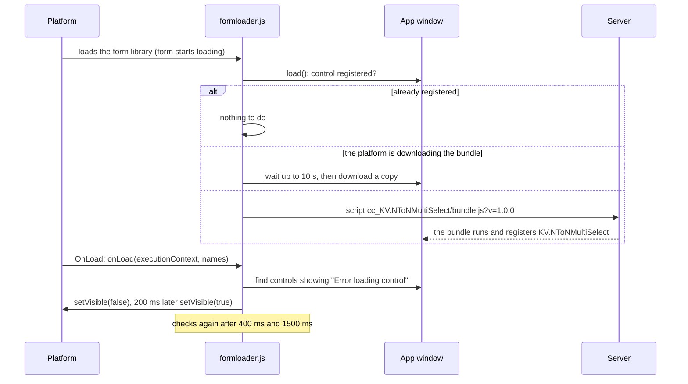

**When not to use it.** When the platform delivers the control itself, the field works without the library. If the
library is added anyway, it finds the control registered (or waits for the platform's download) and does nothing else.

### 7.6 Using the loader for another control

The loader is generic apart from its names. For a control of your own:

1. Change `CONTROL` to your `namespace.constructor` and `BUNDLE` to `cc_<namespace>.<constructor>/bundle.js`.
2. In `isRegistered`, change the global it checks (`host.KV.NToNMultiSelect`) to the global your bundle sets.
3. Rename the handler object `KVNToNMultiSelectLoader`, so two loaders on one form do not overwrite each other.
4. Keep the `__VERSION__` placeholder and stamp it in your build, as `scripts/build.mjs` does.

---

## 8. The names copy plug-in

This chapter explains the C# plug-in in `plugin/NamesCopy/`: what it does, how it is registered, and how each part of
the code works.

### 8.1 Purpose

*Copy names into the host column* lets the control write the selected names into the host column. On its own, the
control only sees changes made in the control itself and in subgrids on the same form. It cannot see links made:

* in subgrids on other forms, or from the other side of the relationship;
* by Power Automate flows, imports, integrations or the Web API.

The plug-in runs inside Dataverse for every link made or removed, wherever it comes from. After each Associate or
Disassociate, it rewrites the host column of each affected record from the links saved in the database. Two other
changes make the host columns out of date without any link message:

* When a linked record is **deleted**, Dataverse removes its links **without** a Disassociate message. The two Delete
  steps cover that case (8.10).
* When a linked record is **renamed**, no link changes at all. The Update step covers that case (8.11).

The solution `NToNMultiSelectWithPlugin` contains the Associate and Disassociate steps only (1.2). The Delete and
Update steps are created in the environment, for each linked table only, by the steps page that the solution also
contains (8.17). Limited to the linked tables, they cost nothing on the deletes and updates of any other table (8.15).

The plug-in has **no configuration of its own**. It reads the settings of the control on the published forms.

| Where to look | What it does |
| --- | --- |
| `NamesCopyPlugin.Execute` | Entry point of every step |
| `ReadForms`, `LoadForms`, `NamesCopyHelpers.ParseFormXml` | Finds which relationships and host columns copy names |
| `CopyPlanOf`, `LoadPlan`, `TableMetadata`, `SupportsPrincipalAccess` | Works out where the names come from, checks the host columns, and reads what the tag check needs: the host table's ownership, its Write privilege, and whether Dataverse answers `RetrievePrincipalAccess` for it |
| `ControlCopy`, `ControlMayWrite`, `Without` | The tag check: leaves alone the column the control writes itself, when the user who made the link may write it |
| `Rebuild`, `ReadRecord`, `ReadLinks`, `Changes`, `NamesCopyHelpers.NamesText` | Reads the links and writes the names (for a rename, with the new name in place of the saved one) |
| `ExecuteDelete`, `NoteLinkedHosts`, `RebuildNotedHosts` | The two Delete steps (8.10) |
| `ExecuteUpdate`, `ReadOther`, `CopyIntoTarget` | The Update step (8.11) |
| `ReadRoutes`, `LoadRoutes`, `ReadHosts` | Finds the host records linked to a record that is deleted or renamed (Delete and Update steps) |
| `Deadline`, `CopiesTime`, `Deadlines` | The 30-second budget that the copies of the deletes and renames of one operation share |
| `FromCache`, `Cached<T>`, `DropExpiredPlans` | The 2-minute caches |
| `SystemService` | The organization service that runs as SYSTEM (8.14) |
| `BeingDeleted` | Leaves out records that the same operation is deleting |

The steps page, which creates the Delete and Update steps for each linked table, is a web page of its own in
`plugin/steps-page/` (8.17).

### 8.2 Registration

To run, a plug-in must be **registered**: Dataverse must know the assembly (the compiled `.dll`), the plug-in type (the
class) and the **steps**. A step says on which message (operation) the class runs, at which stage, and how.

**Assembly and type** (`plugin/registration/PluginAssemblies/.../NToNMultiSelectNamesCopy.dll.data.xml`):

| Item | Value |
| --- | --- |
| Assembly | `NToNMultiSelect.NamesCopy`, version 1.0.0.0, .NET Framework 4.6.2, strong-named |
| Isolation | Sandbox (`<IsolationMode>2</IsolationMode>`); stored in the database (`<SourceType>0</SourceType>`) |
| Plug-in type | `NToNMultiSelect.NamesCopy.NamesCopyPlugin`, friendly name *N:N Multi-Select names copy* |
| Plug-in type description | "Writes the linked names into the host column of N:N Multi-Select (Copy names into the host column = Yes) when records are linked or unlinked anywhere; with the Delete and Update steps its steps page makes, also when a linked record is deleted or renamed." |

**The link steps in the package** (`plugin/registration/SdkMessageProcessingSteps/`, one file per step; there are no
other step files):

| Step name | Message | Stage | Mode | Primary table |
| --- | --- | --- | --- | --- |
| N:N Multi-Select names copy: Associate | Associate | PostOperation (40) | Synchronous | None |
| N:N Multi-Select names copy: Disassociate | Disassociate | PostOperation (40) | Synchronous | None |

Both have the description "Copies the linked names into the host column (N:N Multi-Select)." They have no images (no
copies of the record before or after the change), no filtering attributes, rank 1, server deployment, and they are
customizable (`<IsCustomizable>1</IsCustomizable>`), so an administrator can turn them off even in a managed
installation. `scripts/build-with-plugin.mjs` stops when `plugin/registration` holds a step of another message, or not
exactly one step of each (9.3).

**The steps the steps page creates** for each linked table, in the environment (no released package contains them):

| Step name | Message | Stage | Mode | Primary table | Filtering attributes |
| --- | --- | --- | --- | --- | --- |
| N:N Multi-Select names copy: Delete 1 of 2 (find linked records) for `<table>` | Delete | PreValidation (10) | Synchronous | The linked table | None |
| N:N Multi-Select names copy: Delete 2 of 2 (update their names) for `<table>` | Delete | PostOperation (40) | Synchronous | The linked table | None |
| N:N Multi-Select names copy: Update (follow renames) for `<table>` | Update | PreOperation (20) | Synchronous | The linked table | The table's primary name column |

For example *N:N Multi-Select names copy: Update (follow renames) for new_skill*. Each has a fixed id computed from the
table and the step (8.17.6), rank 1, server deployment and no images. Their descriptions are in the page (`KINDS`,
8.17.7); the Update step's reads "Before an update of this table that sets its name, compares the saved name with the
new one; when it changes, writes the new name into the names columns of the records linked to it."

**Why the link steps have no primary table, and the others one.** The Associate and Disassociate messages cannot be
registered for one table, so a step on them runs for every N:N link in the environment, including system
relationships. For any relationship that no form copies, the step ends after a dictionary lookup in memory, without a
service call once the forms are cached (8.5, 8.6). The Delete and Update messages can be limited to a table, and they
are: a Delete or Update step registered for every table would run on every delete and every update in the
environment, and the call into the sandbox alone costs time even when the plug-in returns at once. Measured, about
15–50 ms more per delete and 15–30 ms more per update, on every table (8.15). Limited to the linked tables, and the
Update step to the name column, they cost nothing on any other table. The steps page creates them so (8.17, recipe
10.8).

### 8.3 The entry point: Execute

Every step calls `Execute`. It sends Delete and Update to methods of their own (`ExecuteDelete`, 8.10, and
`ExecuteUpdate`, 8.11), ignores any other message, and handles Associate and Disassociate itself.

`plugin/NamesCopy/NamesCopyPlugin.cs`, `Execute` (about lines 69–128):

```csharp
public void Execute(IServiceProvider serviceProvider)
{
    var context = (IPluginExecutionContext)serviceProvider.GetService(typeof(IPluginExecutionContext));
    if (context.MessageName == "Delete")
    {
        ExecuteDelete(serviceProvider, context);
        return;
    }
    if (context.MessageName == "Update")
    {
        ExecuteUpdate(serviceProvider, context);
        return;
    }
    if (context.MessageName != "Associate" && context.MessageName != "Disassociate") return;
    var target = Input<EntityReference>(context, "Target");
    var relationship = Input<Relationship>(context, "Relationship");
    var related = Input<EntityReferenceCollection>(context, "RelatedEntities");
    if (target == null || string.IsNullOrEmpty(relationship?.SchemaName) || related == null) return;

    var service = SystemService(serviceProvider);
    var forms = ReadForms(context, service);
    // Links of every other relationship end here, without a service call once the forms are read.
    if (!forms.TryGetValue(relationship.SchemaName.ToLowerInvariant(), out var hosts)) return;

    var tracing = (ITracingService)serviceProvider.GetService(typeof(ITracingService));
    var records = new[] { target }.Concat(related).ToList();
    var control = ControlCopy(context, relationship.SchemaName);
    foreach (var host in hosts)
    {
        // ...
        var ids = records.Where(r => r.LogicalName == host.Table).Select(r => r.Id).Distinct()
            .Where(id => !BeingDeleted(context, host.Table, id))
            .OrderBy(id => id)
            .ToList();
        if (ids.Count == 0) continue;
        var plan = CopyPlanOf(context, service, tracing, relationship.SchemaName, host);
        if (plan == null) continue;
        try
        {
            foreach (var id in ids)
            {
                // The control's record: the other host columns, if any.
                var copied = control != null && control.Table == host.Table && control.Id == id && ControlMayWrite(service.Value, context, plan, control)
                    ? Without(plan, control.Column)
                    : plan;
                if (copied != null) Rebuild(service.Value, tracing, copied, id);
            }
        }
        catch (Exception error)
        {
            // The transaction has ended: the link is rolled back with this message.
            throw new InvalidPluginExecutionException(
                $"N:N Multi-Select could not copy the names into {ColumnNames(plan.Table, plan.Columns.Select(c => c.Name))}: {error.Message}", error);
        }
    }
}
```

Step by step, for Associate and Disassociate:

1. **Read the input parameters.** An Associate or Disassociate request carries the `Target` record, the
   `Relationship` (its schema name) and the `RelatedEntities` (the records linked to or unlinked from the target).
2. **Look the relationship up in the form settings** (`ReadForms`). For any relationship that no form copies, the
   step ends here. Once the forms are cached, this costs no call to the server.
3. **Find the tag** of the control (`ControlCopy`, 8.8).
4. **For each host table** of the relationship, take the records of the request that belong to that table, leave out
   records that are being deleted (`BeingDeleted`, for example a Disassociate that a Delete performs first), and sort
   them by id.
5. **Get the copy plan** (8.7) and **rebuild** each record (8.9). For the record whose column the control writes
   itself, the plan without that column is used, when the user who made the link could write that column
   (`ControlMayWrite`, 8.8).

**Why a fixed order?** `Rebuild` locks each record it updates until the transaction ends. Two requests that update
the same records in a different order could each wait for a record the other holds: a deadlock, and one link rolled
back. Sorting by table (the hosts are already sorted, see `LoadForms`) and then by id gives every request the same
order.

**A self-referencing relationship** (a table linked to itself, for example "related projects") has the same table on
both sides: both records of the link are rebuilt.

### 8.4 The Associate and Disassociate flow

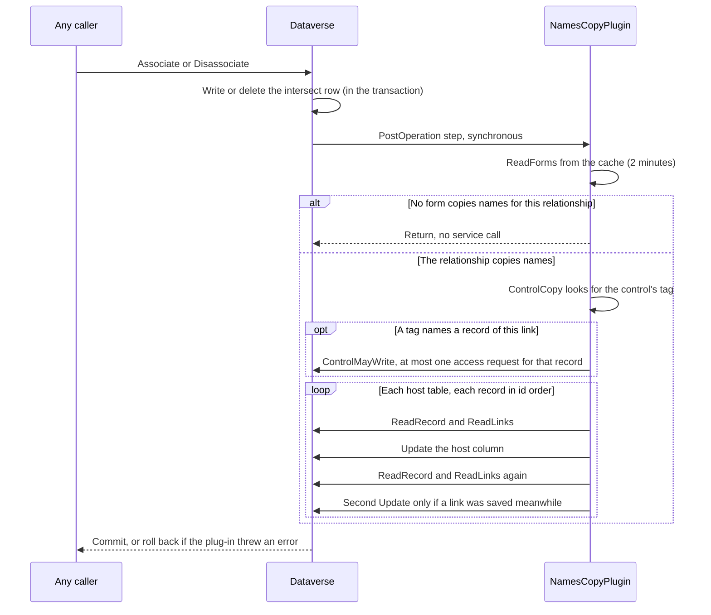

Because the steps are **PostOperation** and **synchronous**, they run inside the same database transaction as the
link, after the link is written. The plug-in therefore sees the new state (the new link is there; the removed link is
gone). If the plug-in throws an exception, the whole operation, link included, is rolled back.

**Very large link requests.** One Associate or Disassociate request can carry very many records (`RelatedEntities`),
which the SDK allows; the control sends one link per request, up to four at a time (4.4). The plug-in rewrites each
host record of the request in the same transaction, about 80–100 ms each. More than about 1,000 host records in one
request can reach the 2-minute limit of synchronous plug-ins, and Dataverse then rolls the whole request back. Link
such numbers of records in smaller batches.

### 8.5 Finding the configuration in the published forms

The plug-in reads the settings of the control from the forms. A form's layout and its controls' settings are stored
as **form XML** in the `systemform` table.

`plugin/NamesCopy/NamesCopyPlugin.cs`, `LoadForms` (about lines 715–737):

```csharp
private static IReadOnlyDictionary<string, Host[]> LoadForms(IOrganizationService service)
{
    // RetrieveMultiple returns the published form XML. The like filter leaves out the forms without the control;
    // an inactive form (formactivationstate 0) isn't shown to anyone, so its settings don't count.
    var query = new QueryExpression("systemform") { ColumnSet = new ColumnSet("objecttypecode", "formxml") };
    query.Criteria.AddCondition("formxml", ConditionOperator.Like, "%" + NamesCopyHelpers.ControlName + "%");
    query.Criteria.AddCondition("formactivationstate", ConditionOperator.Equal, 1);
    return service.RetrieveMultiple(query).Entities
        .SelectMany(form => NamesCopyHelpers.ParseFormXml(form.GetAttributeValue<string>("formxml")).Select(setting => new
        {
            Relationship = setting.RelationshipName.ToLowerInvariant(),
            Table = form.GetAttributeValue<string>("objecttypecode"),
            Column = setting.HostColumn,
        }))
        .Where(setting => !string.IsNullOrEmpty(setting.Table))
        .GroupBy(setting => setting.Relationship)
        .ToDictionary(byRelationship => byRelationship.Key, byRelationship => byRelationship
            .GroupBy(setting => setting.Table)
            .OrderBy(byTable => byTable.Key, StringComparer.Ordinal)
            .Select(byTable => new Host(byTable.Key,
                byTable.Select(setting => setting.Column).Distinct().OrderBy(column => column, StringComparer.Ordinal).ToArray()))
            .ToArray());
}
```

* **One query for the whole environment**: the active forms whose XML contains `.NToNMultiSelect`. The query returns the
  **published** form XML, so a form change counts once the form is published.
* The result is a dictionary: **relationship schema name (lower case) → host tables → host columns**. Tables and columns
  are sorted, which gives `Execute` its fixed order.
* The query has no paging: Dataverse returns at most 5,000 forms. More matching forms than that is practically never
  reached; the forms after the first 5,000 would be ignored.

Each form's XML is parsed by `ParseFormXml`.

`plugin/NamesCopy/NamesCopyHelpers.cs`, `ParseFormXml` (about lines 100–117):

```csharp
foreach (var control in form.Descendants().Where(e => e.Name.LocalName == "customControl"))
{
    var name = (string)control.Attribute("name");
    var parameters = Child(control, "parameters");
    // ...
    if (name == null || !name.EndsWith(ControlName, StringComparison.OrdinalIgnoreCase) || parameters == null) continue;
    var relationship = StaticValue(parameters, "relationshipName");
    var column = Child(parameters, "value")?.Value.Trim().ToLowerInvariant();
    if (string.IsNullOrEmpty(relationship) || string.IsNullOrEmpty(column) ||
        StaticValue(parameters, "writeSummary") != "1")
    {
        continue;
    }
    if (!settings.Any(s => string.Equals(s.RelationshipName, relationship, StringComparison.OrdinalIgnoreCase) && s.HostColumn == column))
    {
        settings.Add(new CopySetting(relationship, column));
    }
}
```

A control counts when:

1. its name ends with `.NToNMultiSelect` (the constant `ControlName`), whatever the publisher prefix and namespace
   before it;
2. its `relationshipName` parameter is a **static** value (typed in the form designer, `static="true"`);
3. it is bound to a host column (the `value` parameter);
4. its `writeSummary` parameter (*Copy names into the host column*) is a static `1` (Yes).

A form has a copy of the settings for each form factor (web, phone, tablet); any of them counts. Malformed XML gives no
settings. The XML is read with DTD processing prohibited and no external resolver.

For orientation, a simplified example of what the parser looks for (not a complete form):

```xml
<customControl formFactor="0" name="kv_KV.NToNMultiSelect">
  <parameters>
    <value>new_projectskills</value>
    <relationshipName type="SingleLine.Text" static="true">new_project_skill</relationshipName>
    <writeSummary type="Enum" static="true">1</writeSummary>
  </parameters>
</customControl>
```

**What this means for administrators:** setting *Copy names into the host column* to **No** on every form turns the
plug-in off for that relationship. A change takes effect after the form is published and the cache has expired
(within about 2 minutes).

### 8.6 Caches and their 2-minute lifetime

A plug-in instance is created once and reused, and it may run on several threads at once. Static fields live as long
as the sandbox worker process that loaded the assembly. The plug-in keeps four caches there:

| Cache | Key | Holds | Lifetime |
| --- | --- | --- | --- |
| `Forms` | Organization id | The dictionary from `LoadForms` | 2 minutes (`CacheTime`) |
| `Plans` | Organization, relationship, host table, host columns | The copy plan (8.7) | 2 minutes; expired plans are dropped when the forms are loaded again (`DropExpiredPlans`) |
| `Routes` | Organization id | The tables whose names are copied (8.7), built from the cached forms | Rebuilt whenever the forms are loaded again |
| `Deadlines` | `CorrelationId` of a delete or rename operation | The 30-second deadline of the copies of the Delete and Update steps (8.10, 8.11) | Removed at the next delete or rename operation in that worker that starts a deadline, once the deadline is more than 2 minutes past |

`plugin/NamesCopy/NamesCopyPlugin.cs`, `FromCache` (about lines 997–1012):

```csharp
private static T FromCache<TKey, T>(ConcurrentDictionary<TKey, Cached<T>> cache, TKey key, Func<T> load)
{
    if (cache.TryGetValue(key, out var cached) && (cached.Expires > Clock() || !cached.StartReload())) return cached.Value;
    T value;
    try
    {
        value = load();
    }
    catch
    {
        cached?.ReloadFailed();
        throw;
    }
    cache[key] = new Cached<T>(value);
    return value;
}
```

* A cached value younger than 2 minutes is returned at once.
* When it has expired, **one** thread loads it again (`StartReload` uses `Interlocked.CompareExchange`); the other
  threads keep using the old value meanwhile. Every link in the environment reads the forms, so this avoids many
  identical queries at once.
* A failed load is never cached: the next caller tries again.
* Cached values are never changed, only replaced whole, so other threads always read a complete value.

**Why 2 minutes?** It is a balance between cost and freshness. A longer time means fewer queries; a shorter time means
form changes count sooner. Each sandbox worker has its own caches, so after a form is published, different workers
may pick up the change at slightly different times, all within about 2 minutes. To change the time, see recipe 10.5.

### 8.7 Copy plans and routes

**A copy plan** says, for one relationship and one host table, where the names come from and which host columns can
take them. `LoadPlan` builds it with two metadata calls and one query:

1. `RetrieveRelationship` gets the relationship. If it is not an N:N relationship, nothing is copied.
2. It finds the side of the host table: Entity1 or Entity2. With a self-referencing relationship it uses Entity1, the
   same side the control reads.
3. `TableMetadata` reads both tables (primary id, primary name, ownership type, privileges, the host columns) with
   **one metadata query**.
4. It checks each host column. A column is left out, with the reason, when it does not exist, is not a text column, is
   calculated, rollup or formula (`SourceType > 0`), cannot be updated, or has no maximum length. Each column kept
   becomes a `HostColumn`: its name, its maximum length, and whether it has column security (`Secured`, from the
   column's `IsSecured`).
5. It records the intersect table and its two id columns, the other table's id and primary name column, and for the
   tag check (8.8) how the host table is owned (`Ownership`), the name of its Write privilege (`WritePrivilege`, the
   name of the table's privilege of type Write, read from its metadata), and whether Dataverse answers
   `RetrievePrincipalAccess` for it (`PrincipalAccess`, one query of its message filters by
   `SupportsPrincipalAccess`, 8.8).

The reasons are stored in `Problems`. `CopyPlanOf` traces them in every execution that meets them and skips the
columns, and the link is kept. A plan with no usable column counts as "copies nothing".

**Why queries rather than Retrieve calls?** In a Dataverse transaction, a failed service call ends the transaction.
A `RetrieveAttribute` call for a column that does not exist would fail and roll back the user's link. A metadata
query simply returns nothing for a missing column. The same idea is used for records: `ReadRecord` uses
`RetrieveMultiple`, which returns no row for a record deleted meanwhile, instead of a `Retrieve`, which would fail.

**Routes** are the reverse view, used by the Delete steps and the Update step: for each table whose records' names
are copied somewhere (a **linked table**), the relationships and host columns that hold them. `LoadRoutes` builds them
with one metadata query of the host tables' N:N relationships. A relationship named in a form that no longer exists is
simply not found, again without a failed call. For a delete or an update of a table that is not in the routes, Delete
1 of 2 and the Update step end with that dictionary lookup.

### 8.8 The tag protocol with the control

When the control makes a link while *Copy names into the host column* is Yes, it writes the names itself once its
links are saved. If the plug-in also rewrote that column, every link would be written twice and cost more time. So
the control **tags** its own requests, and the plug-in leaves exactly that column of that record alone, after checking
that the user who made the link could write that column themselves.

**How the control builds the tag.** `linkTag` and `tagQuery` in `control/NToNMultiSelect/src/relatedData.ts` build
the tag and the query string (the code is in 4.5). The five parts are: the fixed prefix `NToNMultiSelect`, the
relationship schema name, the logical name of the form's table, the record id (lower case, no braces) and the host
column's logical name. The controller only passes a tag while the setting is on and the host column is known.

`control/NToNMultiSelect/index.ts`, `linkTag` (about lines 1080–1083):

```ts
private linkTag(rel: RelationshipInfo, recordId: string): string | undefined {
    const host = (this.context.parameters.value as unknown as { attributes?: { LogicalName?: string } }).attributes?.LogicalName;
    return this.config?.writeSummary && host ? linkTag(rel, recordId, host) : undefined;
}
```

The tag travels as the Web API's `tag` query parameter, for example
`POST <environment URL>/api/data/v9.2/<entity set>(<id>)/<navigation property>/$ref?tag=NToNMultiSelect%7C...`.
Dataverse hands this value to the plug-ins of the request in `SharedVariables["tag"]`. `SharedVariables` is a property
bag of the execution context that carries values between the steps of one request.

**How the plug-in reads it.** `plugin/NamesCopy/NamesCopyPlugin.cs`, `ControlCopy` (about lines 166–179):

```csharp
private static ControlColumn ControlCopy(IPluginExecutionContext context, string relationshipName)
{
    for (var c = context; c != null && c.Mode == 0; c = c.ParentContext)
    {
        if (!c.SharedVariables.TryGetValue("tag", out object value) || !(value is string tag) || !tag.StartsWith(ControlTag, StringComparison.Ordinal)) continue;
        var parts = tag.Split('|');
        if (parts.Length == 5 && string.Equals(parts[1], relationshipName, StringComparison.OrdinalIgnoreCase) &&
            !string.IsNullOrEmpty(parts[2]) && Guid.TryParse(parts[3], out var id) && !string.IsNullOrEmpty(parts[4]))
        {
            return new ControlColumn(parts[2], id, parts[4]);
        }
    }
    return null;
}
```

* It looks in the step's own context and then up the **parent contexts**. A parent context is the context of the
  operation that caused this one; for example, another plug-in that makes a link during the control's request.
* It stops at an **asynchronous** parent (`Mode` 1). Work queued by the request runs later, maybe after the control has
  written the names, so its links count as made elsewhere.
* The tag must have five parts and name the same relationship (not case-sensitive).

**Why the tag is checked.** Any caller can send a tag: it is an ordinary parameter of the request. A user who may link
records but not write the host record could otherwise send a tag of the control's form with the links, and the plug-in
would leave the host column alone: the column would stay out of date. So the plug-in follows the tag **only when the
user who made the link could write that column themselves**. `Execute` asks `ControlMayWrite` only for the record the
tag names (8.3).

`plugin/NamesCopy/NamesCopyPlugin.cs`, `ControlMayWrite` (about lines 191–215):

```csharp
private static bool ControlMayWrite(IOrganizationService service, IPluginExecutionContext context, CopyPlan plan, ControlColumn control)
{
    var column = plan.Columns.FirstOrDefault(c => c.Name == control.Column);
    if (column == null || column.Secured) return false;
    if (plan.PrincipalAccess)
    {
        var access = (RetrievePrincipalAccessResponse)service.Execute(new RetrievePrincipalAccessRequest
        {
            Principal = new EntityReference("systemuser", context.InitiatingUserId),
            Target = new EntityReference(control.Table, control.Id),
        });
        return (access.AccessRights & AccessRights.WriteAccess) != 0;
    }
    if (plan.Ownership == OwnershipTypes.OrganizationOwned && !string.IsNullOrEmpty(plan.WritePrivilege))
    {
        // Organization-owned: the privilege is for every record of the table. Roles of the user's teams count.
        var privileges = (RetrieveUserPrivilegeByPrivilegeNameResponse)service.Execute(new RetrieveUserPrivilegeByPrivilegeNameRequest
        {
            PrivilegeName = plan.WritePrivilege,
            UserId = context.InitiatingUserId,
        });
        return privileges.RolePrivileges != null && privileges.RolePrivileges.Length > 0;
    }
    return false;
}
```

1. **No column security.** A host column with column security (`HostColumn.Secured`, 8.7) never lets the tag count.
   For such a column the plug-in rewrites the column on the control's links too; the control writes it as well when
   the user may update it (5.9.2).
2. **The user may write the record.** The question is asked for the user the request runs for (`InitiatingUserId`:
   the user who made the link; with impersonation, the impersonated user), with the copy plan's `PrincipalAccess`,
   `Ownership` and `WritePrivilege` (8.7), which are cached with the plan:
   * a table for which Dataverse answers `RetrievePrincipalAccess` (most tables owned by users or teams):
     `RetrievePrincipalAccess` returns that user's access rights to the tagged record, and the tag counts when they
     include Write (`AccessRights.WriteAccess`);
   * otherwise, a table owned by the organization: the Write privilege is for every record of the table, so
     `RetrieveUserPrivilegeByPrivilegeName` asks whether the user has the table's Write privilege, under the name read
     from the table's metadata; roles the user has through teams count too;
   * any other table: the tag is ignored.
3. **Otherwise** `ControlMayWrite` returns false, and the column is rebuilt as for any other link.

**Which tables answer `RetrievePrincipalAccess`.** Dataverse lists the messages it supports for each table in the
`sdkmessagefilter` table (the **message filters**), and support for `RetrievePrincipalAccess` does not follow from
how a table is owned. Measured in a development environment, no table owned by the organization had a message filter
for it, and 17 of the 384 user-owned tables (owned by users or teams) had none either, for example `activitypointer`.
A `RetrievePrincipalAccess` request for such a table fails, and a failed request ends the link's transaction. So
`LoadPlan` looks for that message filter of the host table when it builds the copy plan, and stores the answer as
`PrincipalAccess`. `plugin/NamesCopy/NamesCopyPlugin.cs`, `SupportsPrincipalAccess` (about lines 222–229):

```csharp
private static bool SupportsPrincipalAccess(IOrganizationService service, string table)
{
    var query = new QueryExpression("sdkmessagefilter") { ColumnSet = new ColumnSet("sdkmessagefilterid"), TopCount = 1 };
    query.Criteria.AddCondition("primaryobjecttypecode", ConditionOperator.Equal, table);
    var message = query.AddLink("sdkmessage", "sdkmessageid", "sdkmessageid");
    message.LinkCriteria.AddCondition("name", ConditionOperator.Equal, "RetrievePrincipalAccess");
    return service.RetrieveMultiple(query).Entities.Count > 0;
}
```

The query asks for at most one message filter whose primary table is the host table and whose message
(`sdkmessage`) is `RetrievePrincipalAccess`. Unlike a request that the table does not support, it does not fail for
any table: it finds no row. It runs when the copy plan is loaded, so at most once every 2 minutes for each
relationship, host table and host columns in each sandbox worker (8.6), and never on a link that finds its plan in the
cache.

**One request, and never a failed one.** The check costs at most one request, only for a tagged link, and none when
the column has column security or the table gets no check. It runs inside the link's transaction, where a failed
request would end the transaction and roll the link back with an error (8.12). So each table gets only a request that
works for it: `RetrievePrincipalAccess` only where its message filter shows that Dataverse answers it, and
`RetrieveUserPrivilegeByPrivilegeName`, which asks about a privilege rather than a record, for the other tables owned
by the organization. Should the request still fail, the error is thrown like any failed call of the rebuild ("N:N
Multi-Select could not copy the names into `<columns>`: `<reason>`", Appendix B), and the link is rolled back.

**What it skips:** only that host column, of that record, for that relationship, and only when `ControlMayWrite`
returns true (`Without` removes the column from the plan; when it was the only column, the record is skipped).

**What it does not skip:** the other records of the same link (for example the related record, when its table also
copies names), other host columns of the same record, every untagged link (subgrids, flows, imports, the Web API), and
the tagged column when the check says no or the host table gets no check.

**Effect:** a user who can link records but cannot write the host record (or its secured host column) can no longer
keep the host column out of date with a forged tag. Links made in the control cost about the same with or without the
plug-in installed (see the measurements in 8.15): measured in a development environment, the check made no measurable
difference (the times stayed within the run-to-run variation). On a host table that gets no check, the plug-in
rewrites the tagged column on the control's links too: the column stays right, and each of those links takes the time
of a rebuild (about 70 ms, 8.15).

**Whose names end up in the column.** For the column it skips, the control writes the names itself, from the saved
links read with the editing user's privileges (5.4.3): the names that user can see. For links made elsewhere, the
plug-in writes every linked name as SYSTEM (8.14). Where some users cannot read some related records, the text in the
column therefore depends on where the last change was made.

**When the control does not get to write.** The plug-in skips the tagged column whether or not the control writes it
later. If the page is closed before the control has written the names (the user leaves through the browser's prompt,
or the browser or app closes without asking), the links stay, and the host column can miss their names until the
record's links next change (5.8). Covering that case would mean rebuilding the column on every link of the control,
about 70 ms each (8.15).

### 8.9 Rebuild: writing the names

`plugin/NamesCopy/NamesCopyPlugin.cs`, `Rebuild` (about lines 872–905):

```csharp
private static void Rebuild(IOrganizationService service, ITracingService tracing, CopyPlan plan, Guid id, LinkedName rename = null)
{
    var record = ReadRecord(service, plan, id);
    if (record == null)
    {
        tracing.Trace("{0} {1} no longer exists.", plan.Table, id);
        return;
    }
    var links = ReadLinks(service, plan, id, rename);
    // ...
    var update = Changes(plan, id, record, links, true);
    service.Update(update);
    tracing.Trace("{0} {1}: {2} updated ({3} links).", plan.Table, id, string.Join(", ", update.Attributes.Keys), links.Count);

    // ...
    record = ReadRecord(service, plan, id);
    if (record == null) return;
    links = ReadLinks(service, plan, id, rename);
    update = Changes(plan, id, record, links, false);
    if (update == null) return;
    service.Update(update);
    tracing.Trace("{0} {1}: {2} updated again with links saved meanwhile ({3} links).",
        plan.Table, id, string.Join(", ", update.Attributes.Keys), links.Count);
}
```

1. **`ReadRecord`** reads the host columns of the record. A record that no longer exists is traced and skipped.
2. **`ReadLinks`** reads every link of the record from the intersect table, joined to the other table for the primary
   name. It reads pages of 5,000 rows and follows the paging cookie, so a record with any number of links is read
   completely.
3. **`Changes(..., true)`** builds an update with the names text of **every** copied column, and the first
   `Update` is sent even when the text has not changed.
4. **The second read.** The first update takes the record's row lock and holds it until the transaction commits. Links
   to one record can be saved in parallel transactions (other users, flows, integrations). A transaction does not see
   the links of the others until they commit. Reading the record and its links again **after** taking the lock includes
   every link committed before this transaction got the lock. `Changes(..., false)` keeps only the columns whose text
   differs, and a second update writes them. Because the first update is always sent, this transaction always holds
   the lock, so of two parallel transactions the second one always sees the first one's change.
5. **`rename`** is only given by the Update step (8.11): a linked record renamed in this transaction, whose new name is
   not saved yet. Both reads of the links get it.

`plugin/NamesCopy/NamesCopyPlugin.cs`, `ReadLinks` (about lines 922–948):

```csharp
private static List<LinkedName> ReadLinks(IOrganizationService service, CopyPlan plan, Guid id, LinkedName rename = null)
{
    var query = new QueryExpression(plan.Intersect)
    {
        ColumnSet = new ColumnSet(plan.OtherAttribute),
        PageInfo = new PagingInfo { Count = PageSize, PageNumber = 1 },
    };
    query.Criteria.AddCondition(plan.HostAttribute, ConditionOperator.Equal, id);
    var linked = query.AddLink(plan.OtherTable, plan.OtherAttribute, plan.OtherId, JoinOperator.Inner);
    linked.EntityAlias = "t";
    linked.Columns = new ColumnSet(plan.OtherName);
    var links = new List<LinkedName>();
    for (;;)
    {
        var page = service.RetrieveMultiple(query);
        foreach (var row in page.Entities)
        {
            var other = row.GetAttributeValue<Guid>(plan.OtherAttribute).ToString();
            var name = row.GetAttributeValue<AliasedValue>("t." + plan.OtherName)?.Value as string;
            links.Add(rename != null && rename.Id == other ? rename : new LinkedName(other, name));
        }
        if (!page.MoreRecords) break;
        query.PageInfo.PageNumber++;
        query.PageInfo.PagingCookie = page.PagingCookie;
    }
    return links;
}
```

Each row of the intersect table becomes a `LinkedName`: the linked record's id and its saved name, or `(No name)` when
the name is blank. The link whose id is that of `rename` takes the new name instead of the saved one.

**The names text.** `plugin/NamesCopy/NamesCopyHelpers.cs`, `NamesText` (about lines 214–228):

```csharp
public static string NamesText(IEnumerable<LinkedName> links, int? maxLength, out bool wasCut)
{
    var sorted = links.ToList();
    sorted.Sort(CompareLinks);
    var value = string.Join(Separator, sorted.Select(link => link.Name));
    wasCut = maxLength > 0 && value.Length > maxLength;
    if (wasCut)
    {
        // The length counts UTF-16 code units: never keep the first half of a character outside the BMP (an emoji).
        var cut = maxLength.Value - 1;
        if (cut > 0 && char.IsHighSurrogate(value[cut - 1])) cut--;
        return value.Substring(0, cut) + "…";
    }
    return value.Length == 0 ? null : value;
}
```

The text follows exactly the rules of the control (`namesText` in `control/NToNMultiSelect/src/namesCopy.ts`):

* names sorted by name, ignoring case and accents, with numbers compared by value ("Skill 2" before "Skill 10"), then
  by id so that equal names always come in the same order;
* joined with `"; "`;
* cut to the column's maximum length, ending with `…`;
* empty (`null`) when nothing is linked;
* a record without a name is written as `(No name)`.

The control sorts with the browser's `Intl.Collator`. `NamesCopyHelpers.SortKey` turns each name into a key that the
invariant culture of .NET compares in the same order (digit runs become their length and digits; punctuation becomes
an apostrophe and its rank in the browser's order). The source names what can still differ: letters that a language
sorts its own way (for example å in Swedish) and symbols outside ASCII. Both sides must stay in step: see recipe 10.6.

### 8.10 The Delete steps

When a record is deleted, Dataverse deletes its intersect rows itself, before the PreOperation stage, and **without**
a Disassociate. The host records that were linked to it would keep its name. Two steps on Delete fix that. The steps
page creates them in the environment for each linked table, with that table as primary table (8.17); no package
contains them.

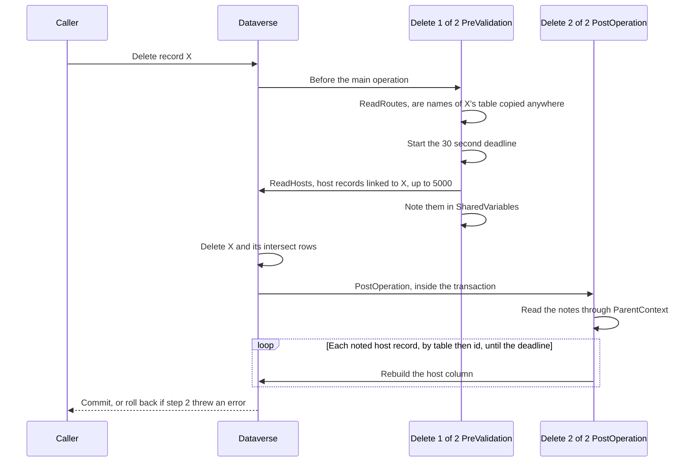

`plugin/NamesCopy/NamesCopyPlugin.cs`, `ExecuteDelete` (about lines 290–297):

```csharp
private static void ExecuteDelete(IServiceProvider serviceProvider, IPluginExecutionContext context)
{
    var target = Input<EntityReference>(context, "Target");
    if (target == null || target.Id == Guid.Empty || string.IsNullOrEmpty(target.LogicalName)) return;
    var key = NotesKey(target);
    if (context.Stage == 10) NoteLinkedHosts(serviceProvider, context, target, key);
    else if (context.Stage == 40) RebuildNotedHosts(serviceProvider, context, target, key);
}
```

**Step 1 of 2, PreValidation (`NoteLinkedHosts`).** PreValidation runs while the links still exist.

1. `ReadRoutes` checks whether the deleted record's table holds names that are copied anywhere. Deletes of every other
   table end here, with a dictionary lookup. With the steps limited to the linked tables, Dataverse calls the steps
   only for those tables, so this lookup ends a delete only when no active form copies the names of the step's table
   (for example a relationship added by hand on the steps page that no form uses yet, 8.17.4).
2. It starts the deadline (see below).
3. For each route, `ReadHosts` reads the host records linked to the deleted record: **one page of up to 5,000**. More
   could not be rebuilt within the deadline anyway; the excess is traced.
4. It writes **notes** into `SharedVariables` under the key `NToNMultiSelect.NamesCopy.Delete|<table>|<id>`. Each note
   has the form `relationship schema name|host table|host columns|id,id,...`; notes are joined with `;`. A note holds
   everything step 2 needs, so step 2 reads neither the forms nor the routes.

**Step 2 of 2, PostOperation (`RebuildNotedHosts`).** PostOperation runs after the record and its links are gone.

1. It reads the notes. Variables set in PreValidation reach PostOperation through `ParentContext` (the PreValidation
   step runs in a context of its own), so it looks in its own variables first and then up the parent contexts.
2. It sorts the work by table and id, the same order as every rebuild, so that a delete and a link of the same records
   cannot deadlock.
3. It rebuilds each noted record until the deadline has passed. The records left over keep the deleted name, and
   their number is traced.

**The 30-second deadline.** Dataverse stops a whole operation after 2 minutes, with all its synchronous steps and
cascaded deletes, and rolls it back. The copies of one delete or rename operation therefore get a budget of 30 seconds
(`CopiesTime`). The Delete steps and the Update step (8.11) share it.

`plugin/NamesCopy/NamesCopyPlugin.cs`, `Deadline` (about lines 413–431):

```csharp
private static DateTime Deadline(IPluginExecutionContext context)
{
    for (var c = context; c != null; c = c.ParentContext)
    {
        if (c.SharedVariables.TryGetValue(DeadlineKey, out object value) && value is long ticks) return new DateTime(ticks, DateTimeKind.Utc);
    }
    var now = Clock();
    var deadline = now + CopiesTime;
    if (context.CorrelationId != Guid.Empty)
    {
        foreach (var old in Deadlines.Where(d => d.Value < now - CacheTime))
        {
            ((ICollection<KeyValuePair<Guid, DateTime>>)Deadlines).Remove(old);
        }
        deadline = Deadlines.GetOrAdd(context.CorrelationId, deadline);
    }
    context.SharedVariables[DeadlineKey] = deadline.Ticks;
    return deadline;
}
```

The first delete or rename of a request that needs the deadline sets it in its `SharedVariables`. A nested or cascaded
delete (a delete caused by another delete) or rename finds it through `ParentContext`, or else in the `Deadlines`
dictionary by the request's `CorrelationId` (an id that all operations of one request share), when it runs in the
same sandbox worker. So all the deletes and renames of one operation share one 30-second budget.

**Limits of the Delete steps:**

* About 80–100 ms per linked record, so roughly 300–350 records fit in the 30 seconds. Records beyond that, and beyond
  the first 5,000 linked records, keep the deleted name until their links next change.
* The user who deletes waits while the names are rewritten (the steps are synchronous).
* A record linked to itself (self-referencing relationship) is deleted with its copy, so it is left out.

**Turning the Delete steps off is safe.** With step 1 off, with step 2 off, with both off and with both deleted,
deletes succeed and links made anywhere are still copied. The only effect: the deleted record's name stays in the host
columns of the records it was linked to, until their links next change. See 8.16.

### 8.11 The Update step: following renames

Renaming a linked record (for example a skill) changes none of its links: Dataverse sends no Associate, Disassociate
or Delete, and the host records linked to it would keep its old name. The Update step rewrites them with the new name.
The steps page creates it in the environment for each linked table, with that table as primary table and its primary
name column as filtering attribute (8.17); no package contains it.

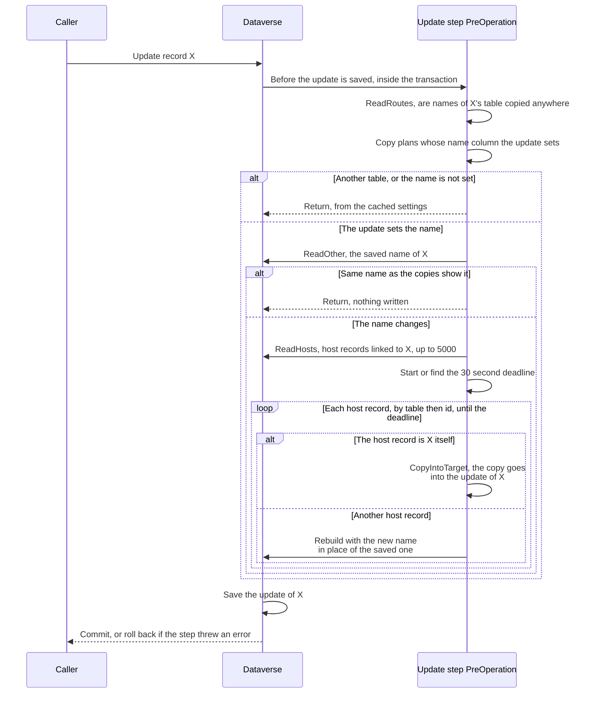

`plugin/NamesCopy/NamesCopyPlugin.cs`, `ExecuteUpdate` (about lines 444–505):

```csharp
private static void ExecuteUpdate(IServiceProvider serviceProvider, IPluginExecutionContext context)
{
    if (context.Stage != 20) return;
    var target = Input<Entity>(context, "Target");
    if (target == null || target.Id == Guid.Empty || string.IsNullOrEmpty(target.LogicalName)) return;
    var service = SystemService(serviceProvider);
    // Updates of every other table end here, without a service call once the forms and routes are read.
    if (!ReadRoutes(context, service).TryGetValue(target.LogicalName, out var routes)) return;
    var tracing = (ITracingService)serviceProvider.GetService(typeof(ITracingService));
    var plans = routes.Select(route => CopyPlanOf(context, service, tracing, route.SchemaName, route.Host))
        .Where(plan => plan != null && plan.OtherTable == target.LogicalName && target.Contains(plan.OtherName))
        .ToList();
    if (plans.Count == 0) return;

    // Every plan reads the same column: the table's primary name.
    var rename = new LinkedName(target.Id.ToString(), target.GetAttributeValue<string>(plans[0].OtherName));
    var work = new List<KeyValuePair<CopyPlan, Guid>>();
    try
    {
        var saved = ReadOther(service.Value, plans[0], target.Id);
        // Compared as the copies show them: no name and a blank one are both "(No name)".
        if (saved == null || new LinkedName(rename.Id, saved.GetAttributeValue<string>(plans[0].OtherName)).Name == rename.Name) return;
        foreach (var plan in plans)
        {
            foreach (var id in ReadHosts(service.Value, tracing, plan, target.ToEntityReference()).Where(id => !BeingDeleted(context, plan.Table, id)))
            {
                work.Add(new KeyValuePair<CopyPlan, Guid>(plan, id));
            }
        }
    }
    catch (Exception error)
    {
        throw new InvalidPluginExecutionException(
            $"N:N Multi-Select could not read the records that hold the name of {target.LogicalName} {target.Id}: {error.Message}", error);
    }
    // In the order of every rebuild (by table, then id), so that a rename and a link of the same records can't
    // deadlock. A record linked through two relationships is rebuilt once for each, one after the other.
    work = work.OrderBy(w => w.Key.Table, StringComparer.Ordinal).ThenBy(w => w.Value).ToList();

    var deadline = Deadline(context);
    for (var i = 0; i < work.Count; i++)
    {
        var plan = work[i].Key;
        var id = work[i].Value;
        if (Clock() > deadline)
        {
            tracing.Trace("{0} {1}: the time for the copies of this rename ran out; {2} linked records keep its old name until their links next change.",
                target.LogicalName, target.Id, work.Count - i);
            return;
        }
        try
        {
            if (plan.Table == target.LogicalName && id == target.Id) CopyIntoTarget(service.Value, plan, target, rename);
            else Rebuild(service.Value, tracing, plan, id, rename);
        }
        catch (Exception error)
        {
            throw new InvalidPluginExecutionException(
                $"N:N Multi-Select could not copy the names into {ColumnNames(plan.Table, plan.Columns.Select(c => c.Name))} of {plan.Table} {id}: {error.Message}", error);
        }
    }
}
```

**Why PreOperation.** Only before the update is saved can the old name still be read. PreOperation (stage 20) runs
inside the transaction, just before Dataverse writes the update: the saved row still holds the old name, and the
`Target` holds the new one. The step can therefore tell a rename from an update that sets the name the record already
has (imports and integrations that send every column do that) or that sets other columns only, and it writes nothing
for those. After the save, in PostOperation, the old name is gone. `ExecuteUpdate` returns at once in any other stage,
so keep the step **synchronous** and in **PreOperation** (an asynchronous step runs after the operation).

Step by step:

1. **Is the table's name copied anywhere?** The `Target` of an Update is an `Entity` with the columns the update sets.
   `ReadRoutes` (8.7) looks its table up in the routes. Updates of every other table end here, without a service call
   once the forms and routes are cached.
2. **Does the update set the name?** For each route, `CopyPlanOf` gets the copy plan from the cache. A plan is kept
   when it copies the names of the target's table (`plan.OtherTable`) and the target contains that table's primary
   name column (`plan.OtherName`). An update of a linked table that does not set the name ends here, from the cached
   plans, without a service call. (With the filtering attribute that the steps page sets, the table's primary name
   column, Dataverse does not even call the step for such updates.) Every plan kept reads the same column, so the new
   name is taken once, as the `LinkedName` `rename`.
3. **Has the name changed?** `ReadOther` reads the saved name with one query. The two names are compared **as the
   copies show them**: both go through `LinkedName`, which shows a blank or missing name as `(No name)`, so a blank
   name replacing a missing one is no change. When the names are the same, or the record is not found, the step
   returns and writes nothing.
4. **Which records hold the name?** For each plan, `ReadHosts` reads the host records linked to the renamed record:
   one page of up to 5,000 per relationship (more are traced, 8.13). Records that the same operation is deleting are
   left out (`BeingDeleted`). The work is sorted by table, then id, the order of every rebuild, so that a rename and a
   link of the same records cannot deadlock.
5. **The deadline.** `Deadline` (8.10) starts the 30-second budget, or finds the one that a delete or rename of the
   same operation already started.
6. **Rewrite each record.** `Rebuild(..., rename)` writes the names of each host record (8.9). The records left when
   the deadline has passed keep the old name, and their number is traced.

`plugin/NamesCopy/NamesCopyPlugin.cs`, `ReadOther` (about lines 522–527):

```csharp
private static Entity ReadOther(IOrganizationService service, CopyPlan plan, Guid id)
{
    var query = new QueryExpression(plan.OtherTable) { ColumnSet = new ColumnSet(plan.OtherName) };
    query.Criteria.AddCondition(plan.OtherId, ConditionOperator.Equal, id);
    return service.RetrieveMultiple(query).Entities.FirstOrDefault();
}
```

As in `ReadRecord`, a query rather than a `Retrieve`: a record that is not found gives no row instead of a failed call
(8.7).

**The new name in place of the saved one.** In PreOperation the new name is not saved yet, so the join to the renamed
record's table in `ReadLinks` still returns the old name. `ReadLinks` therefore puts `rename` in place of the link to
the renamed record. `plugin/NamesCopy/NamesCopyPlugin.cs`, `ReadLinks` (about line 941; the whole function is in 8.9):

```csharp
links.Add(rename != null && rename.Id == other ? rename : new LinkedName(other, name));
```

`Rebuild` passes `rename` to **both** of its reads of the links, and the second one needs it as much as the first. The
second read, under the row lock (8.9), also runs before the rename is saved. Without `rename` it would read the old
name, find that the text differs from the one the first update has just written, and write the old name back with the
second update.

**A record linked to itself.** In a self-referencing relationship (8.3), the renamed record can be one of the host
records linked to it. Rebuilding it would send a second Update of the same record from inside its own update. That
would change the record's row version before the update being saved is written, and fail an update that checks the
row version. `CopyIntoTarget` puts the copy into the `Target` of the update being saved instead, so that one save
writes both the new name and its copy.

`plugin/NamesCopy/NamesCopyPlugin.cs`, `CopyIntoTarget` (about lines 512–516):

```csharp
private static void CopyIntoTarget(IOrganizationService service, CopyPlan plan, Entity target, LinkedName rename)
{
    var links = ReadLinks(service, plan, target.Id, rename);
    foreach (var column in plan.Columns) target[column.Name] = NamesCopyHelpers.NamesText(links, column.MaxLength);
}
```

**Errors.** The update runs in a transaction, and a failed call has ended it, so every failure is thrown and the
rename is rolled back (8.12):

* a failed read of the saved name or of the linked records:
  `N:N Multi-Select could not read the records that hold the name of <table> <id>: <reason>`;
* a failed rewrite of a host record, or a failed read of the links of a record linked to itself:
  `N:N Multi-Select could not copy the names into <columns> of <table> <id>: <reason>`;
* a failed read of the forms, the routes or a copy plan, with the messages of `ReadForms`, `ReadRoutes` and
  `CopyPlanOf` (Appendix B). The step runs only for updates of the linked table that set its name; the forms and the
  routes are read for such an update once their cache has expired, so a failure there rolls back that update, even
  when the name it sets is the one the record already has.

The time running out is not an error: the rename is kept, and the trace says
`<table> <id>: the time for the copies of this rename ran out; <n> linked records keep its old name until their links next change.`
(8.13).

**What it costs** (measured in a development environment, see 8.15):

* On updates of other tables, and on updates of the linked table that do not set its name: no extra time (71–74 ms
  against 72–80 ms), because the step is limited to the table and its name column. A step for every table would add
  about 15–30 ms to every update in the environment (88–92 ms).
* An update that sets a linked table's name to the name it already has: 97–104 ms against 72–79 ms (the saved name is
  read, nothing is written).
* A rename of a record linked to 0, 1, 10 or 100 records: 0.12 s, 0.24 s, 0.9 s and 10.3 s, against about 0.1–0.2 s
  without the step. That is about 10 records a second, so roughly 300–350 records fit in the 30 seconds.

**Turning the Update step off is safe.** Renames still work, and links made anywhere are still copied. The old name
stays in the host columns of the records linked to the renamed one until their links next change. No other step
depends on it (8.16).

### 8.12 Transactions and error handling

The plug-in follows one rule: **a failed service call inside a transaction is never caught and continued**. In
Dataverse, a failed call inside a transaction ends that transaction; carrying on would fail later with a less clear
error. The plug-in throws an `InvalidPluginExecutionException` with a clear message instead, and Dataverse rolls the
operation back. A setting that cannot work is found after successful calls only, so it can be traced and skipped
safely.

| Situation | In a transaction? | What happens |
| --- | --- | --- |
| Associate or Disassociate: a read or write fails | Yes | Thrown; the link (or unlink) is rolled back with a message starting "N:N Multi-Select could not ..." |
| Delete 1 of 2 for the first delete of a request: a read fails | No (`IsInTransaction` is false) | Traced; the delete goes on without the copies, as it would without the plug-in |
| Delete 1 of 2 for a nested or cascaded delete: a read fails | Yes | Thrown; the delete is rolled back |
| Delete 2 of 2: a rewrite fails | Yes | Thrown, naming the record that cannot be written; the delete is rolled back |
| Update: reading the saved name or the linked records fails | Yes (PreOperation) | Thrown; the update, and with it the rename, is rolled back |
| Update: a rewrite, or the copy into the update of a record linked to itself, fails | Yes | Thrown, naming the record that cannot be written; the update is rolled back |
| A setting that cannot work (not an N:N relationship, host column not text, calculated, read-only, missing, no maximum length) | Either | Traced in every execution that meets it; skipped; the link, delete or update is kept |
| A host record deleted meanwhile | Either | Traced ("no longer exists"); skipped |
| The 30-second budget of a delete or rename operation is used up | Yes | Traced with the number of records left; the delete or rename is kept |

All messages are listed in Appendix B. The caller sees the message: the control shows it under the field (for example
*Couldn't add "Security". N:N Multi-Select could not copy the names into ...*), a subgrid shows it in an error dialog,
and a flow or integration gets it as the error of its request.

The same rule decides how the tag check asks its question: it sends only a request that the host table supports, as
its message filters show when the copy plan is loaded, so that no request of the check fails and ends the link's
transaction (8.8).

`NoteLinkedHosts` shows the rule in code (about lines 343–347):

```csharp
catch (InvalidPluginExecutionException error) when (!context.IsInTransaction)
{
    tracing.Trace("{0} The records linked to {1} {2} keep its name.", error.Message, target.LogicalName, target.Id);
    return;
}
```

### 8.13 Tracing

The plug-in writes short lines to the **tracing service** (`ITracingService`). Dataverse stores them in the
**Plug-in Trace Log** when logging is turned on (12.4). What the plug-in traces:

| Trace line (pattern) | Meaning |
| --- | --- |
| `<table> <id>: <columns> updated (<n> links).` | A rebuild wrote the names |
| `<table> <id>: <columns> updated again with links saved meanwhile (<n> links).` | The second read found links saved by a parallel transaction |
| `<table> <id> no longer exists.` | The host record was deleted meanwhile |
| `<relationship> is not an N:N relationship: nothing is copied into <columns>.` | A form names a relationship that is not N:N |
| `<relationship> doesn't link <table>: ...`, `The tables of <relationship> were not found: ...`, `<table> has no primary name column: ...` | The relationship does not fit the form's table |
| `<table>.<column> doesn't exist`, `is not a text column`, `is a calculated, rollup or formula column`, `can't be updated`, `has no maximum length` (each ending "nothing is copied into it.") | The host column cannot take the copy |
| `<table> <id> has more than <n> records linked through <intersect>; the others keep its name.` | Delete or rename: more than 5,000 linked host records |
| `<table> <id>: the time for the copies of this delete ran out; <n> linked records keep its name until their links next change.` | Delete: the 30-second budget was used up |
| `<table> <id>: the time for the copies of this rename ran out; <n> linked records keep its old name until their links next change.` | Rename: the 30-second budget was used up |
| `<error message> The records linked to <table> <id> keep its name.` | Delete 1 of 2 failed outside a transaction; the delete went on |

### 8.14 Running as SYSTEM, and why

`plugin/NamesCopy/NamesCopyPlugin.cs`, `SystemService` (about lines 254–262):

```csharp
/// <summary>
/// As the system user: the copy holds every linked name, also those the editing user can't read, and it is
/// written whatever column security the host column has. The audit history shows SYSTEM as Modified By.
/// </summary>
private static Lazy<IOrganizationService> SystemService(IServiceProvider serviceProvider)
{
    var factory = (IOrganizationServiceFactory)serviceProvider.GetService(typeof(IOrganizationServiceFactory));
    return new Lazy<IOrganizationService>(() => factory.CreateOrganizationService(null));
}
```

`CreateOrganizationService(null)` returns a service that runs as SYSTEM. The reasons:

* **Links made elsewhere get every linked name.** The plug-in writes all linked names, including records some users
  cannot open. Links made in the control are different: the plug-in leaves that column to the control (8.8), and the
  control writes the names of the saved links that the editing user can read (5.4.3). When some users cannot read all
  related records, the text can therefore differ depending on where the last change was made.
* **Linking only needs Append and Append To.** Running as the calling user would also need Write on the host record
  (and Update on a secured host column). A user who may link but not write would get an error, and the error would
  roll back the link.

The tag check (8.8) runs on the same SYSTEM service, but its request names the user the request runs for
(`InitiatingUserId`, normally the user who made the link), so the answer is that user's access, not SYSTEM's.

The service is `Lazy`: it is only created when a step really needs it, so links and unlinks of relationships no form
copies make no service call (the step itself still runs; see 8.15 for the measured cost). Deletes and updates of tables
that have no steps made on the steps page do not call the plug-in at all.

After a change made elsewhere, the host column holds every linked name, also names that some readers of the host
record may not be allowed to see. After a change made in the control, it holds the names the editing user can see.
When that matters, secure the host column with column security;
[Column security on the host column](../README.md#column-security-on-the-host-column) in the README explains how the
control behaves then.

### 8.15 Performance: what each step costs

A step costs time in two ways:

* **On every operation Dataverse calls it for**, also those that have nothing to do with the control: Dataverse calls
  the plug-in in its sandbox, and the plug-in returns after a lookup in its cached settings. The link steps have no
  table, so this is every link and unlink in the environment. The Delete and Update steps that the steps page creates
  are limited to one linked table, and the Update step to updates that set its primary name column, so Dataverse calls
  them for nothing else.
* **When it does its work**: rewriting the host column of each record concerned (8.9), about 80–100 ms per record,
  while the user who made the change waits.

Measured in a development environment: medians of single Web API requests seen from the browser, so the times include
the network. Each step was turned off and on in turn, in alternating blocks.

**On operations the step has nothing to do with**

| Step | Called for | Measured with the step on | Extra time |
| --- | --- | --- | --- |
| Associate, Disassociate | Every link and unlink in the environment (these messages have no table) | 164 ms for a link the plug-in leaves alone, against 161 ms without the steps | about 3 ms |
| Delete 1 and 2, as the steps page makes them | Deletes of the linked table only | 107–109 ms for a delete of another table | None |
| Update, as the steps page makes it | Updates of the linked table that set its name | 71–74 ms for an update of another table, or of the linked table without its name, against 72–80 ms without the step | None |

**Why the steps page limits the Delete and Update steps to the linked tables.** The same steps registered for every
table were measured too: the two Delete steps added about 15–50 ms to every delete in the environment (131, 194, 137
and 143 ms against 109, 149, 111 and 127 ms in four measurements), and the Update step about 15–30 ms to every update
(88–92 ms against 72–80 ms; 110 ms against 77 ms in a first measurement), on every table. An Update step for every
table would also run for the plug-in's own write of each host column, which is an update itself: a link made elsewhere
cost about 20 ms more (266–270 ms against 240–253 ms, in a separate series of measurements made on another day, so
these times are not comparable with the 232 ms in the next table), a delete of a record linked to 100 records took
10.0 s instead of 8.6 s, and a rename of a record linked to 10 records 1.1 s instead of 0.9 s. The Update step the
page makes is not called for that write: it is limited to the linked table and its name column.

**When the step does its work**

| What happens | Without the step(s) | With the step(s) |
| --- | --- | --- |
| One link made elsewhere (copied) | 161 ms | 232 ms |
| 48 links made elsewhere, 4 at a time | 2.08 s | 4.06 s |
| Delete of a record linked to 100 records | 0.5 s | 8.6 s |
| Rename of a record linked to nothing | about 0.1 s | 0.12 s (the saved name is read and compared) |
| Rename of a record linked to 1 record | about 0.1 s | 0.24 s |
| Rename of a record linked to 10 records | about 0.1 s | 0.9 s |
| Rename of a record linked to 100 records | 0.1–0.2 s | 10.3 s |
| Update that sets a linked table's name to the name it already has (an import or integration that sends every column) | 72–79 ms | 97–104 ms: the saved name is read, nothing is written |

Links made in the control are left to the control (8.8): 48 of them, sent 4 at a time, took 2.18 s with the plug-in
installed, against 2.08 s without it. The tag check (8.8) made no measurable difference to them. The control's own
names copy (5.4.3) was written about 120 ms after the link was saved, against 67 ms without its read of the saved
links; picking is not slower.

Deletes and renames rewrite about 10 records a second, up to the **30-second budget per operation** (`CopiesTime`,
8.10): roughly 300–350 records. At most 5,000 linked records are read per relationship. The records left after that
keep the deleted or old name until their links next change, and the trace says how many (8.13). One link request with
very many records has no such budget: more than about 1,000 host records in one request can reach the 2-minute limit
(8.4).

**In short**

* **The link steps** cost almost nothing on links they do not copy, and about 70 ms on each link they copy. Only the
  people and processes who link records pay for them.
* **The Delete and Update steps that the steps page makes** cost nothing on the deletes and updates of any other
  table, and nothing on updates of their table that do not set its name. Deletes and renames of linked records wait
  about 0.1 s for each linked record.
* **Production:** use `NToNMultiSelectWithPlugin`. When the host columns must follow deletes and renames straight
  away, create the Delete and Update steps for your linked tables with the steps page (8.17, recipe 10.8). Without
  them, a deleted or renamed record's name stays in the host columns until their links next change; the form itself
  always shows the current links and names.

### 8.16 Turning steps off

Each step of the plug-in can be turned off on its own: the Associate and Disassociate steps that come with
`NToNMultiSelectWithPlugin`, and the Delete and Update steps that the steps page made for a linked table (8.17).
Turning a step off is safe for the rest of the plug-in and for the control. To take the Delete and Update steps of a
table away for good, remove them with the steps page instead (8.17.9).

**Why nothing else breaks.** All the steps call one class, but no step depends on the work of a Delete or Update
step:

* `Execute` sends a Delete to `ExecuteDelete` and an Update to `ExecuteUpdate`, and handles Associate and
  Disassociate on a path of its own (8.3). That path never reads the notes or the deadline of a delete or rename.
* With step 1 off, step 2 finds no notes in `SharedVariables` and returns at once (`RebuildNotedHosts`).
* With step 2 off, step 1 still runs on every delete of its table, reads the linked records and notes them, and
  nothing uses the notes. That is why both Delete steps of a table must be turned off: step 1 does the reading, so
  turning off only step 2 keeps that cost on every delete of the table.
* With both Delete steps off, or deleted, `ExecuteDelete` never runs.
* With the Update step off, or deleted, `ExecuteUpdate` never runs, and nothing else depends on it: the Delete steps
  start the shared deadline themselves when they need it (8.10).

Turning the Delete steps off was checked in a development environment with step 1 off, with step 2 off, with both off
and with both deleted: in every case deletes succeed, and links made anywhere are still copied by the Associate and
Disassociate steps. With the Delete steps off, a deleted record's name stays in the host columns of the records it was
linked to until their links next change. With the Update step off, renames still work, and a renamed record's old name
stays there in the same way. With all steps off, the control works as without the plug-in: it still writes the names
for the changes made on the form. The form itself always shows the current links and names.

**Turning steps off in the maker portal.** The steps page creates, updates and removes steps, but has no command to
turn one off: it shows a step that is off as *Off*, and **Create or update the steps of the ticked tables** turns it
back on (8.17.7). To turn a step off:


*The maker portal in a development environment, **Objects** > **Plug-in steps (5)** of the solution
`NToNMultiSelectWithPlugin`: the Associate and Disassociate steps, which come from
`plugin/registration/SdkMessageProcessingSteps/`, and the three steps that the steps page made for one linked table
(`... for ntn_demoskill`). The step *Delete 1 of 2 (find linked records) for ntn_demoskill* is selected and the
**Turn off** command is marked.*

1. Go to [make.powerapps.com](https://make.powerapps.com), select the environment, then **Solutions**.
2. Open the solution that holds the step: *N:N Multi-Select* with the name `NToNMultiSelectWithPlugin` for the
   Associate and Disassociate steps and, in development, for the steps the page made there (new steps go into the
   unmanaged solution the page is in, 8.17.8); for steps in a solution of your own (moved there, or made there because
   the page is in it), that solution. Section 2 of the steps page shows which solutions the page's steps are in
   (8.17.5).
3. Select **Objects** → **Plug-in steps**.
4. Select one step, for example *N:N Multi-Select names copy: Delete 1 of 2 (find linked records) for new_skill*, then
   select **Turn off**. The command is offered only while exactly one step is selected (it disappears with two
   selected), so turn each step off on its own.
5. Repeat for each step to turn off, for example *Delete 2 of 2 (update their names) for new_skill* and *Update
   (follow renames) for new_skill*.

To turn a step back on, select it on its own and select **Turn on**. To delete a step instead (unmanaged installation
only), select it, choose **Remove** → **Delete from this environment** and confirm; for the steps the page made, its
**Remove** buttons do the same (8.17.9).

Rules:

* Turn **both** Delete steps of a table off (or remove both).
* In a **managed** installation the steps cannot be deleted, only turned off.
* **An unmanaged import of `NToNMultiSelectWithPlugin` turns its Associate and Disassociate steps back on** and
  re-creates deleted ones; after a managed import (an upgrade too), check them. After every import of that solution,
  turn off again the ones that should stay off. The import does not touch the steps that the steps page made: they are
  components of their own, with their own ids, and no package contains them (8.17.12).
* To switch the whole plug-in off, turn off all its steps the same way, one at a time. The control then writes the
  names for the changes made on the form, as it does without the plug-in. Importing the solution without the plug-in
  does **not** remove or stop a plug-in that is already installed: both solutions are then installed, they share the
  control and the form library, and the plug-in keeps running.
* To remove the plug-in and keep the control, first remove the steps made with the steps page (**Remove all the steps
  made here**, 8.17.9; the page skips steps that came with a managed solution of your own: remove them from that
  solution in development and deploy it again, or delete that solution): they depend on the plug-in, and Dataverse
  refuses to remove it while they exist. Then:
  * **Managed:** import the solution without the plug-in (`NToNMultiSelect`) if it is not installed yet, then delete
    the managed solution `NToNMultiSelectWithPlugin`. Dataverse keeps the control and the form library because the
    other managed solution still contains them, and removes the plug-in assembly, its steps and the steps page.
  * **Unmanaged:** deleting a solution removes only its container. Delete the Associate and Disassociate steps, one at
    a time, then the plug-in assembly `NToNMultiSelect.NamesCopy` and the steps page web resource
    `kv_/NToNMultiSelect/namescopysteps.html` as components (**Remove** → **Delete from this environment**), then
    delete the solution itself, and `NToNMultiSelectTableSteps` if the steps page made one (it holds steps only). The
    control and the form library stay in the environment.

**Not covered by the plug-in:**

* Deletes and renames of the records of a linked table that has no Delete and Update steps made by the steps page, or
  whose steps are off: host columns keep the deleted or old name until their links next change (the form always shows
  the current links and names, and the next change in the control writes them).
* Large deletes and renames: the records left when the 30-second budget has run out (after roughly 300–350 records),
  and those beyond the first 5,000 per relationship, keep the deleted or old name until their links next change
  (8.10, 8.11).
* One Associate or Disassociate request with very many records (possible with the SDK, not with the control): more
  than about 1,000 host records in one request can reach the 2-minute limit of synchronous plug-ins, and Dataverse
  rolls the whole request back. Link in smaller batches (8.4).
* Records linked before the solution was installed, or before *Copy names* was turned on, keep their old text until
  their links change. Fill them once, for example with a flow.
* Imports or integrations that bypass custom plug-ins (the `BypassCustomPluginExecution` option, or a data migration
  with plug-ins turned off).
* More than 5,000 forms with the control: only the first 5,000 are read.

### 8.17 The steps page

The solution `NToNMultiSelectWithPlugin` comes with the plug-in's Associate and Disassociate steps only. The Delete and
Update steps (8.10, 8.11) are made in the environment, for each linked table, by the **steps page**: an HTML web
resource that the same solution contains. This section explains how the page works. Recipe 10.8 gives the procedure,
and 11.15 the tests.


*The steps page in a development environment. Section 1 shows one relationship whose names are copied, found on two
forms, with its host table and column and its linked table. Section 2 shows that linked table, "PCF Demo Skill", with
its name column and its three steps, each "On" and "In NToNMultiSelectWithPlugin", and the buttons. There is no
warning at the top: the plug-in has no Delete or Update step that the page did not make.*

#### 8.17.1 What it is and how to open it

| Item | Value |
| --- | --- |
| Web resource | `kv_/NToNMultiSelect/namescopysteps.html`, type HTML, in `NToNMultiSelectWithPlugin` (not in `NToNMultiSelect`); you can add it to a solution of your own (8.17.8) |
| Display name | *N:N Multi-Select names copy: steps for your tables* |
| Source | `plugin/steps-page/namescopysteps.html`: one HTML file with its style and its script, without libraries or files of its own. The build writes the web resource name into its copy (8.17.2) |
| Address | `https://<your environment>/WebResources/kv_/NToNMultiSelect/namescopysteps.html`, for example `https://contoso.crm.dynamics.com/WebResources/kv_/NToNMultiSelect/namescopysteps.html` |

Open the address in a browser that is signed in to the environment. The page runs at the environment's own address,
so it calls the Dataverse Web API with the signed-in user's session and privileges: it has no sign-in and no server
code of its own. Anyone can open it; only System Customizers and System Administrators can create or remove steps
(Dataverse refuses the others, and the page explains it, 8.17.11).

From top to bottom, the page shows:

* **The intro.** The plug-in comes with its Associate and Disassociate steps only, so the host columns follow links and
  unlinks made anywhere. To make them also follow deletes and renames of the linked records, the page creates the
  plug-in's Delete and Update steps for the linked tables only; the deletes and updates of every other table pay
  nothing.
* **A warning, only when it applies**: the plug-in's Delete and Update steps that this page did not make (8.17.9).
* **A status line**: "Reading the environment..." while it starts, then "Only System Customizers and System
  Administrators can create or remove steps.", or why the page cannot work (8.17.3).
* **1. Relationships whose names are copied** (8.17.4), with a box to add one by its schema name.
* **2. Steps for the linked tables** (8.17.5): each linked table with its name column and its three steps, and the
  buttons **Create or update the steps of the ticked tables**, **Remove the steps of the ticked tables**, **Remove all
  the steps made here** and **Refresh**. Below them, only when the page is in more than one unmanaged solution, a list
  to choose the one new steps go into; then where new steps go (8.17.8), and "Before you uninstall the plug-in, remove
  the steps made here: they depend on it."
* **What was done**: a log of every action, with the time.

#### 8.17.2 How it is packaged

`scripts/build-with-plugin.mjs` adds the page to the solution project (9.3). `scripts/build-with-plugin.mjs`,
`addStepsPage` (about lines 99–125):

```js
function addStepsPage(folder, prefix) {
    const name = `${prefix}_/NToNMultiSelect/namescopysteps.html`;
    const file = `${prefix}_NToNMultiSelectnamescopystepshtml${STEPS_PAGE_ID.toUpperCase()}`;
    mkdirSync(folder, { recursive: true });
    // The page says its own address when it is opened elsewhere (see the page): its name is written into it.
    const page = readFileSync(stepsPage, "utf8");
    if (!page.includes("__STEPS_PAGE_NAME__")) throw new Error("The steps page has no __STEPS_PAGE_NAME__ to fill in.");
    writeFileSync(join(folder, file), page.split("__STEPS_PAGE_NAME__").join(name));
    // ...
    return name;
}
```

* The web resource is named with the prefix of the solution's publisher (`<CustomizationPrefix>` of `Solution.xml`,
  here `kv`), so a build with your own publisher names it `<your prefix>_/NToNMultiSelect/namescopysteps.html`.
* The content file has the name SolutionPackager expects: the web resource name without punctuation, followed by the
  id `STEPS_PAGE_ID` in upper case (as for the form library, 9.5).
* The page's placeholder `__STEPS_PAGE_NAME__` is replaced with the web resource name, so the page can say its own
  address (8.17.3) and find the solutions it is in (8.17.8). The build stops when the placeholder is missing.
* The lines left out write the `.data.xml` file: the id `STEPS_PAGE_ID`, the name, the display name, a description,
  type 1 (HTML) and the content file name.

The page reads its name like this. `plugin/steps-page/namescopysteps.html`, `PAGE_NAME` (about line 115):

```js
const PAGE_NAME = "__STEPS_PAGE_NAME__".startsWith("__") ? "<prefix>_/NToNMultiSelect/namescopysteps.html" : "__STEPS_PAGE_NAME__";
```

In the source, the text still starts with `__`, and the page says `<prefix>_/...`. In the built copy, both texts are
the web resource name. The page uses it in its messages (8.17.3) and to find its own web resource, and with it the
solutions it is in (8.17.8).

#### 8.17.3 Starting: the address check

`start` runs once the page has loaded. It first checks where the page runs. `plugin/steps-page/namescopysteps.html`,
`start` (about lines 922–927):

```js
if (!/^https?:$/.test(location.protocol) || !/\/WebResources\//i.test(location.pathname)) {
  status.className = "warning";
  status.textContent = "Open this page at your environment's address: https://<your environment>/WebResources/" + PAGE_NAME +
    " (for example https://contoso.crm.dynamics.com/WebResources/" + PAGE_NAME + "). A preview, such as the one in the maker portal, cannot reach Dataverse.";
  return;
}
```

Opened anywhere else (the file from disk, or a preview such as the one of the maker portal), the page cannot reach
Dataverse, so it only says where to open it. At the right address, `start`:

1. finds the plug-in type `NToNMultiSelect.NamesCopy.NamesCopyPlugin` (`PLUGIN_TYPE`) and its assembly. Without it,
   the page says "The names copy plug-in is not installed in this environment. Import the solution with the plug-in
   first, then open this page again.";
2. reads the forms (8.17.4), the relationships added by hand, and the steps and their solutions (8.17.5);
3. draws the page (8.17.10), and only then shows sections 1 and 2, so that nothing can be clicked before the tables
   are there.

A failure shows "Could not read the environment: " and the reason.

Every request goes through one function. `plugin/steps-page/namescopysteps.html`, `api` (about lines 157–178):

```js
async function api(method, path, body, options) {
  const headers = { Accept: "application/json", "OData-MaxVersion": "4.0", "OData-Version": "4.0" };
  if (body !== undefined) headers["Content-Type"] = "application/json; charset=utf-8";
  // A PATCH only updates: it never creates a record that is not there.
  if (method === "PATCH") headers["If-Match"] = "*";
  if (options && options.maxPageSize) headers.Prefer = "odata.maxpagesize=" + options.maxPageSize;
  const response = await fetch(path.startsWith("http") ? path : location.origin + API + path, {
    method, headers, credentials: "same-origin", body: body === undefined ? undefined : JSON.stringify(body),
  });
  const text = await response.text();
  let json = null;
  if (text) {
    try { json = JSON.parse(text); } catch (e) { json = null; }
  }
  if (response.status === 404 && options && options.allow404) return null;
  if (!response.ok) {
    const error = new Error((json && json.error && json.error.message) || response.status + " " + response.statusText);
    error.status = response.status;
    throw error;
  }
  return json || {};
}
```

* Requests go to the environment's own Web API (`/api/data/v9.2/`), with the browser's session (`credentials:
  "same-origin"`). A full address is only used for the next-page links that Dataverse returns (`all` follows them,
  500 rows a page).
* A `PATCH` carries `If-Match: *`, so it updates a step that exists and never creates one.
* `allow404` turns "not found" into `null` for the reads that expect it (a table or a step that may not exist) and for
  deletes of steps that are already gone.
* `explain` words the errors an administrator can act on: 401 "You are no longer signed in. Reload the page.", 403
  "You do not have the privileges to change plug-in steps or solutions (System Customizer or System Administrator is
  needed)." followed by Dataverse's message.

#### 8.17.4 Reading the forms as the plug-in does

Section 1 lists the relationships whose names are copied, found the way the plug-in finds them (8.5). `readForms`
reads the active forms (`formactivationstate eq 1`) whose form XML contains `.NToNMultiSelect`; if the service refuses
the text filter on the form XML, it reads all active forms and filters them in the browser. Each form's XML is parsed
with the rules of `NamesCopyHelpers.ParseFormXml`. `plugin/steps-page/namescopysteps.html`, `parseFormXml` (about
lines 219–230):

```js
for (const control of Array.from(doc.getElementsByTagNameNS("*", "customControl"))) {
  const name = control.getAttribute("name");
  const parameters = child(control, "parameters");
  if (!name || !name.toLowerCase().endsWith(CONTROL_NAME.toLowerCase()) || !parameters) continue;
  const relationship = staticValue(parameters, "relationshipName");
  const value = child(parameters, "value");
  const column = value ? value.textContent.trim().toLowerCase() : "";
  if (!relationship || !column || staticValue(parameters, "writeSummary") !== "1") continue;
  if (!settings.some((s) => s.relationship.toLowerCase() === relationship.toLowerCase() && s.column === column)) {
    settings.push({ relationship, column });
  }
}
```

A control counts as in the plug-in: its name ends with `.NToNMultiSelect` (any publisher), its relationship name is a
static value, it is bound to a host column, and *Copy names into the host column* is a static `1`. Malformed XML gives
nothing (`DOMParser` reports a `parsererror`).

For each relationship, host table and host column, section 1 shows:

* the **relationship**, with its schema name as the metadata has it (all N:N relationships of the environment are read
  once, and the name is matched in any case);
* the **host table and column**;
* the **linked table**: the other side of the relationship, the table whose names are copied, which gets the steps
  (`linkedTableOf`: Entity2 when the host table is Entity1, Entity1 when it is Entity2; for a self-referencing
  relationship the same table, as in the plug-in's `LoadRoutes`, 8.7). A name that is not an N:N relationship of the
  environment shows "Not an N:N relationship of this environment"; one that does not link the host table, "Does not
  link `<table>`";
* the **forms** on which it was found.

**Relationships added by hand.** A relationship that no active form copies yet can be added by its schema name, in any
case. For a relationship between two tables, the administrator chooses its linked side: one table, the other, or both;
for a self-referencing one it is the table itself. Hand-added relationships are kept in that browser only
(`localStorage`, under a key with the environment's host name), with the side chosen. One that no active form copies
is marked: "No active form copies names through it yet: its steps do nothing until one does." The plug-in only acts
on relationships the forms copy (8.10, step 1). **Take off the list** removes it from the list; its steps, if any,
stay.

#### 8.17.5 Reading the steps and their solutions

`readSteps` reads everything the page shows about steps, and keeps it only when all of it could be read:

* **The plug-in's steps**: every step of the plug-in type, with its name, message, primary table, stage, mode, state
  (on or off), filtering attributes and whether it is managed.
* **The solutions of each step that has a table**: the solution components of type 92 (plug-in step), named by the
  solutions' unique names. The system solutions (Active, Default, Basic) and hidden ones are left out, so the page
  shows the solutions you see in the maker portal.
* **The solutions that contain the plug-in assembly** (components of type 91): whether one of them is managed (then
  the environment is most likely a test or production environment, 8.17.12), and the publisher of one of them (for
  `NToNMultiSelectTableSteps`, 8.17.8).
* **The solutions this page is in**: its own web resource, found by its name (`PAGE_NAME`, 8.17.2), and the solution
  components of type 61 (web resource) for it. The unmanaged ones among the solutions you see in the maker portal are
  the solutions new steps can go into (8.17.8).
* **`NToNMultiSelectTableSteps`**, by its unique name: its id and whether it is managed, if it is there.

At the end, `pickTarget` sets the solution new steps go into (8.17.8).

Section 2 lists the **linked tables** of section 1 (found and added), plus any table that already has steps of the page
(found by their ids, 8.17.6) but no relationship above: those show "No relationship above uses it: its steps can be
removed". For each table it shows its display name and logical name, the relationships it is linked through, its
primary name column ("None: names cannot be copied" when it has none), and the state of each of its three steps.
`plugin/steps-page/namescopysteps.html`, `stepState` (about lines 503–527):

```js
/**
 * The state of one step of this page: missing, on, off, managed, on another message (changed with another tool:
 * Create can't correct that, see wrongMessages), or with other settings than this page gives it.
 */
async function stepState(table, kind, info) {
  const step = stepById(await idOf(table, kind));
  if (!step) return { text: "Missing", css: "muted" };
  const message = step.sdkmessageid && step.sdkmessageid.name;
  const same = step.stage === kind.stage && step.mode === 0 && message === kind.message &&
    step.sdkmessagefilterid && step.sdkmessagefilterid.primaryobjecttypecode === table &&
    (step.filteringattributes || "") === (kind.filtered ? (info && info.nameColumn) || "" : "");
  let text = message !== kind.message ? "On " + message + ", not " + kind.message + ": Remove, then Create" :
    !same ? "Other settings: Create updates it" : step.statecode === 0 ? "On" : "Off";
  let css = !same ? "error" : step.statecode === 0 ? "ok" : "muted";
  // Where the step is, wherever it was moved (it is found by its id). A step in no solution (its adding failed) is
  // the only one Create puts into a solution.
  const solutions = state.stepSolutions.get(step.sdkmessageprocessingstepid) || [];
  let detail = (step.ismanaged ? "Managed, in " : "In ") + (solutions.length ? solutions.join(", ") : "no solution");
  if (step.ismanaged) detail += ": change it in development";
  else if (!solutions.length && !state.target.managed && message === kind.message) {
    detail += ": Create adds it to " + state.target.uniqueName;
    css = "error";
  }
  return { text, css, detail };
}
```

* **Missing**: the table has no step with that id.
* **On** or **Off**: the step has the settings the page gives it.
* **On `<message>`, not `<its message>`: Remove, then Create** (in red), for example "On Update, not Delete: Remove,
  then Create": the step was put on another message with another tool. A step's message can't be changed, so
  **Create** leaves its table alone; remove the table's steps, then **Create** makes them again (8.17.7).
* **Other settings: Create updates it** (in red): another stage, mode, table or filtering attribute. **Create**
  corrects these in place.
* Under each state, the solutions the step is in: "In NToNMultiSelectWithPlugin", "In YourSolution", "In no solution:
  Create adds it to ...", or "Managed, in ...: change it in development".

A table's box is ticked at first when the table comes from a relationship and has a primary name column. It cannot be
ticked when the table is not found, or when all its steps that exist are managed.

#### 8.17.6 The step ids

Each step of the page has a **fixed id**, computed from the table and the step. `plugin/steps-page/namescopysteps.html`,
`stepId` (about lines 248–259):

```js
/** A name-based UUID (version 5, SHA-1) of the table and the step: the ids of a table's steps never change. */
async function stepId(table, kind) {
  const name = new TextEncoder().encode(table.toLowerCase() + "|" + kind);
  const data = new Uint8Array(16 + name.length);
  data.set(uuidBytes(STEP_NAMESPACE), 0);
  data.set(name, 16);
  const hash = new Uint8Array(await crypto.subtle.digest("SHA-1", data)).slice(0, 16);
  hash[6] = (hash[6] & 0x0f) | 0x50;
  hash[8] = (hash[8] & 0x3f) | 0x80;
  const hex = Array.from(hash, (b) => b.toString(16).padStart(2, "0")).join("");
  return hex.substr(0, 8) + "-" + hex.substr(8, 4) + "-" + hex.substr(12, 4) + "-" + hex.substr(16, 4) + "-" + hex.substr(20, 12);
}
```

The id is a name-based UUID (version 5, as RFC 4122 defines it): the SHA-1 hash of the namespace `STEP_NAMESPACE` and
the name `<table in lower case>|<kind>`, where the kind is `find` (Delete 1 of 2), `rebuild` (Delete 2 of 2) or
`rename` (Update). What follows from it:

* **Create again updates the same steps.** It never makes a second set, also after the steps were moved to another
  solution: the page finds a step by its id, wherever it is.
* **The same table gets the same ids in every environment.** Steps created in development keep their ids when you
  deploy them, and the page in test or production recognizes them. It is also why steps created by the page in test or
  production would block the import of the same steps from development (8.17.12).
* **A step counts as the page's when its id is the id the page computes for its table and kind.** Delete and Update
  steps with any other id are reported as steps the page did not make (8.17.9).

#### 8.17.7 Creating or updating the steps

The three steps of a table are described once. `plugin/steps-page/namescopysteps.html`, `KINDS` and the orders
(about lines 125–137):

```js
const KINDS = [
  { key: "find", message: "Delete", stage: 10, label: "Delete 1 of 2 (find linked records)",
    description: "Before a delete of this table, notes the records whose names column holds the name of the record being deleted. Works with step 2 of 2: keep both or neither." },
  { key: "rebuild", message: "Delete", stage: 40, label: "Delete 2 of 2 (update their names)",
    description: "After a delete of this table, writes the names columns of the records step 1 of 2 noted, without the deleted name. Works with step 1 of 2: keep both or neither." },
  { key: "rename", message: "Update", stage: 20, label: "Update (follow renames)", filtered: true,
    description: "Before an update of this table that sets its name, compares the saved name with the new one; when it changes, writes the new name into the names columns of the records linked to it." },
];
const byKey = (key) => KINDS.find((k) => k.key === key);
// The Delete pair is created in this order (a lone Delete 2 of 2 finds nothing to do; a lone Delete 1 of 2 would
// read for nothing) and removed in the reverse order; Update comes last both times.
const CREATE_ORDER = ["rebuild", "find", "rename"].map(byKey);
const REMOVE_ORDER = ["find", "rebuild", "rename"].map(byKey);
```

**Create or update the steps of the ticked tables** (`createSteps`) first asks for confirmation, with the ticked
tables and where new steps go (8.17.8), and with a warning in a probable test or production environment (8.17.12).
Then:

1. **Every ticked table is checked before anything is written.** It must have a primary name column, Dataverse must
   allow plug-in steps on Delete and on Update of it (`filterOf` reads the message filter of each message and table and
   its `iscustomprocessingstepallowed`), none of its steps may be managed, and none may be on another message than its
   own (`wrongMessages`). A table that fails is skipped whole, with the reason in the log, and nothing of it is
   changed; the others go on.
2. **The steps, table by table**, in `CREATE_ORDER`: Delete 2 of 2, Delete 1 of 2, Update. A lone Delete 2 of 2 finds
   nothing to do, and a lone Delete 1 of 2 would read for nothing, so this order never leaves a half-made pair that
   costs time. A table that fails stops with "Run Create again to finish it."; the other tables go on.
3. The log ends with "Dataverse uses new or changed steps within a short time."

The last two checks of step 1. `plugin/steps-page/namescopysteps.html`, `createSteps` and `wrongMessages` (about lines
768–778 and 795–802):

```js
const existing = await pageSteps(table);
if (existing.some((e) => e.step.ismanaged)) {
  log(table + ": skipped, its steps come from a managed solution here. Change them in development and deploy them again.", "error");
  continue;
}
const wrong = wrongMessages(existing);
if (wrong) {
  log(table + ": skipped, " + wrong + ". A step's message can't be changed: remove the table's steps (Remove the steps of the ticked tables), then Create makes them again.", "error");
  continue;
}
plans.push({ table, info, filters });
// ...
/**
 * The steps of this page on another message than their own (changed with another tool), as "<step> is registered on
 * <message>", or "" when there is none. The page doesn't delete them itself: you remove them, then Create.
 */
function wrongMessages(existing) {
  return existing.filter((e) => e.step.sdkmessageid && e.step.sdkmessageid.name !== e.kind.message)
    .map((e) => e.kind.label + " is registered on " + e.step.sdkmessageid.name).join(" and ");
}
```

Each step is written by `writeStep`. `plugin/steps-page/namescopysteps.html`, `writeStep` (about lines 804–844):

```js
async function writeStep(plan, kind) {
  const id = await idOf(plan.table, kind);
  const fields = {
    name: "N:N Multi-Select names copy: " + kind.label + " for " + plan.table,
    description: kind.description,
    stage: kind.stage,
    mode: 0,
    rank: 1,
    supporteddeployment: 0,
    asyncautodelete: false,
    filteringattributes: kind.filtered ? plan.info.nameColumn : null,
    "sdkmessagefilterid@odata.bind": "/sdkmessagefilters(" + plan.filters[kind.message].id + ")",
  };
  const existing = await api("GET", "sdkmessageprocessingsteps(" + id + ")?$select=statecode,ismanaged&$expand=sdkmessageid($select=name)", undefined, { allow404: true });
  // Managed steps are never changed here (also when one came with an import since the page read the steps).
  if (existing && existing.ismanaged) throw new Error(kind.label + " comes from a managed solution here: change it in development.");
  // Another message can't be set on a step, and the page doesn't delete it (also when it was changed since the page
  // read the steps): you remove it, then Create.
  if (existing && existing.sdkmessageid && existing.sdkmessageid.name !== kind.message) {
    const error = new Error(kind.label + " is registered on " + existing.sdkmessageid.name + ": remove the table's steps, then Create makes them again.");
    // Running Create again doesn't help here (see createSteps).
    error.final = true;
    throw error;
  }
  let what;
  if (existing) {
    await api("PATCH", "sdkmessageprocessingsteps(" + id + ")", fields);
    what = "updated";
    if (existing.statecode !== 0) {
      await api("PATCH", "sdkmessageprocessingsteps(" + id + ")", { statecode: 0, statuscode: 1 });
      what += " and turned on";
    }
  } else {
    await api("POST", "sdkmessageprocessingsteps", Object.assign({
      sdkmessageprocessingstepid: id,
      "eventhandler_plugintype@odata.bind": "/plugintypes(" + state.pluginTypeId + ")",
      "sdkmessageid@odata.bind": "/sdkmessages(" + await messageId(kind.message) + ")",
    }, fields));
    what = "created";
  }
  log(plan.table + ": " + kind.label + " " + what + (kind.filtered ? ", only when " + plan.info.nameColumn + " changes" : "") + ".", "ok");
```

* **The settings.** The name *N:N Multi-Select names copy: `<label>` for `<table>`*, the description of `KINDS`, the
  stage, synchronous (`mode` 0), rank 1, server deployment (`supporteddeployment` 0), and the message filter of the
  message and table, which makes the table the step's primary table. The Update step gets the table's primary name
  column as filtering attribute; the Delete steps get none.
* **A new step** is created with the computed id (8.17.6), on the plug-in type, for the message.
* **An existing step** is updated in place: its settings are set again (so a step with *Other settings* gets the
  page's settings back), and a step that is off is turned back on.
* **A step on another message than its own** (put there with another tool, shown as "On `<message>`, not
  `<its message>`: Remove, then Create", 8.17.5) is not changed, and the page does not delete it: the message of a
  step can't be changed, and the page deletes a step only when you remove it. Step 1 above skips its table whole:
  "`<table>`: skipped, Delete 1 of 2 (find linked records) is registered on Update. A step's message can't be changed:
  remove the table's steps (Remove the steps of the ticked tables), then Create makes them again." Nothing of that
  table is changed. If a step was changed in the short time between that check and its write, `writeStep` stops its
  table with "... is registered on `<message>`: remove the table's steps, then Create makes them again." **Remove**
  deletes the table's steps by their ids, that one too (8.17.9); **Create** then makes the three steps fresh, with the
  same ids, in the solution new steps go into (8.17.8). A step that was in a solution of your own is then only in the
  solution new steps go into: if that is not yours, add it to yours again, as for any new step.
* **A managed step** is never changed: the table is skipped in step 1 above, and `writeStep` refuses one that came
  with an import since the page read the steps.

The rest of `writeStep` adds a new step to a solution when needed (8.17.8).

#### 8.17.8 Where new steps go, and why the page never moves steps

New steps go into **one** solution: the unmanaged solution the page is in, or `NToNMultiSelectTableSteps` where it is
in none. `readSteps` finds the solutions it is in by its own web resource. `plugin/steps-page/namescopysteps.html`, `readSteps` (about lines 364–379):

```js
// The unmanaged solutions this page is in, found by its own web resource: the one that also holds the plug-in
// first, then by name.
const homes = [];
const page = (await api("GET", "webresourceset?$select=webresourceid&$filter=name eq " + quote(PAGE_NAME))).value[0];
if (page) {
  for (const row of await all("solutioncomponents?$select=_solutionid_value&$filter=componenttype eq 61 and objectid eq " + page.webresourceid)) {
    const info = await solutionInfo(row._solutionid_value);
    if (info && info.shown && !info.managed && !homes.some((h) => h.id === row._solutionid_value)) {
      homes.push({ uniqueName: info.uniqueName, id: row._solutionid_value, plugin: holders.has(row._solutionid_value) });
    }
  }
}
homes.sort((a, b) => Number(b.plugin) - Number(a.plugin) || a.uniqueName.localeCompare(b.uniqueName));
const temp = (await api("GET", "solutions?$select=solutionid,ismanaged&$filter=uniquename eq " + quote(TEMP_SOLUTION))).value[0];
Object.assign(state, { steps, stepSolutions, pluginManaged, holderPublisher, homes, temp: temp ? { id: temp.solutionid, managed: !!temp.ismanaged } : null });
pickTarget();
```

* **The page's own web resource** is read by its name (`PAGE_NAME`, written in by the build, 8.17.2), then the
  solutions that contain it (solution components of type 61, web resource).
* **The candidates** are the unmanaged ones among these solutions, as you see them in the maker portal: managed
  solutions, hidden ones and the system solutions (Active, Default, Basic) don't count (`solutionInfo`, the same rule
  as for the solutions of the steps, 8.17.5).
* **Their order**: the solutions that also contain the plug-in assembly (`holders`, the solutions of the component of
  type 91) first, then by unique name.
* **`NToNMultiSelectTableSteps`** is read by its unique name: its id and whether it is managed, or `null` when it is
  not there.

`pickTarget` sets the solution new steps go into, and `choose` keeps a choice made on the page.
`plugin/steps-page/namescopysteps.html`, `pickTarget` and `choose` (about lines 382–403):

```js
/**
 * The solution new steps go into: the one chosen of the unmanaged solutions this page is in (in this browser; the
 * first one when none was chosen), otherwise NToNMultiSelectTableSteps.
 */
function pickTarget() {
  if (state.chosen === null) {
    try { state.chosen = localStorage.getItem(CHOSEN_KEY) || ""; } catch (e) { state.chosen = ""; }
  }
  const home = state.homes.find((h) => h.uniqueName === state.chosen) || state.homes[0];
  state.target = home
    ? { uniqueName: home.uniqueName, id: home.id, managed: false, temp: false }
    : { uniqueName: TEMP_SOLUTION, id: state.temp ? state.temp.id : null, managed: !!(state.temp && state.temp.managed), temp: true };
}

/** Chooses which of the unmanaged solutions this page is in gets the new steps (kept in this browser). */
function choose(uniqueName) {
  state.chosen = uniqueName;
  try { localStorage.setItem(CHOSEN_KEY, uniqueName); } catch (e) { /* private browsing: kept for this visit only */ }
  pickTarget();
  log("New steps go into " + state.target.uniqueName + ".");
  render();
}
```

* **The page is in one unmanaged solution** (the usual case): new steps go into it, and into no other solution, with
  no question. With the published package installed unmanaged (a development environment), that is
  `NToNMultiSelectWithPlugin`, the solution with the plug-in.
* **The page is in several unmanaged solutions** (for example you also added it to a solution of your own): under the
  buttons of section 2, a list appears, labelled "This page is in more than one unmanaged solution. New steps go
  into:". It lists the candidates in their order, a solution that also contains the plug-in shown as "`<name>` (with
  the plug-in)", and has the solution new steps go into selected: the first one until you choose. A choice (`choose`,
  called when the list changes) is kept in that browser for that environment (`localStorage`, key
  `NToNMultiSelect.steps.solution.<host>`, `CHOSEN_KEY`, as for the hand-added relationships, 8.17.4) and logged:
  "New steps go into `<name>`.". When the kept choice is no longer one of the candidates, the first one is used.
* **The page is in no unmanaged solution** (it is only in managed solutions, as in test or production with the managed
  package): new steps go into the unmanaged solution `NToNMultiSelectTableSteps`. The page makes it only when a new
  step needs it (`ensureTarget`), with the publisher of a solution that contains the plug-in (or, when it finds none,
  the environment's default publisher), the display name *N:N Multi-Select names copy: steps for your tables*, version
  1.0.0.0 and the description "The Delete and Update steps of the names copy plug-in for the linked tables, made by the
  steps page where it is in no unmanaged solution. Move them to the solution you deploy.", and logs "Created the
  unmanaged solution NToNMultiSelectTableSteps (this page is in no unmanaged solution here)."
* **The exception: `NToNMultiSelectTableSteps` is itself installed managed** (for example deployed from development)
  where the page is in no unmanaged solution. Nothing can be added to a managed solution, so new steps go into no
  solution: Dataverse keeps them in the environment's default solution. The page says so before **Create**, in the
  note under the buttons and in the question: "NToNMultiSelectTableSteps is managed here: its steps are changed in
  development. New steps made here are not added to a solution."

**New steps straight into the solution you deploy.** Add the steps page web resource to that unmanaged solution
(**Solutions** → your solution → **Add existing** → **More** → **Web resource**, *N:N Multi-Select names copy: steps
for your tables*), open the page again or select **Refresh**, and, if the page is now in more than one unmanaged
solution, choose yours in the list. New steps then go into it. Steps made before stay where they are: move those
yourself (8.17.12). The page is then also a component of your solution and goes with it to test and production.

The end of `writeStep` (about lines 845–860):

```js
  // A new step goes into the solution this page is in (the chosen one when it is in several), or
  // NToNMultiSelectTableSteps where it is in none. A step that already exists stays in the solutions it is in (you
  // move steps yourself); only one in no solution at all (its adding failed before) is added. Nothing is ever taken
  // out of a solution.
  const target = state.target;
  const inSolutions = state.stepSolutions.get(id) || [];
  if (target.managed || (what !== "created" && inSolutions.length)) return;
  // NToNMultiSelectTableSteps is made only when a step has to go into it.
  if (!target.id) await ensureTarget();
  try {
    await api("POST", "AddSolutionComponent", { ComponentId: id, ComponentType: 92, SolutionUniqueName: target.uniqueName, AddRequiredComponents: false, DoNotIncludeSubcomponents: false });
    log(plan.table + ": " + kind.label + " added to " + target.uniqueName + ".", "ok");
  } catch (error) {
    log(plan.table + ": " + kind.label + " could not be added to " + target.uniqueName + ": " + explain(error) + " Run Create again.", "error");
  }
}
```

* **A new step** goes into the target solution, unless that one is managed.
* **A step that already exists** stays where it is; only one in no solution at all is added to the target solution.
* **A failed add** is logged and the other steps go on: "... could not be added to `<solution>`: `<reason>` Run Create
  again." The next **Create** adds the step, which is then in no solution.

**The page never moves a step between solutions and never deletes a solution.** A step that already exists stays in
the solutions it is in: you may have moved it into the solution you deploy (8.17.12), and the page must not take it
out of there, nor put a second copy of it into another solution. Only a new step, or a step that is in no solution at
all (because adding it failed earlier, shown as "In no solution: Create adds it to ..."), is added. A step that you
removed and **Create** made again is a new step: it goes into the target solution only (8.17.7). Nothing is ever taken
out of a solution. Managed steps are never changed or removed by the page.

The note under the buttons (`targetText`) says which case applies, followed by "Steps that already exist stay in the
solutions they are in: the page never moves them.":

* one solution: "New steps go into `<name>`, the solution this page is in.", for example in development "New steps
  go into NToNMultiSelectWithPlugin, the solution this page is in.";
* several: "New steps go into `<name>`, the solution chosen above (this page is in `<n>` unmanaged solutions).";
* none: "This page is in no unmanaged solution here, so new steps go into the solution NToNMultiSelectTableSteps,
  made when a new step needs it." (without "made when a new step needs it" once that solution exists);
* `NToNMultiSelectTableSteps` managed: the text of the exception above.

#### 8.17.9 Removing steps, and the steps the page did not make

**Remove the steps of the ticked tables** and **Remove all the steps made here** (`removeSteps`, `removeAll`) delete
the page's steps of the ticked tables, or of every table that has at least one unmanaged step of the page. They first
ask: "Remove the Delete and Update steps of: `<tables>`? Deletes and renames of their records are then no longer
followed in the host columns." `plugin/steps-page/namescopysteps.html`, `removeSteps` and `removeAll` (about lines
867–885 and 889–895):

```js
for (const table of tables) {
  try {
    let removed = 0;
    for (const kind of REMOVE_ORDER) {
      const step = stepById(await idOf(table, kind));
      if (!step) continue;
      if (step.ismanaged) {
        log(table + ": " + kind.label + " comes from a managed solution here: remove it in development and deploy again.", "error");
        continue;
      }
      await api("DELETE", "sdkmessageprocessingsteps(" + step.sdkmessageprocessingstepid + ")", undefined, { allow404: true });
      removed++;
      log(table + ": " + kind.label + " removed.", "ok");
    }
    if (!removed) log(table + ": no steps to remove.");
  } catch (error) {
    log(table + ": stopped: " + explain(error) + " Run Remove again.", "error");
  }
}
// ...
async function removeAll() {
  const tables = [];
  for (const entry of await linkedTables()) {
    if ((await pageSteps(entry.table)).some((e) => !e.step.ismanaged)) tables.push(entry.table);
  }
  await removeSteps(tables, true);
}
```

Table by table, in `REMOVE_ORDER` (Delete 1 of 2, Delete 2 of 2, Update):

* a managed step is skipped with "... comes from a managed solution here: remove it in development and deploy
  again.";
* every other step of the page is deleted, found by its id whatever its message, so also a step on another message
  than its own (8.17.7); a step that is already gone counts as removed;
* a table without steps of the page logs "`<table>`: no steps to remove.";
* a table that fails stops with "Run Remove again."; the other tables go on.

This is the only place where the page deletes a step: when you remove it. After **Remove**, **Create** makes the
table's three steps fresh, with the same ids, on their own messages, in the solution new steps go into (8.17.8).

Remove deletes only steps with the page's ids (8.17.6). Before you uninstall the plug-in, remove the steps made here:
they depend on it, and Dataverse refuses to remove the plug-in while they exist (8.16).

**The steps the page did not make.** The plug-in can also have Delete or Update steps that the page did not make, for
example steps registered by hand with the Plugin Registration Tool (12.5). `plugin/steps-page/namescopysteps.html`,
`otherSteps` (about lines 669–684):

```js
/**
 * The plug-in's Delete and Update steps that this page did not make (for example registered by hand with the Plugin
 * Registration Tool), as "name (every table or only <table>, on or off)".
 */
async function otherSteps() {
  const others = [];
  for (const step of state.steps) {
    const message = step.sdkmessageid && step.sdkmessageid.name;
    if (message !== "Delete" && message !== "Update") continue;
    const table = step.sdkmessagefilterid && step.sdkmessagefilterid.primaryobjecttypecode;
    let mine = false;
    if (table) for (const kind of KINDS) if (step.sdkmessageprocessingstepid === await idOf(table, kind)) mine = true;
    if (!mine) others.push(step.name + " (" + (table ? "only " + table : "every table") + ", " + (step.statecode === 0 ? "on" : "off") + ")");
  }
  return others;
}
```

When there are any, a warning at the top of the page lists them, for example "`<step name>` (every table, on)" or
"`<step name>` (only `<table>`, off)", and says: "Those that are on run as well as the steps made here: a table that has
both is handled twice (same result, twice the time), and a step for every table makes every delete or update in the
environment slower. Turn off or delete the ones you no longer need (in the solution's plug-in steps, or with the
Plugin Registration Tool)." Without such steps, the warning is not shown. The page only reports them: it never turns
them off, changes or deletes them, because it did not make them and cannot know why they are there. Turn them off in
the maker portal (8.16), or delete them there or with the Plugin Registration Tool (12.5).

#### 8.17.10 Drawing the page: render, the render token and setBusy

`render` draws sections 1 and 2 from the state that `readForms` and `readSteps` built. It builds the new table bodies
off the page, reading what it still needs (the tables' metadata, the step ids, the states) as it goes, and only then
replaces the old ones, sets the warning, the list of solutions (filled with the candidates and shown only when the
page is in more than one unmanaged solution, 8.17.8) and the note under the buttons. Two drawings can overlap, for
example a change of a linked side in section 1 while the previous drawing still waits for a table's metadata. The
**render token** keeps only the newest. `plugin/steps-page/namescopysteps.html`, `render` (about lines 550–552 and
641–646):

```js
async function render() {
  const token = ++state.renderToken;
  const relationships = document.createElement("tbody");
  // ...
  // Only the newest drawing is shown.
  if (token !== state.renderToken) return;
  $("relationships").replaceWith(relationships);
  relationships.id = "relationships";
  $("tables").replaceWith(tables);
  tables.id = "tables";
```

Every action runs through `run`. `plugin/steps-page/namescopysteps.html`, `run` (about lines 710–727):

```js
async function run(work) {
  if (state.busy) return;
  setBusy(true);
  try {
    await work();
  } catch (error) {
    log("Failed: " + explain(error), "error");
  } finally {
    // The page shows the new state before its buttons can be used again.
    try {
      await readSteps();
      await render();
    } catch (error) {
      log("Could not read the steps again: " + explain(error), "error");
    }
    setBusy(false);
  }
}
```

* **One action at a time.** `setBusy(true)` turns off every button, choice and box of the page and sets
  `aria-busy="true"` on it; a second click while an action runs does nothing.
* **The new state before the next click.** After every action, also a failed one, the page reads the steps again and
  draws them before its buttons work again, so what it shows is what Dataverse has.
* **Locked boxes stay locked.** `setBusy(false)` keeps a table's box off when the table cannot be changed here (not
  found, or only managed steps).
* **Accessibility.** The status line is a `role="status"` region, the log a `role="log"` region that is read out
  politely, the box column has a header for screen readers ("Selected"), each box and each choice of a linked side has
  a label naming its table or relationship, the list of solutions has its label, and every control shows a focus
  outline.

#### 8.17.11 Security

* **No privileges of its own.** Every request is the signed-in user's, with that user's session and privileges. The
  page cannot do anything the user could not do in the maker portal. Dataverse refuses to create, change or delete a
  step for a user who is not a System Customizer or System Administrator, and the page shows its 403 message with an
  explanation (8.17.3). Reading its own web resource and the solutions it is in (8.17.8) needs no privilege beyond
  these: reading web resources is part of the System Customizer role.
* **Only the environment.** The page talks to the Web API of the environment it is opened from (`credentials:
  "same-origin"`), and loads nothing from anywhere else: its style and script are in the file.
* **No markup from data.** Every text the page shows (relationship, table, form and step names, Dataverse's messages)
  is set with `textContent` or as a text node, never as HTML, so a name cannot add markup or script to the page. Form
  XML is parsed as XML with `DOMParser`, which runs nothing.
* **What it keeps.** Only the relationships added by hand and their linked sides, and the solution chosen for new
  steps (8.17.8), in that browser's `localStorage`, under keys with the environment's host name.
* **Writes it makes.** Steps on the plug-in type `NToNMultiSelect.NamesCopy.NamesCopyPlugin`: it creates and updates
  them, deletes them only when you remove them, and adds a new step (or one in no solution) to one solution: the
  unmanaged solution the page is in (the one chosen on the page when it is in several), or `NToNMultiSelectTableSteps`,
  which it creates only where the page is in no unmanaged solution and a new step needs it. A `PATCH` never creates a
  step (`If-Match: *`), and managed steps are never changed or removed.
* **What the steps can do.** The steps only make Dataverse call the plug-in for deletes and renames of a table. They
  run the same class as the link steps, as SYSTEM (8.14), and can do nothing the plug-in does not already do.

#### 8.17.12 Deploying the steps to test and production

The usual way: **create the steps in development and deploy them with your own solution.**

1. In development, `NToNMultiSelectWithPlugin` is installed unmanaged, and the page is in it, so the page puts new
   steps into it (8.17.8).
2. Add the steps to the solution you deploy: **Solutions** → your solution → **Add existing** → **Plug-in step**, and
   select the page's steps (*N:N Multi-Select names copy: ... for `<table>`*). Or deploy from development the solution
   that holds them. Or, before you create the steps, add the steps page to the solution you deploy and choose that
   solution on the page: new steps then go straight into it (8.17.8).
3. Export that solution (managed for test and production) and import it where `NToNMultiSelectWithPlugin` is
   installed: the steps depend on the plug-in.
4. The steps keep their ids in every environment (8.17.6). The page there shows them as *On* and "Managed, in
   `<your solution>`: change it in development".

The released packages never contain table steps.

**The warning in test and production.** Where a managed solution contains the plug-in and the page is in no unmanaged
solution (so new steps would go into `NToNMultiSelectTableSteps`), the page assumes a test or production environment.
Create then asks first: "The plug-in comes from a managed solution here, so this is probably a test or production
environment. The usual way is to create the steps in development and deploy them with the plug-in: steps created here
get the same ids, so they would block that import. Create them here anyway?" The note under the buttons says the same.

**Imports of `NToNMultiSelectWithPlugin` do not touch the page's steps.** They are separate components with their own
ids, and an unmanaged import adds and updates components but does not take components out of a solution. An unmanaged
import turns the Associate and Disassociate steps back on and re-creates deleted ones; after a managed import, check
them (8.16).

**Checked in a development environment:** the steps were created only for the linked table, with the same ids after
**Remove** and **Create**; a rename and a delete were followed by them alone; and Delete or Update steps made elsewhere
were listed in the warning and left untouched. Also checked: steps moved by hand into another solution are still shown
*On* and are neither moved nor duplicated by **Create**, and a step in no solution is added by **Create**. And a step
whose message was changed elsewhere is shown as "On `<message>`, not `<its message>`: Remove, then Create"; **Create**
skips its table and sends no delete; **Remove** deletes the table's three steps; then **Create** makes them again on
their own messages, with the same ids. With the page in `NToNMultiSelectWithPlugin` only, there is no list and new
steps go there; with the page also added to a second unmanaged solution, the list showed `NToNMultiSelectWithPlugin
(with the plug-in)` first and chosen, the steps made after choosing the other solution went into it only, and the
choice stayed after a reload.

---

## 9. Building and packaging

This chapter walks through the two build scripts and the solution projects, so that you can change them safely.
Together the scripts write four packages: `build.mjs` the two of `NToNMultiSelect`, `build-with-plugin.mjs` the two of
`NToNMultiSelectWithPlugin`.

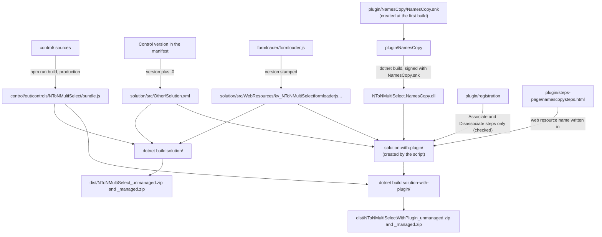

### 9.1 What gets packaged

A **solution** is the unit Dataverse uses to move customizations between environments: a zip file with XML files
that describe the components, and the files they need. The components here are:

| Component | Type in `Solution.xml` | Comes from |
| --- | --- | --- |
| Code component `kv_KV.NToNMultiSelect` | 66 | The control project, through the `ProjectReference` in `solution/solution.cdsproj` |
| Web resource `kv_/NToNMultiSelect/formloader.js` | 61 | `solution/src/WebResources/` |
| Plug-in assembly `NToNMultiSelect.NamesCopy` (solution with the plug-in) | 91 | `plugin/registration/PluginAssemblies/` and the built `.dll` |
| Plug-in steps: Associate and Disassociate only (solution with the plug-in) | 92 | `plugin/registration/SdkMessageProcessingSteps/`; `scripts/build-with-plugin.mjs` checks that there is exactly one step of each |
| Web resource `kv_/NToNMultiSelect/namescopysteps.html`, the steps page (solution with the plug-in) | 61 | `plugin/steps-page/namescopysteps.html`, written into the project by `addStepsPage` (8.17.2) |

### 9.2 `scripts/build.mjs`, step by step

**Step 0: read the version and check the manifest texts.** `scripts/build.mjs` (about lines 17–26):

```js
const root = join(dirname(fileURLToPath(import.meta.url)), "..");
const manifest = readFileSync(join(root, "control/NToNMultiSelect/ControlManifest.Input.xml"), "utf8");
const version = /<control[^>]*\sversion="([^"]+)"/.exec(manifest)[1];
console.log(`Building N:N Multi-Select ${version} (solution version ${version}.0)`);

// Dataverse rejects apostrophes in manifest display and description keys on import (noAposStringType), but the PCF
// build tools don't check for it. Fail here instead of halfway through an import.
for (const m of manifest.matchAll(/(display-name-key|description-key)="([^"]*)"/g)) {
    if (m[2].includes("'")) throw new Error(`Manifest ${m[1]} contains an apostrophe, which Dataverse rejects on import: ${m[2]}`);
}
```

The control version in the manifest is the **only** place to set the version. The script fails early when a setting's
display name or description contains an apostrophe, because Dataverse would reject the import (3.2.5).

**Steps 1 and 2: stamp the version.** (about lines 28–36)

```js
// 1. Form loader web resource. SolutionPackager expects a flat file named <name without punctuation><GUID>.
//    The control version is stamped in so the bundle URL changes with every release.
const loader = readFileSync(join(root, "formloader/formloader.js"), "utf8").replace("__VERSION__", version);
writeFileSync(join(root, "solution/src/WebResources/kv_NToNMultiSelectformloaderjs078EAC10-CCC9-489A-8EEB-8FA3FEECD8F8"), loader);

// 2. Solution version = control version + ".0".
const solutionXmlPath = join(root, "solution/src/Other/Solution.xml");
const solutionXml = readFileSync(solutionXmlPath, "utf8").replace(/<Version>[^<]*<\/Version>/, `<Version>${version}.0</Version>`);
writeFileSync(solutionXmlPath, solutionXml);
```

* The form library's `VERSION = "__VERSION__"` becomes the control version. The library adds it to the bundle address
  (`?v=1.0.0`), so browsers download a new bundle after an upgrade.
* The copy is written to the file name SolutionPackager expects: the web resource name without punctuation, followed by
  its id.
* The solution version becomes the control version plus `.0` (1.0.0 → 1.0.0.0).

**Step 3: build and package.** (about lines 41–44)

```js
execSync("npm run build -- --noColor --buildMode production", { cwd: join(root, "control"), stdio: "inherit" });
// Packages left over from an earlier build would otherwise be copied to dist/ if packaging were skipped.
rmSync(join(root, "solution/bin/Release"), { recursive: true, force: true });
execSync("dotnet build -c Release -nologo -v:minimal", { cwd: join(root, "solution"), stdio: "inherit" });
```

The production bundle is built first, because `dotnet build` skips the control when `control/out` is newer than the
sources (and after a plain `npm run build`, that would be the development bundle). Old packages are removed, then
`dotnet build` packs the solution.

**Step 3b: check what went into the package.** (about lines 48–56)

```js
const builtManifest = readFileSync(join(root, "control/out/controls/NToNMultiSelect/ControlManifest.xml"), "utf8");
for (const [, name] of manifest.matchAll(/<property name="([^"]+)"/g)) {
    if (!builtManifest.includes(`name="${name}"`)) throw new Error(`Built manifest is missing property ${name}; the package is stale.`);
}
if (!builtManifest.includes(`version="${version}"`)) throw new Error("Built manifest has a different version; the package is stale.");
const packagedLoader = readFileSync(join(root, "solution/src/WebResources/kv_NToNMultiSelectformloaderjs078EAC10-CCC9-489A-8EEB-8FA3FEECD8F8"), "utf8");
if (!packagedLoader.includes("KVNToNMultiSelectLoader") || !packagedLoader.includes(`VERSION = "${version}"`)) {
    throw new Error("Packaged form loader is not the current one.");
}
```

Every setting of the source manifest must be in the built manifest, with the same version, and the packaged form
library must carry the handler name the documentation gives and the current version.

**Step 4: copy the packages to `dist/`.** The two zips from `solution/bin/Release` are copied as
`dist/NToNMultiSelect_unmanaged.zip` and `dist/NToNMultiSelect_managed.zip`. The file names carry no version; the
version is inside the solution.

### 9.3 `scripts/build-with-plugin.mjs`, step by step

The script builds the control's production bundle and the plug-in, then the solution `NToNMultiSelectWithPlugin`: the
solution without the plug-in under another unique name, plus the plug-in registration from `plugin/registration/` and
the steps page from `plugin/steps-page/`. Its numbered comments (1 to 4) are the steps below.

**The constants at the top.** `scripts/build-with-plugin.mjs` (about lines 32–42):

```js
/** The messages of the steps in the solution, by message id: Associate and Disassociate only. */
const MESSAGES = {
    "16e7c888-3b24-448b-b7da-ebfe9b681762": "Associate",
    "bdfc191d-fc56-493a-a6b1-cb0c47a22ecc": "Disassociate",
};

const SOLUTION = {
    uniqueName: "NToNMultiSelectWithPlugin",
    description:
        "Many-to-many multi-select field control, with the plug-in that keeps the names in the host column up to date when records are linked or unlinked. Its steps page creates the Delete and Update steps for the linked tables.",
};
```

* `MESSAGES` names the message of a step file by the id in its `<SdkMessageId>` element. It holds the Associate and
  Disassociate messages only: a step file of any other message stops the build (step 3).
* `SOLUTION` holds the unique name of the solution, which also names its output files, and the description written
  into its `Solution.xml`.
* Above them, `stepsPage` is the source of the steps page and `STEPS_PAGE_ID` the id of its web resource (8.17.2).

**Step 1: the control's production bundle.** (about lines 127–130)

```js
// 1. The control's production bundle, as scripts/build.mjs builds it. The solution project takes the bundle from
// control/out, and dotnet build skips the control when control/out is newer than the sources: after a plain
// `npm run build` or `npm start watch`, that would be the development bundle.
execSync("npm run build -- --noColor --buildMode production", { cwd: join(root, "control"), stdio: "inherit" });
```

The solution with the plug-in takes the control's bundle from `control/out`, as the solution without it does. A plain
`npm run build` or `npm start watch` leaves a development bundle there, and `dotnet build` would package it as it is
(it skips the control when `control/out` is newer than the sources). So the script runs the control's production
build itself, with the same command as `build.mjs` (9.2, step 3), and the package always carries the production bundle
of the current sources. The version in `Solution.xml` and the form library copy, on the other hand, come from
`solution/src`, which only `build.mjs` writes: after a change to the version or to `formloader/formloader.js`, run
`node scripts/build.mjs` before `node scripts/build-with-plugin.mjs`.

**Step 2: the key, the plug-in and its public key token.** (about lines 132–140)

```js
// 2. The plug-in assembly (.NET Framework 4.6.2, as the Dataverse sandbox requires), signed with the key of this copy
// of the repository, created at the first build.
const keyFile = join(pluginProject, "NamesCopy.snk");
if (!existsSync(keyFile)) {
    createKey(keyFile);
    console.log("Created the strong name key plugin/NamesCopy/NamesCopy.snk. Keep it (it is not committed): every later build of the plug-in must be signed with it.");
}
execSync("dotnet build -c Release -nologo -v:minimal", { cwd: pluginProject, stdio: "inherit" });
const token = publicKeyToken(keyFile);
```

* The repository has no key: `plugin/NamesCopy/NamesCopy.snk` is ignored by Git. At the first run the script creates
  one (`createKey`, 9.4) and says so; every later run uses it.
* `dotnet build -c Release` builds the plug-in into `plugin/NamesCopy/bin/Release/net462/`, signed with that key
  (`NamesCopy.csproj`, 9.4).
* `publicKeyToken` reads the token from the key (9.4). It is written into the registration in step 3, so any key
  works without further changes.

**Step 3: the solution project.** (about lines 145–154)

```js
// 3. The solution project: the solution without the plug-in under another unique name, plus the plug-in registration.
const project = join(root, "solution-with-plugin");
rmSync(project, { recursive: true, force: true });
mkdirSync(project, { recursive: true });
writeFileSync(
    join(project, "solution.cdsproj"),
    readFileSync(join(root, "solution/solution.cdsproj"), "utf8").replace(/<ProjectGuid>[^<]*<\/ProjectGuid>/, `<ProjectGuid>${randomUUID()}</ProjectGuid>`),
);
cpSync(join(root, "solution/src"), join(project, "src"), { recursive: true });
cpSync(registration, join(project, "src"), { recursive: true });
```

The folder `solution-with-plugin/` is deleted and created again on every run. It gets a copy of the solution project
(with a new project id), the solution sources (already stamped by `build.mjs`) and all the plug-in registration files.
It sits next to `solution/`, at the same depth, so the project's reference to the control project
(`..\control\control.pcfproj`, 9.5) works unchanged. The files in `plugin/registration/` are never changed.

**Step 3, continued: the assembly and its token.** (about lines 156–160)

```js
// The assembly and the public key token of this build.
const asmFolder = readdirSync(join(project, "src/PluginAssemblies"))[0];
copyFileSync(dll, join(project, "src/PluginAssemblies", asmFolder, "NToNMultiSelectNamesCopy.dll"));
const withToken = (path) => writeFileSync(path, readFileSync(path, "utf8").replace(/PublicKeyToken=[0-9a-f]{16}/g, `PublicKeyToken=${token}`));
withToken(join(project, "src/PluginAssemblies", asmFolder, "NToNMultiSelectNamesCopy.dll.data.xml"));
```

The built `.dll` is copied next to its registration file, and the public key token in the assembly file is replaced
with the token of **this** build's key.

**Step 3, continued: the steps, one Associate and one Disassociate step.** (about lines 162–176)

```js
// The steps: one Associate and one Disassociate step, nothing else.
const stepsFolder = join(project, "src/SdkMessageProcessingSteps");
const steps = [];
const messages = [];
for (const file of readdirSync(stepsFolder)) {
    const path = join(stepsFolder, file);
    const messageId = /<SdkMessageId>([^<]+)<\/SdkMessageId>/.exec(readFileSync(path, "utf8"))?.[1];
    if (!MESSAGES[messageId]) throw new Error(`${file}: a step of message ${messageId}; the solution only has Associate and Disassociate steps.`);
    withToken(path);
    steps.push(file.replace(/\.xml$/, ""));
    messages.push(MESSAGES[messageId]);
}
if (messages.sort().join(", ") !== "Associate, Disassociate") {
    throw new Error(`Expected one Associate and one Disassociate step in plugin/registration, found: ${messages.join(", ") || "none"}.`);
}
```

* The `<SdkMessageId>` of each step file is looked up in `MESSAGES`. A step of any other message (a Delete or an
  Update step, for example) stops the build with `<file>: a step of message <id>; the solution only has Associate and
  Disassociate steps.` The Delete and Update steps never go into the package: the steps page creates them in the
  environment, for the linked tables (8.17).
* The messages of the step files, sorted and joined with `", "`, must read exactly `Associate, Disassociate`: one step
  of each. A missing step, a second step of the same message or any further step file stops the build with `Expected
  one Associate and one Disassociate step in plugin/registration, found: <messages>.`, which lists the messages found
  in sorted order (`none` when there are no step files). Recipe 10.7 shows what to change for a step of your own.
* The step files get the token of this build, and their ids (the file names without `.xml`) become the solution's
  steps.

**Step 3, continued: the steps page, Solution.xml and Customizations.xml.** (about lines 183–197)

```js
const solutionXmlPath = join(project, "src/Other/Solution.xml");
const plainSolutionXml = readFileSync(solutionXmlPath, "utf8");
const prefix = /<CustomizationPrefix>([^<]+)<\/CustomizationPrefix>/.exec(plainSolutionXml)[1];
const pageName = addStepsPage(join(project, "src/WebResources"), prefix);
const solutionXml = plainSolutionXml
    .replace("<UniqueName>NToNMultiSelect</UniqueName>", `<UniqueName>${SOLUTION.uniqueName}</UniqueName>`)
    // Same display name as the solution without the plug-in; the unique name and the description tell them apart.
    .replace(/(<Descriptions>\s*<Description description=")[^"]*(" languagecode="1033" \/>)/, `$1${SOLUTION.description}$2`)
    .replace(
        "</RootComponents>",
        `  <RootComponent type="91" id="{${asmId}}" schemaName="${asmName}" behavior="0" />\n` +
            steps.map((id) => `      <RootComponent type="92" id="${id}" behavior="0" />\n`).join("") +
            `      <RootComponent type="61" schemaName="${pageName}" behavior="0" />\n` +
            "    </RootComponents>",
    );
```

* `addStepsPage` writes the steps page into the project's `WebResources` folder, named with the publisher's prefix
  read from `Solution.xml` (8.17.2).
* The unique name `NToNMultiSelect` becomes `NToNMultiSelectWithPlugin`, and the English (1033) description the one in
  `SOLUTION`. The display name stays *N:N Multi-Select*.
* The root components get the assembly (type 91, read from its registration file), the two steps (type 92) and the
  steps page (type 61; by this component the page finds the solutions it is in, 8.17.8).
* The script fails if the unique name was not replaced. If `Customizations.xml` has no `<SdkMessageProcessingSteps />`
  element, it adds one after `<SolutionPluginAssemblies />`.

**Step 4: package and copy.** (about lines 206–215)

```js
// 4. Package (the control's bundle is taken from control/out, built in step 1) and copy to dist/.
execSync("dotnet build -c Release -nologo -v:minimal", { cwd: project, stdio: "inherit" });
const out = join(project, "bin/Release");
const packages = readdirSync(out).filter((f) => f.endsWith(".zip"));
if (packages.length !== 2) throw new Error(`Expected a managed and an unmanaged package in ${out}, found: ${packages.join(", ") || "none"}.`);
for (const file of packages) {
    const target = `${SOLUTION.uniqueName}_${file.includes("_managed") ? "managed" : "unmanaged"}.zip`;
    copyFileSync(join(out, file), join(dist, target));
    console.log(`Wrote dist/${target} (${steps.length} steps, plug-in public key token ${token})`);
}
```

`dotnet build -c Release` packs the project, with the bundle that step 1 built in `control/out` (the same production
build as that of `build.mjs`), and its two zips are copied to `dist/` under the solution's unique name:
`dist/NToNMultiSelectWithPlugin_unmanaged.zip` and `dist/NToNMultiSelectWithPlugin_managed.zip`. Together with the
two of `build.mjs`, that makes the four packages of a release (13.4). For each zip, the console shows the number of
steps (2) and the public key token used.

### 9.4 The strong-name key and the public key token

Dataverse only registers **strong-named** assemblies. A strong name is a signature made with a key pair; it gives the
assembly a unique identity. The **public key token** is a short (8-byte) fingerprint of the public key, written as 16
hexadecimal digits, for example `PublicKeyToken=5cb2560336bdade3`. The registration files must name the token of the
key that signed the assembly.

`plugin/NamesCopy/NamesCopy.csproj` signs the assembly (about lines 10–12):

```xml
<!-- Dataverse only registers strong-named plug-in assemblies. -->
<SignAssembly>true</SignAssembly>
<AssemblyOriginatorKeyFile>NamesCopy.snk</AssemblyOriginatorKeyFile>
```

**The key is private, and not in the repository.** `plugin/NamesCopy/NamesCopy.snk` gives the assembly its identity,
its public key token. It is listed in `.gitignore`, so the repository has no key. The released packages are signed
with the maintainer's key. `scripts/build-with-plugin.mjs` creates a new key the first time it runs without one, prints
"Created the strong name key plugin/NamesCopy/NamesCopy.snk. ...", and uses it for every later build (9.3, step 2).
`scripts/build-with-plugin.mjs`, `createKey` (about lines 75–93):

```js
function createKey(snkPath, bits = 2048) {
    const jwk = generateKeyPairSync("rsa", { modulusLength: bits, publicExponent: 0x10001 }).privateKey.export({ format: "jwk" });
    // A JWK number is big-endian without leading zeros: little-endian, padded to `size` bytes.
    const le = (value, size) => {
        const bytes = Buffer.from(value, "base64url").reverse();
        if (bytes.length > size) throw new Error("Unexpected key part length.");
        return Buffer.concat([bytes, Buffer.alloc(size - bytes.length)]);
    };
    const header = Buffer.alloc(20);
    header.writeUInt8(0x07, 0); // PRIVATEKEYBLOB
    header.writeUInt8(0x02, 1); // version
    header.writeUInt32LE(0x2400, 4); // CALG_RSA_SIGN
    header.write("RSA2", 8, "ascii");
    header.writeUInt32LE(bits, 12);
    header.writeUInt32LE(Buffer.from(jwk.e, "base64url").readUIntBE(0, Buffer.from(jwk.e, "base64url").length), 16);
    const whole = bits / 8;
    const half = bits / 16;
    writeFileSync(snkPath, Buffer.concat([header, le(jwk.n, whole), le(jwk.p, half), le(jwk.q, half), le(jwk.dp, half), le(jwk.dq, half), le(jwk.qi, half), le(jwk.d, whole)]));
}
```

Node.js makes a 2048-bit RSA key pair (public exponent 65537). `createKey` writes it in the format that `sn -k`
writes, a `PRIVATEKEYBLOB`: a header (blob type `0x07`, version 2, algorithm `CALG_RSA_SIGN`, the marker `RSA2`, the bit
length and the public exponent), then the modulus, the two primes, the two exponents, the coefficient and the private
exponent, each little-endian and of its fixed size. No Windows tool is needed.

`scripts/build-with-plugin.mjs`, `publicKeyToken` (about lines 48–68), computes the token from the key file:

```js
function publicKeyToken(snkPath) {
    const snk = readFileSync(snkPath);
    // A key pair file: BLOBHEADER (8 bytes), RSAPUBKEY ("RSA2", bit length, exponent), modulus, private parts.
    if (snk[0] !== 0x07 || snk.toString("ascii", 8, 12) !== "RSA2") throw new Error(`${snkPath} is not a strong name key pair file.`);
    const bitLength = snk.readUInt32LE(12);
    const modulus = snk.subarray(20, 20 + bitLength / 8);
    // The same key as a PUBLICKEYBLOB, after the signature algorithm, hash algorithm and length.
    const blob = Buffer.alloc(20);
    blob.writeUInt8(0x06, 0);
    blob.writeUInt8(0x02, 1);
    blob.writeUInt32LE(0x2400, 4);
    blob.write("RSA1", 8, "ascii");
    blob.writeUInt32LE(bitLength, 12);
    snk.copy(blob, 16, 16, 20);
    const head = Buffer.alloc(12);
    head.writeUInt32LE(0x2400, 0);
    head.writeUInt32LE(0x8004, 4);
    head.writeUInt32LE(blob.length + modulus.length, 8);
    const sha = createHash("sha1").update(Buffer.concat([head, blob, modulus])).digest();
    return Buffer.from(sha.subarray(sha.length - 8)).reverse().toString("hex");
}
```

In plain words:

1. A `.snk` file holds the whole key pair. The script checks that it is one (first byte `0x07`, the marker `RSA2`),
   then reads the key length and the **modulus** (the public part of the RSA key).
2. It rebuilds the public key in the form assemblies store it: a 12-byte header (signature algorithm `0x2400`, hash
   algorithm `0x8004` = SHA-1, length), then a public key blob (`0x06` = public key, marker `RSA1`, length, exponent),
   then the modulus.
3. It hashes that with SHA-1 and takes the **last 8 bytes in reverse order**. That is the .NET definition of a public
   key token.

The script writes this token into the registration files of each build (9.3, step 3), so any key works without
further changes.

**Keep the key file.** An environment that has the plug-in only takes an update signed with the same key. Back up
`plugin/NamesCopy/NamesCopy.snk` and build every later version of your plug-in with it. To use a key you already have
(made with `sn -k`, the Strong Name tool of the Windows SDK, or with Visual Studio), put it at
`plugin/NamesCopy/NamesCopy.snk` before the first build; the script only creates a key when that file is missing.

**Your build has another identity than the released plug-in.** A build signed with your own key has another public key
token than the released packages. To switch an environment from the released plug-in to your own build, remove the
released one first (8.16 shows how to remove the plug-in and keep the control), or give the registration new ids
(10.1). Test it in a development environment first.

**Signing gives an identity, not security.** Anyone can build the plug-in with a key of their own; what protects an
environment is that only administrators and customizers can import solutions. Keep your private key private all the
same: anyone with it can sign assemblies as you.

### 9.5 The solution project

**`solution/solution.cdsproj`** is an MSBuild project that uses the `Microsoft.PowerApps.MSBuild.Solution` package
(downloaded from NuGet on the first build). It packs the folder `src` (`<SolutionRootPath>src</SolutionRootPath>`) into
a solution zip. Two settings matter.

`solution/solution.cdsproj`, the package type (about lines 35–38):

```xml
<PropertyGroup>
  <SolutionPackageType>Both</SolutionPackageType>
  <SolutionPackageEnableLocalization>false</SolutionPackageEnableLocalization>
</PropertyGroup>
```

`solution/solution.cdsproj`, the reference to the control project (about lines 56–58):

```xml
<ItemGroup>
  <ProjectReference Include="..\control\control.pcfproj" />
</ItemGroup>
```

* `Both` builds a managed **and** an unmanaged package from the same sources.
* The project reference to the control project adds the code component to the package (as root component
  `kv_KV.NToNMultiSelect`, type 66). That is why `Solution.xml` in the repository only lists the web resource. The
  copy that `build-with-plugin.mjs` makes in `solution-with-plugin/` sits at the same depth as `solution/`, so the
  reference works there unchanged (9.3).

**`solution/src/Other/Solution.xml`** (about lines 5–95, shortened):

```xml
<UniqueName>NToNMultiSelect</UniqueName>
<LocalizedNames>
  <!-- Localized Solution Name in language code -->
  <LocalizedName description="N:N Multi-Select" languagecode="1033" />
</LocalizedNames>
<Descriptions>
  <Description description="Many-to-many multi-select field control that looks like the native multi-select choice field." languagecode="1033" />
</Descriptions>
<Version>1.0.0.0</Version>
<!-- Solution Package Type: Unmanaged(0)/Managed(1)/Both(2)-->
<Managed>2</Managed>
<Publisher>
  <!-- Unique Publisher Name of Cds Solution -->
  <UniqueName>KV</UniqueName>
  <!-- ... -->
  <!-- Customization Prefix for the Cds Publisher-->
  <CustomizationPrefix>kv</CustomizationPrefix>
  <!-- Derived Option Value Prefix for the Customization Prefix of Cds Publisher -->
  <CustomizationOptionValuePrefix>72720</CustomizationOptionValuePrefix>
  <!-- ... -->
</Publisher>
<RootComponents>
  <RootComponent type="61" schemaName="kv_/NToNMultiSelect/formloader.js" behavior="0" />
</RootComponents>
```

| Element | Meaning |
| --- | --- |
| `UniqueName` | The solution's unique name, `NToNMultiSelect` (the unique name of the solution with the plug-in is set by `build-with-plugin.mjs` from `SOLUTION`) |
| `LocalizedName`, `Description` | Display name and description in English (1033). The solution with the plug-in keeps the display name and gets the description from `SOLUTION` |
| `Version` | Set by `build.mjs` from the control version |
| `Publisher` | The **publisher** owns the components. Its unique name is `KV`. When the environment already has a publisher with this unique name, the import uses it |
| `CustomizationPrefix` | The **publisher prefix** `kv`: it starts the names of the components (`kv_KV.NToNMultiSelect`, `kv_/NToNMultiSelect/formloader.js`) |
| `CustomizationOptionValuePrefix` | The **choice value prefix** 72720: the first digits of choice values this publisher would create (the solution creates none) |
| `RootComponents` | The components of the solution |

**`solution/src/Other/Customizations.xml`** holds the solution's customizations. It is empty here (only language
1033), because the control and the web resource are described by their own files. `Relationships.xml` is empty too.

**The web resource files.** SolutionPackager stores a web resource as two files:

* `kv_NToNMultiSelectformloaderjs078EAC10-CCC9-489A-8EEB-8FA3FEECD8F8`: the content. The name is the web resource name
  without punctuation (`kv_/NToNMultiSelect/formloader.js` → `kv_NToNMultiSelectformloaderjs`) followed by the web
  resource id in upper case.
* The same name plus `.data.xml`: the web resource's id, name (`kv_/NToNMultiSelect/formloader.js`), display name,
  description, type (3 = script) and the content file name.

Never edit the content file by hand: `build.mjs` overwrites it from `formloader/formloader.js`.

### 9.6 Managed and unmanaged packages

| | Unmanaged | Managed |
| --- | --- | --- |
| Use for | Development environments | Test and production environments |
| Components | Can be changed, and added to other solutions | Locked; owned by the solution |
| After import | **Publish all customizations** is needed | Live at once |
| Removing the solution | Removes only the container; the components stay | Removes its components, except those another installed managed solution also contains |
| Plug-in steps | Can be turned off or deleted | Can be turned off, not deleted |

Develop in an unmanaged installation; ship the managed package to test and production. Do not import both kinds of the
same solution into one environment.

The two solutions share the control and the form library (1.2). When both are installed as managed solutions,
deleting one of them keeps the components the other still contains. Deleting `NToNMultiSelectWithPlugin` while
`NToNMultiSelect` is installed, for example, removes the plug-in assembly, its link steps and the steps page, and keeps
the control and the form library (remove the steps made with the steps page first: they depend on the plug-in, 8.16).
Only deleting both removes everything (13.5). An unmanaged import never removes
components, and deleting an unmanaged solution removes only its container.

---

## 10. Customization recipes

Each recipe gives the goal, the files to change, the exact edits, and how to check the result. After any change to
the control, raise the control version (2.9) and rebuild.

### 10.1 Use your own publisher, prefix and namespace instead of KV

**Goal:** ship the control under your own publisher (for example `Contoso`, prefix `con`), so that it can live next to
other solutions without name clashes.

**Every place that holds KV, kv or the publisher:**

| File | Line(s), about | Current value | Change to |
| --- | --- | --- | --- |
| `control/NToNMultiSelect/ControlManifest.Input.xml` | 13 | `namespace="KV"` | `namespace="Contoso"`. The control becomes `Contoso.NToNMultiSelect`, its solution component `con_Contoso.NToNMultiSelect` and its bundle `cc_Contoso.NToNMultiSelect/bundle.js` |
| `control/NToNMultiSelect/ControlManifest.Input.xml` | 3 (comment) | `N:N Multi-Select (KV.NToNMultiSelect)` | Your name (comment only) |
| `control/NToNMultiSelect/index.ts` | 12 | `const CONTROL_NAME = "KV.NToNMultiSelect";` | `"Contoso.NToNMultiSelect"` (console prefix and `registerControl`) |
| `control/NToNMultiSelect/index.ts` | 1584, 1589, 1592–1593 | `window.KV.NToNMultiSelect` (comment), `KV?:`, `w.KV` | `Contoso` in each (the window global the form library checks) |
| `solution/src/Other/Solution.xml` | 18, 21, 25 | Publisher unique name, display name and description `KV` | `Contoso` |
| `solution/src/Other/Solution.xml` | 30 | `<CustomizationPrefix>kv</CustomizationPrefix>` | `con` (2 to 8 letters or digits, starting with a letter) |
| `solution/src/Other/Solution.xml` | 32 | `<CustomizationOptionValuePrefix>72720</CustomizationOptionValuePrefix>` | Your publisher's choice value prefix (a number from 10000 to 99999; see below) |
| `solution/src/Other/Solution.xml` | 94 | `schemaName="kv_/NToNMultiSelect/formloader.js"` | `con_/NToNMultiSelect/formloader.js` |
| `solution/src/WebResources/kv_NToNMultiSelectformloaderjs<ID>` and `.data.xml` | file names | `kv_...078EAC10-CCC9-489A-8EEB-8FA3FEECD8F8` | `con_NToNMultiSelectformloaderjs<NEW ID>` (see below) |
| `...data.xml` | 3, 4, 6, 13 | `<WebResourceId>`, `<Name>kv_/NToNMultiSelect/formloader.js</Name>`, the description, `<FileName>` | The new id, `con_/NToNMultiSelect/formloader.js`, your description, the new file name |
| `scripts/build.mjs` | 31, 53 | The web resource file name | The new file name |
| `scripts/build.mjs` | 54 | `"KVNToNMultiSelectLoader"` | The new handler global (below) |
| `formloader/formloader.js` | 2, 4–5 (comments) | `kv_/...`, `KV.NToNMultiSelect`, `KVNToNMultiSelectLoader` | Your names |
| `formloader/formloader.js` | 20 | `var CONTROL = "KV.NToNMultiSelect";` | `"Contoso.NToNMultiSelect"` |
| `formloader/formloader.js` | 21 | `var BUNDLE = "cc_KV.NToNMultiSelect/bundle.js";` | `"cc_Contoso.NToNMultiSelect/bundle.js"` |
| `formloader/formloader.js` | 46 | `host.KV && typeof host.KV.NToNMultiSelect` | `host.Contoso && typeof host.Contoso.NToNMultiSelect` |
| `formloader/formloader.js` | 184 | `window.KVNToNMultiSelectLoader = host.KVNToNMultiSelectLoader` | For example `ContosoNToNMultiSelectLoader` (forms then call `ContosoNToNMultiSelectLoader.onLoad`) |
| `plugin/NamesCopy/NamesCopyHelpers.cs` | 53 (comment) | `(for example kv_KV.)` | Your prefix and namespace (comment only) |
| `LICENSE` | 3 | `Copyright (c) 2026 KV` | Keep this line, as the MIT license requires, and add `Copyright (c) <year> <your name>` on the next line |
| `README.md`, `docs/` | many | Names, handler, publisher | Your names |

**The plug-in needs no change.** It finds the control by the end of its name (`ControlName = ".NToNMultiSelect"` in
`NamesCopyHelpers.cs`), whatever the prefix and namespace, and the tag prefix `NToNMultiSelect|` contains no publisher.

**The publisher and its choice value prefix.** If the publisher already exists in your environments (**Solutions** →
**Publishers**), use its unique name, prefix and choice value prefix exactly as they are there. Otherwise any number
from 10000 to 99999 works: the solution creates no choices, so the value only matters for choices you add later. Use
the same publisher, with the same values, in every environment.

**A new id for the web resource.** Create one in PowerShell with `[guid]::NewGuid()`, or with
`node -e "console.log(crypto.randomUUID())"` anywhere Node.js runs. Use it in lower case with braces in
`<WebResourceId>`, and in upper case without braces at the end of the two file names. A new id keeps your web resource
apart from the KV one if both are ever in one environment.

**Your own solution names (required when the KV solution may be in the same environment).** Dataverse identifies a
solution by its unique name, so two solutions named `NToNMultiSelect` cannot be installed side by side. The unique
name `NToNMultiSelect` is in `Solution.xml` (line 5), and `scripts/build-with-plugin.mjs` looks for it there to replace
it (`<UniqueName>NToNMultiSelect</UniqueName>`, line 188): change both together. The unique name
`NToNMultiSelectWithPlugin` is in `SOLUTION` at the top of `scripts/build-with-plugin.mjs` (line 39), which also names
its output files. The steps page needs no change for it: it does not look for `NToNMultiSelectWithPlugin` by name,
but finds the solutions it is in by its own web resource (8.17.8). `TEMP_SOLUTION` in
`plugin/steps-page/namescopysteps.html` (line 121) names the solution the page makes where it is in no unmanaged
solution. The output file names of the solution without the plug-in are in `scripts/build.mjs` (line 65). Also change the
display name and description in `Solution.xml` (lines 8 and 11), the description in `SOLUTION` (line 41), and
`display-name-key` on the `<control>` element of the manifest. Makers can then tell your control from the KV one in the
form designer and in the solution list.

**The steps page** needs no other change for your publisher: the build names its web resource with your prefix
(`<your prefix>_/NToNMultiSelect/namescopysteps.html`, 8.17.2). Give it a new id as for the form library: `STEPS_PAGE_ID`
in `scripts/build-with-plugin.mjs` (line 30).

**Optional: your own plug-in identity.** If your solution with the plug-in may meet the KV one in an environment (one
replacing the other, or both installed), give the registration new ids (create each one as above):

* `PluginAssemblyId`: in the `PluginAssembly` element of `NToNMultiSelectNamesCopy.dll.data.xml` (lower case, no
  braces), and in upper case at the end of the folder name and in the `<FileName>` path on line 6 of the same file.
  Rename the folder rather than copying it: `build-with-plugin.mjs` uses the first folder in `PluginAssemblies`.
* `PluginTypeId`: in the `PluginType` element of the assembly file and in `<PluginTypeId>` of every step file (lower
  case, no braces).
* Each step's `SdkMessageProcessingStepId` (lower case, with braces), which is also the step's file name.
* `STEP_NAMESPACE` in `plugin/steps-page/namescopysteps.html` (line 139), the namespace of the ids that the steps page
  computes for the steps of each table (8.17.6), so that the steps of your plug-in never take the ids of the KV
  page's steps. If you also rename the plug-in type, change `PLUGIN_TYPE` (line 116), by which the page finds it.

Sign with your own key (9.4), and test this in a development environment. Keep only one names copy plug-in running
per environment, though: both plug-ins find the KV control and yours by the name ending `.NToNMultiSelect` (8.5), so
with two running every link made elsewhere is copied twice. Remove one of them, or turn its steps off (8.16).

**The control version.** Your control is a new component (`con_Contoso.NToNMultiSelect`) that no environment has yet,
so it can keep its version for the first import. Raise it for every later change (2.9).

**Keep the constructor name.** Renaming the class `NToNMultiSelect` touches many more places: `constructor=` in the
manifest, the class name in `index.ts`, `CONTROL_NAME` and the window global, the folder `control/NToNMultiSelect`
and the paths to it in both build scripts, the bundle path and the global checked in the form library, and
`ControlName` in `NamesCopyHelpers.cs` (the plug-in finds the control on the forms by it). It is rarely worth it.

**Check:** build, import into a development environment, and confirm in the solution that the component is named
`con_Contoso.NToNMultiSelect` and the web resource `con_/NToNMultiSelect/formloader.js`. Add the new control to a form
(it is a different component from the KV one), open a record, and check that the browser console prefix reads
`[Contoso.NToNMultiSelect]` when you cause an error.

### 10.2 Change texts or add a language

**Files:** `control/NToNMultiSelect/src/strings.ts` (and, for the "no name" text of the names copy,
`plugin/NamesCopy/NamesCopyHelpers.cs`).

Every text the control shows is in the `Strings` interface, with one block per language: `en` and `fr`. Texts that
depend on a number or a name are functions. Whole sentences are kept per language, because word order differs between
languages.

**Change a text:** edit its value in `en` (and `fr`). For example `placeholder: "Select or search options"`.

**Add a language** (German as the example):

1. Copy the `en` block, rename it `de`, and translate every value. TypeScript reports any missing key, because the
   block has the type `Strings`.
2. Add the language to `LANGUAGES` with its language ids (LCIDs). `control/NToNMultiSelect/src/strings.ts` (about
   line 229) currently reads:

   ```ts
   const LANGUAGES: { lcids: number[]; strings: Strings }[] = [{ lcids: [1036, 3084, 2060, 4108, 5132, 6156], strings: fr }];
   ```

   Add an entry such as `{ lcids: [1031, 2055, 3079, 4103, 5127], strings: de }` (German for Germany, Switzerland,
   Austria, Luxembourg and Liechtenstein).
3. `stringsFor` picks the block by the user's language (`context.userSettings.languageId`); any other language gets
   English.

**Notes:**

* The settings' names and descriptions in the form designer come from the manifest and are English. They must never
  contain an apostrophe (`build.mjs` checks this). PCF can translate them with `.resx` resource files listed under
  `<resources>`, with keys in `display-name-key` and `description-key`. This control has none, because some
  environments deliver code components without their resources (3.2.4); if you add them, check in a development
  environment that the form designer and the form both still work.
* With *Copy names into the host column*, a linked record without a name is written as the control's `noName` text,
  for example `(Sans nom)` in French. The plug-in always writes `NoName = "(No name)"`. If records without a name are
  common in your data, decide which text you want and use it in both places.

**Build and import:** the texts are part of the control's bundle, so a change shows only after a new build and import.
Raise the control version (2.9), run `node scripts/build.mjs`, and also `node scripts/build-with-plugin.mjs` if you use
the solution with the plug-in; then import the package and publish (2.8). Without a higher version, an environment that
already has the same version keeps the old texts until the old copy is removed (13.5). A change to
`NamesCopyHelpers.cs` alone needs `build-with-plugin.mjs` and an import, but no new control version (2.8).

**Check:** in the app, **Settings** (gear) → **Personalization Settings** → **Languages**, choose the language (the
environment must have that language enabled), reload, and walk through the messages (chapter 11).

### 10.3 Change the look

**File:** `control/NToNMultiSelect/src/styles.ts`.

The CSS is one string, `CSS`, injected once per page by `ensureStyles`. It is injected from code rather than shipped as
a PCF CSS resource because some environments send code components to the form without their resources. The values
were measured from the native multi-select choice control, so both look the same side by side.

| What | Class | Example property |
| --- | --- | --- |
| Idle names (bold) | `.ntnms-view-text` | `font-weight:600` |
| Border on hover and focus | `.ntnms.is-active`, `.ntnms.is-focused` | `border-color:#666` |
| Chips | `.ntnms-chip` | `background:#efefef` |
| Keyboard highlight of a chip or row | `.is-current::after` | `border:1px solid #000` |
| Chip being saved | `.ntnms-chip.is-saving` | `opacity:.6` |
| List rows, selected rows | `.ntnms-option`, `.ntnms-option.is-selected` | `min-height:35px`, `background:#bdbdbd` |
| List height (4 rows) | `.ntnms-list` | `max-height:140px` (also `LIST_MAX_HEIGHT` in `view.ts`) |
| + New button | `.ntnms-menu .ntnms-create` | `color:#2975b2` |
| Read-only field | `.ntnms.is-disabled` | `background-color:#efefef` |
| Error and hint under the field | `.ntnms-error`, `.ntnms-hint` | `color:#a4262c` (error), `color:#616161` (hint) |
| Windows high contrast | `@media (forced-colors:active)` | System colours |

The icons are characters of the **CRM MDL2** icon font (`GLYPH` at the end of the file); they are private-use
characters and may look empty in your editor.

**When you change the CSS**, also give `STYLE_ID` (`"ntnms-styles-v8"`) a new value, for example
`"ntnms-styles-v9"`. `ensureStyles` injects nothing when an element with that id is already on the page, so another
build of this control on the same page could otherwise keep its CSS.

If you change the list height, change `LIST_MAX_HEIGHT` in `view.ts` too: it is used to place the list above or below
the field.

**Check:** reload with Ctrl+F5, then in the developer tools find `<style id="ntnms-styles-v9">` in `<head>` and inspect
the field. Check the idle, hover, focused, open, read-only and high contrast looks (chapter 11).

### 10.4 Add a new setting

**Goal (example):** a setting *Show item count* that hides the count next to *Select all*.

**Files:** the manifest, `index.ts`, `src/view.ts`.

1. **Add the property to the manifest** (`ControlManifest.Input.xml`, before `<resources>`). No apostrophes in the
   texts:

   ```xml
   <property name="showCount" display-name-key="Show item count" description-key="Yes (default): the Select all row shows the number of records in the list. No: the number is hidden." of-type="Enum" usage="input" required="false" default-value="1">
     <value name="No" display-name-key="No">0</value>
     <value name="Yes" display-name-key="Yes">1</value>
   </property>
   ```

   Other property types used by the control: `SingleLine.Text` (text), `Multiple` (long text), `Whole.None` (whole
   number). `usage="input"` means a value typed in the form designer (or bound to a column); `usage="bound"` is the host
   column.
2. **Update the types:** `npm run refreshTypes` (or any build) adds `showCount` to `IInputs` in
   `generated/ManifestTypes.d.ts`.
3. **Read the setting** in `index.ts`: add `showCount: boolean;` to the `Config` interface, and in `readConfig`:

   ```ts
   showCount: String(p.showCount?.raw ?? "1") !== "0",
   ```

   If the setting changes which records the list offers, use it in `optionsQuery` (which builds the list query) and add
   it to `optionsKey` in `applyConfig`, so that the list reloads when the value changes (3.8).
4. **Pass it to the view.** Add `showCount: boolean;` to `ViewState` in `src/view.ts`, and in `render()` in `index.ts`
   add `showCount: config?.showCount ?? true,` to the object passed to `this.view.render`.
5. **Use it** in `renderMenu` in `src/view.ts`:

   ```ts
   this.countText.textContent = state.showCount ? this.t.itemCount(state.options.length) : "";
   ```

6. **Raise the control version** and run `node scripts/build.mjs`. The build checks that the new property is in the
   built manifest.
7. **Document the setting** in the README settings table, and in 3.2.3 and A.1 of this guide.

**If the plug-in must read the setting** (as it reads *Copy names into the host column*), read it in
`NamesCopyHelpers.ParseFormXml` with `StaticValue(parameters, "showCount")`; it returns the value typed in the form
designer, or null. A setting that changes what the plug-in copies needs more than that line: add it to `CopySetting`,
carry it through `LoadForms` into `Host`, and add it to the key of the `Plans` cache in `CopyPlanOf`, so that forms
with different values get different plans. If it matters for deletes too, add it to the notes of the Delete steps
(8.10), which carry everything step 2 needs. A changed value then counts within 2 minutes, like any form change (8.6).

**Check:** in the form designer, the control's settings show *Show item count*. Set it to No, save and publish, open a
record and open the list of a relationship whose related table has at most 100 active records (*Select all* only
appears up to *Select all limit*, 100 by default): *Select all* shows without the count.

### 10.5 Change limits and timings

Every limit and timing is a named constant (or, in a few places, a literal value). [Appendix A.2](#a2-constants)
lists them all, with the file, the value and what to watch out for. The ones changed most often:

* **List sizes** in `src/relatedData.ts`. `CLIENT_MODE_LIMIT` (500) decides when a list is filtered in the browser and
  when it searches on the server; it is also the page size of a large list without a search, and the highest
  *Select all limit*. `SERVER_PAGE_SIZE` (100) is the page size of server searches. Dataverse returns at most 5,000
  rows per page. If you change 500, also change the manifest descriptions of *Select all limit* and *Search mode for
  large tables*, which say 500.
* **Timings** in `index.ts` (the excerpt below). A shorter search pause (`SEARCH_DEBOUNCE_MS`) means more requests
  while the user types; a shorter subgrid pause (`SUBGRID_REFRESH_DELAY_MS`) means more grid reloads during fast
  clicking.
* **Parallel requests**: `MAX_PARALLEL` (4) in `src/syncEngine.ts`. Dataverse limits the concurrent requests of each
  user; keep it low.
* **Timeouts and retries** in `src/dataverse.ts`: `READ_TIMEOUT_MS`, `WRITE_TIMEOUT_MS`, `MAX_RETRIES` and
  `BACKOFF_MS`. Keep the write timeout a little above the 2-minute limit of synchronous plug-ins (4.6).
* **Plug-in** constants in `NamesCopyPlugin.cs`: `CacheTime` (2 minutes; shorter means more queries on every link),
  `CopiesTime` (30 seconds, the budget of the copies of one delete or rename operation, shared by the Delete and Update
  steps; must stay well under the 2-minute limit of the whole operation) and `PageSize` (5,000, the Dataverse
  maximum).

`control/NToNMultiSelect/index.ts`, the constants at the top of the file (about lines 12–23):

```ts
const CONTROL_NAME = "KV.NToNMultiSelect";
const SEARCH_DEBOUNCE_MS = 300;
const RESYNC_DEBOUNCE_MS = 400;
/** Subgrids are refreshed once the user pauses, not after every single click. */
const SUBGRID_REFRESH_DELAY_MS = 600;
/** The control's own subgrid refresh comes back as one OnLoad per grid within this time. */
const SELF_REFRESH_WINDOW_MS = 3000;
/** Default for the "Select all limit" setting: each record is its own request, so keep bulk changes reasonable. */
const DEFAULT_SELECT_ALL_LIMIT = 100;
const LOAD_RETRY_DELAYS_MS = [1000, 3000, 9000];
/** An initialisation that failed on a passing problem is tried again once after this pause (and when back online). */
const INIT_RETRY_DELAY_MS = 30_000;
```

**Check:** for list sizes, use a related table with more records than the new limit and watch the requests in the
**Network** tab (the `Prefer: odata.maxpagesize` header shows the page size). For timings, use the network throttling
of the developer tools (chapter 11).

### 10.6 Change the names format or separator

**The rule:** the control and the plug-in must write **exactly the same text** (for the same records: the control
includes only the records the editing user can read, the plug-in all of them; see 5.4.3). The control writes the names
for its own links; the plug-in writes them for links made elsewhere. If the formats differ, the column changes format
depending on who changed the links last.

| What | Control | Plug-in |
| --- | --- | --- |
| Separator `"; "` | `SEPARATOR` in `src/namesCopy.ts` | `Separator` in `NamesCopyHelpers.cs` |
| Order of the names | `compareItems` in `src/types.ts` (via `NamesCopy.namesToWrite`) | `CompareLinks`, `SortKey` and `CompareKeys` in `NamesCopyHelpers.cs` |
| Cut and ellipsis `…` | `namesText` in `src/namesCopy.ts` | `NamesText` in `NamesCopyHelpers.cs` |
| Empty when nothing is linked (`null`) | `namesText` | `NamesText` |
| Name of a record without one | `noName` in `src/strings.ts` | `NoName` in `NamesCopyHelpers.cs` |

The control's side is shown in 4.10 (`namesText`), the plug-in's in 8.9 (`NamesText`).

In `NamesCopyHelpers.cs`, change `Separator` (line 56), not `Separators` (line 73), which is the sort order of
punctuation. Update the comments that show the format too (`namesCopy.ts` line 3, `NamesCopyHelpers.cs` lines 48 and
202). The field's own idle text joins the names with ", " in `view.ts`; it is not part of the copy and does not change.

**Example: use a comma.** Set `SEPARATOR = ", "` in `namesCopy.ts` and `Separator = ", "` in `NamesCopyHelpers.cs`.
Update the example in the description of *Copy names into the host column* in the manifest ("for example API design;
Automation"), the README (the settings table and the *Copy names into the host column* section), section 5.4 of this
guide and the Technical Reference.

**Changing the order:** `compareItems` also sorts the chips and the idle text of the field. To change only the order of
the copy, leave `compareItems` alone and sort the names your way in `NamesCopy` (both in `update`, which decides
whether a write is needed, and in `namesToWrite`, which builds the text that is written) and in `NamesText` in the
plug-in.

Existing records keep the old format until their links next change. Raise the control version (2.9) first: otherwise
the import replaces the plug-in but keeps the old control, and the two write different formats. Then rebuild both
packages.

**Check:** with *Copy names* = Yes and a solution with the plug-in, link three records in the control and check the
host column; then link one more in a subgrid on another form and check that the format is the same.

### 10.7 Add a step of your own to the solution

**Goal:** put a step of your own into the solution with the plug-in, for example the Associate step of a plug-in that
enforces a rule on the server (10.9).

**File:** `scripts/build-with-plugin.mjs`, step 3 (9.3).

The solution carries the step files of `plugin/registration/SdkMessageProcessingSteps`, and the script checks them:

* a step file whose `<SdkMessageId>` is not in `MESSAGES` (Associate and Disassociate) stops the build with
  `<file>: a step of message <id>; the solution only has Associate and Disassociate steps.`;
* step files other than exactly one Associate and one Disassociate step stop it with `Expected one Associate and one
  Disassociate step in plugin/registration, found: <messages>.`

To add a step of your own on Associate or Disassociate:

1. **Get its step file.** Register the step in a development environment (for example with the Plugin Registration
   Tool, 12.5), add it to a solution there, export that solution and unpack it with `pac solution unpack`. Copy its
   file from the `SdkMessageProcessingSteps` folder into `plugin/registration/SdkMessageProcessingSteps`. A step of a
   plug-in type of its own also needs that type in the assembly's registration file (10.9).
2. **Change the expected messages.** In the check after the loop, write the messages of all the step files, sorted
   and joined with `", "`, and the error text to match. For example, for a second Associate step (new code):

   ```js
   if (messages.sort().join(", ") !== "Associate, Associate, Disassociate") {
       throw new Error(`Expected two Associate steps and one Disassociate step in plugin/registration, found: ${messages.join(", ") || "none"}.`);
   }
   ```

3. **Build:** `node scripts/build.mjs`, then `node scripts/build-with-plugin.mjs`. The "Wrote dist/..." lines give the
   number of steps of each zip. The script writes the public key token of this build into your step file too.

**Writing a step file by hand.** For a step without a primary table you can copy one of the two step files and change:
`Name`; `SdkMessageProcessingStepId` (a new id, lower case with braces, also the file name); `Description`; `Stage`
(10 PreValidation, 20 PreOperation, 40 PostOperation); `Mode` (0 synchronous, 1 asynchronous); and, for another plug-in
type, `PluginTypeName` and `PluginTypeId`. Keep `SdkMessageId`: the files in this repository import into any
environment with these message ids.

**The Delete and Update steps do not go into the package.** `MESSAGES` lets the build refuse them on purpose. They
belong to the linked tables of each environment: create them with the steps page (8.17, recipe 10.8), and deploy them
with your own solution (8.17.12).

**Check:** import the new package into a development environment, open the solution and select **Objects** →
**Plug-in steps**: it lists the two link steps and yours. Then test as in 11.11.

### 10.8 Create the Delete and Update steps for your tables

**Goal:** make the host columns follow deletes and renames of the linked records, with no cost on the deletes and
updates of any other table (8.15). 8.17 explains how the steps page works; 8.16 why turning steps off is safe.

**Which tables.** The **linked tables**: the tables whose names are copied. For a control on the *Project* form that
copies the names of skills, that is the *Skill* table (`new_skill` in the examples below); both tables when forms on
both sides copy. The Associate and Disassociate steps need nothing: they come with the solution, and those messages
have no table.

**In the development environment** (with `NToNMultiSelectWithPlugin` installed unmanaged):

1. Make sure the forms that copy the names are published, with *Copy names into the host column* = Yes: the page reads
   the active forms (8.17.4).
2. Open `https://<your environment>/WebResources/kv_/NToNMultiSelect/namescopysteps.html` in a browser where you are
   signed in as a System Customizer or System Administrator.
3. **Section 1.** Check the relationships whose names your forms copy, and their linked tables. To prepare the steps
   of a relationship that no active form copies yet, add it by its schema name and choose its linked side.
4. **Section 2.** Tick the linked tables, select **Create or update the steps of the ticked tables**, read the question
   and confirm. Each table gets its three steps, on, in the unmanaged solution the page is in, here
   `NToNMultiSelectWithPlugin` (8.17.8; when the page is in more than one, first choose the solution in the list under
   the buttons). **What was done** lists every step created or updated.
5. **Check the result.** In section 2 each step of the table shows *On* and "In NToNMultiSelectWithPlugin" (or the
   solution you chose). If a warning at the top lists Delete or Update steps that the page did not make, turn off or
   delete those you no longer need (8.17.9): those that are on run as well, and a table that has both is handled twice.

A table added later gets its steps the same way. Running **Create** again for a table updates its steps in place
(8.17.6), and turns a step that was off back on. A step put on another message with another tool cannot be corrected
in place: it shows "On `<message>`, not `<its message>`: Remove, then Create", and **Create** skips its table. Remove
the table's steps, then **Create** makes them again (8.17.7); if they were in a solution of yours and new steps go
elsewhere, add them to it again.

**To test and production.** Add the steps to the solution you deploy (**Solutions** → your solution → **Add
existing** → **Plug-in step**), or deploy from development the solution that holds them, and import it where
`NToNMultiSelectWithPlugin` is installed (8.17.12). To have new steps go straight into the solution you deploy, add the
steps page to it before you create them (**Add existing** → **More** → **Web resource**) and choose it on the page
(8.17.8); the page then goes with that solution too. Do not create the steps with the page in test or production: steps created there get the same ids as those
from development and would block their import.

**After an import of `NToNMultiSelectWithPlugin`**, including upgrades, the page's steps stay as they are: no package
contains them (8.17.12). There is nothing to redo for them.

**Removing them.** **Remove the steps of the ticked tables**, or **Remove all the steps made here** (8.17.9). Remove
them before you uninstall the plug-in: they depend on it.

**Check:** delete and rename a record of each linked table and check the host columns (11.12). Delete and update a
record of another table and check that it is not slower (8.15 has the times to compare). With the Plug-in Trace Log
on **All** (12.4), deletes and updates of other tables leave no entry of `NToNMultiSelect.NamesCopy.NamesCopyPlugin`.

### 10.9 Enforce rules on the server

The view, the filters, *Show inactive records* and *Maximum selections* only apply in the control. *Maximum
selections* is also checked by each copy of the field on its own: two copies of the same field on one form, two
browser tabs or two users can together go over the limit (5.3). To make a rule hold everywhere (subgrids, imports,
flows, the Web API, and every copy of the field), use a plug-in on **Associate**, **PreValidation**, that throws an
`InvalidPluginExecutionException` when a link breaks the rule. When the control makes the link, it undoes the pick and
shows the plug-in's message under the field.

The README has a complete sample: [Enforcing the rules on the server](../README.md#enforcing-the-rules-on-the-server).
Key points:

* Check the relationship name first and return at once for any other relationship (the step runs for every N:N link).
* Register it as a separate plug-in type, in its own assembly or in `plugin/NamesCopy` next to `NamesCopyPlugin`. In
  the second case, copy from the unpacked export of your development environment (as in 10.7) both the new
  `<PluginType ...>` element into `<PluginTypes>` of `NToNMultiSelectNamesCopy.dll.data.xml` and its step file into
  `plugin/registration/SdkMessageProcessingSteps`; `build-with-plugin.mjs` rewrites the public key token in both.
  Without the `PluginType` entry the package's step points to a type that is not in the package, and the import fails.
  The build expects exactly one Associate and one Disassociate step file, so also change the expected messages in its
  check (recipe 10.7).
* PreValidation runs before the transaction, so refusing a link there costs little and changes nothing.

---

## 11. Testing your changes

Test every change in a development environment, in the browser you and your users use. The checklist below covers
every feature.

The repository has no automated test suite and no build pipeline. What a change has to pass is the type check and
ESLint (2.5), the checks the build scripts make (9.2, 9.3) and this checklist. If you add automated tests of your own:
`NamesCopyHelpers.cs` needs no Dataverse (form XML, the sort order, the names text), so an ordinary .NET test project
can call it; in the control, `SyncEngine` and `NamesCopy` take interfaces (an executor, a writer), so a JavaScript test
runner can drive them with fakes.

Prepare:

* a form with the control on a relationship whose related table has **fewer than 500** records, and one whose related
  table has **more than 500** (a view or filter that matches more than 500 also works);
* a subgrid of the same relationship on the form, and a second form or the related table's form with a subgrid of the
  other side;
* a user with a restricted security role, and (for column security) a field security profile;
* the browser's developer tools open (F12) on the **Console** tab.

### 11.1 States and look

| Test | Expected |
| --- | --- |
| Open a record with links | Bold names, comma separated; `---` when there are none |
| Move the mouse over the field | Grey border; the values become chips with an × |
| Click into the field | Chips, the "Select or search options" box and the chevron; the list stays closed (unless *Open list on click* = Yes) |
| Form or field read-only | Grey box with the names; nothing can be changed |
| Windows high contrast on | Selected rows use the system highlight colours |

### 11.2 Picking and removing

| Test | Expected |
| --- | --- |
| Open the list with the chevron, pick and unpick rows | Each change is saved at once (the chip is pale while it saves); the form is not made dirty |
| Click the same row quickly several times | Ends in the last state, with the fewest requests (Network tab) |
| *Select all*, then again | All rows selected, then all removed; only offered within *Select all limit* |
| *Maximum selections* reached | Other rows are greyed out with a note; + New is hidden |
| *Maximum selections* reached, slow network (Network throttling): remove a value with its ×, and open the list at once | Until the removal is saved, the other rows stay greyed and + New and *Select all* stay hidden; the removed value can be picked again |
| Remove a value with its × | The field keeps its focused look and the next value has a black border, as in the screenshot in 6.4.2 |

After an ×: ← and → move the highlight (the first and last value keep it), Delete or Backspace removes the highlighted
value, typing does nothing, Escape collapses an expanded field, Tab moves to the search box, Enter opens the record
(*Open selected records* = Yes). With the list open, the × also closes the list.

### 11.3 Keyboard and the native-like behaviours

| Test | Expected |
| --- | --- |
| Tab into the field, then ↓ or Alt+↓ | The list opens with the first row (or *Select all*) highlighted |
| ↑/↓, PageUp/PageDown, Ctrl+Home/Ctrl+End | The highlight moves; the list scrolls with it |
| Enter on a row (or Space, with an empty search box) | The row is toggled; Enter on *+ New* opens quick create |
| Escape | The list closes and the search text is cleared |
| Backspace in the empty search box, list closed | The last value is highlighted; ← → Delete work as after an × |
| Backspace while the list is open | Nothing happens to the values |
| Click "+N" with several lines of values | All values show, the first one highlighted, as in the screenshot in 6.3 |

"+N" also closes an open list. The field stays open when the mouse leaves, until the focus leaves the field (a click
outside, or Tab). "less" collapses and keeps the focus and the highlight. A highlight on a lower value is scrolled
into view by "+N".

### 11.4 + New (quick create)

Prepare the related table: quick create enabled and a Quick Create form, and *Show + New button* = Yes.

| Test | Expected |
| --- | --- |
| Click "+ New ..." (or Enter on it) | The list closes; quick create opens; the field keeps its focused look |
| While quick create is open, type, press Enter or click the chevron | Nothing opens; a second quick create cannot start |
| *Save and Close* | The new record is selected (if the list offers it); the focus is back in the search box; the list is closed |
| *Cancel* | The same, without a new value |
| Create a record the list does not offer (inactive, or outside the view) | "... was created, but it is not one of the records this field offers ..." |

The screenshots in 5.7 show each of these states.

### 11.5 Large lists and search

| Test | Expected |
| --- | --- |
| Open the list of a table with more than 500 records | 500 rows; scrolling to the end loads the next 500 |
| Type a search | The previous rows disappear at once and "Loading…" shows; after a 300 ms pause the server results appear (100 per page) |
| Type quickly, then click a row as soon as results show | Only rows of the current search can be picked |
| *Search mode* Starts with / Contains | Matches the start of the name / anywhere in the name |
| Search for `50%` or `C_Sharp` | Matches the literal text (wildcards escaped) |
| Search for only `-` or `'` | "No entries found", no request |
| *Select all* in a large list | Only offered for a search whose results are all loaded and within the limit |
| Lists of 500 or fewer | Search matches anywhere in the name, ignoring case and accents |

### 11.6 List settings

| Test | Expected |
| --- | --- |
| *Records from view* with a view name, then its id | Only the view's records, in its sort order |
| A view that does not exist, a translated view name, a view of another table | A clear message in the list naming the problem (and the ids) |
| *FetchXML filter* with `<filter>`; with a complete `<fetch>`; invalid XML | Narrowed list; the query's order; a message with the parser error |
| *Extra OData filter* together with a view | "The extra OData filter can't be combined with a view ..." |
| *Show inactive records* = Yes | Inactive records offered too |

### 11.7 Subgrids

| Test | Expected |
| --- | --- |
| Pick in the control | The subgrid refreshes about half a second after the last saved change |
| Add or remove in the subgrid | The control follows |
| *Subgrids to refresh* = `none` | No refresh either way |
| *Hide related subgrids* = Yes, then No | The subgrid is hidden, then shown again |
| The field twice on the form (header and body) | A change in one shows in the other |

### 11.8 New records

| Test | Expected |
| --- | --- |
| Pick values on a new record | "Your selections are linked when you save the record." |
| Save (or Save & Close) | The picks are linked |
| Save blocked by an empty required field, then fixed | Nothing is linked until the save succeeds |
| The control on a quick create form, or a new Appointment | "Save the record first, then pick values here." |

### 11.9 Read-only and column security

1. Create a field security profile in which a test user may read but **not update** the host column, and enable
   column security on the host column.
2. Open a record as that user: the control is **read-only**, as a native field on that column would be.
3. With *Copy names* = Yes, add a link in a subgrid on the same form as that user: the control does **not** write the
   host column. With the solution with the plug-in, the plug-in writes it.

The read-only check is `columnLocked()` in `index.ts` (the code is in 5.9.2).

Also test a user without Append To on the related table: picks are undone with "You don't have permission to change
these related records. (prvAppendTo...)".

### 11.10 The names copy, without the plug-in

| Test | Expected |
| --- | --- |
| *Copy names* = Yes; pick values | The host column gets "A; B; C" (check in a view); the form is not made dirty |
| Link a record in another browser tab, then pick a value in the first tab | The host column holds both links, and the first tab's field shows the other tab's link |
| Open a record as a test user who has Write, then (as an administrator, in another tab) remove the Write privilege on that table from the user's role, and pick a value in the open form | The link is saved; "The names could not be copied into *(field label)*: You don't have permission to change this record." |
| After the form has loaded, block the read of the saved links (developer tools → Network → right-click the `GET .../<navigation property>?$select=...` request → **Block request URL**), then pick a value | After the client's retries (about 7 seconds): "The names could not be copied into *(field label)*: Can't reach the server. Check your connection and try again."; the link is saved and the column keeps its value |
| Block the link requests instead (right-click a `POST .../$ref` request → **Block request URL**), then pick a value | After the client's retries: "Couldn't add ..." and the value goes back. A write that fails this way may still have been saved, so the control reads the saved links (a `GET` of the navigation property) and sends no `PATCH` when the column already holds their names (5.4.1) |
| A host column shorter than the names | The text ends with "…" |

### 11.11 The names copy, with the plug-in

| Test | Expected |
| --- | --- |
| Link in a subgrid on a form without the control | The host column follows |
| Link from the other side of the relationship | The host column of each affected record follows |
| Link with a flow or the Web API | The host column follows |
| Link in the control, once on a host table owned by users or teams and once on one owned by the organization | The control writes the column; the link is kept, and the plug-in's trace shows no update for that record and column (the tag check asks whichever question the table supports, 8.8) |
| Link in the control as a user who may link records but has no Write access to the host record | The control cannot write the column ("The names could not be copied into ...", 5.4.4); the plug-in ignores the tag and writes it: the trace shows an `updated` line for that record and column (8.8) |
| Host column with column security: link in the control | The plug-in writes the column too (8.8): the trace shows an `updated` line for that record and column |
| Set *Copy names* = No on every form, publish, wait 2 minutes, link in a subgrid | The host column no longer changes |
| A host column that cannot take the copy (for example a calculated column) | The link is kept; the trace explains why nothing was copied |

### 11.12 Deletes and renames

With `NToNMultiSelectWithPlugin` installed and the Delete and Update steps of the related table created with the steps
page (recipe 10.8). Prepare a related record linked to host records whose host columns copy its name, on more than one
form or host column if you can, and the Plug-in Trace Log on **All** (12.4).

| Test | Expected |
| --- | --- |
| Delete a related record linked to some host records | Their host columns no longer hold its name |
| Turn both Delete steps of the table off, repeat | The delete works; the name stays until their links next change |
| Delete and update records of a table that has no steps of the page | Not slower (8.15); no entry of the plug-in in the trace log |
| Rename a related record linked to some host records | Every host column that held its old name shows the new one, sorted into its place among the other names |
| Update the related record with the name it already has (for example a Web API `PATCH` that sends the name), or change another column only | Nothing is written: the host records keep their *Modified On* and row version, and the trace shows no `updated` line |
| Rename a record linked to many host records (for example 100) | The rename waits while the names are rewritten (about 10 records a second, 8.15); all host columns follow, or, beyond the 30-second budget, the trace says how many keep the old name |
| Self-referencing relationship: rename a record linked to itself | Its own host column gets the new name in the same save, and the other linked records follow |
| Turn the Update step off, rename | The rename works; the old name stays until their links next change |
| Import `NToNMultiSelectWithPlugin` again, then delete and rename a linked record | The steps page still shows the table's steps *On*, and the host columns follow (the import does not touch them, 8.17.12) |

### 11.13 Messages, tabs and slow networks

| Test | How | Expected |
| --- | --- | --- |
| Offline | Developer tools → Network → **Offline**, then pick | "Can't reach the server ..."; the pick is undone |
| Slow network | Network throttling (for example **Slow 4G** or **3G**), then pick several values quickly | Pale chips while saving; at most 4 requests at a time |
| Leave while saving | With a slow network, pick and close the tab at once | The browser asks for confirmation. If you leave anyway, the links already saved stay, and the host column can miss their names until the record's links next change (5.8) |
| Close the record while saving | Pick many values, then go back to the list | The writes finish; failures show as an app notification |
| French | User language French | Every text in French |

### 11.14 Checking the plug-in with the Plug-in Trace Log

1. Turn the trace log on with **All** (12.4).
2. Link a record in a subgrid on a form that has the control with *Copy names* = Yes.
3. Open the Plug-in Trace Log and find the newest entry for `NToNMultiSelect.NamesCopy.NamesCopyPlugin` with the message
   `Associate`.
4. Its message block should hold a line such as `new_project <id>: new_projectskills updated (3 links).`
5. Link a record in the control: no line for the control's own record and column.
6. Delete a linked related record: entries for `Delete`, with `updated` lines for the records it was linked to.
7. Rename a linked related record: an entry for `Update`, with `updated` lines for the records it is linked to. An
   update that sends the same name again: no `updated` line.
8. Set the trace log back to **Exception** (or **Off**) when you are done.

### 11.15 The steps page

In a development environment with `NToNMultiSelectWithPlugin` installed unmanaged and a form that copies names
(recipe 10.8 gives the procedure, 8.17 the details):

| Test | Expected |
| --- | --- |
| Open the page in the maker portal's preview, or the repository file from disk | It only says where to open it: "Open this page at your environment's address: https://<your environment>/WebResources/kv_/NToNMultiSelect/namescopysteps.html ..." (the repository file, before the build writes its name in, says `<prefix>_/NToNMultiSelect/namescopysteps.html`) |
| Open it at the environment's address | Section 1 lists the relationship, its host table and column, its linked table and the forms; section 2 lists the linked table with its three steps *Missing*; no list of solutions, and the note under the buttons says "New steps go into NToNMultiSelectWithPlugin, the solution this page is in. ..." |
| As a user who is neither System Customizer nor System Administrator, try to create steps | Dataverse refuses, and the page says "You do not have the privileges to change plug-in steps or solutions (System Customizer or System Administrator is needed)." |
| Tick the table, **Create or update the steps of the ticked tables** | Three steps *On*, each "In NToNMultiSelectWithPlugin"; no `NToNMultiSelectTableSteps` is made; the log lists each step |
| Delete and rename a linked record | The host columns follow (11.12) |
| **Create** again | The same steps are updated, not doubled (the step ids do not change) |
| Turn a step off in the maker portal, **Refresh**, then **Create** | The page shows it *Off*, then *On* again |
| Move a step by hand into another unmanaged solution, **Refresh**, **Create** | Still *On*, shown in the other solution; neither moved nor duplicated |
| Change the message of a step of the page elsewhere (for example Delete 1 of 2 to Update in the Plugin Registration Tool), **Refresh** | The step shows "On Update, not Delete: Remove, then Create", in red, with the solutions it is in |
| Then tick its table, **Create** | The log says "`<table>`: skipped, Delete 1 of 2 (find linked records) is registered on Update. A step's message can't be changed: remove the table's steps (Remove the steps of the ticked tables), then Create makes them again."; nothing of that table is changed, and no step is deleted |
| Then **Remove the steps of the ticked tables**, and **Create** | Remove deletes the table's three steps, that one too; Create makes them again on their own messages, with the same ids, *On*, in `NToNMultiSelectWithPlugin` |
| Register a Delete or Update step on the plug-in by hand (Plugin Registration Tool), **Refresh** | The warning at the top lists it, "(every table, on)" or "(only `<table>`, on)"; the page does not change it |
| Add a relationship by its schema name in other letter case | It is found; for a relationship between two tables, the page asks which side is linked; it stays after a reload in the same browser |
| A hand-added relationship that no active form copies | Marked "No active form copies names through it yet: its steps do nothing until one does." |
| **Remove the steps of the ticked tables**, confirm | The three steps are gone (*Missing*); deletes and renames are no longer followed; **Create** makes them again with the same ids |
| Add the steps page to a second unmanaged solution of yours, one without the plug-in (**Add existing** → **More** → **Web resource**), **Refresh** | A list under the buttons, "This page is in more than one unmanaged solution. New steps go into:", with "NToNMultiSelectWithPlugin (with the plug-in)" first and selected; the note says "... (this page is in 2 unmanaged solutions)." |
| Choose your solution in the list, reload the page, tick a table without steps, **Create** | Choosing logs "New steps go into `<your solution>`."; after the reload your solution is still chosen; **Create** logs "... added to `<your solution>`." for each new step; steps that already existed stay where they are |
| Where the page is in no unmanaged solution (for example `NToNMultiSelectWithPlugin` installed managed): **Create** | The note says "This page is in no unmanaged solution here, ..."; **Create** first asks with the test or production warning (8.17.12); the steps go into `NToNMultiSelectTableSteps`, made with the publisher of a solution that contains the plug-in |

---

## 12. Debugging and troubleshooting

### 12.1 The browser console

Press F12 → **Console**. The control and the form library write their own lines with a fixed prefix, so you can filter
on it:

| Prefix | Who | Examples |
| --- | --- | --- |
| `[KV.NToNMultiSelect]` | The control | `initialisation failed`, `loading related records failed`, `add failed for <id>`, `remove failed for <id>`, `copying the names into the host column failed`, `loading options failed`, `searching failed`, `loading more records failed`, `checking the new record against the list failed`, `opening the record <id> failed` |
| `[KV.NToNMultiSelect]` (warning) | The control | The host column is Business Required; the host column's logical name is not available |
| `[KV.NToNMultiSelect loader]` | The form library | `Could not download cc_KV.NToNMultiSelect/bundle.js.`, `KV.NToNMultiSelect bundle loaded but did not register the control.` |

Each error line is followed by the error object, with the Web API's message and code.

### 12.2 The network requests to look at

Developer tools → **Network**, filter on `api/data`. The control's requests:

| What | Request |
| --- | --- |
| Relationship metadata | `GET .../RelationshipDefinitions(SchemaName='<name>')/Microsoft.Dynamics.CRM.ManyToManyRelationshipMetadata?...`; when not found, `GET .../EntityDefinitions(LogicalName='<table>')/ManyToManyRelationships?...` |
| Table metadata | `GET .../EntityDefinitions(LogicalName='<table>')?$select=LogicalName,EntitySetName,...` and `.../Attributes(LogicalName='statecode')` |
| Saved links | `GET .../<entity set>(<id>)/<navigation property>?$select=...&$orderby=...` (`Prefer: odata.maxpagesize=5000`) |
| List | `GET .../<related entity set>?$select=...&$orderby=...&$filter=...`, or `?fetchXml=...` with a view or FetchXML |
| View | `GET .../savedqueries?$select=savedqueryid,name,fetchxml,returnedtypecode&$filter=...` |
| Link | `POST .../<entity set>(<id>)/<navigation property>/$ref` (with `?tag=...` while *Copy names* = Yes) |
| Unlink | `DELETE .../<entity set>(<id>)/<navigation property>(<related id>)/$ref` (with `?tag=...`) |
| Names copy | `GET` of the saved links, then `PATCH .../<entity set>(<id>)` with `If-Match: *` and the host column, sent with `keepalive` |
| Form library | `GET <environment URL>/webresources/cc_KV.NToNMultiSelect/bundle.js?v=1.0.0` |

A request's **Response** tab shows the Web API's error (`error.code`, `error.message`).

### 12.3 Common errors and their causes

The README's [Troubleshooting](../README.md#troubleshooting) table covers what users and administrators meet. For
developers, also:

| Symptom | Cause | Fix |
| --- | --- | --- |
| Your change has no effect after the import | Same control version (2.9), or the browser kept the old bundle | Raise the version; Ctrl+F5; clear site data |
| `build.mjs`: "Manifest ... contains an apostrophe, which Dataverse rejects on import" | An apostrophe in a setting's display name or description | Reword the text without the apostrophe |
| `dotnet build` (in either script): MSB3030 "Could not copy the file ... because it was not found", although the file exists | On Windows, the repository folder is too deep: the full path passes the 260-character limit | Move the repository to a short folder, for example `C:\src\NToNMultiSelect` (2.2) |
| `npx tsc --noEmit`: "Cannot find module './generated/ManifestTypes'" | The types are written from the manifest and are not committed | Run `npm run refreshTypes` (or any build) in `control/` first |
| The solution with the plug-in has the old solution version or the old form library | `build.mjs` was not run after the version or `formloader/formloader.js` changed: `build-with-plugin.mjs` builds the control itself, but takes both from `solution/src` (9.3, step 1) | Run `node scripts/build.mjs`, then `node scripts/build-with-plugin.mjs` |
| `build.mjs`: "Built manifest is missing property ..." or "the package is stale" | The build used an old `control/out` | Delete `control/out` and build again |
| "Expected a managed and an unmanaged package ..." | Packaging failed or was skipped | Read the `dotnet build` output above the message |
| `build-with-plugin.mjs`: `<file>: a step of message <id>; the solution only has Associate and Disassociate steps.` | A step file in `plugin/registration/SdkMessageProcessingSteps` has another message than Associate or Disassociate, for example a Delete or Update step | Remove it: the Delete and Update steps are created per linked table by the steps page (8.17). A step of your own: recipe 10.7 |
| `build-with-plugin.mjs`: "Expected one Associate and one Disassociate step in plugin/registration, found: `<messages>`." | `plugin/registration/SdkMessageProcessingSteps` does not hold exactly one Associate and one Disassociate step file | Restore the two files; for a step of your own, change the expected messages (recipe 10.7) |
| `build-with-plugin.mjs`: "The steps page has no __STEPS_PAGE_NAME__ to fill in." | The placeholder was removed from `plugin/steps-page/namescopysteps.html` | Put `__STEPS_PAGE_NAME__` back where the page names itself (`PAGE_NAME`, 8.17.2) |
| The import of the solution with the plug-in fails about the assembly | The public key token in the registration does not match the assembly | Build with `build-with-plugin.mjs`, which writes the token |
| The import of a new build of the plug-in fails where the plug-in is installed | Your build is signed with another key than the installed plug-in (9.4) | Build with the key the installed plug-in was signed with, or remove the installed plug-in first (8.16) |
| "N:N Multi-Select could not ..." under the field or in a dialog | The plug-in failed and rolled back the link, delete or update | See Appendix B and the Plug-in Trace Log |
| The plug-in does not update the host column | No active, published form with *Copy names* = Yes for that relationship; the cache (2 minutes); steps off; a host column that cannot take the copy; an import that bypasses plug-ins | Check each in that order; the trace log names column problems |
| The trace shows `updated` lines for the record and column of the control's own links | The plug-in did not follow the control's tag: the host column has column security, the user may not write the record, or the host table gets no check (Dataverse does not answer `RetrievePrincipalAccess` for it, and the organization does not own it) (8.8) | Nothing to fix: the plug-in keeps the column right, at the cost of a rebuild on each of those links |
| A host column keeps the name of a deleted record, or a renamed record's old name | The linked table has no Delete and Update steps (the solution brings only the Associate and Disassociate steps); its steps are off; or the record had more linked records than the 30-second budget covers (the trace log says how many) | Create the steps of the linked table with the steps page (recipe 10.8), or turn them back on (8.16); the name goes when those records' links next change |
| The steps page says where to open it, or that the plug-in is not installed | It was opened outside the environment's address, or `NToNMultiSelectWithPlugin` is not installed | Open it at `<environment URL>/WebResources/kv_/NToNMultiSelect/namescopysteps.html` (8.17.3) |
| The steps page puts new steps into another solution than you expect, or makes `NToNMultiSelectTableSteps` | New steps go into the unmanaged solution the page is in: the page is in several and another one is chosen in that browser, or it is in no unmanaged solution there (for example `NToNMultiSelectWithPlugin` installed managed) | Read the note under the buttons; choose the solution in the list, or add the page to the unmanaged solution the steps belong in (8.17.8). Move the steps made before yourself |
| The steps page shows a step "On `<message>`, not `<its message>`: Remove, then Create", and **Create** skips its table ("... is registered on `<message>`") | The step was put on another message with another tool; a step's message can't be changed, and the page deletes a step only when you remove it | **Remove the steps of the ticked tables** for that table, then **Create** makes them again (8.17.7); if they were in a solution of yours and new steps go elsewhere, add them to it again |
| A link of many records at once fails after about 2 minutes | One Associate or Disassociate request with more than about 1,000 host records reaches the 2-minute limit of synchronous plug-ins (8.4) | Link in smaller batches |

### 12.4 The Plug-in Trace Log

The Plug-in Trace Log stores what plug-ins write with `ITracingService`, and the exceptions they throw.

**Turn it on:**

1. Go to [make.powerapps.com](https://make.powerapps.com) and select the environment.
2. **Settings** (the gear at the top right) → **Advanced settings**.
3. **Settings** → **Administration** → **System Settings** → **Customization** tab.
4. Set **Enable logging to plug-in trace log** to **All** (every execution) or **Exception** (only failures) → **OK**.

**Read it:** in the same Advanced settings, **Settings** → **Plug-In Trace Log** (in the Customization group). Or
query the Web API in the browser:

```
<environment URL>/api/data/v9.2/plugintracelogs?$select=createdon,messagename,messageblock,exceptiondetails&$filter=startswith(typename,'NToNMultiSelect.NamesCopy')&$orderby=createdon desc&$top=20
```

`messageblock` holds the trace lines (8.13); `exceptiondetails` holds the error of a failed execution.

Set the log back to **Exception** or **Off** when you are done; trace logs take storage.

### 12.5 The Plugin Registration Tool

The Plugin Registration Tool (PRT) shows and changes plug-in registrations.

1. Start it with `pac tool prt` (Power Platform CLI), which downloads it on the first run.
2. **Create New Connection** → sign in → choose the environment.
3. Find the assembly **NToNMultiSelect.NamesCopy**. Under it are the plug-in type and its steps: the two link steps
   that come with `NToNMultiSelectWithPlugin`, and the three steps of each table for which the steps page created
   them (*... for `<table>`*).

What you can do there:

* **Enable** or **Disable** a step (the same as **Turn on** / **Turn off** in the maker portal).
* **Unregister** a step: for example a Delete or Update step that the steps page lists in its warning as a step it did
  not make (8.17.9). Remove the page's own steps with the page instead.
* **Update** the assembly with a newly built `.dll` (fast during development).
* **Register New Step**: a step of your own (recipe 10.7). Create the Delete and Update steps of the linked tables with
  the steps page, not here: steps registered here get other ids than the page's, so the page lists them in its warning
  and does not manage them, and a table that has both is handled twice (8.17.9).
* **Install Profiler**: record an execution of a step and replay it in Visual Studio's debugger, to step through the
  plug-in code line by line. The Release build carries no debug information (`<DebugType>none</DebugType>` in
  `NamesCopy.csproj`), so build a Debug copy for this: `dotnet build -c Debug` in `plugin/NamesCopy` writes
  `NToNMultiSelect.NamesCopy.dll` and its `.pdb` to `bin/Debug/net462`. **Update** the assembly with that `.dll`,
  profile and replay, then update it again with the Release build.

Changes made in the PRT go straight into the environment. To ship them, add them to a solution.

---

## 13. Releasing a new version

This chapter is about releasing your own build. To offer a change to this project instead, open an issue, or a pull
request from your fork, on the repository, and say what you changed and how you tested it (chapter 11).

### 13.1 Version numbers

| Version | Where | How it changes |
| --- | --- | --- |
| Control version, for example `1.0.0` | `version` on `<control>` in `ControlManifest.Input.xml` | By hand. **This drives everything else** |
| Solution version, for example `1.0.0.0` | `solution/src/Other/Solution.xml` | Written by `build.mjs` (control version + `.0`), used by both solutions |
| Form library `VERSION` | The web resource copy | Written by `build.mjs` |
| Plug-in assembly version `1.0.0.0` | `plugin/NamesCopy/NamesCopy.csproj` (`<Version>`) and the registration files (`Version=1.0.0.0`) | By hand, rarely |

Raise the control version for every release that changes the control (2.9). Use the third number for fixes and the
second for new features.

**Updates of your managed solution.** A package with a higher version, imported over the installed managed solution
(managed over managed), upgrades it in place: the forms keep the control and its settings, and the import replaces the
control, the form library and the plug-in. After the import, check the Associate and Disassociate steps, and turn off
again any that should stay off (8.16). The Delete and Update steps that the steps page made are not touched (8.17.12).

The plug-in assembly version can usually stay as it is: an import replaces the assembly's content, so an update never
needs a new assembly version. Dataverse treats a change of the major or minor number as a different assembly. If you
do change it, change `Version=` in the assembly file and in every step file too (`build-with-plugin.mjs` only rewrites
the public key token).

### 13.2 Build both solutions

```powershell
cd control
npm ci
npm run refreshTypes
npx tsc --noEmit
npm run lint
cd ..
node scripts/build.mjs
node scripts/build-with-plugin.mjs
```

The two scripts write four zips into `dist/`: the unmanaged and managed packages of `NToNMultiSelect` and
`NToNMultiSelectWithPlugin` (9.3). Build the plug-in with the key of your earlier releases (9.4). Then import each
package into a clean development or test environment and run through chapter 11. `build.mjs` changes `Solution.xml` and the web resource
copy when the version changed: commit them with the version change.

### 13.3 Checksums

Publish the SHA-256 checksum of each zip so that people can check their download:

```powershell
Get-FileHash .\dist\*.zip -Algorithm SHA256 | Format-Table Hash, Path
```

On macOS or Linux, `shasum -a 256 dist/*.zip` (or `sha256sum dist/*.zip`) gives the same checksums.

Write the checksums and the component names into `dist/README.txt` (written by hand; the build scripts do not create
it). Users check a file with `Get-FileHash .\NToNMultiSelect_managed.zip -Algorithm SHA256`.

### 13.4 What to publish

Create a release on the repository's **Releases** page (on GitHub: **Releases** → **Draft a new release**) and attach:

| File | Use |
| --- | --- |
| `NToNMultiSelect_unmanaged.zip` | Solution without the plug-in, development environments |
| `NToNMultiSelect_managed.zip` | Solution without the plug-in, test and production |
| `NToNMultiSelectWithPlugin_unmanaged.zip` | Solution with the plug-in, its Associate and Disassociate steps and the steps page, development environments |
| `NToNMultiSelectWithPlugin_managed.zip` | Solution with the plug-in, its Associate and Disassociate steps and the steps page, test and production |
| `README.txt` | Component names, notes and SHA-256 checksums |
| `NToNMultiSelect-Technical-Reference.docx` | The Technical Reference, the administrator's guide: a copy of `docs/NToNMultiSelect - Technical Reference.docx`, attached under this name |
| `NToNMultiSelect-Developer-Guide.docx` | This guide as a Word document: a copy of `docs/NToNMultiSelect - Developer Guide.docx`, attached under this name |

`dist/` is not committed: the packages live on the release only. `README.txt` is written by hand; the build scripts do
not create it (13.3).

### 13.5 The same-version caveat

When a build keeps the control version of a copy that is already installed (for example a new build of 1.0.0 over an
installed 1.0.0), Dataverse keeps the old code component. Environments that already have that version must remove the
old copy first:

1. Note the control's settings on each form that uses it, and whether the form uses the form library (handler
   `KVNToNMultiSelectLoader.onLoad`) and the parameter of its On Load handler.
2. Remove the control from those forms, and remove the form library's On Load handler and the library where they were
   added; save and publish the forms. Then delete the component (unmanaged) or the managed solution. If more than one
   managed N:N Multi-Select solution is installed, delete them all: Dataverse keeps a component while any installed
   managed solution contains it.
3. Import the new package; after an unmanaged import, **Publish all customizations**.
4. Add the control (and, where it was used, the form library and its handler) to the forms again with the same
   settings, then save and publish.
5. Reload the app with Ctrl+F5. If the old behaviour still shows, clear the site data of the environment in the browser
   (F12 → **Application** → **Storage** → **Clear site data**) and reload.

The plug-in assembly and its Associate and Disassociate steps need no removal of their own: in an unmanaged
installation the import replaces them, and in a managed installation deleting the solution removes them and the
import brings them back. An unmanaged import turns the Associate and Disassociate steps back on and re-creates deleted
ones; after a managed import, check them. Turn off again any that were off (8.16).

**The steps page's steps in a managed installation.** A managed solution with the plug-in can only be deleted once the
steps made with the steps page are removed: they depend on the plug-in (8.16). Before deleting it, remove them on the
steps page (**Remove all the steps made here**, 8.17.9). The page skips steps deployed with a managed solution of your
own: remove them as for an uninstall (8.16), from that solution in development and then deploy it again, or by
deleting that solution. After the import, deploy them again with your solution (8.17.12); in development, create them
again on the page (recipe 10.8): they get the same ids. Do not create them on the page in test or production: steps
created there would block a later import of the same steps from development.

**Both solutions installed.** To move from the solution without the plug-in to the one with it, import
`NToNMultiSelectWithPlugin`. Both solutions are then installed and share the control and the form library. Deleting
only the managed solution with the plug-in later (once the steps made with the steps page are removed, 8.16) removes
the plug-in and keeps the control; to remove everything, delete both, and `NToNMultiSelectTableSteps` if the steps
page made one (it holds steps only). With unmanaged solutions, deleting a solution removes only its container: first
remove the steps made with the steps page (8.17.9), then delete the Associate and Disassociate steps, the plug-in
assembly and the steps page web resource `kv_/NToNMultiSelect/namescopysteps.html` (and, for a full removal, the
control and the form library `kv_/NToNMultiSelect/formloader.js`) as components, one at a time (**Remove** →
**Delete from this environment**). Then delete the solutions, and `NToNMultiSelectTableSteps` if the steps page made
one.

---

## Appendix A. Reference tables

The tables in this appendix collect what the chapters explain one piece at a time.

### A.1 Manifest properties

| Property | Display name | Type | Default |
| --- | --- | --- | --- |
| `value` | Host column | bound, `SingleLine.Text` / `SingleLine.TextArea` / `Multiple` | – (required) |
| `relationshipName` | N:N relationship schema name | `SingleLine.Text` | – (required) |
| `filter` | Extra OData filter (optional) | `SingleLine.Text` | empty |
| `view` | Records from view (optional) | `SingleLine.Text` | empty |
| `fetchXml` | FetchXML filter (optional) | `Multiple` | empty |
| `showInactive` | Show inactive records | `Enum` (0 No, 1 Yes) | 0 (No) |
| `showSelectAll` | Show Select all | `Enum` (0 No, 1 Yes) | 1 (Yes) |
| `selectAllLimit` | Select all limit | `Whole.None` | empty = 100 (0 = 500, at most 500) |
| `maxSelections` | Maximum selections | `Whole.None` | empty or 0 = no limit |
| `subgrids` | Subgrids to refresh (optional) | `SingleLine.Text` | empty = every subgrid of the relationship; `none` = off |
| `hideSubgrids` | Hide related subgrids | `Enum` (0 No, 1 Yes) | 0 (No) |
| `placeholder` | Placeholder (optional) | `SingleLine.Text` | empty = "Select or search options" |
| `writeSummary` | Copy names into the host column | `Enum` (0 No, 1 Yes) | 0 (No) |
| `searchMode` | Search mode for large tables | `Enum` (0 Starts with, 1 Contains) | 0 (Starts with) |
| `openOnClick` | Open list on click | `Enum` (0 No, 1 Yes) | 0 (No) |
| `openRecords` | Open selected records | `Enum` (0 No, 1 Yes) | 0 (No) |
| `allowCreate` | Show + New button | `Enum` (0 No, 1 Yes) | 0 (No) |

### A.2 Constants

The limits, timings and fixed names worth knowing, with the file each is in (the icon code points of `GLYPH` are in
4.12). Recipe 10.5 explains which ones are worth changing.

| Name | Value | File | What it controls | Notes |
| --- | --- | --- | --- | --- |
| `CONTROL_NAME` | `"KV.NToNMultiSelect"` | `index.ts` | Registration name and the prefix of console messages | Change with the namespace (10.1) |
| `SEARCH_DEBOUNCE_MS` | 300 | `index.ts` | Wait after the last keystroke before a server search | Shorter means more requests while typing |
| `RESYNC_DEBOUNCE_MS` | 400 | `index.ts` | Wait before the links are read again (subgrid change, reconnect, failed batch) | |
| `SUBGRID_REFRESH_DELAY_MS` | 600 | `index.ts` | Wait after a batch of writes before the subgrids are refreshed | |
| `SELF_REFRESH_WINDOW_MS` | 3000 | `index.ts` | Time in which subgrid OnLoads count as echoes of the control's own refresh | |
| `DEFAULT_SELECT_ALL_LIMIT` | 100 | `index.ts` | *Select all limit* when the setting is empty | Each record is its own request; the manifest description says 100 |
| `LOAD_RETRY_DELAYS_MS` | `[1000, 3000, 9000]` | `index.ts` | Retries of the first read of the links; and of a re-read that fails while an add of unknown outcome holds a place (at most three in a row, 5.5.2) | |
| `INIT_RETRY_DELAY_MS` | 30000 | `index.ts` | The one timed retry of a start-up that failed on a passing problem | |
| `NO_POST_SAVE_TABLES` | `["appointment", "recurringappointmentmaster", "serviceappointment"]` | `index.ts` | New records of these tables show "Save the record first ..." | Their new-record save skips the save events |
| (literal in `warmOptions`) | 50 ms | `index.ts` | Delay before the list is loaded in the background | |
| `CLIENT_MODE_LIMIT` | 500 | `src/relatedData.ts` | Size of the first page; up to this many records the list is filtered in the browser; highest *Select all limit*; page size of "load more" without a search | The descriptions of *Select all limit* and *Search mode for large tables* say 500; Dataverse returns at most 5,000 rows per page |
| `SERVER_PAGE_SIZE` | 100 | `src/relatedData.ts` | Page size of server searches | |
| `FETCH_ANNOTATIONS` | `odata.include-annotations="Microsoft.Dynamics.CRM.fetchxmlpagingcookie,Microsoft.Dynamics.CRM.morerecords"` | `src/relatedData.ts` | Annotations requested for FetchXML paging | |
| `FETCH_PARAMETER` | `"?fetchXml="` | `src/relatedData.ts` | Query parameter that carries the list's FetchXML | |
| `MAX_URL_LENGTH` | 30000 | `src/relatedData.ts` | Longest FetchXML request address; past it, paging drops the cookie, and a longer query fails with a message | FetchXML travels in the URL |
| (literal in `loadSelected`) | `maxPageSize: 5000` | `src/relatedData.ts` | Page size when the saved links are read | 5,000 is the Dataverse maximum |
| `READ_TIMEOUT_MS` | 120000 | `src/dataverse.ts` | Time allowed for a read, body included | |
| `WRITE_TIMEOUT_MS` | 130000 | `src/dataverse.ts` | Time allowed for a write | Keep it a little above the 2-minute limit of synchronous plug-ins |
| `MAX_RETRIES` | 3 | `src/dataverse.ts` | Retries for 429, 502–504 and lost connections | |
| `BACKOFF_MS` | `[1000, 2000, 4000]` | `src/dataverse.ts` | Pause before each retry (plus up to 250 ms at random) | |
| `MAX_PAUSE_HONOURED_MS` | 300000 (5 minutes) | `src/dataverse.ts` | Longest `Retry-After` that is honoured | |
| `MAX_WAIT_PER_REQUEST_MS` | 60000 | `src/dataverse.ts` | Longest a request waits for a throttling pause before it fails with "server busy" | |
| `KEEPALIVE_MAX_BYTES` | 60000 | `src/dataverse.ts` | Largest body sent with fetch `keepalive` (the names copy); a larger one is sent as an ordinary request | Browsers take at most 64 KiB of keepalive bodies at a time (4.6) |
| `THROTTLING_CODES` | `0x80072322`, `0x80072321`, `0x80072326` | `src/dataverse.ts` | Error codes treated as "server busy" | |
| `QUERY_TOO_EXPENSIVE_CODES` | `0x80048573`, `0x80048574`, `0x80048575`, `0x80048644`, `0x80048544`, `0x80048744`, `0x80048745` | `src/dataverse.ts` | Error codes shown as "This search is too slow for this table ..." | |
| (literal in the constructor) | `/api/data/v9.2` | `src/dataverse.ts` | Web API version | |
| `MAX_PARALLEL` | 4 | `src/syncEngine.ts` | Link requests in flight at once | Dataverse limits the concurrent requests of each user; keep it low |
| `LIST_MAX_HEIGHT` | 140 | `src/view.ts` | Height of the list's scrolling part (4 rows of 35 px) | Keep in line with `.ntnms-list` in `styles.ts` |
| `MENU_MAX_HEIGHT` | 247 (13 + 35 + 22 + 140 + 35 + 2) | `src/view.ts` | Tallest the whole list can get; used to choose above or below | |
| `MAX_COLLAPSED_CHIPS` | 50 | `src/view.ts` | Chips built while the field is collapsed (and read-only names shown as links) | |
| `MAX_SPOKEN_NAMES` | 10 | `src/view.ts` | Names spoken in the selection summary before only the count is said | |
| (literals in `view.ts`) | 70 px, 4 rows, 30 ms, 8 px | `src/view.ts` | Load-more distance from the end of the list; Page Up / Page Down step; announcement delay; margin kept between the list and the window edge | |
| `waitUntilPlaced` default | 3000 ms (checked every 50 ms) | `src/formBridge.ts` | How long a new record's control waits to be attached to the page | |
| `OVERLAY` | CSS selector | `src/formBridge.ts` | Containers (dialogs, quick create, side panes) where `Xrm.Page` is not the control's form | |
| `NAMES_SHOWN` | 12 | `src/fetchQuery.ts` | Names listed in a "not found" message | |
| `SEPARATOR` | `"; "` | `src/namesCopy.ts` | Between names in the host column copy | The plug-in's `Separator` must be the same (10.6) |
| `STYLE_ID` | `"ntnms-styles-v8"` | `src/styles.ts` | Id of the injected style sheet | Change it when the CSS changes (3.6) |
| `LANGUAGES` | French: 1036, 3084, 2060, 4108, 5132, 6156 | `src/strings.ts` | Language ids per translation; anything else is English | |
| `CONTROL`, `BUNDLE`, `VERSION` | `"KV.NToNMultiSelect"`, `"cc_KV.NToNMultiSelect/bundle.js"`, stamped version | `formloader/formloader.js` | What the form library loads | `VERSION` is written by `build.mjs` |
| `STATE_KEY`, `REMOUNTS_KEY` | `"__pcfLoader:" + CONTROL`, `"__pcfRemounts:" + CONTROL` | `formloader/formloader.js` | App-window keys of the shared download promise and of the remount counts | Named after the control, so loaders of different controls never share state |
| (literals in `formloader.js`) | 10000 ms (checked every 100 ms), 200 ms, 2, 400 ms and 1500 ms | `formloader/formloader.js` | Wait for the platform's own download; hide/show pause; remounts per control and record; extra checks after OnLoad | |
| `CacheTime` | 2 minutes | `plugin/NamesCopy/NamesCopyPlugin.cs` | Lifetime of the cached forms and copy plans | Shorter means more queries on every link |
| `CopiesTime` | 30 seconds | `plugin/NamesCopy/NamesCopyPlugin.cs` | Budget of the copies of one delete or rename operation, shared by the Delete and Update steps | Must stay well under the 2-minute limit of the whole operation |
| `PageSize` | 5000 | `plugin/NamesCopy/NamesCopyPlugin.cs` | Page size of `ReadLinks`, and the most host records `ReadHosts` reads per relationship | 5,000 is the Dataverse maximum |
| `ControlTag` | `"NToNMultiSelect\|"` | `plugin/NamesCopy/NamesCopyPlugin.cs` | What a tag of the control starts with | Must match `linkTag` in `relatedData.ts` |
| `DeadlineKey` | `"NToNMultiSelect.NamesCopy.Deadline"` | `plugin/NamesCopy/NamesCopyPlugin.cs` | `SharedVariables` key of the deadline of a delete or rename operation | |
| (prefix in `NotesKey`) | `"NToNMultiSelect.NamesCopy.Delete\|<table>\|<id>"` | `plugin/NamesCopy/NamesCopyPlugin.cs` | `SharedVariables` key of the host records Delete 1 of 2 notes for Delete 2 of 2 | |
| `ControlName` | `".NToNMultiSelect"` | `plugin/NamesCopy/NamesCopyHelpers.cs` | The end of the control's name that the plug-in looks for in the form XML | Change it if you rename the class (10.1) |
| `Separator` | `"; "` | `plugin/NamesCopy/NamesCopyHelpers.cs` | Between names in the host column | Must match `SEPARATOR` in `namesCopy.ts` |
| `NoName` | `"(No name)"` | `plugin/NamesCopy/NamesCopyHelpers.cs` | The name written for a linked record without one; the Update step compares names as they show with it (8.11) | The control writes its `noName` text (10.2) |
| `Separators` | The ASCII space and punctuation characters, space first and `$` last | `plugin/NamesCopy/NamesCopyHelpers.cs` | Their order in the browser's sort, used by `SortKey` | |
| `MESSAGES` | The ids of Associate and Disassociate | `scripts/build-with-plugin.mjs` | The only messages whose step files the solution takes; the build also expects exactly one step file of each | See 9.3 and recipe 10.7 |
| `SOLUTION` | `uniqueName` `"NToNMultiSelectWithPlugin"` and the description | `scripts/build-with-plugin.mjs` | Unique name, output file names and description of the solution with the plug-in | The steps page does not use it (10.1) |
| `STEPS_PAGE_ID` | `"2920d18e-7d4e-4e8d-94c7-f51018faea0e"` | `scripts/build-with-plugin.mjs` | Id of the steps page's web resource | A new id for your own publisher (10.1) |
| `PAGE_NAME` | The web resource name, written in by the build in place of `__STEPS_PAGE_NAME__` (`kv_/NToNMultiSelect/namescopysteps.html`) | `plugin/steps-page/namescopysteps.html` | The page's own web resource name: its address in messages, and how it finds the solutions it is in (8.17.2, 8.17.8) | Keep `__STEPS_PAGE_NAME__` in it (8.17.2) |
| `TEMP_SOLUTION` | `"NToNMultiSelectTableSteps"` | `plugin/steps-page/namescopysteps.html` | The solution new steps go into where the page is in no unmanaged solution, made when a new step needs it (8.17.8) | |
| `ADDED_KEY`, `CHOSEN_KEY` | `"NToNMultiSelect.steps.added." + location.host`, `"NToNMultiSelect.steps.solution." + location.host` | `plugin/steps-page/namescopysteps.html` | `localStorage` keys of the relationships added by hand and of the solution chosen for new steps (8.17.4, 8.17.8) | Kept in that browser, for that environment |
| `PLUGIN_TYPE`, `CONTROL_NAME` | `"NToNMultiSelect.NamesCopy.NamesCopyPlugin"`, `".NToNMultiSelect"` | `plugin/steps-page/namescopysteps.html` | The plug-in type the page makes steps for; the end of the control's name it looks for in the form XML | `CONTROL_NAME` must match `ControlName` of the plug-in |
| `KINDS` | Delete 1 of 2 (stage 10), Delete 2 of 2 (stage 40), Update (stage 20, name column) | `plugin/steps-page/namescopysteps.html` | The three steps of a linked table: message, stage, label, description (8.17.7) | Must match the stages `ExecuteDelete` and `ExecuteUpdate` act on |
| `STEP_NAMESPACE` | `"ebf70503-5125-409b-bb0c-02d5160925c8"` | `plugin/steps-page/namescopysteps.html` | Namespace of the name-based ids of the page's steps (8.17.6) | Changing it gives every table new step ids: the page then no longer finds the steps it made |

### A.3 Web API requests of the control

All paths are relative to `<environment URL>/api/data/v9.2/`. Every request sends `Accept: application/json`,
`OData-MaxVersion: 4.0` and `OData-Version: 4.0`, with the user's session. `<set>` is the entity set name of the form's
table, `<target set>` that of the related table, `<nav>` the navigation property, `<id col>` and `<name col>` the
related table's primary id and name columns.

| # | Method | URL shape | When |
| --- | --- | --- | --- |
| 1 | GET | `EntityDefinitions(LogicalName='<table>')?$select=LogicalName,EntitySetName,PrimaryIdAttribute,PrimaryNameAttribute,IsQuickCreateEnabled,DisplayName` | Start-up, for the form's table and (unless self-referencing) the related table. Once per page. |
| 2 | GET | `RelationshipDefinitions(SchemaName='<name>')/Microsoft.Dynamics.CRM.ManyToManyRelationshipMetadata?$select=SchemaName,Entity1LogicalName,Entity2LogicalName,Entity1NavigationPropertyName,Entity2NavigationPropertyName` | Start-up. Once per page. |
| 3 | GET | `EntityDefinitions(LogicalName='<table>')/ManyToManyRelationships?$select=...` (same columns as 2) | Only when 2 finds nothing (the name was entered in another casing, or is wrong). |
| 4 | GET | `EntityDefinitions(LogicalName='<related table>')/Attributes(LogicalName='statecode')?$select=LogicalName` | Start-up, to know whether "active" is `statecode eq 0` (not for the User table). |
| 5 | GET | `savedqueries?$select=savedqueryid,name,fetchxml,returnedtypecode&$filter=<match> and returnedtypecode eq '<related table>' and statecode eq 0`, where `<match>` is `name eq '<view>'` or, for an id, `savedqueryid eq <id>` | When *Records from view* is set. Once per page. |
| 6 | GET | `savedqueries?$select=returnedtypecode&$filter=<match> and statecode eq 0&$top=1` and `savedqueries?$select=savedqueryid,name&$filter=returnedtypecode eq '<related table>' and statecode eq 0 and (querytype eq 0 or querytype eq 64)&$orderby=name asc` | Only when 5 finds nothing, to word the error (the second only for a name, not an id). |
| 7 | GET | `<set>(<record id>)/<nav>?$select=<id col>,<name col>&$orderby=<name col> asc,<id col> asc` with `Prefer: odata.maxpagesize=5000`, following `@odata.nextLink` | Record open; re-reads (subgrid change, reconnect, failed batch, after a new record's first save; a failed re-read again after 1, 3 and 9 seconds while an add of unknown outcome holds a place); before every names copy write. |
| 8 | GET | `<target set>?$select=<id col>,<name col>&$orderby=<name col> asc,<id col> asc&$filter=<active> and (<extra filter>) and <id col> ne <record id> and startswith(<name col>,'<term>')` with `Prefer: odata.maxpagesize=500` (first page) or `100` (search); next pages from `@odata.nextLink` | The list, without a view or FetchXML. Each filter part only when it applies; `contains` instead of `startswith` with *Search mode* = Contains; the `ne` part only for a self-referencing relationship. |
| 9 | GET | `<target set>?fetchXml=<encoded FetchXML with count and page>` with `Prefer: odata.include-annotations="Microsoft.Dynamics.CRM.fetchxmlpagingcookie,Microsoft.Dynamics.CRM.morerecords"` | The list, with a view or FetchXML. Next pages: the same with `page` + 1 and `paging-cookie`. |
| 10 | GET | `<target set>?$select=<id col>&$filter=<list filters> and <id col> eq <new id>`, or `<target set>?fetchXml=<list query with count 1 and an id condition>` | After *+ New*: is the new record offered by the list? |
| 11 | POST | `<set>(<record id>)/<nav>/$ref[?tag=<tag>]` with body `{"@odata.id": "<api URL>/<target set>(<target id>)"}` | Each pick (associate). The tag only while *Copy names* is Yes. |
| 12 | GET | `<set>(<record id>)/<nav>?$select=<id col>&$filter=<id col> eq <target id>` | Only when 11 answered "already exists", to check the link is really there. |
| 13 | DELETE | `<set>(<record id>)/<nav>(<target id>)/$ref[?tag=<tag>]` | Each removal (disassociate). "Not found" counts as done. |
| 14 | PATCH | `<set>(<record id>)` with body `{"<host column>": "<names>"}` (or `null`) and `If-Match: *`, sent with fetch `keepalive` (up to 60,000 bytes) | The names copy, after request 7, when the text changed. |

The form library makes one more request, outside the Web API: `GET <environment URL>/webresources/cc_KV.NToNMultiSelect/bundle.js?v=<version>`
(a script tag), only when the platform did not deliver the bundle.

### A.4 What the plug-in reads and writes

The plug-in uses the organization service inside Dataverse, as the SYSTEM user (8.14). Calls 2 to 4 and 6 to 11
happen only for a relationship or table that a form copies. Calls 1 and 5 are the exception: call 1 runs for any link,
and for a delete or rename that a Delete or Update step of the steps page is called for, when the cached forms are
missing or expired; call 5 runs for such a delete or rename after the forms were loaded again (so each at most about
once every 2 minutes per sandbox worker). After that, links of anything else end with a dictionary lookup, and
Dataverse does not call the Delete and Update steps for the deletes and updates of other tables at all.

| # | Call | Function | When |
| --- | --- | --- | --- |
| 1 | `RetrieveMultiple` on `systemform`: columns `objecttypecode` and `formxml`, where `formxml` is like `%.NToNMultiSelect%` and `formactivationstate` = 1 | `LoadForms` | When the cached forms of the organization are missing or older than 2 minutes (one thread reloads them) |
| 2 | `RetrieveRelationship` by schema name | `LoadPlan` | When the copy plan of a relationship, host table and host columns is missing or older than 2 minutes |
| 3 | `RetrieveMetadataChanges`: the host table and the other table, with their primary id and name columns, ownership type and privileges, and the host columns (all properties) | `TableMetadata`, called by `LoadPlan` | With 2 |
| 4 | `RetrieveMultiple` on `sdkmessagefilter`, linked to `sdkmessage`: at most one message filter of the message `RetrievePrincipalAccess` whose `primaryobjecttypecode` is the host table | `SupportsPrincipalAccess`, called by `LoadPlan` | With 2 and 3, once the relationship and both tables are found |
| 5 | `RetrieveMetadataChanges`: the N:N relationships of the host tables (`SchemaName`, `Entity1LogicalName`, `Entity2LogicalName`) | `LoadRoutes` | Delete 1 of 2 or Update, after the forms were loaded again |
| 6 | `RetrieveMultiple` on the other table: the primary name column of the updated record | `ReadOther` | Update, once when the update sets the primary name column of a table whose names are copied |
| 7 | `RetrieveMultiple` on the intersect table: the host ids linked to the deleted or renamed record, one page of 5,000 | `ReadHosts` | Delete 1 of 2, for each route of the deleted record's table; Update, for each copy plan of the renamed record's table, once the name has changed |
| 8 | `RetrieveMultiple` on the host table: the host columns of one record | `ReadRecord`, called by `Rebuild` | Twice for each record rebuilt |
| 9 | `RetrieveMultiple` on the intersect table, joined to the other table for its primary name, in pages of 5,000 with the paging cookie | `ReadLinks`, called by `Rebuild` and `CopyIntoTarget` | Twice for each record rebuilt; once for a renamed record linked to itself (its copy goes into the update being saved, without a call of its own) |
| 10 | `Update` of the host record: the host columns | `Rebuild` | Once for each record rebuilt, and a second time when links were saved meanwhile |
| 11 | `RetrievePrincipalAccess` for the user the request runs for and the tagged record (a host table for which call 4 found a message filter), or else `RetrieveUserPrivilegeByPrivilegeName` for that user and the table's Write privilege (a host table owned by the organization) | `ControlMayWrite` | Associate or Disassociate carrying the control's tag, once for the tagged record when its host column has no column security; for any other host table, no call (8.8) |

## Appendix B. Glossary and plug-in messages

### B.1 Glossary

| Term | Meaning |
| --- | --- |
| **Associate / Disassociate** | The Dataverse messages that make and remove a link of an N:N relationship. The Web API runs them for `POST .../$ref` and `DELETE .../$ref` |
| **Bound property** | A manifest property with `usage="bound"`: it is connected to a column of the form. The control's only bound property is the host column (`value`) |
| **Chip** | One selected value shown as a grey box with an × in the hovered or focused field |
| **Choice value prefix** | The first digits (here 72720) of choice values a publisher creates |
| **Code component** | A control built with PCF: a TypeScript class compiled into `bundle.js`, described by a manifest, and stored in Dataverse as a custom control |
| **Column security** | Field security profiles that decide who may read, create or update a single column. When it secures the host column, users who may not update it see the control read-only |
| **Copy names into the host column** | The setting (`writeSummary`) that makes the control write the selected names into the host column of the record |
| **CorrelationId** | An id that all operations caused by one request share |
| **Dataverse** | The database behind model-driven apps. It stores data in tables (entities), with columns (attributes) and rows (records) |
| **Entity set name** | The plural name a table has in Web API addresses, for example `new_projects` |
| **FetchXML** | Dataverse's XML query language. System views store their query as FetchXML |
| **Field control** | A code component placed on one column of a form (`control-type="standard"`) |
| **Filtering attributes** | The columns an Update step is limited to: Dataverse runs the step only for updates that set one of them. The Update step that the steps page creates uses the linked table's primary name column (8.17.7) |
| **Form** | The page that shows one record. Each column on the form is shown by a control |
| **Form library** | A JavaScript web resource added to a form. Here: `kv_/NToNMultiSelect/formloader.js`, which downloads the control's bundle where the platform does not (chapter 7) |
| **Form XML** | The XML stored in `systemform` that describes a form and its controls' settings |
| **Host column** | The text column of the form's table that the control is placed on. The control uses it as an anchor and, with *Copy names into the host column*, writes the linked names into it |
| **Input property** | A manifest property with `usage="input"`: a setting filled in the form designer |
| **Intersect table** | The hidden table in which Dataverse stores the links of an N:N relationship, one row per link, with the ids of both records |
| **Linked table** | A table whose records' names are copied into host columns: the related table of a control with *Copy names into the host column* = Yes (both tables when forms on both sides copy). The steps page creates the Delete and Update steps for the linked tables only (8.17) |
| **Managed / unmanaged solution** | Unmanaged: components can be changed; used in development. Managed: components are locked and removed with the solution, unless another installed managed solution also contains them; used in test and production |
| **Manifest** | `ControlManifest.Input.xml`: the control's name, version and settings (properties) |
| **Message** | A named operation in Dataverse, such as Create, Update, Delete or Associate. Plug-in steps are registered on messages |
| **Message filter** | A row of the `sdkmessagefilter` table: a message that Dataverse supports for one table (its `primaryobjecttypecode`). A step limited to a table is registered on its message filter (8.17.7); the plug-in reads the message filters to know whether a host table answers `RetrievePrincipalAccess` (8.8) |
| **Model-driven app** | A Power Apps app built on Dataverse. Its forms, views and navigation are built from table metadata |
| **N:N relationship** | A many-to-many relationship between two Dataverse tables: each record of one table can be linked to many records of the other, and the other way round |
| **Names copy plug-in** | The optional plug-in `NToNMultiSelect.NamesCopy` in the solution `NToNMultiSelectWithPlugin` (chapter 8) |
| **Navigation property** | The name the Web API uses to reach the related rows of a record, for example `new_projects(<id>)/new_project_skill` |
| **OData** | The standard the Web API follows, with query options such as `$select`, `$filter` and `$orderby` |
| **Paging cookie** | A value Dataverse returns with a page of query results (FetchXML or QueryExpression) so that the next page continues after the last record |
| **ParentContext** | The execution context of the operation that caused the current one |
| **PCF** | Power Apps component framework: Microsoft's framework for building custom controls for Power Apps |
| **Plug-in** | Server code (a .NET class implementing `IPlugin`) that Dataverse runs during an operation |
| **Plug-in assembly** | The compiled `.dll` that holds plug-in types |
| **Plug-in step** | A registration that tells Dataverse to run a plug-in type for a message, a stage and a mode (synchronous or asynchronous), optionally for one table |
| **Plug-in Trace Log** | The Dataverse table (`plugintracelog`) that stores the trace lines and exceptions of plug-ins (12.4) |
| **Plugin Registration Tool** | Microsoft's tool to view and change plug-in registrations (12.5) |
| **PostOperation** | The stage after the main operation, inside the transaction for synchronous steps; an exception rolls the operation back |
| **PreOperation** | The stage just before the main operation is saved, inside the transaction; an exception rolls the operation back. The Update step runs there, while the old name can still be read (8.11) |
| **PreValidation** | The stage before the main operation, before security checks, usually outside the database transaction |
| **Public key token** | The 8-byte fingerprint of a strong name's public key, written as 16 hexadecimal digits |
| **Publisher** | The owner of a solution's components |
| **Publisher prefix** | The short text (here `kv`) at the start of the names of a publisher's components |
| **Quick create** | A small form that opens in a side panel to create a record without leaving the current one |
| **Sandbox** | The isolated process in which Dataverse runs custom plug-ins, with limited access and a 2-minute time limit |
| **SharedVariables** | A property bag of the plug-in execution context that carries values between the steps of one request; the Web API's `tag` parameter arrives there |
| **Solution** | The package that moves customizations between environments. This project has two: the solution without the plug-in (`NToNMultiSelect`), and the solution with the plug-in, its Associate and Disassociate steps and the steps page (`NToNMultiSelectWithPlugin`) |
| **Stage** | The point in the operation at which a step runs: PreValidation (10), PreOperation (20), PostOperation (40) |
| **Steps page** | The HTML web resource `kv_/NToNMultiSelect/namescopysteps.html` of `NToNMultiSelectWithPlugin`, opened by an administrator at the environment's address, that creates and removes the plug-in's Delete and Update steps for the linked tables (8.17). New steps go into the unmanaged solution the page is in, or `NToNMultiSelectTableSteps` where it is in none (8.17.8) |
| **Strong name** | A signature with a key pair that gives a .NET assembly a unique identity; Dataverse only registers strong-named plug-in assemblies |
| **Subgrid** | A list of related records shown on a form, for example the skills of a project |
| **Synchronous / asynchronous** | Synchronous steps run while the caller waits: PreOperation and PostOperation in the transaction, PreValidation usually before it. Asynchronous steps run later, in a system job |
| **Tag** | The Web API parameter `tag` that the control adds to its own link requests while *Copy names into the host column* is Yes, so that the plug-in leaves that column to the control when the user who made the link may write it (8.8) |
| **Web API** | Dataverse's REST interface at `<environment URL>/api/data/v9.2/` |
| **Web resource** | A file (script, style, image) stored in Dataverse; the form library is one |
| **Xrm** | The global client API object of model-driven apps (`window.Xrm`). It gives access to the form, its subgrids and its save events |

### B.2 Error messages of the names copy plug-in

All messages start with "N:N Multi-Select could not". `<columns>` is a list such as `new_project.new_projectskills`;
`<reason>` is the message of the failed call.

| Message | Step(s) | When | Effect |
| --- | --- | --- | --- |
| `N:N Multi-Select could not read which forms copy names: <reason>` | Associate, Disassociate, Delete 1 of 2, Update | Reading the forms failed (the cache was empty or had expired) | Associate/Disassociate: the link is rolled back. Delete 1 of 2: traced and the delete goes on (first delete of a request), or the delete is rolled back (nested or cascaded delete). Update: the update (of the linked table, setting its name) is rolled back |
| `N:N Multi-Select could not copy the names into <columns>: <reason>` | Associate, Disassociate (also when a copy plan cannot be loaded in any step) | Reading or writing a host record failed, the request of the tag check failed (8.8), or the copy plan could not be loaded (its metadata, or the message filter of `RetrievePrincipalAccess`) | The link (or the delete or update) is rolled back; in Delete 1 of 2 outside a transaction, traced and the delete goes on |
| `N:N Multi-Select could not read which tables' names are copied: <reason>` | Delete 1 of 2, Update | The metadata query of the host tables' relationships failed | Delete 1 of 2: traced and the delete goes on (first delete), or the delete is rolled back (nested or cascaded delete). Update: the update (of the linked table, setting its name) is rolled back |
| `N:N Multi-Select could not read the records whose <columns> hold the name of <table> <id>: <reason>` | Delete 1 of 2 | Reading the host records linked to the deleted record failed | As the first two cases of the previous row |
| `N:N Multi-Select could not read the records that hold the name of <table> <id>: <reason>` | Update | Reading the saved name of the renamed record, or the host records linked to it, failed | The update, and with it the rename, is rolled back |
| `N:N Multi-Select could not copy the names into <columns> of <table> <id>: <reason>` | Delete 2 of 2, Update | Rewriting a host record failed; for Update also reading the links of a renamed record linked to itself | The delete or the update is rolled back |

Settings that cannot work (a relationship that is not N:N, a host column that is not text, and so on) are not errors:
they are traced (8.13), and the link, delete or update is kept.
